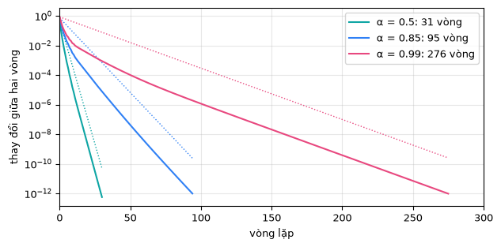

# Chương 1 · Ví dụ áp dụng: xếp hạng nhân vật bằng vector riêng

> Ghi chú của người biên soạn: trang này do người biên soạn viết thêm, không có trong sách gốc. Trang dùng trị riêng và vector riêng ([mục 1.11](math/ch01_vi)) để xếp hạng các nút trong một mạng thật. Đây là ý tưởng của thuật toán PageRank mà Google dùng để xếp hạng trang web.

## Bài toán

Dữ liệu là mạng nhân vật của tiểu thuyết *Những người khốn khổ* (Victor Hugo), do Knuth (1993) tổng hợp và có sẵn trong thư viện `networkx`. Mỗi nút là một nhân vật. Hai nhân vật được nối với nhau nếu cùng xuất hiện trong một chương, với trọng số là số chương họ xuất hiện cùng nhau.

Câu hỏi: nhân vật nào "quan trọng" nhất trong mạng? Đếm số người quen là một cách. Nhưng ta muốn một tiêu chí tinh hơn: quen với người quan trọng thì đáng giá hơn quen với người không quan trọng. Tiêu chí này tự tham chiếu đến chính nó, và lời giải của nó hoá ra là một vector riêng.

## 1. Dữ liệu: ma trận kề

<!-- run -->
```python
import numpy as np
import matplotlib.pyplot as plt
import networkx as nx

G = nx.les_miserables_graph()
names = list(G.nodes)
n = len(names)
A = nx.to_numpy_array(G, nodelist=names, weight="weight")      # a_ij = số chương i và j cùng xuất hiện
print("số nhân vật:", n, "; số cặp có quan hệ:", G.number_of_edges())
print("A đối xứng ?", np.allclose(A, A.T), "; hạng của A:", np.linalg.matrix_rank(A))
deg = A.sum(1)
print("5 nhân vật có tổng trọng số lớn nhất:", [names[i] for i in np.argsort(-deg)[:5]])
```

<!-- output -->
```output
số nhân vật: 77 ; số cặp có quan hệ: 254
A đối xứng ? True ; hạng của A: 64
5 nhân vật có tổng trọng số lớn nhất: ['Valjean', 'Marius', 'Enjolras', 'Courfeyrac', 'Combeferre']
```
<!-- /output -->

## 2. Bước đi ngẫu nhiên và phân phối dừng

Hình dung một người đọc nhảy từ nhân vật này sang nhân vật khác. Từ nhân vật $i$, họ nhảy sang nhân vật $j$ với xác suất tỉ lệ với $a_{ij}$:

$$
p_{ij} = \frac{a_{ij}}{\sum_k a_{ik}}, \qquad \text{tức} \quad \mathbf{P} = \mathbf{D}^{-1}\mathbf{A},
$$

với $\mathbf{D}$ là ma trận đường chéo chứa tổng mỗi hàng của $\mathbf{A}$. Nếu $\boldsymbol{\pi}$ là phân phối xác suất của vị trí người đọc ở một bước thì ở bước sau nó là $\mathbf{P}^T\boldsymbol{\pi}$. Sau rất nhiều bước, phân phối ổn định ở $\boldsymbol{\pi}$ thoả mãn

$$
\mathbf{P}^T \boldsymbol{\pi} = \boldsymbol{\pi},
$$

tức $\boldsymbol{\pi}$ là **vector riêng của $\mathbf{P}^T$ ứng với trị riêng 1**. Nhân vật nào được ghé thăm thường xuyên thì quan trọng.

<!-- run -->
```python
P = A / deg[:, None]
print("mỗi hàng của P có tổng bằng 1:", np.allclose(P.sum(1), 1))

w, V = np.linalg.eig(P.T)
k = np.argmin(np.abs(w - 1))
pi = np.real(V[:, k]); pi /= pi.sum()
print(f"trị riêng gần 1 nhất: {w[k].real:.12f};  |trị riêng| lớn nhất: {np.abs(w).max():.12f}")
print("P^T pi = pi ?", np.allclose(P.T @ pi, pi))

# Với đồ thị vô hướng, phân phối dừng có công thức đóng: tỉ lệ với tổng trọng số của nút
print("pi tỉ lệ với tổng trọng số ?", np.allclose(pi, deg / deg.sum()))
```

<!-- output -->
```output
mỗi hàng của P có tổng bằng 1: True
trị riêng gần 1 nhất: 1.000000000000;  |trị riêng| lớn nhất: 1.000000000000
P^T pi = pi ? True
pi tỉ lệ với tổng trọng số ? True
```
<!-- /output -->

Kết quả cuối là một định lý nhỏ: với đồ thị vô hướng, $\pi_i = d_i / \sum_k d_k$. Kiểm tra: $(\mathbf{P}^T \mathbf{d})_j = \sum_i \frac{a_{ij}}{d_i} d_i = \sum_i a_{ij} = d_j$. Vậy trên đồ thị vô hướng, bước đi ngẫu nhiên thuần tuý không cho gì hơn việc đếm tổng trọng số.

## 3. PageRank

PageRank thêm một chi tiết: ở mỗi bước, với xác suất $1 - \alpha$, người đọc bỏ dở và nhảy tới một nhân vật bất kỳ (chọn đều). Ma trận chuyển trở thành

$$
\mathbf{M} = \alpha \mathbf{P} + (1 - \alpha)\frac{1}{n}\mathbf{1}\mathbf{1}^T.
$$

Google dùng $\alpha = 0.85$. Các phần tử của $\mathbf{M}$ đều dương, nên theo định lý Perron–Frobenius, trị riêng 1 là trị riêng lớn nhất và vector riêng tương ứng là duy nhất, có mọi thành phần dương. Ta tìm nó bằng **phương pháp lũy thừa** (xem [trang Code](math/ch01_code_vi)): lặp $\boldsymbol{\pi} \leftarrow \mathbf{M}^T\boldsymbol{\pi}$.

<!-- run -->
```python
def pagerank(P, alpha=0.85, tol=1e-12, max_iter=10000):
    n = len(P)
    pi = np.full(n, 1 / n)
    errs = []
    for it in range(max_iter):
        new = alpha * P.T @ pi + (1 - alpha) / n          # = M^T pi, vì tổng pi bằng 1
        errs.append(np.abs(new - pi).sum())
        pi = new
        if errs[-1] < tol:
            break
    return pi, errs

pr, errs = pagerank(P)
print("số vòng lặp:", len(errs))
print("khớp nx.pagerank:", np.allclose(pr, [nx.pagerank(G, alpha=0.85, tol=1e-12)[v] for v in names], atol=1e-8))

order_pr, order_deg = np.argsort(-pr), np.argsort(-deg)
print(f"\n{'hạng':>4}  {'PageRank':24s} {'tổng trọng số':24s}")
for r in range(10):
    i, j = order_pr[r], order_deg[r]
    print(f"{r + 1:4d}  {names[i]:13s} {pr[i]:.4f}    {names[j]:13s} {deg[j]:4.0f}")
```

<!-- output -->
```output
số vòng lặp: 95
khớp nx.pagerank: True

hạng  PageRank                 tổng trọng số           
   1  Valjean       0.0996    Valjean        158
   2  Marius        0.0517    Marius         104
   3  Myriel        0.0392    Enjolras        91
   4  Cosette       0.0369    Courfeyrac      84
   5  Enjolras      0.0366    Combeferre      68
   6  Thenardier    0.0357    Cosette         68
   7  Courfeyrac    0.0330    Bossuet         66
   8  Gavroche      0.0283    Thenardier      61
   9  Fantine       0.0272    Gavroche        56
  10  Javert        0.0268    Javert          47
```
<!-- /output -->

Hai bảng xếp hạng gần giống nhau ở nhóm đầu (Valjean luôn đứng đầu), nhưng khác ở giữa bảng. Ta xem nhân vật nào được PageRank đẩy lên hay kéo xuống nhiều nhất:

<!-- run -->
```python
rank_pr = np.empty(n, int); rank_pr[order_pr] = np.arange(1, n + 1)
rank_deg = np.empty(n, int); rank_deg[order_deg] = np.arange(1, n + 1)
diff = rank_deg - rank_pr
for i in np.argsort(-diff)[:3]:
    print(f"{names[i]:14s}: hạng theo trọng số {rank_deg[i]:2d} -> PageRank {rank_pr[i]:2d};  số người quen {int((A[i] > 0).sum())}")
for i in np.argsort(diff)[:3]:
    print(f"{names[i]:14s}: hạng theo trọng số {rank_deg[i]:2d} -> PageRank {rank_pr[i]:2d};  số người quen {int((A[i] > 0).sum())}")
```

<!-- output -->
```output
MmeMagloire   : hạng theo trọng số 29 -> PageRank 14;  số người quen 3
MlleBaptistine: hạng theo trọng số 32 -> PageRank 17;  số người quen 3
Myriel        : hạng theo trọng số 16 -> PageRank  3;  số người quen 10
Prouvaire     : hạng theo trọng số 30 -> PageRank 40;  số người quen 9
Boulatruelle  : hạng theo trọng số 67 -> PageRank 77;  số người quen 1
Grantaire     : hạng theo trọng số 33 -> PageRank 43;  số người quen 10
```
<!-- /output -->

Giải thích cho trường hợp của Myriel (vị giám mục ở đầu truyện):

- Trong 10 người quen của ông, có 7 nhân vật chỉ quen mỗi ông (Napoleon, Cravatte, Geborand...).
- Mỗi lần người đọc nhảy ngẫu nhiên tới một trong 7 nhân vật này, bước tiếp theo *chắc chắn* đưa họ về Myriel.
- Bước nhảy ngẫu nhiên phân phối đều cho mọi nhân vật, kể cả những nhân vật phụ. Vì vậy Myriel "gom" được phần xác suất của cả 7 nhân vật đó. Hai người hầu của ông (MmeMagloire, MlleBaptistine) cũng được hưởng lợi khi ở gần ông.

Ngược lại, Prouvaire và Grantaire nằm trong nhóm sinh viên quen biết dày đặc lẫn nhau. Xác suất đến với họ bị chia đều cho cả nhóm, nên họ tụt hạng.

## 4. Tốc độ hội tụ

Sai số của phương pháp lũy thừa giảm theo tỉ lệ $|\lambda_2 / \lambda_1|$ sau mỗi vòng. Với ma trận $\mathbf{M}$ ở trên, $\lambda_1 = 1$ và có thể chứng minh $|\lambda_2| \le \alpha$. Vì vậy $\alpha$ càng gần 1 thì thuật toán có thể càng chậm.

<!-- run -->
```python
fig, ax = plt.subplots(figsize=(6.4, 3.2))
for alpha, c in [(0.5, "#0ea5a4"), (0.85, "#2f80f5"), (0.99, "#e8487f")]:
    pr_a, e = pagerank(P, alpha)
    M = alpha * P + (1 - alpha) / n
    lam = np.sort(np.abs(np.linalg.eigvals(M)))[::-1]
    ax.semilogy(e, color=c, label=f"α = {alpha}: {len(e)} vòng")
    ax.semilogy(e[0] * lam[1] ** np.arange(len(e)), color=c, ls=":", lw=1)
    print(f"alpha = {alpha}: |lambda_2| = {lam[1]:.4f}, số vòng = {len(e)}")
ax.set_xlabel("vòng lặp"); ax.set_ylabel("thay đổi giữa hai vòng"); ax.grid(alpha=.3); ax.legend()
ax.set_xlim(0, 300)
fig.tight_layout()
```

<!-- output -->
```output
alpha = 0.5: |lambda_2| = 0.4663, số vòng = 31
alpha = 0.85: |lambda_2| = 0.7927, số vòng = 95
alpha = 0.99: |lambda_2| = 0.9233, số vòng = 276
```

<div align=center></div>
<!-- /output -->

Đường chấm giảm theo $|\lambda_2|^t$. Sau vài chục vòng đầu, đường sai số thực tế song song với đường chấm cùng màu: tốc độ hội tụ đúng như trị riêng thứ hai dự đoán. Với $\alpha = 0.99$, $|\lambda_2| = 0.92$ chứ không phải 0.99. Cận $|\lambda_2| \le \alpha$ chỉ là cận trên; giá trị thật còn phụ thuộc vào cấu trúc của mạng.

## Rút ra được gì

- "Độ quan trọng" định nghĩa theo kiểu tự tham chiếu ($\boldsymbol{\pi} = \mathbf{M}^T\boldsymbol{\pi}$) chính là bài toán tìm vector riêng.
- Với ma trận lớn và thưa (web có hàng tỉ trang), không ai gọi `eig`. Phương pháp lũy thừa chỉ cần các phép nhân ma trận với vector.
- Tốc độ hội tụ do khoảng cách giữa hai trị riêng lớn nhất quyết định. Ý tưởng này còn gặp lại ở [chương 21](ml/ch21_vi) (PCA) và ở các thuật toán học tăng cường như [lặp giá trị](rl_vi).
