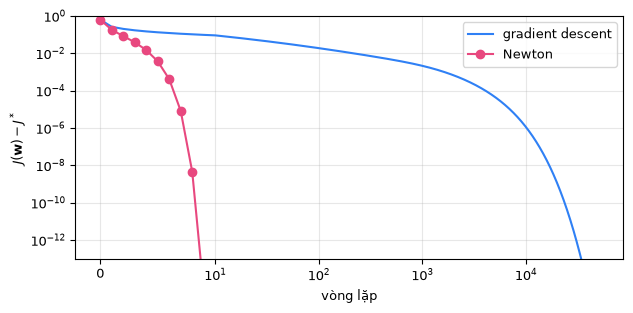

# Chương 2 · Ví dụ áp dụng: phương pháp Newton cho hồi quy logistic

> Ghi chú của người biên soạn: trang này do người biên soạn viết thêm, không có trong sách gốc. Trang dùng gradient và ma trận Hessian ([chương 2](math/ch02_vi)) để huấn luyện hồi quy logistic ([chương 14](ml/ch14_vi)) trên dữ liệu chẩn đoán ung thư vú. Trước khi dùng, các công thức được kiểm tra bằng đạo hàm số như [mục 2.6](math/ch02_vi).

## Bài toán

Gradient descent ([chương 12](ml/ch12_vi)) chỉ dùng đạo hàm bậc nhất: nó biết hướng dốc nhất, nhưng không biết nên đi bao xa. **Phương pháp Newton** dùng thêm Hessian, tức thông tin về độ cong, để chọn cả hướng lẫn độ dài bước:

$$
\mathbf{w} \leftarrow \mathbf{w} - \left(\nabla^2 J(\mathbf{w})\right)^{-1} \nabla J(\mathbf{w}).
$$

Đây là bước nhảy thẳng tới điểm cực tiểu của xấp xỉ bậc hai (khai triển Taylor tới bậc 2) của $J$ quanh $\mathbf{w}$. Câu hỏi: trên một bài toán thật, Newton nhanh hơn GD bao nhiêu, và cái giá là gì?

## 1. Dữ liệu và hàm mất mát

Bộ *Breast Cancer Wisconsin* (Street, Wolberg và Mangasarian, 1993) có 569 mẫu sinh thiết, mỗi mẫu 30 đặc trưng đo từ ảnh tế bào, nhãn lành tính hoặc ác tính. Hàm mất mát là cross-entropy trung bình cộng thêm một chút suy giảm trọng số:

$$
J(\mathbf{w}) = -\frac{1}{N}\sum_{i=1}^N \left(y_i \log a_i + (1 - y_i)\log(1 - a_i)\right) + \frac{\lambda}{2}\|\mathbf{w}\|_2^2, \qquad a_i = \sigma(\mathbf{x}_i^T\mathbf{w}).
$$

Không có thành phần $\lambda$, dữ liệu này gần như tách được tuyến tính và $\mathbf{w}$ sẽ tiến ra vô cùng (xem [ví dụ áp dụng chương 14](ml/ch14_app_vi)).

<!-- run -->
```python
import numpy as np
import matplotlib.pyplot as plt
from sklearn.datasets import load_breast_cancer
from sklearn.model_selection import train_test_split
from sklearn.preprocessing import StandardScaler

X_raw, y = load_breast_cancer(return_X_y=True)
X_tr, X_te, y_tr, y_te = train_test_split(X_raw, y, test_size=0.3, stratify=y, random_state=0)
sc = StandardScaler().fit(X_tr)
add1 = lambda Z: np.hstack([Z, np.ones((len(Z), 1))])     # cột 1 cho hệ số tự do
X, Xt = add1(sc.transform(X_tr)), add1(sc.transform(X_te))
N, d = X.shape
lam = 1e-3
print("huấn luyện:", X.shape, " kiểm tra:", Xt.shape)

sigmoid = lambda z: 1 / (1 + np.exp(-z))

def loss(w):
    z = X @ w
    # log(1 + e^z) - y z: cách viết ổn định của cross-entropy
    return np.mean(np.logaddexp(0, z) - y_tr * z) + lam / 2 * w @ w
```

<!-- output -->
```output
huấn luyện: (398, 31)  kiểm tra: (171, 31)
```
<!-- /output -->

## 2. Gradient và Hessian

Theo quy tắc chuỗi và Bảng 2.1, với $\mathbf{a} = \sigma(\mathbf{X}\mathbf{w})$:

$$
\nabla J(\mathbf{w}) = \frac{1}{N}\mathbf{X}^T(\mathbf{a} - \mathbf{y}) + \lambda\mathbf{w}, \qquad
\nabla^2 J(\mathbf{w}) = \frac{1}{N}\mathbf{X}^T \mathbf{S} \mathbf{X} + \lambda \mathbf{I}, \quad \mathbf{S} = \mathrm{diag}\big(a_i(1 - a_i)\big).
$$

Vì $a_i(1 - a_i) > 0$, Hessian có dạng $\mathbf{B}^T\mathbf{B} + \lambda\mathbf{I}$ với $\mathbf{B} = (\mathbf{S}/N)^{1/2}\mathbf{X}$, nên luôn xác định dương ([mục 1.13](math/ch01_vi)). Do đó $J$ là hàm lồi chặt ([chương 23](math/ch23_vi)) và có đúng một điểm cực tiểu.

<!-- run -->
```python
def grad(w):
    return X.T @ (sigmoid(X @ w) - y_tr) / N + lam * w

def hess(w):
    a = sigmoid(X @ w)
    return (X.T * (a * (1 - a))) @ X / N + lam * np.eye(d)

# Kiểm tra bằng đạo hàm số hai phía (mục 2.6)
w0 = np.random.default_rng(0).standard_normal(d) * 0.1
E = np.eye(d) * 1e-6
g_num = np.array([(loss(w0 + e) - loss(w0 - e)) / 2e-6 for e in E])
H_num = np.column_stack([(grad(w0 + e) - grad(w0 - e)) / 2e-6 for e in E])
rel = lambda u, v: np.linalg.norm(u - v) / (np.linalg.norm(u) + np.linalg.norm(v))
print(f"gradient: sai số tương đối {rel(g_num, grad(w0)):.1e}")
print(f"Hessian:  sai số tương đối {rel(H_num, hess(w0)):.1e}")
print(f"trị riêng của Hessian: nhỏ nhất {np.linalg.eigvalsh(hess(w0)).min():.1e}, lớn nhất {np.linalg.eigvalsh(hess(w0)).max():.2f}")
```

<!-- output -->
```output
gradient: sai số tương đối 1.5e-10
Hessian:  sai số tương đối 2.2e-10
trị riêng của Hessian: nhỏ nhất 1.0e-03, lớn nhất 3.03
```
<!-- /output -->

Trị riêng nhỏ nhất gần như đúng bằng $\lambda = 10^{-3}$: nếu không có thành phần suy giảm trọng số, Hessian gần như suy biến. Lý do là nhiều đặc trưng tương quan rất mạnh với nhau (bán kính, chu vi và diện tích của nhân tế bào). Tỉ số giữa trị riêng lớn nhất và nhỏ nhất (số điều kiện) vì vậy cỡ 3000. Theo hướng ứng với trị riêng nhỏ nhất, mặt mất mát gần như phẳng. Đây là tình huống mà GD đi rất chậm (giống "bát dẹt" ở [mô phỏng chương 12](ml/ch12_viz_vi)).

## 3. Newton so với gradient descent

Với GD, ta chọn bước học $\eta = 1/L$, trong đó $L$ là cận trên của trị riêng lớn nhất của Hessian: vì $a(1 - a) \le 1/4$, ta có $L = \lambda_{\max}(\mathbf{X}^T\mathbf{X})/(4N) + \lambda$. Đây là bước học lớn nhất đảm bảo GD không phân kỳ.

<!-- run -->
```python
from time import perf_counter

def newton(w, tol=1e-10, max_iter=50):
    hist = [loss(w)]
    for it in range(max_iter):
        g = grad(w)
        if np.linalg.norm(g) < tol:
            break
        w = w - np.linalg.solve(hess(w), g)        # giải hệ thay vì nghịch đảo (trang Thư viện chương 1)
        hist.append(loss(w))
    return w, hist

def gd(w, eta, tol=1e-10, max_iter=200000):
    hist = [loss(w)]
    for it in range(max_iter):
        g = grad(w)
        if np.linalg.norm(g) < tol:
            break
        w = w - eta * g
        hist.append(loss(w))
    return w, hist

L = np.linalg.eigvalsh(X.T @ X).max() / (4 * N) + lam
t = perf_counter(); w_nt, h_nt = newton(np.zeros(d)); t_nt = perf_counter() - t
t = perf_counter(); w_gd, h_gd = gd(np.zeros(d), 1 / L); t_gd = perf_counter() - t
print(f"Newton: {len(h_nt) - 1:6d} vòng, {1000 * t_nt:7.1f} ms, J = {h_nt[-1]:.10f}")
print(f"GD:     {len(h_gd) - 1:6d} vòng, {1000 * t_gd:7.1f} ms, J = {h_gd[-1]:.10f}")
print("hai nghiệm trùng nhau:", np.allclose(w_nt, w_gd, atol=1e-6))

J_star = min(h_nt[-1], h_gd[-1])
fig, ax = plt.subplots(figsize=(6.4, 3.2))
ax.semilogy(np.array(h_gd) - J_star + 1e-16, color="#2f80f5", label="gradient descent")
ax.semilogy(np.array(h_nt) - J_star + 1e-16, "o-", color="#e8487f", label="Newton")
ax.set_xscale("symlog", linthresh=10); ax.set_xlabel("vòng lặp"); ax.set_ylabel(r"$J(\mathbf{w}) - J^*$")
ax.set_ylim(1e-13, 1); ax.grid(alpha=.3); ax.legend()
fig.tight_layout()
print("\nNewton, J - J* qua từng vòng:", " ".join(f"{v - J_star:.0e}" for v in h_nt))
```

<!-- output -->
```output
Newton:     10 vòng,     4.9 ms, J = 0.0521887142
GD:      49773 vòng,  2165.8 ms, J = 0.0521887142
hai nghiệm trùng nhau: True

Newton, J - J* qua từng vòng: 6e-01 2e-01 8e-02 4e-02 2e-02 4e-03 4e-04 8e-06 5e-09 2e-15 0e+00
```

<div align=center></div>
<!-- /output -->

Newton cần 10 vòng (vài mili giây), GD cần gần 50 000 vòng (vài giây). Đường của Newton có dạng đặc trưng: vài vòng đầu giảm vừa phải, rồi sai số giảm *bình phương* sau mỗi vòng (số chữ số chính xác tăng gấp đôi). Đây là **hội tụ bậc hai**, xảy ra khi $\mathbf{w}$ đã đủ gần nghiệm để xấp xỉ bậc hai của $J$ là chính xác.

## 4. So với scikit-learn

Hàm mục tiêu của `LogisticRegression` là $\frac{1}{2}\|\mathbf{w}\|_2^2 + C\sum_i \text{CE}_i$. Chia $J$ cho $\lambda$ ta được đúng dạng này với $C = 1/(\lambda N)$. Ta tắt `fit_intercept` vì cột 1 đã nằm trong $\mathbf{X}$ (khi đó hệ số tự do cũng bị phạt, giống như trong $J$).

<!-- run -->
```python
from sklearn.linear_model import LogisticRegression

clf = LogisticRegression(C=1 / (lam * N), fit_intercept=False, solver="newton-cg", tol=1e-12, max_iter=1000).fit(X, y_tr)
print("hệ số khớp với Newton tự viết:", np.allclose(clf.coef_.ravel(), w_nt, atol=1e-5))
acc = lambda w, A, t: np.mean((A @ w > 0) == t)
print(f"độ chính xác: huấn luyện {acc(w_nt, X, y_tr):.4f}, kiểm tra {acc(w_nt, Xt, y_te):.4f}")
```

<!-- output -->
```output
hệ số khớp với Newton tự viết: True
độ chính xác: huấn luyện 0.9925, kiểm tra 0.9532
```
<!-- /output -->

## 5. Cái giá của Newton

Mỗi vòng Newton phải dựng Hessian $d \times d$ (tốn khoảng $N d^2$ phép tính) và giải một hệ $d$ phương trình (khoảng $d^3/3$). Với $d = 31$ như ở đây, việc này rẻ. Nhưng chi phí tăng rất nhanh theo $d$:

<!-- run -->
```python
for dd in [31, 1000, 10 ** 6]:
    mem = dd * dd * 8
    print(f"d = {dd:>8,}: Hessian chiếm {mem / 1e9:12,.3f} GB, giải hệ cần cỡ {dd ** 3 / 3:.1e} phép tính")
```

<!-- output -->
```output
d =       31: Hessian chiếm        0.000 GB, giải hệ cần cỡ 9.9e+03 phép tính
d =    1,000: Hessian chiếm        0.008 GB, giải hệ cần cỡ 3.3e+08 phép tính
d = 1,000,000: Hessian chiếm    8,000.000 GB, giải hệ cần cỡ 3.3e+17 phép tính
```
<!-- /output -->

Một mạng neuron nhỏ đã có hàng triệu tham số. Hessian của nó chiếm hàng nghìn GB bộ nhớ. Vì vậy học sâu dùng các phương pháp bậc nhất (GD, momentum, Adam) và chấp nhận đi nhiều bước hơn. Ở giữa hai thái cực có các phương pháp tựa Newton như L-BFGS (lựa chọn mặc định `solver="lbfgs"` của scikit-learn). L-BFGS xấp xỉ Hessian từ vài gradient gần nhất, không cần dựng nó ra.

## Rút ra được gì

- Bảng gradient của chương 2 cho ngay cả gradient lẫn Hessian của hàm mất mát logistic. Đạo hàm số xác nhận cả hai công thức.
- Hessian xác định dương nghĩa là bài toán lồi và có nghiệm duy nhất. Newton và GD hội tụ về cùng một điểm, và cùng điểm với scikit-learn.
- Newton cần ít hơn GD hàng nghìn lần số vòng lặp, nhưng mỗi vòng đắt hơn nhiều. Với ít tham số, Newton thắng. Với nhiều tham số, chỉ các phương pháp bậc nhất (hoặc tựa Newton) dùng được.
