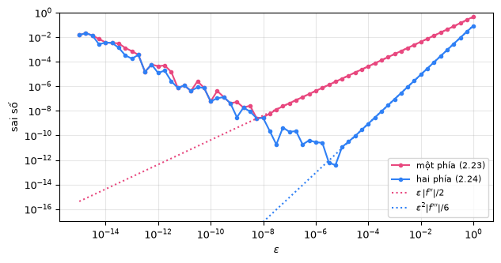

# Chương 2 · Code từ đầu

> Ghi chú của người biên soạn: trang này do người biên soạn viết thêm, không có trong sách gốc. Trang chạy lại đoạn code kiểm tra gradient của [mục 2.6](math/ch02_vi) (đã sửa để chạy được với NumPy mới), rồi dùng nó để kiểm tra toàn bộ Bảng 2.1, quy tắc chuỗi, ma trận Hessian, và đo sai số của hai cách xấp xỉ đạo hàm.

## Cách dùng trang này

Các khối chạy lần lượt từ trên xuống và dùng chung biến. Cần `numpy` và `matplotlib`.

## 1. Đoạn code của sách

<small class="viz-ref">Mục 2.6.2</small>

Hàm `check_grad` giữ như sách. Thay đổi duy nhất: `fn2` trả về một số (`.item()`) thay vì mảng $1 \times 1$, vì NumPy mới không cho gán mảng vào một phần tử.

<!-- run -->
```python
import numpy as np
import matplotlib.pyplot as plt

def check_grad(fn, gr, X):
    X_flat    = X.reshape(-1) # convert X to an 1d array, 1 for loop needed
    shape_X   = X.shape                # original shape of X
    num_grad  = np.zeros_like(X)       # numerical grad, shape = shape of X
    grad_flat = np.zeros_like(X_flat)  # 1d version of grad
    eps       = 1e-6      # a small number, 1e-10 -> 1e-6 is usually good
    numElems  = X_flat.shape[0] # number of elements in X
    # calculate numerical gradient
    for i in range(numElems):          # iterate over all elements of X
        Xp_flat      = X_flat.copy()
        Xn_flat      = X_flat.copy()
        Xp_flat[i]  += eps
        Xn_flat[i]  -= eps
        Xp           = Xp_flat.reshape(shape_X)
        Xn           = Xn_flat.reshape(shape_X)
        grad_flat[i] = (fn(Xp) - fn(Xn))/(2*eps)

    num_grad = grad_flat.reshape(shape_X)

    diff = np.linalg.norm(num_grad - gr(X))
    print('Difference between two methods should be small:', diff)

np.random.seed(0)
# ==== check if grad(trace(A*X)) == A^T ====
m, n = 10, 20
A = np.random.rand(m, n)
X = np.random.rand(n, m)

def fn1(X):
    return np.trace(A.dot(X))

def gr1(X):
    return A.T

check_grad(fn1, gr1, X)
# ==== check if grad(x^T*A*x) == (A + A^T)*x  ====
A = np.random.rand(m, m)
x = np.random.rand(m, 1)

def fn2(x):
    return x.T.dot(A).dot(x).item()          # sửa: trả về một số

def gr2(x):
    return (A + A.T).dot(x)

check_grad(fn2, gr2, x)
```

<!-- output -->
```output
Difference between two methods should be small: 4.2511344536258187e-08
Difference between two methods should be small: 2.030498409023766e-09
```
<!-- /output -->

Hai sai số cỡ $10^{-8}$ và $10^{-9}$, cùng cỡ với kết quả in trong sách (số cụ thể khác vì dữ liệu ngẫu nhiên khác).

## 2. Kiểm tra toàn bộ Bảng 2.1

<small class="viz-ref">Mục 2.4, 2.5 · Bảng 2.1</small>

Viết lại `check_grad` thành hàm trả về sai số tương đối $\frac{\|\mathbf{g}_{\text{số}} - \mathbf{g}_{\text{công thức}}\|}{\|\mathbf{g}_{\text{số}}\| + \|\mathbf{g}_{\text{công thức}}\|}$. Sai số tuyệt đối khó đánh giá vì nó phụ thuộc vào độ lớn của gradient.

<!-- run -->
```python
def num_grad(f, X, eps=1e-6):
    g = np.zeros_like(X, dtype=float)
    for idx in np.ndindex(X.shape):
        E = np.zeros_like(X, dtype=float); E[idx] = eps
        g[idx] = (f(X + E) - f(X - E)) / (2 * eps)
    return g

def rel_err(g1, g2):
    return np.linalg.norm(g1 - g2) / (np.linalg.norm(g1) + np.linalg.norm(g2))

rng = np.random.default_rng(0)
n, m, p = 4, 3, 5
a, b = rng.standard_normal(n), rng.standard_normal(n)
A = rng.standard_normal((n, n)); Am = rng.standard_normal((m, n)); bm = rng.standard_normal(m)
x = rng.standard_normal(n)

vector_rows = [
    ("a^T x",          lambda x: a @ x,                       lambda x: a),
    ("x^T A x",        lambda x: x @ A @ x,                   lambda x: (A + A.T) @ x),
    ("||x||_2^2",      lambda x: x @ x,                       lambda x: 2 * x),
    ("||Ax - b||_2^2", lambda x: np.sum((Am @ x - bm) ** 2),  lambda x: 2 * Am.T @ (Am @ x - bm)),
    ("a^T (x^T x) b",  lambda x: (a @ b) * (x @ x),           lambda x: 2 * (a @ b) * x),
    ("a^T x x^T b",    lambda x: (a @ x) * (x @ b),           lambda x: (np.outer(a, b) + np.outer(b, a)) @ x),
]
for name, f, g in vector_rows:
    print(f"{name:16s}: sai số tương đối {rel_err(num_grad(f, x), g(x)):.1e}")

Xm = rng.standard_normal((n, p)); Bp = rng.standard_normal((m, p))
Ma = rng.standard_normal((n, n))
av, bv = rng.standard_normal(n), rng.standard_normal(p)
Ax = rng.standard_normal((p, n))                    # cho trace(A X): A có cỡ p x n
At, Bt = rng.standard_normal((n, 2)), rng.standard_normal((p, 2))   # cho trace(A^T X B)
matrix_rows = [
    ("||X||_F^2 = trace(X^T X)",   lambda X: np.sum(X ** 2),               lambda X: 2 * X),
    ("trace(A X)",                  lambda X: np.trace(Ax @ X),              lambda X: Ax.T),
    ("trace(X^T A X)",              lambda X: np.trace(X.T @ Ma @ X),        lambda X: (Ma + Ma.T) @ X),
    ("a^T X b",                     lambda X: av @ X @ bv,                   lambda X: np.outer(av, bv)),
    ("||A X - B||_F^2",             lambda X: np.sum((Am @ X - Bp) ** 2),    lambda X: 2 * Am.T @ (Am @ X - Bp)),
    ("trace(A^T X B)",              lambda X: np.trace(At.T @ X @ Bt),       lambda X: At @ Bt.T),
]
for name, f, g in matrix_rows:
    print(f"{name:28s}: sai số tương đối {rel_err(num_grad(f, Xm), g(Xm)):.1e}")
```

<!-- output -->
```output
a^T x           : sai số tương đối 1.5e-10
x^T A x         : sai số tương đối 6.7e-11
||x||_2^2       : sai số tương đối 1.3e-11
||Ax - b||_2^2  : sai số tương đối 1.1e-10
a^T (x^T x) b   : sai số tương đối 4.7e-11
a^T x x^T b     : sai số tương đối 8.3e-11
||X||_F^2 = trace(X^T X)    : sai số tương đối 1.7e-10
trace(A X)                  : sai số tương đối 9.5e-11
trace(X^T A X)              : sai số tương đối 1.5e-10
a^T X b                     : sai số tương đối 1.8e-10
||A X - B||_F^2             : sai số tương đối 3.8e-10
trace(A^T X B)              : sai số tương đối 2.0e-10
```
<!-- /output -->

Mọi công thức trong Bảng 2.1 đều đúng: sai số tương đối cỡ $10^{-10}$ trở xuống. Nếu một công thức sai (chẳng hạn quên chuyển vị), sai số sẽ cỡ $10^{-1}$:

<!-- run -->
```python
print("x^T A x với công thức sai A x:        ", f"{rel_err(num_grad(lambda x: x @ A @ x, x), A @ x):.1e}")
print("trace(A X) với công thức sai A (thiếu ^T):", f"{rel_err(num_grad(lambda X: np.trace(Ax @ X), Xm), Ax.reshape(n, p)):.1e}")
```

<!-- output -->
```output
x^T A x với công thức sai A x:         2.4e-01
trace(A X) với công thức sai A (thiếu ^T): 6.7e-01
```
<!-- /output -->

## 3. Quy tắc chuỗi và gradient của hàm trả về vector

<small class="viz-ref">Mục 2.2, 2.3</small>

Với $\mathbf{h}: \mathbb{R}^k \to \mathbb{R}^n$, gradient $\nabla \mathbf{h}(\mathbf{x})$ theo cách viết của sách là ma trận $k \times n$ (cột thứ $j$ là $\nabla h_j$). Quy tắc chuỗi $\nabla_{\mathbf{x}} g(\mathbf{h}(\mathbf{x})) = (\nabla_{\mathbf{x}} \mathbf{h})(\nabla_{\mathbf{h}} g)$ (công thức (2.11)) được kiểm tra trên $g(\mathbf{h}) = \|\mathbf{h}\|_2^2$ và $\mathbf{h}(\mathbf{x}) = \tanh(\mathbf{W}\mathbf{x})$, một tầng của mạng neuron ([chương 16](ml/ch16_vi)).

<!-- run -->
```python
W = rng.standard_normal((3, 4)); x = rng.standard_normal(4)
h = lambda x: np.tanh(W @ x)

# Gradient của h (k x n = 4 x 3), tính bằng số: cột j là gradient của h_j
grad_h_num = np.column_stack([num_grad(lambda x: h(x)[j], x) for j in range(3)])
grad_h = W.T * (1 - np.tanh(W @ x) ** 2)            # công thức: W^T diag(1 - tanh^2)
print("gradient của h:", grad_h.shape, "; sai số tương đối", f"{rel_err(grad_h_num, grad_h):.1e}")

grad_g = 2 * h(x)                                   # gradient của ||h||^2 theo h
chain = grad_h @ grad_g                             # (2.11)
print("quy tắc chuỗi:  sai số tương đối", f"{rel_err(num_grad(lambda x: np.sum(h(x) ** 2), x), chain):.1e}")
```

<!-- output -->
```output
gradient của h: (4, 3) ; sai số tương đối 2.1e-11
quy tắc chuỗi:  sai số tương đối 4.8e-11
nếu nhân ngược thứ tự: lỗi kích thước (4, 3) và (3,) không còn khớp khi k ≠ n
```
<!-- /output -->

## 4. Ma trận Hessian

<small class="viz-ref">Mục 2.1, công thức (2.2)</small>

Hessian là gradient của gradient. Ta xấp xỉ nó bằng cách lấy đạo hàm số của hàm gradient.

<!-- run -->
```python
def num_hessian(grad, x, eps=1e-5):
    return np.column_stack([(grad(x + eps * e) - grad(x - eps * e)) / (2 * eps) for e in np.eye(len(x))])

H = num_hessian(lambda x: (A + A.T) @ x, x)
print("Hessian của x^T A x là A + A^T:", np.allclose(H, A + A.T, atol=1e-6), "; đối xứng:", np.allclose(H, H.T, atol=1e-6))
print("Hessian của ||Ax - b||^2 là 2 A^T A:", np.allclose(num_hessian(lambda x: 2 * Am.T @ (Am @ x - bm), x), 2 * Am.T @ Am, atol=1e-6))

# Hessian của f(x) = sum(exp(x_i)) + (sum x_i)^2: gradient e^x + 2(1^T x) 1
gf = lambda x: np.exp(x) + 2 * x.sum()
print("Hessian của sum(e^x) + (1^T x)^2:\n", num_hessian(gf, np.zeros(3)).round(6))
```

<!-- output -->
```output
Hessian của x^T A x là A + A^T: True ; đối xứng: True
Hessian của ||Ax - b||^2 là 2 A^T A: True
Hessian của sum(e^x) + (1^T x)^2:
 [[3. 2. 2.]
 [2. 3. 2.]
 [2. 2. 3.]]
```
<!-- /output -->

Hessian cuối cùng là $\mathrm{diag}(e^{\mathbf{x}}) + 2\mathbf{1}\mathbf{1}^T$, tại $\mathbf{x} = \mathbf{0}$ bằng $\mathbf{I} + 2\mathbf{1}\mathbf{1}^T$: đường chéo bằng 3, ngoài đường chéo bằng 2.

## 5. Xấp xỉ một phía hay hai phía, và chọn $\varepsilon$

<small class="viz-ref">Mục 2.6.1 · công thức (2.21)–(2.24)</small>

Sách chứng minh bằng khai triển Taylor rằng xấp xỉ một phía có sai số $O(\varepsilon)$, còn xấp xỉ hai phía có sai số $O(\varepsilon^2)$. Nhưng trên máy tính còn một nguồn sai số nữa: phép trừ $f(x + \varepsilon) - f(x)$ của hai số gần bằng nhau mất độ chính xác, gây sai số cỡ $\delta / \varepsilon$ với $\delta \approx 10^{-16}$ là độ chính xác của số thực 64 bit. Sai số này *tăng* khi $\varepsilon$ giảm.

<!-- run -->
```python
f, df = np.sin, np.cos
x0 = 1.0
eps = np.logspace(-15, 0, 61)
e1 = np.abs((f(x0 + eps) - f(x0)) / eps - df(x0))
e2 = np.abs((f(x0 + eps) - f(x0 - eps)) / (2 * eps) - df(x0))

fig, ax = plt.subplots(figsize=(6.4, 3.4))
ax.loglog(eps, e1, "o-", ms=3, color="#e8487f", label="một phía (2.23)")
ax.loglog(eps, e2, "o-", ms=3, color="#2f80f5", label="hai phía (2.24)")
ax.loglog(eps, 0.5 * eps * np.abs(np.sin(x0)), ":", color="#e8487f", label=r"$\varepsilon\, |f''|/2$")
ax.loglog(eps, eps ** 2 / 6 * np.abs(np.cos(x0)), ":", color="#2f80f5", label=r"$\varepsilon^2 |f'''|/6$")
ax.set_xlabel(r"$\varepsilon$"); ax.set_ylabel("sai số"); ax.set_ylim(1e-17, 1); ax.grid(alpha=.3); ax.legend(fontsize=8)
fig.tight_layout()
for name, e in [("một phía", e1), ("hai phía", e2)]:
    k = np.argmin(e)
    print(f"{name}: sai số nhỏ nhất {e[k]:.1e} tại eps = {eps[k]:.0e}")
```

<!-- output -->
```output
một phía: sai số nhỏ nhất 2.5e-09 tại eps = 6e-09
hai phía: sai số nhỏ nhất 3.8e-13 tại eps = 6e-06
```

<div align=center></div>
<!-- /output -->

Đồ thị có hình chữ V:

- **Bên phải:** sai số do cắt khai triển Taylor, đúng theo hai đường chấm (độ dốc 1 và 2).
- **Bên trái:** sai số làm tròn, tăng như $1/\varepsilon$.

Điểm tốt nhất là nơi hai loại sai số cân bằng. Với xấp xỉ một phía, điểm đó ở khoảng $\varepsilon \approx 10^{-8}$; với hai phía, ở khoảng $10^{-5}$. Lời khuyên trong code của sách ("$10^{-10}$ đến $10^{-6}$ thường là tốt") hợp lý cho xấp xỉ hai phía, nhưng $10^{-10}$ đã hơi nhỏ: sai số lúc đó cỡ $10^{-8}$–$10^{-7}$, kém hàng nghìn lần so với $\varepsilon \approx 10^{-5}$.
