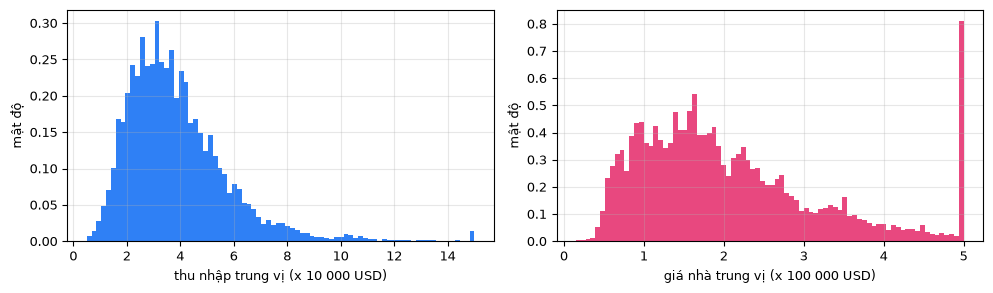
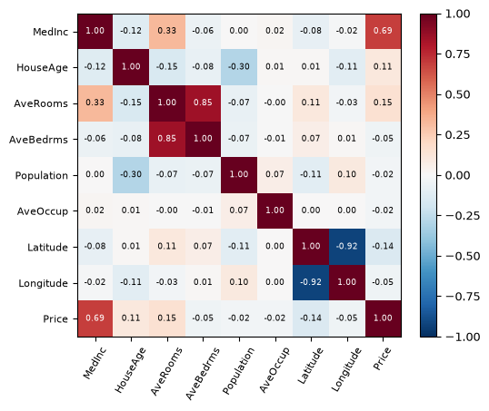
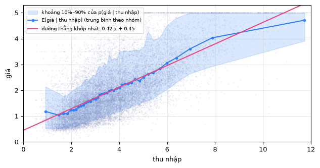

# Chương 3 · Ví dụ áp dụng: đọc dữ liệu bằng ngôn ngữ xác suất

> Ghi chú của người biên soạn: trang này do người biên soạn viết thêm, không có trong sách gốc. Trang dùng các khái niệm của [chương 3](math/ch03_vi) (xác suất biên, có điều kiện, quy tắc Bayes, độc lập, hiệp phương sai) để khám phá một bộ dữ liệu thật trước khi xây mô hình.

## Bài toán

Dữ liệu *California housing* (Pace và Barry, 1997) gồm 20 640 khu dân cư ở bang California theo điều tra dân số năm 1990. Mỗi khu có thu nhập trung vị của hộ gia đình (đơn vị 10 000 USD), tuổi nhà, số phòng trung bình, vị trí, và giá nhà trung vị (đơn vị 100 000 USD). Đây cũng là dữ liệu của [ví dụ áp dụng chương 7](ml/ch07_app_vi).

Ta coi mỗi khu dân cư là một lần lấy mẫu, và đặt các câu hỏi bằng ngôn ngữ xác suất: phân phối của giá nhà là gì? Biết thu nhập thì phân phối đó thay đổi thế nào? Những đặc trưng nào phụ thuộc vào nhau?

## 1. Phân phối biên

<!-- run -->
```python
import numpy as np
import matplotlib.pyplot as plt
from sklearn.datasets import fetch_california_housing

data = fetch_california_housing()
X, price = data.data, data.target
names = data.feature_names
income = X[:, names.index("MedInc")]
print("số khu dân cư:", len(price))
print(f"giá nhà: trung bình {price.mean():.3f}, trung vị {np.median(price):.3f}, nhỏ nhất {price.min():.3f}, lớn nhất {price.max():.5f}")
print(f"tỉ lệ khu có giá đúng bằng giá trị lớn nhất: {np.mean(price == price.max()):.2%}")

fig, axes = plt.subplots(1, 2, figsize=(10, 3))
axes[0].hist(income, bins=80, density=True, color="#2f80f5"); axes[0].set_xlabel("thu nhập trung vị (x 10 000 USD)")
axes[1].hist(price, bins=80, density=True, color="#e8487f"); axes[1].set_xlabel("giá nhà trung vị (x 100 000 USD)")
for ax in axes: ax.set_ylabel("mật độ"); ax.grid(alpha=.3)
fig.tight_layout()
```

<!-- output -->
```output
số khu dân cư: 20640
giá nhà: trung bình 2.069, trung vị 1.797, nhỏ nhất 0.150, lớn nhất 5.00001
tỉ lệ khu có giá đúng bằng giá trị lớn nhất: 4.68%
```

<div align=center></div>
<!-- /output -->

Hai biểu đồ là ước lượng của hai phân phối biên $p(\text{thu nhập})$ và $p(\text{giá})$. Cả hai đều lệch phải: nhiều khu có giá trị vừa phải, ít khu có giá trị rất cao. Biểu đồ giá có một cột bất thường ở 5.0: gần 5% số khu bị **cắt ngọn** (censored) ở 500 000 USD. Mọi khu đắt hơn đều được ghi là 500 001 USD. Đây là đặc điểm của cách thu thập dữ liệu, không phải của thị trường nhà.

## 2. Xác suất đồng thời và có điều kiện

<small class="viz-ref">Mục 3.1.2–3.1.4</small>

Chia thu nhập thành 5 nhóm có số khu bằng nhau (theo các ngũ phân vị), và gọi khu có giá từ 300 000 USD trở lên là "giá cao". Đếm tần suất cho ta bảng $p(\text{nhóm thu nhập}, \text{giá cao})$.

<!-- run -->
```python
edges = np.quantile(income, [0.2, 0.4, 0.6, 0.8])
g = np.digitize(income, edges)                          # nhóm 0 (thấp nhất) .. 4 (cao nhất)
high = price >= 3.0
labels = ["Q1 (thấp)", "Q2", "Q3", "Q4", "Q5 (cao)"]

joint = np.array([[np.mean((g == k) & (high == h)) for h in (False, True)] for k in range(5)])
p_g, p_high = joint.sum(1), joint.sum(0)[1]
print(f"{'nhóm thu nhập':14s} {'p(nhóm, thường)':>16s} {'p(nhóm, cao)':>13s} {'p(nhóm)':>8s} {'p(cao | nhóm)':>14s}")
for k in range(5):
    print(f"{labels[k]:14s} {joint[k, 0]:16.4f} {joint[k, 1]:13.4f} {p_g[k]:8.3f} {joint[k, 1] / p_g[k]:14.3f}")
print(f"\np(giá cao) = {p_high:.4f}")
```

<!-- output -->
```output
nhóm thu nhập   p(nhóm, thường)  p(nhóm, cao)  p(nhóm)  p(cao | nhóm)
Q1 (thấp)                0.1938        0.0061    0.200          0.030
Q2                       0.1896        0.0103    0.200          0.052
Q3                       0.1774        0.0228    0.200          0.114
Q4                       0.1633        0.0367    0.200          0.183
Q5 (cao)                 0.0885        0.1115    0.200          0.557

p(giá cao) = 0.1873
```
<!-- /output -->

Xác suất biên $p(\text{giá cao}) \approx 0.19$, nhưng xác suất có điều kiện thay đổi rất mạnh theo nhóm thu nhập: từ 3% ở nhóm thấp nhất lên 56% ở nhóm cao nhất.

## 3. Quy tắc Bayes: đừng nhầm chiều của xác suất có điều kiện

<small class="viz-ref">Mục 3.1.5 · công thức (3.23)</small>

$p(\text{giá cao} \mid \text{Q5})$ và $p(\text{Q5} \mid \text{giá cao})$ là hai đại lượng khác nhau. Quy tắc Bayes nối chúng với nhau:

$$
p(\text{Q5} \mid \text{cao}) = \frac{p(\text{cao} \mid \text{Q5})\, p(\text{Q5})}{p(\text{cao})}.
$$

<!-- run -->
```python
p_high_given_q5 = joint[4, 1] / p_g[4]
bayes = p_high_given_q5 * p_g[4] / p_high
direct = np.mean(g[high] == 4)                           # đếm trực tiếp trong các khu giá cao
print(f"p(cao | Q5) = {p_high_given_q5:.3f}")
print(f"p(Q5 | cao) theo Bayes = {bayes:.3f};  đếm trực tiếp = {direct:.3f}")

# Một sự kiện hiếm: khu có giá dưới 50 000 USD
low = price < 0.5
print(f"\np(giá < 50k) = {low.mean():.3f}")
print(f"p(Q1 | giá < 50k) = {np.mean(g[low] == 0):.3f}  nhưng  p(giá < 50k | Q1) = {np.mean(low[g == 0]):.3f}")
```

<!-- output -->
```output
p(cao | Q5) = 0.557
p(Q5 | cao) theo Bayes = 0.595;  đếm trực tiếp = 0.595

p(giá < 50k) = 0.010
p(Q1 | giá < 50k) = 0.879  nhưng  p(giá < 50k | Q1) = 0.042
```
<!-- /output -->

Gần 90% khu có giá dưới 50 000 USD thuộc nhóm thu nhập thấp nhất. Nhưng trong nhóm thu nhập thấp nhất, chỉ khoảng 4% khu có giá như vậy, vì bản thân những khu này rất hiếm (1% tổng số). Theo quy tắc Bayes, hai xác suất chênh nhau đúng bằng tỉ số $p(\text{Q1}) / p(\text{giá} < 50\text{k}) \approx 0.2 / 0.01$. Nhầm hai chiều này là lỗi rất phổ biến khi đọc thống kê (ví dụ kinh điển: xét nghiệm y tế cho bệnh hiếm).

## 4. Độc lập và hiệp phương sai

<small class="viz-ref">Mục 3.1.6, 3.1.9 · công thức (3.26), (3.38)</small>

Nếu thu nhập và giá nhà độc lập, bảng đồng thời phải bằng tích các xác suất biên (3.26). Ma trận hiệp phương sai (chuẩn hoá thành ma trận hệ số tương quan) cho cái nhìn tổng quát về sự phụ thuộc *tuyến tính* giữa mọi cặp đặc trưng.

<!-- run -->
```python
print("max |p(nhóm, giá) - p(nhóm) p(giá)| =", np.abs(joint - np.outer(p_g, joint.sum(0))).max().round(4))

D = np.column_stack([X, price])
cols = names + ["Price"]
Dc = D - D.mean(0)
S = Dc.T @ Dc / len(D)                                   # (3.38)
sd = np.sqrt(np.diag(S))
R = S / np.outer(sd, sd)                                  # hệ số tương quan
print("khớp np.corrcoef:", np.allclose(R, np.corrcoef(D.T)))

fig, ax = plt.subplots(figsize=(5.4, 4.6))
im = ax.imshow(R, cmap="RdBu_r", vmin=-1, vmax=1)
ax.set_xticks(range(9)); ax.set_xticklabels(cols, rotation=60, fontsize=8); ax.set_yticks(range(9)); ax.set_yticklabels(cols, fontsize=8)
for i in range(9):
    for j in range(9):
        ax.text(j, i, f"{R[i, j]:.2f}", ha="center", va="center", fontsize=6.5, color="w" if abs(R[i, j]) > 0.6 else "k")
fig.colorbar(im, fraction=0.046); fig.tight_layout()

order = np.argsort(-np.abs(R[-1, :-1]))
print("tương quan với giá, theo độ lớn:", [(cols[i], round(float(R[-1, i]), 2)) for i in order[:4]])
```

<!-- output -->
```output
max |p(nhóm, giá) - p(nhóm) p(giá)| = 0.074
khớp np.corrcoef: True
tương quan với giá, theo độ lớn: [('MedInc', 0.69), ('AveRooms', 0.15), ('Latitude', -0.14), ('HouseAge', 0.11)]
```

<div align=center></div>
<!-- /output -->

Ma trận cho thấy:

- **Thu nhập** có tương quan mạnh nhất với giá (0.69). Đây là đặc trưng quan trọng nhất trong hồi quy ở chương 7.
- **Vĩ độ và kinh độ** tương quan rất mạnh (−0.92): các khu dân cư của California nằm dọc một dải chạy chéo từ tây bắc xuống đông nam. Đây là phụ thuộc giữa hai đặc trưng, không liên quan gì tới giá.
- **Số phòng và số phòng ngủ trung bình** tương quan mạnh (0.85), vì nhà nhiều phòng thì cũng nhiều phòng ngủ.

Hệ số tương quan bằng 0 *không* có nghĩa là độc lập. Nó chỉ đo phụ thuộc tuyến tính. Ví dụ: tương quan giữa kinh độ và giá chỉ khoảng −0.05, nhưng giá nhà phụ thuộc rất mạnh vào vị trí (ven biển hay trong đất liền, gần San Francisco và Los Angeles hay không), một quan hệ không tuyến tính theo kinh độ.

## 5. Kỳ vọng có điều kiện

<small class="viz-ref">Mục 3.1.7</small>

Mô hình hồi quy thực chất ước lượng **kỳ vọng có điều kiện** $\text{E}[\text{giá} \mid \text{thu nhập}]$. Với một đặc trưng, ta có thể ước lượng trực tiếp đại lượng này: chia thu nhập thành nhiều nhóm hẹp và lấy trung bình giá trong từng nhóm.

<!-- run -->
```python
bins = np.quantile(income, np.linspace(0, 1, 41))
mid = 0.5 * (bins[1:] + bins[:-1])
idx = np.clip(np.digitize(income, bins[1:-1]), 0, 39)
cond_mean = np.array([price[idx == k].mean() for k in range(40)])
cond_q = np.array([np.quantile(price[idx == k], [0.1, 0.9]) for k in range(40)])
w = np.polyfit(income, price, 1)

fig, ax = plt.subplots(figsize=(6.4, 3.4))
ax.scatter(income, price, s=1, alpha=.08, color="#9aa0c8")
ax.fill_between(mid, cond_q[:, 0], cond_q[:, 1], color="#2f80f5", alpha=.18, label="khoảng 10%–90% của p(giá | thu nhập)")
ax.plot(mid, cond_mean, "o-", ms=3, color="#2f80f5", label="E[giá | thu nhập] (trung bình theo nhóm)")
t = np.linspace(0, 15, 2); ax.plot(t, w[0] * t + w[1], color="#e8487f", label=f"đường thẳng khớp nhất: {w[0]:.2f} x + {w[1]:.2f}")
ax.set_xlim(0, 12); ax.set_ylim(0, 5.3); ax.set_xlabel("thu nhập"); ax.set_ylabel("giá"); ax.legend(fontsize=7, loc="upper left"); ax.grid(alpha=.3)
fig.tight_layout()
print("E[giá | thu nhập] ở 5 nhóm cuối:", cond_mean[-5:].round(2))
```

<!-- output -->
```output
E[giá | thu nhập] ở 5 nhóm cuối: [3.06 3.25 3.6  4.03 4.71]
```

<div align=center></div>
<!-- /output -->

Đường trung bình theo nhóm gần như thẳng ở giữa, nhưng ở nhóm thu nhập cao nhất nó nằm dưới đường thẳng: giá bị cắt ngọn ở 5.0 nên trung bình không thể vượt quá con số này (cận trên của dải màu xanh chạm 5.0 từ mức thu nhập khoảng 6.5). Một đường thẳng không mô tả được chỗ cong đó. Dải màu xanh cho thấy thêm một điều mà kỳ vọng che mất: độ phân tán của giá *tăng* theo thu nhập. Nói cách khác, $p(\text{giá} \mid \text{thu nhập})$ không chỉ dịch chuyển mà còn rộng ra.

## Rút ra được gì

- Biểu đồ tần suất là ước lượng của phân phối biên; nó giúp phát hiện những điều bất thường như giá trị bị cắt ngọn.
- Xác suất có điều kiện theo hai chiều ($p(A \mid B)$ và $p(B \mid A)$) có thể rất khác nhau; quy tắc Bayes nối chúng qua các xác suất biên.
- Ma trận hiệp phương sai (tương quan) cho thấy những cặp đặc trưng gần như lặp lại thông tin của nhau, điều sẽ quan trọng khi giảm chiều dữ liệu ([chương 21](ml/ch21_vi), PCA).
- Hồi quy là ước lượng kỳ vọng có điều kiện. Nhìn vào cả phân phối có điều kiện cho nhiều thông tin hơn chỉ nhìn kỳ vọng.
