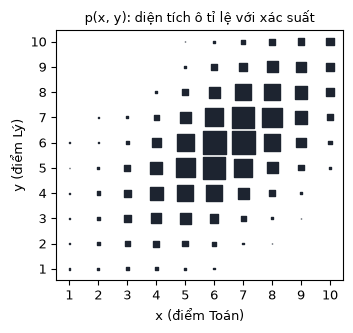
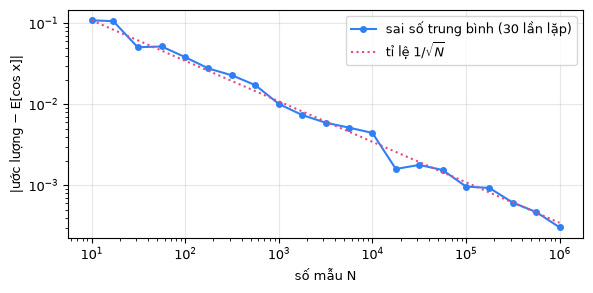

# Chương 3 · Code từ đầu

> Ghi chú của người biên soạn: trang này do người biên soạn viết thêm, không có trong sách gốc. Trang dựng lại ví dụ điểm Toán và Lý của [mục 3.1](math/ch03_vi) bằng một bảng xác suất đồng thời, rồi tự tính xác suất biên, xác suất có điều kiện, quy tắc Bayes, kỳ vọng, hiệp phương sai, và tự viết cách lấy mẫu từ các phân phối ở mục 3.2.

## Cách dùng trang này

Các khối chạy lần lượt từ trên xuống và dùng chung biến. Cần `numpy` và `matplotlib`.

## 1. Bảng xác suất đồng thời

<small class="viz-ref">Mục 3.1.2 · Hình 3.1</small>

Sách không cho số liệu cụ thể của Hình 3.1. Ta tạo một bảng tương tự: điểm Toán $x$ và điểm Lý $y$ (số nguyên từ 1 đến 10) của 100 000 học sinh mô phỏng, hai điểm có tương quan với nhau. Đếm tần suất rồi chia cho tổng ta được $p(x, y)$.

<!-- run -->
```python
import numpy as np
import matplotlib.pyplot as plt

rng = np.random.default_rng(0)
n_students = 100_000
ability = rng.standard_normal(n_students)                       # "năng lực chung" làm hai môn tương quan
math_ = np.clip(np.rint(6.5 + 1.6 * (0.8 * ability + 0.6 * rng.standard_normal(n_students))), 1, 10).astype(int)
phys_ = np.clip(np.rint(6.0 + 1.7 * (0.8 * ability + 0.6 * rng.standard_normal(n_students))), 1, 10).astype(int)

P = np.zeros((10, 10))                                           # P[x-1, y-1] = p(x, y)
np.add.at(P, (math_ - 1, phys_ - 1), 1)
P /= P.sum()
print("tổng mọi p(x, y) =", round(P.sum(), 12))
print(f"p(x = 7, y = 7) = {P[6, 6]:.4f};  p(x = 10, y = 1) = {P[9, 0]:.6f};  p(x = 1, y = 10) = {P[0, 9]:.6f}")

fig, ax = plt.subplots(figsize=(3.6, 3.4))
ys, xs = np.meshgrid(np.arange(1, 11), np.arange(1, 11))
ax.scatter(xs, ys, s=4000 * P, marker="s", color="#1d2430")
ax.set_xlabel("x (điểm Toán)"); ax.set_ylabel("y (điểm Lý)"); ax.set_xticks(range(1, 11)); ax.set_yticks(range(1, 11))
ax.set_title("p(x, y): diện tích ô tỉ lệ với xác suất", fontsize=9)
fig.tight_layout()
```

<!-- output -->
```output
tổng mọi p(x, y) = 1.0
p(x = 7, y = 7) = 0.0607;  p(x = 10, y = 1) = 0.000000;  p(x = 1, y = 10) = 0.000000
```

<div align=center></div>
<!-- /output -->

## 2. Xác suất biên, có điều kiện và quy tắc Bayes

<small class="viz-ref">Mục 3.1.3–3.1.6 · công thức (3.6)–(3.26)</small>

<!-- run -->
```python
px = P.sum(axis=1)                       # (3.6): p(x) = sum_y p(x, y)
py = P.sum(axis=0)                       # (3.7)
print("p(x):", px.round(3))
print("p(y):", py.round(3))

# (3.13): p(x | y = 9) = p(x, y = 9) / p(y = 9)
px_given_y9 = P[:, 8] / py[8]
print("\np(x | y = 9):", px_given_y9.round(3), "; tổng =", px_given_y9.sum().round(10))
print(f"điểm Toán trung bình: của mọi học sinh {np.arange(1, 11) @ px:.2f}, của học sinh được 9 điểm Lý {np.arange(1, 11) @ px_given_y9:.2f}")

# (3.15)-(3.16): ma trận có điều kiện theo cả hai chiều, và quy tắc tích
Px_y = P / py[None, :]                   # cột j: p(x | y = j+1)
Py_x = P / px[:, None]                   # hàng i: p(y | x = i+1)
print("\np(x|y)p(y) = p(y|x)p(x) = p(x, y) ?", np.allclose(Px_y * py, P) and np.allclose(Py_x * px[:, None], P))

# (3.23): Bayes. Biết p(y | x) và p(x), suy ra p(x | y) mà không cần bảng đồng thời
post = Py_x[:, 8] * px / np.sum(Py_x[:, 8] * px)
print("Bayes cho đúng p(x | y = 9) ?", np.allclose(post, px_given_y9))

# (3.26): x và y có độc lập không? So p(x, y) với p(x) p(y)
print(f"\nmax |p(x, y) - p(x)p(y)| = {np.abs(P - np.outer(px, py)).max():.4f}: x và y không độc lập")
```

<!-- output -->
```output
p(x): [0.001 0.006 0.024 0.076 0.159 0.235 0.234 0.161 0.076 0.03 ]
p(y): [0.004 0.015 0.051 0.119 0.195 0.233 0.194 0.117 0.052 0.019]

p(x | y = 9): [0.    0.    0.    0.001 0.012 0.074 0.195 0.304 0.261 0.153] ; tổng = 1.0
điểm Toán trung bình: của mọi học sinh 6.49, của học sinh được 9 điểm Lý 8.18

p(x|y)p(y) = p(y|x)p(x) = p(x, y) ? True
Bayes cho đúng p(x | y = 9) ? True

max |p(x, y) - p(x)p(y)| = 0.0170: x và y không độc lập
```
<!-- /output -->

Biết thêm một học sinh được 9 điểm Lý làm thay đổi hẳn phân phối điểm Toán của học sinh đó: điểm Toán trung bình tăng từ 6.49 lên 8.18. Đó chính là ý nghĩa của việc $x$ và $y$ không độc lập.

## 3. Kỳ vọng, phương sai và hiệp phương sai

<small class="viz-ref">Mục 3.1.7–3.1.9 · công thức (3.27)–(3.39)</small>

Với một bảng xác suất, kỳ vọng là tổng có trọng số. Với dữ liệu, kỳ vọng được ước lượng bằng trung bình cộng. Hai cách phải cho cùng kết quả.

<!-- run -->
```python
vals = np.arange(1, 11)
Ex, Ey = vals @ px, vals @ py
Exy = vals @ P @ vals                                    # E[xy] = sum_{x,y} x y p(x, y)  (3.30)
cov = Exy - Ex * Ey
var_x, var_y = (vals ** 2) @ px - Ex ** 2, (vals ** 2) @ py - Ey ** 2
print(f"từ bảng:    E[x] = {Ex:.4f}, E[y] = {Ey:.4f}, Var(x) = {var_x:.4f}, Cov(x, y) = {cov:.4f}, hệ số tương quan = {cov / np.sqrt(var_x * var_y):.4f}")

D = np.column_stack([math_, phys_]).astype(float)       # mỗi hàng là một học sinh
mean = D.mean(axis=0)
Dc = D - mean                                            # (3.39): dữ liệu đã chuẩn hoá về kỳ vọng 0
S = Dc.T @ Dc / len(D)                                   # (3.38): S = (1/N) X̂ X̂^T  (ở đây các điểm nằm theo hàng)
print(f"từ dữ liệu: E[x] = {mean[0]:.4f}, E[y] = {mean[1]:.4f}, Var(x) = {S[0, 0]:.4f}, Cov(x, y) = {S[0, 1]:.4f}")

# Lưu ý: np.cov mặc định chia cho N - 1, không phải N như (3.38)
small = D[:5]
print("\nvới 5 điểm, S theo (3.38):\n", (small - small.mean(0)).T @ (small - small.mean(0)) / 5)
print("np.cov(small.T):\n", np.cov(small.T))
print("np.cov(small.T, bias=True) khớp (3.38):", np.allclose(np.cov(small.T, bias=True), (small - small.mean(0)).T @ (small - small.mean(0)) / 5))
```

<!-- output -->
```output
từ bảng:    E[x] = 6.4926, E[y] = 5.9952, Var(x) = 2.5877, Cov(x, y) = 1.6983, hệ số tương quan = 0.6185
từ dữ liệu: E[x] = 6.4926, E[y] = 5.9952, Var(x) = 2.5877, Cov(x, y) = 1.6983

với 5 điểm, S theo (3.38):
 [[0.64 0.76]
 [0.76 2.24]]
np.cov(small.T):
 [[0.8  0.95]
 [0.95 2.8 ]]
np.cov(small.T, bias=True) khớp (3.38): True
```
<!-- /output -->

Hệ số $\frac{1}{N - 1}$ cho một ước lượng *không chệch* của phương sai. Với $N$ lớn, sự khác biệt không đáng kể. Với $N$ nhỏ, nó có ý nghĩa: cần biết thư viện dùng quy ước nào.

## 4. Tự viết cách lấy mẫu

<small class="viz-ref">Mục 3.2</small>

Mọi cách lấy mẫu đều bắt đầu từ số ngẫu nhiên phân phối đều trên $[0, 1)$:

- **Bernoulli, categorical:** chia đoạn $[0, 1)$ thành các khúc có độ dài $\lambda_1, \dots, \lambda_K$, xem số ngẫu nhiên rơi vào khúc nào.
- **Phân phối chuẩn:** phép biến đổi Box–Muller biến hai số đều thành hai số chuẩn độc lập.
- **Chuẩn nhiều chiều:** nếu $\mathbf{z} \sim \mathcal{N}(\mathbf{0}, \mathbf{I})$ và $\mathbf{\Sigma} = \mathbf{L}\mathbf{L}^T$ (phân tích Cholesky, [trang Code chương 1](math/ch01_code_vi)) thì $\boldsymbol{\mu} + \mathbf{L}\mathbf{z} \sim \mathcal{N}(\boldsymbol{\mu}, \mathbf{\Sigma})$, vì hiệp phương sai của $\mathbf{L}\mathbf{z}$ là $\mathbf{L}\mathbf{I}\mathbf{L}^T = \mathbf{\Sigma}$.
- **Beta và Dirichlet:** lấy các mẫu từ phân phối Gamma rồi chuẩn hoá cho tổng bằng 1 (ở đây dùng sẵn bộ sinh Gamma của NumPy).

<!-- run -->
```python
u = rng.random

def categorical(lam, n):
    edges = np.cumsum(lam)                               # ranh giới các khúc
    return np.searchsorted(edges, u(n), side="right")

def normal(n):                                           # Box–Muller
    u1, u2 = 1 - u(n), u(n)
    return np.sqrt(-2 * np.log(u1)) * np.cos(2 * np.pi * u2)

def mvn(mu, Sigma, n):
    L = np.linalg.cholesky(Sigma)
    return mu + normal(n * len(mu)).reshape(n, len(mu)) @ L.T

def dirichlet(alpha, n):
    g = rng.gamma(alpha, size=(n, len(alpha)))
    return g / g.sum(axis=1, keepdims=True)

N = 200_000
lam = np.array([0.1, 0.2, 0.3, 0.4])
print("categorical: tần suất", (np.bincount(categorical(lam, N)) / N).round(3), "; lambda", lam)
z = normal(N)
print(f"Box–Muller: trung bình {z.mean():+.4f}, phương sai {z.var():.4f}, tỉ lệ |z| < 1.96: {np.mean(np.abs(z) < 1.96):.4f} (lý thuyết 0.95)")

mu, Sigma = np.array([1., -2]), np.array([[2., 1.2], [1.2, 1.]])
Xs = mvn(mu, Sigma, N)
print("chuẩn 2 chiều: trung bình", Xs.mean(0).round(3), "; hiệp phương sai\n", np.cov(Xs.T).round(3))

alpha = np.array([2., 5.])                               # Dirichlet 2 chiều = Beta(2, 5) cho thành phần đầu
B = dirichlet(alpha, N)[:, 0]
print(f"Beta(2, 5): trung bình {B.mean():.4f} (lý thuyết {2 / 7:.4f}), phương sai {B.var():.5f} (lý thuyết {2 * 5 / (7 ** 2 * 8):.5f})")
```

<!-- output -->
```output
categorical: tần suất [0.099 0.2   0.298 0.402] ; lambda [0.1 0.2 0.3 0.4]
Box–Muller: trung bình +0.0030, phương sai 1.0068, tỉ lệ |z| < 1.96: 0.9491 (lý thuyết 0.95)
chuẩn 2 chiều: trung bình [ 1.001 -1.999] ; hiệp phương sai
 [[1.995 1.196]
 [1.196 0.997]]
Beta(2, 5): trung bình 0.2856 (lý thuyết 0.2857), phương sai 0.02548 (lý thuyết 0.02551)
```
<!-- /output -->

## 5. Kỳ vọng bằng mô phỏng Monte Carlo

<small class="viz-ref">Mục 3.1.7</small>

Khi không tính được tổng hay tích phân trong định nghĩa kỳ vọng, ta có thể lấy $N$ mẫu và tính trung bình. Luật số lớn đảm bảo trung bình này tiến về kỳ vọng. Sai số giảm theo $1/\sqrt{N}$: muốn chính xác thêm một chữ số, cần gấp 100 lần số mẫu.

Ví dụ: với $x \sim \mathcal{N}(0, 1)$, $\text{E}[\cos x] = e^{-1/2}$.

<!-- run -->
```python
true = np.exp(-0.5)
Ns = np.logspace(1, 6, 21).astype(int)
errs = np.array([[abs(np.cos(normal(n)).mean() - true) for _ in range(30)] for n in Ns]).mean(axis=1)

fig, ax = plt.subplots(figsize=(6, 3))
ax.loglog(Ns, errs, "o-", color="#2f80f5", ms=4, label="sai số trung bình (30 lần lặp)")
ax.loglog(Ns, errs[0] * np.sqrt(Ns[0] / Ns), ":", color="#e8487f", label=r"tỉ lệ $1/\sqrt{N}$")
ax.set_xlabel("số mẫu N"); ax.set_ylabel(r"|ước lượng $-$ E[cos x]|"); ax.grid(alpha=.3); ax.legend()
fig.tight_layout()
for n in [100, 10_000, 1_000_000]:
    print(f"N = {n:>9,}: ước lượng {np.cos(normal(n)).mean():.5f}  (đúng: {true:.5f})")
```

<!-- output -->
```output
N =       100: ước lượng 0.59467  (đúng: 0.60653)
N =    10,000: ước lượng 0.61024  (đúng: 0.60653)
N = 1,000,000: ước lượng 0.60640  (đúng: 0.60653)
```

<div align=center></div>
<!-- /output -->

## Tóm tắt

| Trong sách | Trên trang này |
| --- | --- |
| Xác suất biên (3.6) | `P.sum(axis=1)` |
| Xác suất có điều kiện (3.15) | chia một cột (hoặc hàng) cho tổng của nó |
| Quy tắc Bayes (3.23) | nhân tiên nghiệm với likelihood rồi chuẩn hoá |
| Hiệp phương sai (3.38) | `Dc.T @ Dc / N`, hoặc `np.cov(..., bias=True)` |
| Lấy mẫu chuẩn nhiều chiều | Box–Muller + phân tích Cholesky |
