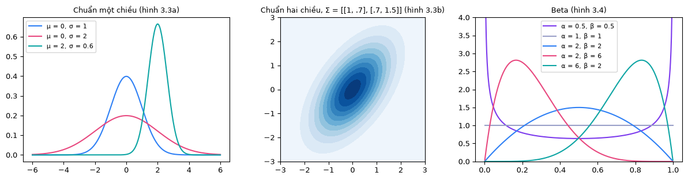
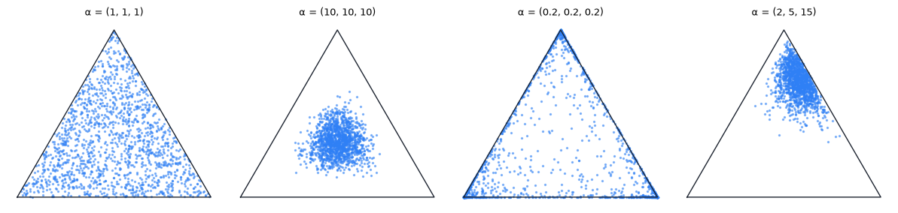

# Chương 3 · Dùng thư viện

> Ghi chú của người biên soạn: trang này do người biên soạn viết thêm, không có trong sách gốc. Trang giới thiệu `scipy.stats`, thư viện chứa sẵn mọi phân phối ở [mục 3.2](math/ch03_vi), và vẽ lại các hình 3.3, 3.4 của sách bằng nó.

## Cách dùng trang này

Các khối chạy lần lượt từ trên xuống và dùng chung biến. Cần `numpy`, `scipy`, `matplotlib`.

| Phân phối trong sách | `scipy.stats` | Tham số |
| --- | --- | --- |
| Bernoulli (3.41) | `bernoulli(p)` | $p = \lambda$ |
| Categorical (3.43) | `multinomial(1, p)` | vector $\boldsymbol{\lambda}$ |
| Chuẩn một chiều (3.45) | `norm(loc, scale)` | `loc` $= \mu$, `scale` $= \sigma$ (độ lệch chuẩn, không phải phương sai) |
| Chuẩn nhiều chiều (3.46) | `multivariate_normal(mean, cov)` | $\boldsymbol{\mu}, \mathbf{\Sigma}$ |
| Beta (3.47) | `beta(a, b)` | $\alpha, \beta$ |
| Dirichlet | `dirichlet(alpha)` | $\boldsymbol{\alpha}$ |

## 1. Một phân phối, nhiều phương thức

Mỗi phân phối trong `scipy.stats` có cùng một bộ phương thức: `pmf`/`pdf` (hàm khối hoặc mật độ xác suất), `cdf` (hàm phân phối tích luỹ), `ppf` (hàm ngược của `cdf`), `rvs` (lấy mẫu), `mean`, `var`, `entropy`, và bản logarit `logpdf`, `logpmf`.

<!-- run -->
```python
import numpy as np
import matplotlib.pyplot as plt
from scipy import stats

X = stats.norm(loc=170, scale=7)                   # chiều cao (cm) ~ N(170, 7^2)
print(f"mật độ tại 170: {X.pdf(170):.4f}  (mật độ, không phải xác suất: có thể > 1 nếu sigma nhỏ)")
print(f"P(x < 180) = {X.cdf(180):.4f};  P(160 < x < 180) = {X.cdf(180) - X.cdf(160):.4f}")
print(f"95% số người cao dưới {X.ppf(0.95):.1f} cm")
print(f"kỳ vọng {X.mean()}, phương sai {X.var()}")
print("5 mẫu:", X.rvs(5, random_state=0).round(1))

print(f"\nN(0, 0.1^2) có mật độ tại 0 bằng {stats.norm(0, 0.1).pdf(0):.2f} > 1: ghi chú sau công thức (3.2) của sách")

B = stats.bernoulli(0.3)
print(f"Bernoulli(0.3): p(1) = {B.pmf(1):.2f}, p(0) = {B.pmf(0):.2f}, kỳ vọng {B.mean()}, phương sai {B.var():.2f} = lambda(1 - lambda)")
C = stats.multinomial(1, [0.2, 0.5, 0.3])
print("categorical: p(x = e_2) =", C.pmf([0, 1, 0]), "; 3 mẫu one-hot:\n", C.rvs(3, random_state=0))
```

<!-- output -->
```output
mật độ tại 170: 0.0570  (mật độ, không phải xác suất: có thể > 1 nếu sigma nhỏ)
P(x < 180) = 0.9234;  P(160 < x < 180) = 0.8469
95% số người cao dưới 181.5 cm
kỳ vọng 170.0, phương sai 49.0
5 mẫu: [182.3 172.8 176.9 185.7 183.1]

N(0, 0.1^2) có mật độ tại 0 bằng 3.99 > 1: ghi chú sau công thức (3.2) của sách
Bernoulli(0.3): p(1) = 0.30, p(0) = 0.70, kỳ vọng 0.3, phương sai 0.21 = lambda(1 - lambda)
categorical: p(x = e_2) = 0.5 ; 3 mẫu one-hot:
 [[0 0 1]
 [0 1 0]
 [0 0 1]]
```
<!-- /output -->

## 2. Làm việc với log của mật độ

Tích của nhiều xác suất nhỏ nhanh chóng bằng 0 trên máy tính. Vì vậy, ước lượng hợp lý cực đại ([chương 4](math/ch04_vi)) luôn làm việc với tổng các logarit. Dùng `logpdf` thay vì `np.log(pdf(...))`: kết quả giống nhau khi mật độ không quá nhỏ, nhưng `logpdf` vẫn đúng ở vùng mà `pdf` đã bằng 0.

<!-- run -->
```python
data = stats.norm(0, 1).rvs(2000, random_state=1)
print("tích của 2000 mật độ:     ", np.prod(stats.norm(0, 1).pdf(data)))
print("tổng của 2000 log mật độ: ", stats.norm(0, 1).logpdf(data).sum())
print("\nlog mật độ tại x = 40:  np.log(pdf) =", np.log(stats.norm.pdf(40)), "; logpdf =", stats.norm.logpdf(40))
```

<!-- output -->
```output
tích của 2000 mật độ:      0.0
tổng của 2000 log mật độ:  -2850.6767176504663

log mật độ tại x = 40:  np.log(pdf) = -inf ; logpdf = -800.9189385332047
```
<!-- /output -->

## 3. Chuẩn nhiều chiều: kiểm tra công thức (3.46)

<small class="viz-ref">Mục 3.2.4 · công thức (3.46)</small>

Tự viết log mật độ theo công thức của sách, dùng `slogdet` và `solve` ([trang Thư viện chương 1](math/ch01_lib_vi)) thay vì tính định thức và nghịch đảo:

$$
\log p(\mathbf{x}) = -\frac{D}{2}\log(2\pi) - \frac{1}{2}\log|\mathbf{\Sigma}| - \frac{1}{2}(\mathbf{x} - \boldsymbol{\mu})^T\mathbf{\Sigma}^{-1}(\mathbf{x} - \boldsymbol{\mu}).
$$

<!-- run -->
```python
mu = np.array([1., -1, 0.5])
A = np.random.default_rng(0).standard_normal((3, 3))
Sigma = A @ A.T + 0.5 * np.eye(3)
x = np.array([0.2, 0.1, -0.3])

def mvn_logpdf(x, mu, Sigma):
    D = len(mu)
    _, logdet = np.linalg.slogdet(Sigma)
    d = x - mu
    return -0.5 * (D * np.log(2 * np.pi) + logdet + d @ np.linalg.solve(Sigma, d))

print("tự viết:", mvn_logpdf(x, mu, Sigma))
print("scipy:  ", stats.multivariate_normal(mu, Sigma).logpdf(x))

# Ma trận hiệp phương sai phải xác định dương (mục 1.13)
try:
    stats.multivariate_normal(mu, np.array([[1., 2, 0], [2, 1, 0], [0, 0, 1]]))
except ValueError as e:
    print("\nSigma không xác định dương:", str(e)[:70])
```

<!-- output -->
```output
tự viết: -4.693679406626728
scipy:   -4.693679406626728

Sigma không xác định dương: The input matrix must be symmetric positive semidefinite.
```
<!-- /output -->

## 4. Vẽ lại hình 3.3 và 3.4

<small class="viz-ref">Mục 3.2.3–3.2.5 · Hình 3.3, 3.4</small>

<!-- run -->
```python
fig, axes = plt.subplots(1, 3, figsize=(12, 3.2))
t = np.linspace(-6, 6, 400)
for (m, s), c in zip([(0, 1), (0, 2), (2, 0.6)], ["#2f80f5", "#e8487f", "#0ea5a4"]):
    axes[0].plot(t, stats.norm(m, s).pdf(t), color=c, label=f"μ = {m}, σ = {s}")
axes[0].set_title("Chuẩn một chiều (hình 3.3a)", fontsize=9); axes[0].legend(fontsize=8)

g = np.linspace(-3, 3, 200); G1, G2 = np.meshgrid(g, g)
pdf2 = stats.multivariate_normal([0, 0], [[1, 0.7], [0.7, 1.5]]).pdf(np.dstack([G1, G2]))
axes[1].contourf(G1, G2, pdf2, levels=12, cmap="Blues"); axes[1].set_aspect("equal")
axes[1].set_title("Chuẩn hai chiều, Σ = [[1, .7], [.7, 1.5]] (hình 3.3b)", fontsize=9)

lam = np.linspace(0.001, 0.999, 400)
for (a, b), c in zip([(0.5, 0.5), (1, 1), (2, 2), (2, 6), (6, 2)], ["#7c3aed", "#9aa0c8", "#2f80f5", "#e8487f", "#0ea5a4"]):
    axes[2].plot(lam, stats.beta(a, b).pdf(lam), color=c, label=f"α = {a}, β = {b}")
axes[2].set_ylim(0, 4); axes[2].set_title("Beta (hình 3.4)", fontsize=9); axes[2].legend(fontsize=8)
fig.tight_layout()
```

<!-- output -->
<div align=center></div>
<!-- /output -->

Các tính chất của phân phối Beta mà sách mô tả hiện rõ trên hình:

- $\alpha = \beta = 1$: phân phối đều.
- $\alpha = \beta > 1$: đối xứng, có đỉnh ở giữa.
- $\alpha = \beta < 1$: dồn về hai đầu.
- $\alpha > \beta$: lệch về phía 1, và ngược lại.

## 5. Dirichlet: phân phối trên các vector xác suất

<small class="viz-ref">Mục 3.2.6</small>

Mỗi mẫu của phân phối Dirichlet là một vector không âm có tổng bằng 1, tức là một bộ tham số $\boldsymbol{\lambda}$ của phân phối categorical. Với $K = 3$, các mẫu nằm trên một tam giác (đơn hình).

<!-- run -->
```python
fig, axes = plt.subplots(1, 4, figsize=(12, 3))
corners = np.array([[0, 0], [1, 0], [0.5, np.sqrt(3) / 2]])
for ax, alpha in zip(axes, [(1, 1, 1), (10, 10, 10), (0.2, 0.2, 0.2), (2, 5, 15)]):
    S = stats.dirichlet(alpha).rvs(1500, random_state=0)
    xy = S @ corners                                            # toạ độ trên tam giác
    ax.scatter(*xy.T, s=2, color="#2f80f5", alpha=.5)
    ax.plot(*np.vstack([corners, corners[:1]]).T, color="#1d2430", lw=1)
    ax.set_title(f"α = {alpha}", fontsize=9); ax.set_aspect("equal"); ax.axis("off")
    print(f"alpha = {alpha}: trung bình mẫu {S.mean(0).round(3)}, lý thuyết {(np.array(alpha) / sum(alpha)).round(3)}")
fig.tight_layout()
```

<!-- output -->
```output
alpha = (1, 1, 1): trung bình mẫu [0.339 0.332 0.329], lý thuyết [0.333 0.333 0.333]
alpha = (10, 10, 10): trung bình mẫu [0.332 0.335 0.332], lý thuyết [0.333 0.333 0.333]
alpha = (0.2, 0.2, 0.2): trung bình mẫu [0.332 0.332 0.336], lý thuyết [0.333 0.333 0.333]
alpha = (2, 5, 15): trung bình mẫu [0.089 0.228 0.683], lý thuyết [0.091 0.227 0.682]
```

<div align=center></div>
<!-- /output -->

Bốn trường hợp tương ứng với nhận xét trong sách:

- $\boldsymbol{\alpha} = (1, 1, 1)$: phân bố đều trên tam giác.
- Các $\alpha_k$ bằng nhau và lớn: mẫu tập trung quanh tâm, tức các thành phần gần bằng nhau.
- Các $\alpha_k$ bằng nhau và nhỏ hơn 1: mẫu dồn ra các cạnh và các đỉnh, tức thường chỉ một hoặc hai thành phần đáng kể (vector "thưa").
- Các $\alpha_k$ khác nhau: mẫu lệch về đỉnh ứng với $\alpha_k$ lớn nhất (đỉnh trên cùng, $\alpha_3 = 15$).

## 6. Bộ sinh số ngẫu nhiên và hạt giống

Cách khuyên dùng hiện nay của NumPy là tạo một bộ sinh riêng bằng `np.random.default_rng(seed)`, thay vì `np.random.seed` dùng chung cho cả chương trình. Các hàm `rvs` của SciPy nhận bộ sinh này qua tham số `random_state`.

<!-- run -->
```python
rng = np.random.default_rng(42)
a = stats.norm(0, 1).rvs(3, random_state=rng)
rng = np.random.default_rng(42)
b = stats.norm(0, 1).rvs(3, random_state=rng)
print("cùng hạt giống, cùng kết quả:", np.array_equal(a, b), a.round(4))
```

<!-- output -->
```output
cùng hạt giống, cùng kết quả: True [ 0.3047 -1.04    0.7505]
```
<!-- /output -->

## Tóm tắt

- Chú ý tham số: `norm(loc, scale)` nhận **độ lệch chuẩn**; `multivariate_normal(mean, cov)` nhận **ma trận hiệp phương sai**.
- Mật độ xác suất có thể lớn hơn 1; chỉ tích phân của nó mới là xác suất.
- Làm việc với `logpdf`/`logpmf` khi nhân nhiều xác suất với nhau.
