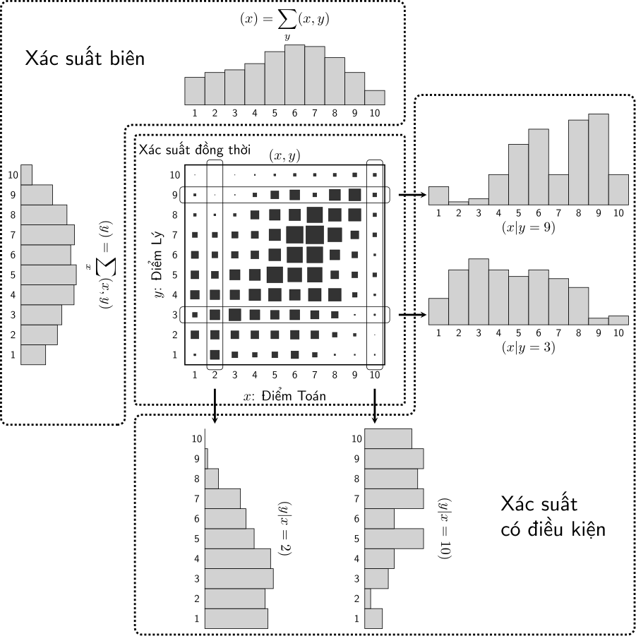
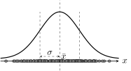
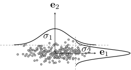
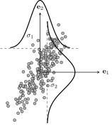
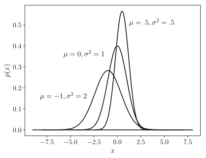
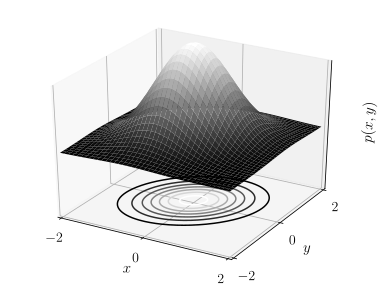
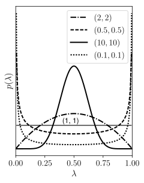
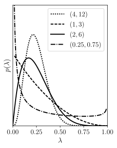
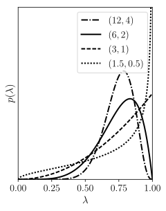

# Chương 3 Ôn tập Xác suất

> Ghi chú của người biên soạn: chương này lấy nguyên văn từ sách *Machine Learning cơ bản* của **Vũ Hữu Tiệp** ([mã nguồn LaTeX](https://github.com/tiepvupsu/ebookMLCB), giấy phép [CC BY-SA 4.0](https://creativecommons.org/licenses/by-sa/4.0/); trang gốc [machinelearningcoban.com](https://machinelearningcoban.com)). Người biên soạn chỉ đổi định dạng sang trang web: số chương, mục, công thức và hình giữ như bản PDF, hình vector được vẽ lại dưới dạng SVG.

Chương này được viết dựa trên Chương 2 và 3 của cuốn *Computer Vision: Models, Learning, and Inference – Simon J.D. Prince* (<https://goo.gl/GTEXzd>).

## 3.1 Xác suất

### 3.1.1 Biến ngẫu nhiên

Một *biến ngẫu nhiên* (random variable) $x$ là một biến dùng để đo những đại lượng không xác định. Biến này có thể được dùng để ký hiệu kết quả/đầu ra của một thí nghiệm, ví dụ như tung đồng xu, hoặc một đại lượng biến đổi trong tự nhiên, ví dụ như nhiệt độ trong ngày. Nếu quan sát một số lượng lớn đầu ra $\{x_i\}_{i=1}^I$ của các thí nghiệm này, ta có thể nhận được những giá trị khác nhau ở mỗi thí nghiệm. Tuy nhiên, sẽ có những giá trị xảy ra nhiều lần hơn những giá trị khác, hoặc xảy ra gần một giá trị này hơn những giá trị khác. Thông tin về đầu ra này được đo bởi một *phân phối xác suất* (probability distribution) được biểu diễn bằng một hàm $p(x)$. Một biến ngẫu nhiên có thể là rời rạc hoặc liên tục.

Một biến ngẫu nhiên rời rạc sẽ lấy giá trị trong một tập hợp các điểm rời rạc cho trước. Ví dụ tung đồng xu thì có hai khả năng là *xấp* và *ngửa*. Tập các giá trị này có thể có thứ tự như khi tung xúc xắc hoặc không có thứ tự như khi đầu ra là các giá trị *nắng*, *mưa*, *bão*. Mỗi đầu ra có một giá trị xác suất tương ứng với nó. Các giá trị xác suất này không âm và có tổng bằng một.

$$
\text{Nếu}~ x ~\text{là biến ngẫu nhiên rời rạc thì}\quad \sum_{x} p(x) = 1. \tag{3.1}
$$

Biến ngẫu nhiên liên tục lấy giá trị là các số thực. Những giá trị này có thể là hữu hạn, ví dụ thời gian làm bài của mỗi thí sinh trong một bài thi 180 phút, hoặc vô hạn, ví dụ thời gian phải chờ tới khách hàng tiếp theo. Không như biến ngẫu nhiên rời rạc, xác suất để đầu ra bằng chính xác một giá trị nào đó theo lý thuyết là bằng không. Thay vào đó, phân phối của biến ngẫu nhiên rời rạc thường được xác định dựa trên xác suất để đầu ra rơi vào một khoảng giá trị nào đó. Việc này được mô tả bởi một hàm số được gọi là *hàm mật độ xác suất* (probability density function, pdf). Hàm mật độ xác suất luôn cho giá trị dương, và tích phân của nó trên toàn miền giá trị đầu ra phải bằng một.

$$
\text{Nếu}~ x ~\text{là biến ngẫu nhiên liên tục thì} \int p(x)dx = 1. \tag{3.2}
$$

> Nếu $x$ là một biến ngẫu nhiên rời rạc thì $p(x) \leq 1,~\forall x$. Trong khi đó, nếu $x$ là biến ngẫu nhiên liên tục, $p(x)$ có thể nhận giá trị không âm bất kỳ, điều này vẫn đảm bảo tích phân của hàm mật độ xác suất theo toàn bộ giá trị của $x$ bằng một.

### 3.1.2 Xác suất đồng thời

Nếu quan sát số lượng lớn các cặp đầu ra của hai biến ngẫu nhiên $x$ và $y$ thì có những cặp đầu ra xảy ra thường xuyên hơn những cặp khác. Thông tin này được biểu diễn bằng một phân phối được gọi là *xác suất đồng thời* (joint probability) của $x$ và $y$, được ký hiệu là $p(x, y)$. Hai biến ngẫu nhiên $x$ và $y$ có thể cùng là biến ngẫu nhiên rời rạc, liên tục, hoặc một rời rạc, một liên tục. Luôn nhớ rằng tổng các xác suất trên mọi cặp giá trị $(x, y)$ đều bằng một.

$$
\begin{align*}
\text{Cả }x\text{ và }y\text{ là rời rạc:}  & &\sum_{x, y} p(x, y) &= 1. \tag{3.3} \\
\text{Cả }x\text{ và }y\text{ là liên tục:} & &\int p(x, y) dx dy &=1. \tag{3.4} \\
x ~\text{rời rạc}, ~ y ~\text{liên tục:} & &\sum_{x} \int p(x, y) dy &= \int \left(\sum_{x} p(x, y) \right)dy = 1. \tag{3.5}
\end{align*}
$$

Xét ví dụ trong Hình 3.1, phần “Xác suất đồng thời”. Biến ngẫu nhiên $x$ thể hiện điểm thi môn Toán của học sinh ở một trường THPT trong một kỳ thi quốc gia, biến ngẫu nhiên $y$ thể hiện điểm thi môn Vật Lý cũng trong kỳ thi đó. Đại lượng $p(x = x^*, y = y^*)$ là tỉ lệ giữa tần suất số học sinh được *đồng thời* $x^*$ điểm môn Toán và $y^*$ điểm môn Vật lý với toàn bộ số học sinh của trường đó. Tỉ lệ này có thể coi là xác suất khi số học sinh trong trường là lớn. Ở đây $x^*$ và $y^*$ là các số xác định. Thông thường, xác suất này được viết gọn lại thành $p(x^*, y^*)$, và $p(x, y)$ được dùng như một hàm tổng quát để mô tả các xác suất.

Giả sử thêm rằng điểm các môn là các số tự nhiên từ 1 đến 10.

Các ô vuông màu đen thể hiện xác suất $p(x, y)$, với diện tích ô vuông càng lớn biểu thị xác suất càng cao. Chú ý rằng tổng các xác suất này bằng một.

Có thể thấy rằng xác suất để một học sinh được 10 điểm môn Toán và 1 điểm môn Lý rất thấp, điều tương tự xảy ra với 10 điểm môn Lý và 1 điểm môn Toán. Xác suất để một học sinh được khoảng 7 điểm cả hai môn là cao nhất.

Hình 3.1: Xác suất đồng thời, xác suất biên, xác suất có điền kiện và mối quan hệ giữa chúng

Thông thường, chúng ta sẽ làm việc với các bài toán ở đó xác suất được xác định trên nhiều hơn hai biến ngẫu nhiên. Chẳng hạn, $p(x, y, z)$ thể hiện xác suất đồng thời của ba biến ngẫu nhiên $x,y$ và $z$. Khi có nhiều biến ngẫu nhiên, ta có thể viết chúng dưới dạng vector. Cụ thể, ta có thể viết $p(\mathbf{x})$ để thể hiện xác suất của biến ngẫu nhiên nhiều chiều $\mathbf{x} = [x_1, x_2, \dots, x_n]^T$. Khi có nhiều tập các biến ngẫu nhiên, ví dụ $\mathbf{x}$ và $\mathbf{y}$, ta có thể viết $p(\mathbf{x}, \mathbf{y})$ để thể hiện xác suất đồng thời của tất cả các thành phần trong hai biến ngẫu nhiên nhiều chiều này.

### 3.1.3 Xác suất biên

Nếu biết xác suất đồng thời của nhiều biến ngẫu nhiên, ta cũng có thể xác định được phân phối xác suất của từng biến bằng cách lấy tổng (với biến ngẫu nhiên rời rạc) hoặc tích phân (với biến ngẫu nhiên liên tục) theo tất cả các biến còn lại:

$$
\begin{align*}
\text{Nếu} ~x, y ~\text{rời rạc:}~ &p(x) = \sum_{y}p(x, y), \tag{3.6} \\
&p(y) = \sum_{x}p(x, y). \tag{3.7} \\
\text{Nếu} ~x, y ~\text{liên tục:}~ &p(x) = \int p(x, y)dy, \tag{3.8} \\
&p(y) = \int p(x, y)dx. \tag{3.9}
\end{align*}
$$

Với nhiều biến hơn, chẳng hạn bốn biến rời rạc $x, y, z, w$, cách tính được thực hiện tương tự:

$$
\begin{align*}
p(x) &= \sum \limits_{ y, z, w}p(x, y, z, w), \tag{3.10} \\
p(x, y) &= \sum \limits_{z, w}p(x, y, z, w). \tag{3.11}
\end{align*}
$$

Cách xác định xác suất của một biến dựa trên xác suất đồng thời của nó với các biến khác được gọi là *phép biên hoá* (marginalization). Xác suất đó được gọi là *xác suất biên* (marginal probability).

Từ đây trở đi, nếu không đề cập gì thêm, chúng ta sẽ dùng ký hiệu $\sum$ để chỉ chung cho cả hai loại biến ngẫu nhiên rời rạc và liên tục. Nếu biến là liên tục, ta sẽ ngầm hiểu rằng dấu tổng ($\sum$) cần được thay bằng dấu tích phân ($\int$), biến lấy vi phân chính là biến được viết dưới dấu $\sum$. Chẳng hạn, trong (3.11), nếu $z$ là liên tục, $w$ là rời rạc, công thức đúng sẽ là

$$
p(x, y) = \sum_{w}\left( \int p(x, y, z, w)dz \right) = \int \left( \sum_{w} p(x, y, z, w)\right) dz. \tag{3.12}
$$

Quay lại ví dụ trong Hình 3.1 với hai biến ngẫu nhiên rời rạc $x, y$. Lúc này, $p(x)$ được hiểu là xác suất để một học sinh đạt được $x$ điểm môn Toán. Xác suất này được biểu thị ở khu vực “Xác suất biên”. Có hai cách tính xác suất này. Cách thứ nhất là đếm số học sinh được $x$ điểm môn toán rồi chia cho tổng số học sinh. Cách thứ hai dựa trên xác suất đồng thời để một học sinh được $x$ điểm môn Toán và $y$ điểm môn Lý. Số lượng học sinh đạt $x = x^*$ điểm môn Toán sẽ bằng tổng số học sinh đạt $x = x^*$ điểm môn Toán *và* $y$ điểm môn Lý, với $y$ là một giá trị bất kỳ từ 1 đến 10. vì vậy, để tính xác suất $p(x)$, ta chỉ cần tính tổng của toàn bộ $p(x, y)$ với $y$ chạy từ 1 đến 10.

Dựa trên nhận xét này, mỗi giá trị của $p(x)$ chính bằng tổng các giá trị trong cột thứ $x$ của hình vuông trung tâm. Mỗi giá trị của $p(y)$ sẽ bằng tổng các giá trị trong hàng thứ $y$ tính từ đưới lên của hình vuông đó. Chú ý rằng tổng các xác suất luôn bằng một.

### 3.1.4 Xác suất có điều kiện.

Dựa vào phân phối điểm của các học sinh, liệu ta có thể tính được xác suất để một học sinh được điểm 10 môn Lý, biết rằng học sinh đó được điểm 1 môn Toán?

Xác suất để một biến ngẫu nhiên $x$ nhận một giá trị nào đó biết rằng biến ngẫu nhiên $y$ có giá trị $y^*$ được gọi là *xác suất có điều kiện* (conditional probability), ký hiệu là $p(x| y = y^*)$.

Xác suất có điều kiện $p(x | y = y^*)$ có thể được tính dựa trên xác suất đồng thời $p(x, y)$. Quay lại Hình 3.1 ở khu vực “Xác suất có điều kiện”. Nếu biết rằng $y = 9$, xác suất $p(x | y = 9)$ có thể tính được dựa trên hàng thứ chín của hình vuông trung tâm, tức hàng $p(x, y = 9)$. Xác suất $p(x | y = 9)$ lớn nếu $p(x, y= 9)$ lớn. Chú ý rằng tổng các xác suất $\sum_{x} p(x, y = 9)$ nhỏ hơn một, và bằng tổng các xác suất trên hàng thứ chín này. Để thoả mãn điều kiện tổng các xác suất bằng một, ta cần chia mỗi đại lượng $p(x, y = 9)$ cho tổng của hàng này, tức là

$$
p(x | y = 9) =\frac{p(x, y = 9)}{\sum \limits_x p(x, y = 9)} =
\frac{p(x, y = 9)}{p(y = 9)}. \tag{3.13}
$$

Tổng quát,

$$
\displaystyle
p(x|y = y^*) = \frac{p(x, y = y^*)}{\sum \limits_{x} p(x, y = y^*)} =
\frac{p(x, y = y^*)}{p(y = y^*)}, \tag{3.14}
$$

ở đây ta đã sử dụng công thức tính xác suất biên trong (3.7) cho mẫu số. Thông thường, ta có thể viết xác suất có điều kiện mà không cần chỉ rõ giá trị $y = y^*$ và có các công thức gọn hơn:

$$
p(x |y) = \frac{p(x, y)}{p(y)}, ~p(y | x) = \frac{p(y, x)}{p(x)}. \tag{3.15}
$$

Từ đó ta có quan hệ

$$
p(x, y) = p(x|y)p(y) = p(y | x) p(x). \tag{3.16}
$$

Khi có nhiều hơn hai biến ngẫu nhiên, ta có các công thức

$$
\begin{align*}
p(x, y, z, w)
& =  p(x, y, z | w) p(w) \tag{3.17} \\
& =  p(x, y | z, w)p(z, w) = p(x, y | z, w) p(z | w) p(w) \tag{3.18} \\
& =  p(x | y, z, w)p(y | z, w) p(z | w) p(w). \tag{3.19}
\end{align*}
$$

Công thức (3.19) có dạng chuỗi và được sử dụng nhiều sau này.

### 3.1.5 Quy tắc Bayes

Công thức (3.16) biểu diễn xác suất đồng thời theo hai cách. Từ đó có thể suy ra

$$
p(y |x) p(x) = p(x | y) p(y). \tag{3.20}
$$

Biến đối một chút:

$$
\begin{align*}
p(y | x)
& =  \frac{p(x |y) p(y)}{p(x)} \tag{3.21} \\
& =  \frac{p(x |y) p(y)}{\sum \limits_{y} p(x, y)} \tag{3.22} \\
& =  \frac{p(x |y) p(y)}{\sum \limits_{y} p(x | y) p(y)}. \tag{3.23}
\end{align*}
$$

Trong dòng thứ hai và thứ ba, các công thức về xác suất biên và xác suất đồng thời ở mẫu số đã được sử dụng. Từ (3.23) ta có thể thấy rằng $p(y | x)$ hoàn toàn có thể tính được nếu ta biết mọi $p(x | y)$ và $p(y)$. Tuy nhiên, việc tính trực tiếp xác suất này thường phức tạp.

Ba công thức (3.21)-(3.23) thường được gọi là *quy tắc Bayes*. Chúng được sử dụng rộng rãi trong machine learning

### 3.1.6 Biến ngẫu nhiên độc lập

Nếu biết giá trị của một biến ngẫu nhiên $x$ không mang lại thông tin về việc suy ra giá trị của biến ngẫu nhiên $y$ và ngược lại, thì ta nói rằng hai biến ngẫu nhiên này là *độc lập*. Chẳng hạn, chiều cao của một học sinh và điểm thi môn Toán của học sinh đó có thể coi là hai biến ngẫu nhiên độc lập. Khi hai biến ngẫu nhiên $x$ và $y$ là độc lập, ta có

$$
\begin{align*}
p(x | y) &= p(x), \tag{3.24} \\
p(y | x) &= p(y). \tag{3.25}
\end{align*}
$$

Thay vào biểu thức xác suất đồng thời trong (3.16), ta có

$$
p(x, y) = p(x | y) p(y) = p(x) p(y). \tag{3.26}
$$

### 3.1.7 Kỳ vọng

*Kỳ vọng* (expectation) của một biến ngẫu nhiên $x$ được định nghĩa bởi

$$
\begin{align*}
\text{E}[x] = \sum_x x p(x)  & \text{nếu}~ x ~ \text{là rời rạc.} \quad \tag{3.27} \\
\text{E}[x] = \int x p(x) dx  & \text{nếu}~ x ~ \text{là liên tục.} \tag{3.28}
\end{align*}
$$

Giả sử $f(.)$ là một hàm số trả về một số với mỗi giá trị $x^*$ của biến ngẫu nhiên $x$. Khi đó, nếu $x$ là biến ngẫu nhiên rời rạc, ta có

$$
\text{E}[f(x)] = \sum_x f(x) p(x). \tag{3.29}
$$

Công thức cho biến ngẫu nhiên liên tục cũng được viết tương tự.

Với xác suất đồng thời, kỳ vọng của một hàm cũng được xác định tương tự:

$$
\text{E}[f(x, y)] = \sum_{x,y} f(x, y) p(x, y) dx dy. \tag{3.30}
$$

Có ba tính chất cần nhớ về kỳ vọng:

1.  Kỳ vọng của một hằng số theo một biến ngẫu nhiên $x$ bất kỳ bằng chính hằng số đó:

    $$
    \text{E}[\alpha] = \alpha. \tag{3.31}
    $$

2.  Kỳ vọng có tính chất tuyến tính:

    $$
    \begin{align*}
    \text{E}[\alpha x] & =  \alpha \text{E}[x], \tag{3.32} \\
    \text{E}[f(x) + g(x)] & =  \text{E}[f(x)] + \text{E}[g(x)]. \tag{3.33}
    \end{align*}
    $$

3.  Kỳ vọng của tích hai biến ngẫu nhiên độc lập bằng tích kỳ vọng của chúng:

    $$
    \text{E}[f(x) g(y)] = \text{E}[f(x)] \text{E}[g(y)]. \tag{3.34}
    $$

Khái niệm kỳ vọng thường đi kèm với khái niệm *phương sai* (variance) trong không gian một chiều và *ma trận hiệp phương sai* (covariance matrix) trong không gian nhiều chiều.

### 3.1.8 Phương sai

Cho $N$ giá trị $x_1, x_2, \dots, x_N$. Kỳ vọng và phương sai của bộ dữ liệu này được tính theo công thức

$$
\begin{align*}
\bar{x} &= \frac{1}{N}\sum_{n=1}^N x_n = \frac{1}{N}\mathbf{x1}, \tag{3.35} \\
\sigma^2 &= \frac{1}{N} \sum_{n=1}^N (x_n - \bar{x})^2, \tag{3.36}
\end{align*}
$$

với $\mathbf{x} = \left[\begin{matrix} x_1, x_2, \dots, x_N\end{matrix}\right]$, và $\mathbf{1} \in \mathbb{R}^N$ là vector cột chứa toàn phần tử 1. Kỳ vọng đơn giản là trung bình cộng của toàn bộ các giá trị. Phương sai là trung bình cộng của bình phương khoảng cách từ mỗi điểm tới kỳ vọng. Phương sai càng nhỏ, các điểm dữ liệu càng gần với kỳ vọng, tức các điểm dữ liệu càng giống nhau. Phương sai càng lớn, dữ liệu càng có tính phân tán. Ví dụ về kỳ vọng và phương sai của dữ liệu một chiều có thể được thấy trong Hình 3.2(a).

Căn bậc hai của phương sai, $\sigma$ còn được gọi là *độ lệch chuẩn* (standard deviation) của dữ liệu.

 <small>(a)</small> <small>(b)</small> <small>(c)</small>

Hình 3.2: Ví dụ về kỳ vọng và phương sai. (a) Dữ liệu trong không gian một chiều. (b) Dữ liệu trong không gian hai chiều mà hai chiều không tương quan. Trong trường hợp này, ma trận hiệp phương sai là ma trận đường chéo với hai phần tử trên đường chéo là $\sigma_1, \sigma_2$, đây cũng chính là hai trị riêng của ma trận hiệp phương sai và là phương sai của mỗi chiều dữ liệu. (c) Dữ liệu trong không gian hai chiều có tương quan. Theo mỗi chiều, ta có thể tính được kỳ vọng và phương sai. Phương sai càng lớn thì dữ liệu trong chiều đó càng phân tán. Trong ví dụ này, dữ liệu theo chiều thứ hai phân tán nhiều hơn so với chiều thứ nhất.

### 3.1.9 Ma trận hiệp phương sai

Cho $N$ điểm dữ liệu được biểu diễn bởi các vector cột $\mathbf{x}_1, \dots, \mathbf{x}_N$, khi đó, vector kỳ vọng và ma trận hiệp phương sai của toàn bộ dữ liệu được định nghĩa là

$$
\begin{align*}
\bar{\mathbf{x}} &= \frac{1}{N} \sum_{n=1}^N \mathbf{x}_n, \tag{3.37} \\
\mathbf{S} &=  \frac{1}{N}\sum_{n=1}^N (\mathbf{x}_n - \bar{\mathbf{x}})(\mathbf{x}_n - \bar{\mathbf{x}})^T = \frac{1}{N}\hat{\mathbf{X}}\hat{\mathbf{X}}^T. \tag{3.38}
\end{align*}
$$

Trong đó $\hat{\mathbf{X}}$ được tạo bằng cách trừ mỗi cột của $\mathbf{X}$ đi $\bar{\mathbf{x}}$:

$$
\hat{\mathbf{x}}_n = \mathbf{x}_n - \bar{\mathbf{x}}. \tag{3.39}
$$

Một vài tính chất của ma trận hiệp phương sai:

1.  Ma trận hiệp phương sai là một ma trận đối xứng, hơn nữa, nó là một ma trận [nửa xác định dương](https://machinelearningcoban.com/2017/03/12/convexity/#positive-semidefinite).

2.  Mọi phần tử trên đường chéo của ma trận hiệp phương sai là các số không âm. Chúng chính là phương sai của từng chiều dữ liệu.

3.  Các phần tử ngoài đường chéo $s_{ij}, i \neq j$ thể hiện sự tương quan giữa thành phần thứ $i$ và thứ $j$ của dữ liệu, còn được gọi là hiệp phương sai. Giá trị này có thể dương, âm hoặc bằng không. Khi nó bằng không, ta nói rằng hai thành phần $i, j$ trong dữ liệu là *không tương quan*.

4.  Nếu ma trận hiệp phương sai là ma trận đường chéo, ta có dữ liệu hoàn toàn không tương quan giữa các chiều.

Ví dụ về sự tương quan của dữ liệu được cho trong Hình 3.2(b) và 3.2(c).

## 3.2 Một vài phân phối thường gặp

### 3.2.1 Phân phối Bernoulli

Phân phối Bernoulli là một phân phối rời rạc mô tả các biến ngẫu nhiên nhị phân với đầu ra chỉ nhận một trong hai giá trị $x \in \{0, 1\}$. Hai giá trị này có thể là *xấp* và *ngửa* khi tung đồng xu; có thể là *giao dịch lừa đảo* và *giao dịch thông thường* trong bài toán xác định giao dịch lừa đảo trong tín dụng; có thể là *người* và *không phải người* trong bài toán xác định xem trong một bức ảnh có người hay không.

Phân phối Bernoulli được mô tả bằng một tham số $\lambda \in [0, 1]$. Xác suất của mỗi đầu ra là

$$
p(x = 1) = \lambda, ~~~~ p(x = 0) = 1 - p(x = 1) = 1 - \lambda. \tag{3.40}
$$

Hai đẳng thức này thường được viết gọn lại thành

$$
p(x) = \lambda^x (1 - \lambda)^{1 - x}, \tag{3.41}
$$

với giả định $0 ^0 = 1$. Thật vậy, $p(0) = \lambda^0 (1 - \lambda)^1 = 1 - \lambda$, và $p(1) = \lambda^1 (1 - \lambda)^0 = \lambda$.

Phân phối Bernoulli thường được ký hiệu ngắn gọn dưới dạng

$$
p(x) = \text{Bern}_x [\lambda]. \tag{3.42}
$$

### 3.2.2 Phân phối categorical

Trong nhiều trường hợp, đầu ra của biến ngẫu nhiên rời rạc có thể nhận nhiều hơn hai giá trị. Ví dụ, một bức ảnh có thể chứa một chiếc xe, một người, hoặc một con mèo. Khi đó, ta dùng một phân phối tổng quát của phân phối Bernoulli, được gọi là *phân phối categorical*. Các đầu ra được mô tả bởi một phần tử trong tập hợp $\{1, 2, \dots, K\}$.

Nếu có $K$ đầu ra, phân phối categorical sẽ được mô tả bởi $K$ tham số, viết dưới dạng vector $\lambda = [\lambda_1, \lambda_2, \dots, \lambda_K]$ với các $\lambda_k$ không âm và có tổng bằng một. Mỗi giá trị $\lambda_k$ thể hiện xác suất để đầu ra nhận giá trị $k$: $p(x = k) = \lambda_k$.

Phân phối categorical thường được ký hiệu dưới dạng:

$$
p(x) = \text{Cat}_x [\lambda]. \tag{3.43}
$$

Cách biểu diễn đầu ra là một số $k$ trong tập hợp $\{1, 2, \dots, K\}$ có thể được thay bằng biểu diễn *one-hot*. Mỗi vector one-hot là một vector $K$ phần tử, trong đó $K-1$ phần tử bằng 0, một phần tử bằng 1 tại vị trí ứng với đầu ra $k$. Nói cách khác, mỗi đầu ra là một trong các vector đơn vị bậc $K$: $\{\mathbf{e}_1, \mathbf{e}_2,\dots, \mathbf{e}_K\}$. Ta có thể viết

$$
p(x = k) = p(\mathbf{x} = \mathbf{e}_k) = \prod_{j=1}^K \lambda_j^{x_j} = \lambda_k. \tag{3.44}
$$

Dấu bằng cuối cùng xảy ra vì $x_k = 1, x_j = 0~\forall j \neq k$.

### 3.2.3 Phân phối chuẩn một chiều

*Phân phối chuẩn một chiều* (univariate normal distribution) được định nghĩa trên các biến liên tục nhận giá trị $x \in (-\infty, \infty)$. Đây là một phân phối được sử dụng nhiều nhất với các biến ngẫu nhiên liên tục. Phân phối này được mô tả bởi hai tham số: kỳ vọng $\mu$ và phương sai $\sigma^2$.

Hàm mật độ xác suất của phân phối này được định nghĩa bởi

$$
p(x) = \frac{1}{\sqrt{2\pi \sigma^2}}\exp \left( -\frac{(x - \mu)^2}{2\sigma^2}\right). \tag{3.45}
$$

Hàm mật độ này thường được viết gọn dưới dạng $p(x) = \text{Norm}_x [\mu, \sigma^2]$ hoặc $\mathcal{N}(\mu, \sigma^2)$.

Ví dụ về đồ thị hàm mật độ xác suất của phân phối chuẩn một chiều được biểu thị trên Hình 3.3(a).

 <small>(a)</small> <small>(b)</small>

Hình 3.3: Ví dụ về hàm mật độ xác suất của (a) phân phối chuẩn một chiều, và (b) phân phối chuẩn hai chiều.

### 3.2.4 Phân phối chuẩn nhiều chiều

*Phân phối chuẩn nhiều chiều* (multivariate normal distribution) là trường hợp tổng quát của phân phối chuẩn khi biến ngẫu nhiên là nhiều chiều, giả sử là $D$ chiều. Có hai tham số mô tả phân phối này là vector kỳ vọng $\boldsymbol{\mu} \in \mathbb{R}^D$ và ma trận hiệp phương sai $\mathbf{\Sigma} \in \mathbb{S}^D$ là một ma trận đối xứng xác định dương.

Hàm mật độ xác suất có dạng

$$
p(\mathbf{x}) = \frac{1}{(2\pi)^{D/2} |\mathbf{\Sigma}|^{1/2}} \exp \left(-\frac{1}{2}
(\mathbf{x} - \boldsymbol{\mu})^T \mathbf{\Sigma}^{-1} (\mathbf{x} - \boldsymbol{\mu})\right), \tag{3.46}
$$

với $|\mathbf{\Sigma}|$ là định thức của ma trận hiệp phương sai $\mathbf{\Sigma}$.

Hàm mật độ này thường được viết gọn lại dưới dạng $p(\mathbf{x}) = \text{Norm}_{\mathbf{x}}[\boldsymbol{\mu}, \mathbf{\Sigma}]$ hoặc $\mathcal{N}(\boldsymbol{\mu}, \mathbf{\Sigma})$.

Ví dụ về hàm mật độ xác suất của một phân phối chuẩn hai chiều được mô tả bởi một mặt cong trên Hình 3.3(b). Nếu cắt mặt này theo các mặt phẳng song song với mặt đáy, ta sẽ thu được các hình ellipse đồng tâm.

### 3.2.5 Phân phối Beta

Phân phối Beta là một phân phối liên tục được định nghĩa trên một biến ngẫu nhiên $\lambda \in [0, 1]$. Phân phối Beta được dùng để mô tả tham số cho một phân phối khác. Cụ thể, phân phối này phù hợp với việc mô tả sự biến động của tham số $\lambda$ trong phân phối Bernoulli.

Phân phối Beta được mô tả bởi hai tham số dương $\alpha, \beta$. Hàm mật độ xác suất của nó được cho bởi

$$
p(\lambda) = \frac{\Gamma(\alpha + \beta)}{\Gamma(\alpha) \Gamma(\beta)} \lambda^{\alpha - 1} ( 1 - \lambda) ^{\beta - 1}, \tag{3.47}
$$

với $\Gamma(.)$ là hàm số gamma, được định nghĩa bởi

$$
\Gamma(z) = \int_0^{\infty} t^{z-1}\exp(-t) dt. \tag{3.48}
$$

Trên thực tế, việc tính giá trị của hàm số gamma không thực sự quan trọng vì nó chỉ mang tính chuẩn hoá để tổng xác suất bằng một.

Phân phối Beta thường được ký hiệu là $p(\lambda) =  \text{Beta}_{\lambda}[\alpha, \beta]$.

Hình 3.4 minh hoạ hàm mật độ xác suất của phân phối Beta với các cặp giá trị $(\alpha, \beta)$ khác nhau.

 <small>(a) $\alpha = \beta$</small> <small>(b) $\alpha < \beta$</small> <small>(c) $\alpha > \beta$</small>

Hình 3.4: Ví dụ về hàm mật độ xác suất của phân phối Beta. (a) $\alpha = \beta$, đồ thị hàm số là đối xứng. (b) $\alpha < \beta$, đồ thị hàm số lệch sang trái, chứng tỏ xác suất $\lambda$ nhỏ là lớn. (c) $\alpha > \beta$, đồ thị hàm số lệch sang phải, chứng tỏ xác suất $\lambda$ lớn là lớn.

- Trong Hình 3.4(a), khi $\alpha =\beta$. Đồ thị của các hàm mật độ xác suất đối xứng qua đường thẳng $\lambda = 0.5$. Khi $\alpha = \beta = 1$, thay vào (3.47), ta thấy $p(\lambda) = 1$ với mọi $\lambda$. Trong trường hợp này, phân phối Beta trở thành *phân phối đều* Khi $\alpha = \beta > 1$, các hàm số đạt giá trị cao tại gần trung tâm, tức $\lambda$ sẽ nhận giá trị xung quanh điểm 0.5 với xác suất cao. Khi $\alpha = \beta < 1$, hàm số đạt giá trị cao tại các điểm gần 0 và 1.

- Trong Hình 3.4(b), khi $\alpha < \beta$, ta thấy rằng đồ thị có xu hướng lệch sang bên trái. Các giá trị $(\alpha, \beta)$ này nên được sử dụng nếu ta dự đoán rằng $\lambda$ là một số nhỏ hơn $0.5$.

- Trong Hình 3.4(c), khi $\alpha > \beta$, điều ngược lại xảy ra với các hàm số đạt giá trị cao tại các điểm gần 1.

### 3.2.6 Phân phối Dirichlet

Phân phối Dirichlet chính là trường hợp tổng quát của phân phối Beta khi được dùng để mô tả tham số của phân phối categorical. Nhắc lại rằng phân phối categorical là trường hợp tổng quát của phân phối Bernoulli.

Phân phối Dirichlet được định nghĩa trên $K$ biến liên tục $\lambda_1, \dots, \lambda_K$ trong đó các $\lambda_k$ không âm và có tổng bằng một. Bởi vậy, nó phù hợp để mô tả tham số của phân phối categorical. Có $K$ tham số dương để mô tả một phân phối Dirichlet: $\alpha_1, \dots, \alpha_K$.

Hàm mật độ xác suất của phân phối Dirichlet được cho bởi

$$
p(\lambda_1, \dots, \lambda_K) = \frac{\Gamma(\sum_{k=1}^K \alpha_k)}{\prod_{k=1}^K\Gamma(\alpha_k)} \prod_{k=1}^K \lambda_k^{\alpha_k - 1}. \tag{3.49}
$$

Dạng thu gọn của nó là $p(\lambda_1, \dots, \lambda_K) = \text{Dir}_{\lambda_1, \dots, \lambda_K}[\alpha_1, \dots, \alpha_K]$.
