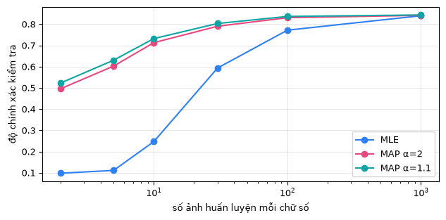
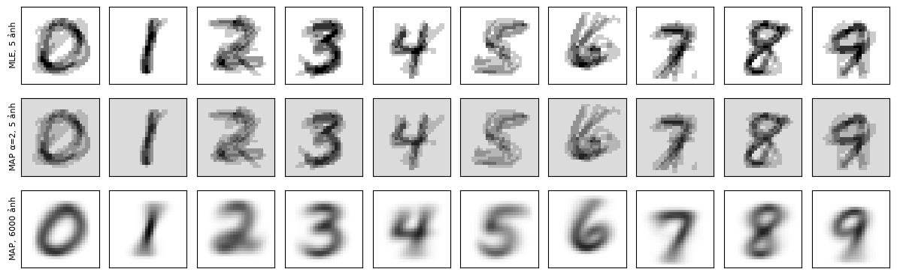

# Chương 4 · Ví dụ áp dụng: khi MLE gặp ít dữ liệu

> Ghi chú của người biên soạn: trang này do người biên soạn viết thêm, không có trong sách gốc. Trang dùng MLE và MAP ([chương 4](math/ch04_vi)) để ước lượng hàng nghìn tham số Bernoulli từ ảnh chữ số viết tay MNIST, rồi dùng chúng để phân loại. Thí nghiệm cho thấy cụ thể điều mà sách nói ở cuối chương: "MAP có thể được coi như một phương pháp giúp tránh thiên lệch khi có ít dữ liệu huấn luyện".

## Bài toán

Mỗi ảnh MNIST có $28 \times 28 = 784$ điểm ảnh. Ta làm tròn mỗi điểm ảnh thành 0 (tối) hoặc 1 (sáng). Với mỗi chữ số $c$ và mỗi điểm ảnh $j$, gọi $\lambda_{cj}$ là xác suất điểm ảnh $j$ sáng trong một ảnh chữ số $c$. Có $10 \times 784 = 7840$ tham số Bernoulli cần ước lượng.

Nếu coi các điểm ảnh độc lập với nhau khi biết chữ số (giả thiết "ngây thơ" của bộ phân loại naive Bayes, [chương 11](ml/ch11_vi)), xác suất của một ảnh $\mathbf{x}$ là

$$
p(\mathbf{x} \mid c) = \prod_{j=1}^{784} \lambda_{cj}^{x_j}(1 - \lambda_{cj})^{1 - x_j},
$$

và ta dự đoán chữ số $c$ làm $p(c)\,p(\mathbf{x} \mid c)$ lớn nhất (quy tắc Bayes, [mục 3.1.5](math/ch03_vi)).

## 1. Dữ liệu

<!-- run -->
```python
import numpy as np
import matplotlib.pyplot as plt
from sklearn.datasets import fetch_openml

X, y = fetch_openml("mnist_784", version=1, return_X_y=True, as_frame=False)
X = (X > 127).astype(np.uint8)                     # làm tròn thành 0/1
y = y.astype(int)
X_tr, y_tr, X_te, y_te = X[:60000], y[:60000], X[60000:], y[60000:]
print("huấn luyện:", X_tr.shape, " kiểm tra:", X_te.shape)
print("tỉ lệ điểm ảnh sáng:", X_tr.mean().round(3))
```

<!-- output -->
```output
huấn luyện: (60000, 784)  kiểm tra: (10000, 784)
tỉ lệ điểm ảnh sáng: 0.132
```
<!-- /output -->

## 2. MLE và MAP cho từng điểm ảnh

<small class="viz-ref">Công thức (4.10), (4.40)</small>

Với $N_c$ ảnh của chữ số $c$, trong đó điểm ảnh $j$ sáng $n_{cj}$ lần:

- **MLE** (công thức (4.10)): $\lambda_{cj} = n_{cj} / N_c$.
- **MAP** với tiên nghiệm $\text{Beta}(\alpha, \alpha)$ (công thức (4.40)): $\lambda_{cj} = \dfrac{n_{cj} + \alpha - 1}{N_c + 2\alpha - 2}$.

Phân loại dùng log để tránh tích của 784 số nhỏ bằng 0 ([trang Thư viện chương 3](math/ch03_lib_vi)). Cần cẩn thận: nếu $\lambda_{cj} = 0$ mà $x_j = 1$, log-likelihood bằng $-\infty$.

<!-- run -->
```python
def fit(X, y, alpha=1.0):
    """alpha = 1: MLE. alpha > 1: MAP với tiên nghiệm Beta(alpha, alpha)."""
    lam = np.zeros((10, X.shape[1])); prior = np.zeros(10)
    for c in range(10):
        Xc = X[y == c]
        lam[c] = (Xc.sum(0) + alpha - 1) / (len(Xc) + 2 * alpha - 2)
        prior[c] = len(Xc) / len(X)
    return lam, prior

def log_scores(X, lam, prior):
    with np.errstate(divide="ignore"):
        L1, L0 = np.log(lam), np.log(1 - lam)          # có thể là -inf khi lam = 0 hoặc 1
    S = np.log(prior)[None, :].repeat(len(X), 0)
    for c in range(10):
        # chỉ cộng log lam ở những điểm sáng, log(1 - lam) ở những điểm tối (tránh 0 x -inf = nan)
        S[:, c] += np.where(X == 1, L1[c], L0[c]).sum(1)
    return S

def evaluate(lam, prior, X, y):
    S = log_scores(X, lam, prior)
    all_inf = np.all(np.isneginf(S), axis=1)
    acc = np.mean(np.argmax(S, 1) == y)
    return acc, all_inf.mean()

for name, alpha in [("MLE", 1.0), ("MAP, alpha = 2", 2.0)]:
    lam, prior = fit(X_tr, y_tr, alpha)
    acc, frac = evaluate(lam, prior, X_te, y_te)
    print(f"{name:15s}: số tham số bằng đúng 0 hoặc 1: {np.sum((lam == 0) | (lam == 1)):5d}  | "
          f"độ chính xác {acc:.4f}  | ảnh có p(x|c) = 0 với MỌI c: {frac:.2%}")
```

<!-- output -->
```output
MLE            : số tham số bằng đúng 0 hoặc 1:  2517  | độ chính xác 0.8434  | ảnh có p(x|c) = 0 với MỌI c: 0.04%
MAP, alpha = 2 : số tham số bằng đúng 0 hoặc 1:     0  | độ chính xác 0.8427  | ảnh có p(x|c) = 0 với MỌI c: 0.00%
```
<!-- /output -->

Với toàn bộ 60 000 ảnh huấn luyện, MLE vẫn có hơn 2500 tham số bằng đúng 0 hoặc 1: những điểm ảnh ở rìa chưa từng sáng trong một chữ số nào đó. Một ảnh kiểm tra chỉ cần sáng ở một điểm như vậy là $p(\mathbf{x} \mid c) = 0$ với chữ số đó: mô hình khẳng định "không thể nào" chỉ vì chưa từng thấy. Tuy vậy, với nhiều dữ liệu như thế, hiếm có ảnh nào bị loại ở *mọi* chữ số (0.04%), nên độ chính xác của MLE và MAP gần như bằng nhau (khoảng 84%).

## 3. Khi chỉ có vài ảnh mỗi chữ số

Vấn đề trở nên nghiêm trọng khi dữ liệu ít. Lấy ngẫu nhiên $N_c$ ảnh cho mỗi chữ số và lặp lại thí nghiệm 5 lần:

<!-- run -->
```python
rng = np.random.default_rng(0)
by_class = [np.flatnonzero(y_tr == c) for c in range(10)]
sizes = [2, 5, 10, 30, 100, 1000]
res = {k: [] for k in ["MLE", "MAP α=2", "MAP α=1.1"]}
inf_frac = []
for n in sizes:
    r = {k: [] for k in res}; fr = []
    for rep in range(5):
        idx = np.concatenate([rng.choice(ix, n, replace=False) for ix in by_class])
        for k, a in [("MLE", 1.0), ("MAP α=2", 2.0), ("MAP α=1.1", 1.1)]:
            lam, prior = fit(X_tr[idx], y_tr[idx], a)
            acc, frac = evaluate(lam, prior, X_te, y_te)
            r[k].append(acc)
            if k == "MLE": fr.append(frac)
    for k in res: res[k].append(np.mean(r[k]))
    inf_frac.append(np.mean(fr))
    print(f"N_c = {n:5d}: MLE {res['MLE'][-1]:.3f} (ảnh bị loại ở mọi lớp: {inf_frac[-1]:6.1%}) | MAP α=1.1 {res['MAP α=1.1'][-1]:.3f} | MAP α=2 {res['MAP α=2'][-1]:.3f}")

fig, ax = plt.subplots(figsize=(6.4, 3.2))
for k, c in zip(res, ["#2f80f5", "#e8487f", "#0ea5a4"]):
    ax.semilogx(sizes, res[k], "o-", color=c, label=k)
ax.set_xlabel("số ảnh huấn luyện mỗi chữ số"); ax.set_ylabel("độ chính xác kiểm tra"); ax.grid(alpha=.3); ax.legend()
fig.tight_layout()
```

<!-- output -->
```output
N_c =     2: MLE 0.098 (ảnh bị loại ở mọi lớp: 100.0%) | MAP α=1.1 0.523 | MAP α=2 0.496
N_c =     5: MLE 0.111 (ảnh bị loại ở mọi lớp:  98.4%) | MAP α=1.1 0.631 | MAP α=2 0.603
N_c =    10: MLE 0.247 (ảnh bị loại ở mọi lớp:  75.4%) | MAP α=1.1 0.732 | MAP α=2 0.713
N_c =    30: MLE 0.594 (ảnh bị loại ở mọi lớp:  24.8%) | MAP α=1.1 0.803 | MAP α=2 0.790
N_c =   100: MLE 0.772 (ảnh bị loại ở mọi lớp:   5.0%) | MAP α=1.1 0.837 | MAP α=2 0.831
N_c =  1000: MLE 0.840 (ảnh bị loại ở mọi lớp:   0.3%) | MAP α=1.1 0.844 | MAP α=2 0.842
```

<div align=center></div>
<!-- /output -->

Với vài ảnh mỗi chữ số, MLE gần như vô dụng: phần lớn ảnh kiểm tra có xác suất bằng 0 với mọi chữ số, và `argmax` của một dãy toàn $-\infty$ chỉ trả về chữ số đầu tiên. MAP với tiên nghiệm Beta không bao giờ cho xác suất bằng đúng 0 hay 1, nên vẫn phân loại được. Khi dữ liệu nhiều lên, khoảng cách giữa hai phương pháp thu hẹp dần, đúng như ở [trang Code](math/ch04_code_vi): MAP tiến về MLE.

## 4. Nhìn vào các tham số

<!-- run -->
```python
idx = np.concatenate([rng.choice(ix, 5, replace=False) for ix in by_class])
lam_mle, _ = fit(X_tr[idx], y_tr[idx], 1.0)
lam_map, _ = fit(X_tr[idx], y_tr[idx], 2.0)
lam_all, _ = fit(X_tr, y_tr, 2.0)
fig, axes = plt.subplots(3, 10, figsize=(12, 3.9))
for c in range(10):
    for r, (L, name) in enumerate([(lam_mle, "MLE, 5 ảnh"), (lam_map, "MAP α=2, 5 ảnh"), (lam_all, "MAP, 6000 ảnh")]):
        axes[r, c].imshow(L[c].reshape(28, 28), cmap="gray_r", vmin=0, vmax=1)
        axes[r, c].set_xticks([]); axes[r, c].set_yticks([])
        if c == 0: axes[r, c].set_ylabel(name, fontsize=8)
fig.tight_layout()
print("MLE (5 ảnh): giá trị có thể có của lambda:", np.unique(lam_mle))
print("MAP (5 ảnh): giá trị có thể có của lambda:", np.unique(lam_map).round(3))
```

<!-- output -->
```output
MLE (5 ảnh): giá trị có thể có của lambda: [0.  0.2 0.4 0.6 0.8 1. ]
MAP (5 ảnh): giá trị có thể có của lambda: [0.143 0.286 0.429 0.571 0.714 0.857]
```

<div align=center></div>
<!-- /output -->

Với 5 ảnh, MLE chỉ có 6 giá trị $0, 0.2, \dots, 1$; mọi điểm ảnh nằm ngoài 5 nét chữ đã thấy đều bị gán xác suất sáng bằng đúng 0. MAP kéo mọi giá trị về phía 0.5 một chút: $0$ thành $1/7$, $1$ thành $6/7$. Hàng cuối là các tham số học từ toàn bộ dữ liệu: những "khuôn mẫu" mờ của từng chữ số.

## 5. Chọn siêu tham số

Tiên nghiệm $\text{Beta}(2, 2)$ khá "mạnh": nó kéo mọi điểm ảnh, kể cả những điểm ở rìa gần như không bao giờ sáng, lên ít nhất $1/(N_c + 2)$. Siêu tham số $\alpha$ có thể chọn bằng tập xác thực, như mọi siêu tham số khác ([chương 8](ml/ch08_vi)):

<!-- run -->
```python
idx = np.concatenate([rng.choice(ix, 30, replace=False) for ix in by_class])
val = rng.choice(60000, 5000, replace=False)
for a in [1.001, 1.01, 1.1, 1.5, 2, 5, 20]:
    lam, prior = fit(X_tr[idx], y_tr[idx], a)
    acc_val, _ = evaluate(lam, prior, X_tr[val], y_tr[val])
    print(f"alpha = {a:6}: độ chính xác trên tập xác thực {acc_val:.4f}")
```

<!-- output -->
```output
alpha =  1.001: độ chính xác trên tập xác thực 0.8134
alpha =   1.01: độ chính xác trên tập xác thực 0.8168
alpha =    1.1: độ chính xác trên tập xác thực 0.8120
alpha =    1.5: độ chính xác trên tập xác thực 0.8054
alpha =      2: độ chính xác trên tập xác thực 0.7966
alpha =      5: độ chính xác trên tập xác thực 0.7594
alpha =     20: độ chính xác trên tập xác thực 0.6826
```
<!-- /output -->

Tiên nghiệm yếu ($\alpha$ chỉ lớn hơn 1 một chút) cho kết quả tốt nhất ở đây; $\alpha$ càng lớn, các tham số càng bị kéo về 0.5 và độ chính xác càng giảm. Điều quan trọng nhất là có một tiên nghiệm để không tham số nào bằng đúng 0 hay 1; độ mạnh của tiên nghiệm là chuyện tinh chỉnh.

## Rút ra được gì

- MLE trả về đúng tần suất quan sát được. Với ít dữ liệu, nhiều tần suất bằng đúng 0, và mô hình tuyên bố những điều chưa thấy là "không thể xảy ra".
- MAP với tiên nghiệm Beta tương đương với việc cộng thêm $\alpha - 1$ lần "quan sát giả" cho mỗi kết quả. Trong naive Bayes, kỹ thuật này có tên là **làm trơn Laplace** (Laplace smoothing).
- Với nhiều dữ liệu, MAP và MLE gần như trùng nhau; tiên nghiệm chỉ quan trọng khi dữ liệu ít.
