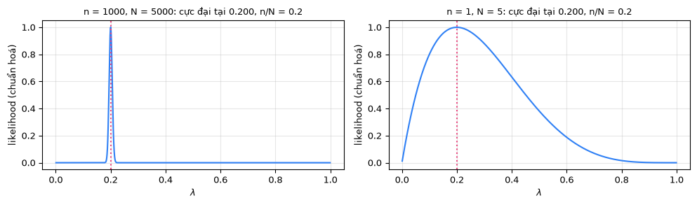
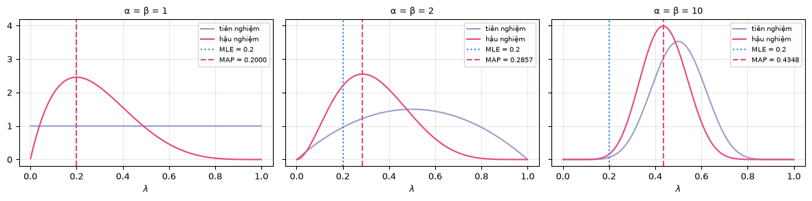

# Chương 4 · Code từ đầu

> Ghi chú của người biên soạn: trang này do người biên soạn viết thêm, không có trong sách gốc. Trang chạy lại bốn ví dụ MLE và ví dụ MAP của [chương 4](math/ch04_vi): đồng xu, xúc xắc, phân phối chuẩn một chiều và nhiều chiều (phần sách để lại làm bài tập), và tiên nghiệm Beta. Mỗi lời giải dạng đóng được so với lời giải tìm bằng số.

## Cách dùng trang này

Các khối chạy lần lượt từ trên xuống và dùng chung biến. Cần `numpy` và `matplotlib`.

## 1. Ví dụ 1: đồng xu

<small class="viz-ref">Mục 4.2.3 · công thức (4.9), (4.10)</small>

Tung đồng xu $N = 5000$ lần, được $n = 1000$ lần ngửa. Log-likelihood là $n\log\lambda + (N - n)\log(1 - \lambda)$; sách chứng minh nó đạt cực đại tại $\lambda = n/N$. Ta kiểm tra bằng cách vẽ hàm này.

<!-- run -->
```python
import numpy as np
import matplotlib.pyplot as plt

def loglik_coin(lam, n, N):
    return n * np.log(lam) + (N - n) * np.log(1 - lam)

lam = np.linspace(0.001, 0.999, 9981)
fig, axes = plt.subplots(1, 2, figsize=(10, 3))
for ax, (n, N) in zip(axes, [(1000, 5000), (1, 5)]):
    ll = loglik_coin(lam, n, N)
    best = lam[np.argmax(ll)]
    ax.plot(lam, np.exp(ll - ll.max()), color="#2f80f5")
    ax.axvline(n / N, color="#e8487f", ls=":")
    ax.set_title(f"n = {n}, N = {N}: cực đại tại {best:.3f}, n/N = {n / N}", fontsize=9)
    ax.set_xlabel(r"$\lambda$"); ax.set_ylabel("likelihood (chuẩn hoá)"); ax.grid(alpha=.3)
fig.tight_layout()
```

<!-- output -->
<div align=center></div>
<!-- /output -->

Cùng một ước lượng $\lambda = 0.2$, nhưng hai đường cong rất khác nhau. Với 5000 lần tung, likelihood là một đỉnh hẹp: chỉ những $\lambda$ rất gần 0.2 mới giải thích được dữ liệu. Với 5 lần tung, đường cong trải rộng: $\lambda = 0.5$ cũng hoàn toàn có thể. MLE chỉ trả về vị trí đỉnh và bỏ qua thông tin về độ "chắc chắn" này. Đó chính là động cơ của MAP ở mục 4.3.

## 2. Ví dụ 2: xúc xắc và ràng buộc tổng bằng 1

<small class="viz-ref">Mục 4.2.3 · công thức (4.14)–(4.19)</small>

Sách giải bài toán có ràng buộc $\sum_j \lambda_j = 1$ bằng nhân tử Lagrange. Một cách khác hay dùng trong học máy: viết $\boldsymbol{\lambda} = \text{softmax}(\mathbf{z})$ (luôn thoả ràng buộc), rồi tối ưu không ràng buộc theo $\mathbf{z}$ bằng gradient ascent. Gradient của log-likelihood theo $\mathbf{z}$ là $\mathbf{n} - N\boldsymbol{\lambda}$ (giống hồi quy softmax, [chương 15](ml/ch15_vi)).

<!-- run -->
```python
rng = np.random.default_rng(0)
true = np.array([0.1, 0.1, 0.15, 0.15, 0.2, 0.3])          # một con xúc xắc không cân đối
rolls = rng.choice(6, size=600, p=true)
counts = np.bincount(rolls, minlength=6); N = counts.sum()
print("số lần mỗi mặt:", counts)

softmax = lambda z: np.exp(z - z.max()) / np.exp(z - z.max()).sum()
z = np.zeros(6)
for it in range(2000):
    z += 0.01 * (counts - N * softmax(z))                    # gradient ascent theo z
print("gradient ascent:   ", softmax(z).round(4))
print("lời giải sách n/N: ", (counts / N).round(4))
print("tham số thật:      ", true)
```

<!-- output -->
```output
số lần mỗi mặt: [ 54  61  69  90 128 198]
gradient ascent:    [0.09   0.1017 0.115  0.15   0.2133 0.33  ]
lời giải sách n/N:  [0.09   0.1017 0.115  0.15   0.2133 0.33  ]
tham số thật:       [0.1  0.1  0.15 0.15 0.2  0.3 ]
```
<!-- /output -->

## 3. Ví dụ 3: phân phối chuẩn và độ chệch của phương sai

<small class="viz-ref">Mục 4.2.3 · công thức (4.20)–(4.26)</small>

MLE cho $\mu = \frac{1}{N}\sum x_i$ và $\sigma^2 = \frac{1}{N}\sum (x_i - \mu)^2$. Ước lượng phương sai này **chệch**: trung bình qua nhiều lần lặp lại thí nghiệm, nó nhỏ hơn giá trị thật, đúng bằng hệ số $\frac{N - 1}{N}$. Nguyên nhân là $\mu$ được ước lượng từ chính các điểm dữ liệu đó, nên các điểm luôn "gần" $\mu$ hơn so với gần kỳ vọng thật.

<!-- run -->
```python
mu_true, sigma_true = 10.0, 2.0
for N in [2, 5, 20, 100]:
    est = []
    for _ in range(100_000 // N * 2):
        x = rng.normal(mu_true, sigma_true, N)
        m = x.mean()
        est.append([m, np.mean((x - m) ** 2)])
    est = np.array(est)
    print(f"N = {N:3d}: E[mu_MLE] = {est[:, 0].mean():.3f}   E[sigma2_MLE] = {est[:, 1].mean():.3f}   "
          f"(N-1)/N x sigma^2 = {(N - 1) / N * sigma_true ** 2:.3f}")
```

<!-- output -->
```output
N =   2: E[mu_MLE] = 10.000   E[sigma2_MLE] = 2.016   (N-1)/N x sigma^2 = 2.000
N =   5: E[mu_MLE] = 10.001   E[sigma2_MLE] = 3.211   (N-1)/N x sigma^2 = 3.200
N =  20: E[mu_MLE] = 10.009   E[sigma2_MLE] = 3.806   (N-1)/N x sigma^2 = 3.800
N = 100: E[mu_MLE] = 9.999   E[sigma2_MLE] = 3.948   (N-1)/N x sigma^2 = 3.960
```
<!-- /output -->

Kỳ vọng $\mu$ không chệch, còn phương sai thì chệch, rõ nhất khi $N$ nhỏ. Chia cho $N - 1$ thay vì $N$ sẽ khử được độ chệch này. Đây là lý do `np.cov` mặc định chia cho $N - 1$ (xem [trang Code chương 3](math/ch03_code_vi)).

## 4. Ví dụ 4: phân phối chuẩn nhiều chiều

<small class="viz-ref">Mục 4.2.3 · Ví dụ 4</small>

Sách để lại việc chứng minh $\boldsymbol{\mu} = \frac{1}{N}\sum \mathbf{x}_i$ và $\mathbf{\Sigma} = \frac{1}{N}\sum (\mathbf{x}_i - \boldsymbol{\mu})(\mathbf{x}_i - \boldsymbol{\mu})^T$ cho bạn đọc. Ở đây ta kiểm tra bằng số: tại nghiệm này, gradient của log-likelihood theo $\boldsymbol{\mu}$ và theo $\mathbf{\Sigma}$ bằng 0, và mọi nhiễu loạn nhỏ đều làm log-likelihood giảm.

<!-- run -->
```python
def mvn_loglik(X, mu, Sigma):
    N, D = X.shape
    _, logdet = np.linalg.slogdet(Sigma)
    Xc = X - mu
    return -0.5 * (N * D * np.log(2 * np.pi) + N * logdet + np.sum(Xc * np.linalg.solve(Sigma, Xc.T).T))

X = rng.multivariate_normal([1, -1, 2], [[2, 0.8, 0.3], [0.8, 1, -0.2], [0.3, -0.2, 0.5]], size=500)
N, D = X.shape
mu_hat = X.mean(0)
S_hat = (X - mu_hat).T @ (X - mu_hat) / N

# Gradient bằng đạo hàm số hai phía (mục 2.6): theo mu, và theo các phần tử của Sigma (giữ đối xứng)
eps = 1e-6
g_mu = [(mvn_loglik(X, mu_hat + eps * e, S_hat) - mvn_loglik(X, mu_hat - eps * e, S_hat)) / (2 * eps) for e in np.eye(D)]
g_S = []
for i in range(D):
    for j in range(i, D):
        E = np.zeros((D, D)); E[i, j] = E[j, i] = eps
        g_S.append((mvn_loglik(X, mu_hat, S_hat + E) - mvn_loglik(X, mu_hat, S_hat - E)) / (2 * eps))
print("|gradient theo mu|    lớn nhất:", f"{np.max(np.abs(g_mu)):.1e}")
print("|gradient theo Sigma| lớn nhất:", f"{np.max(np.abs(g_S)):.1e}")

best = mvn_loglik(X, mu_hat, S_hat)
worse = 0
for _ in range(1000):
    A = rng.standard_normal((D, D)) * 0.02
    worse += mvn_loglik(X, mu_hat + rng.standard_normal(D) * 0.02, S_hat + A @ A.T + (A + A.T) / 2) < best
print(f"1000 nhiễu loạn ngẫu nhiên: {worse} lần làm log-likelihood giảm")
print("so với chia cho N - 1: log-likelihood giảm", f"{best - mvn_loglik(X, mu_hat, np.cov(X.T)):.4f}")
```

<!-- output -->
```output
|gradient theo mu|    lớn nhất: 0.0e+00
|gradient theo Sigma| lớn nhất: 1.1e-07
1000 nhiễu loạn ngẫu nhiên: 1000 lần làm log-likelihood giảm
so với chia cho N - 1: log-likelihood giảm 0.0015
```
<!-- /output -->

## 5. MAP với tiên nghiệm Beta

<small class="viz-ref">Mục 4.3 · công thức (4.36)–(4.40) · Hình 4.1</small>

Ví dụ của sách: tung 5 lần, được 1 lần ngửa. Với tiên nghiệm $\text{Beta}(\alpha, \beta)$, hậu nghiệm là $\text{Beta}(n + \alpha, m + \beta)$ và MAP là đỉnh của nó, $\lambda = \frac{n + \alpha - 1}{N + \alpha + \beta - 2}$.

<!-- run -->
```python
from math import lgamma

def beta_pdf(x, a, b):
    return np.exp(lgamma(a + b) - lgamma(a) - lgamma(b) + (a - 1) * np.log(x) + (b - 1) * np.log(1 - x))

n, N = 1, 5
m = N - n
fig, axes = plt.subplots(1, 3, figsize=(12, 3), sharey=True)
for ax, (a, b) in zip(axes, [(1, 1), (2, 2), (10, 10)]):
    post = beta_pdf(lam, n + a, m + b)
    map_grid = lam[np.argmax(post)]
    map_formula = (n + a - 1) / (N + a + b - 2)
    ax.plot(lam, beta_pdf(lam, a, b), color="#9aa0c8", label="tiên nghiệm")
    ax.plot(lam, post, color="#e8487f", label="hậu nghiệm")
    ax.axvline(n / N, color="#2f80f5", ls=":", label=f"MLE = {n / N}")
    ax.axvline(map_formula, color="#e8487f", ls="--", label=f"MAP = {map_formula:.4f}")
    ax.set_title(f"α = β = {a}", fontsize=9); ax.set_xlabel(r"$\lambda$"); ax.legend(fontsize=7); ax.grid(alpha=.3)
    print(f"alpha = beta = {a:2d}: MAP trên lưới {map_grid:.4f}, theo (4.40) {map_formula:.4f}")
fig.tight_layout()
```

<!-- output -->
```output
alpha = beta =  1: MAP trên lưới 0.2000, theo (4.40) 0.2000
alpha = beta =  2: MAP trên lưới 0.2857, theo (4.40) 0.2857
alpha = beta = 10: MAP trên lưới 0.4348, theo (4.40) 0.4348
```

<div align=center></div>
<!-- /output -->

Ba kết quả khớp với sách: $1/5$ khi $\alpha = \beta = 1$ (trùng MLE), $2/7 \approx 0.2857$ khi $\alpha = \beta = 2$, và $10/23 \approx 0.4348$ khi $\alpha = \beta = 10$.

Khi có nhiều dữ liệu, ảnh hưởng của tiên nghiệm giảm dần và MAP tiến về MLE:

<!-- run -->
```python
a = b = 10
for N in [5, 50, 500, 5000]:
    n = N // 5                                               # giữ tỉ lệ ngửa 1/5
    print(f"N = {N:5d}: MLE = {n / N:.4f}, MAP (alpha = beta = 10) = {(n + a - 1) / (N + a + b - 2):.4f}")
```

<!-- output -->
```output
N =     5: MLE = 0.2000, MAP (alpha = beta = 10) = 0.4348
N =    50: MLE = 0.2000, MAP (alpha = beta = 10) = 0.2794
N =   500: MLE = 0.2000, MAP (alpha = beta = 10) = 0.2104
N =  5000: MLE = 0.2000, MAP (alpha = beta = 10) = 0.2011
```
<!-- /output -->

## Tóm tắt

| Ví dụ | Lời giải của sách | Cách kiểm tra trên trang này |
| --- | --- | --- |
| Đồng xu (MLE) | $n/N$ | vẽ log-likelihood, tìm đỉnh |
| Xúc xắc (MLE có ràng buộc) | $n_j / N$ | tham số hoá bằng softmax + gradient ascent |
| Chuẩn một chiều | trung bình, phương sai chia $N$ | mô phỏng: phương sai MLE chệch |
| Chuẩn nhiều chiều | trung bình, ma trận hiệp phương sai chia $N$ | gradient bằng số bằng 0 |
| Đồng xu (MAP, tiên nghiệm Beta) | $\frac{n + \alpha - 1}{N + \alpha + \beta - 2}$ | đỉnh của hậu nghiệm trên lưới |
