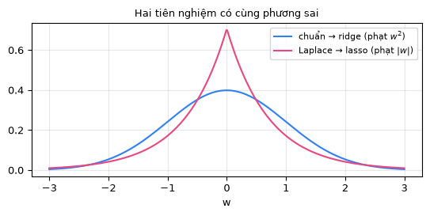
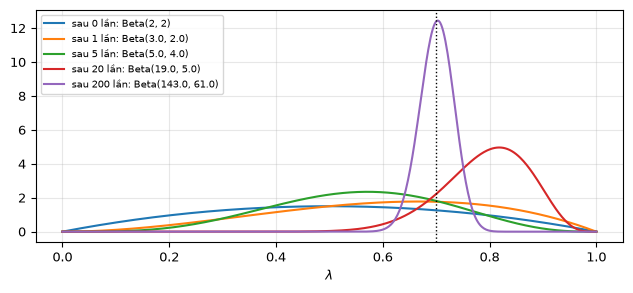

# Chương 4 · Dùng thư viện

> Ghi chú của người biên soạn: trang này do người biên soạn viết thêm, không có trong sách gốc. Trang cho thấy MLE và MAP của [chương 4](math/ch04_vi) xuất hiện trong thư viện dưới những cái tên nào: hàm `fit` của `scipy.stats`, tối ưu số khi không có lời giải dạng đóng, và các mô hình hồi quy có hàm phạt của scikit-learn.

## Cách dùng trang này

Các khối chạy lần lượt từ trên xuống và dùng chung biến. Cần `numpy`, `scipy`, `scikit-learn`, `matplotlib`.

| Ý tưởng trong sách | Trong thư viện |
| --- | --- |
| MLE cho một phân phối | `scipy.stats.<phân phối>.fit(data)` |
| MLE không có lời giải dạng đóng | `scipy.optimize.minimize` trên log-likelihood âm |
| MAP với tiên nghiệm chuẩn cho trọng số | hồi quy ridge, `alpha` hoặc `C` trong các mô hình tuyến tính |
| MAP với tiên nghiệm Laplace | hồi quy lasso |
| Cập nhật tiên nghiệm liên hợp | `scipy.stats.beta`, `scipy.stats.dirichlet` |

## 1. `fit` là MLE

<small class="viz-ref">Mục 4.2</small>

<!-- run -->
```python
import numpy as np
import matplotlib.pyplot as plt
from scipy import stats, optimize

rng = np.random.default_rng(0)
x = rng.normal(5.0, 2.0, size=30)
loc, scale = stats.norm.fit(x)
print(f"norm.fit:       mu = {loc:.4f}, sigma = {scale:.4f}")
print(f"công thức sách: mu = {x.mean():.4f}, sigma = {np.sqrt(np.mean((x - x.mean()) ** 2)):.4f}  (chia N)")
print(f"np.std(ddof=1):                 sigma = {x.std(ddof=1):.4f}  (chia N - 1, không phải MLE)")
```

<!-- output -->
```output
norm.fit:       mu = 4.7570, sigma = 1.6184
công thức sách: mu = 4.7570, sigma = 1.6184  (chia N)
np.std(ddof=1):                 sigma = 1.6460  (chia N - 1, không phải MLE)
```
<!-- /output -->

## 2. Khi không có lời giải dạng đóng

Với phân phối chuẩn, Bernoulli hay categorical, phương trình đạo hàm bằng 0 giải được bằng tay. Nhiều phân phối khác không như vậy. Ví dụ, phân phối Gamma (hay dùng cho thời gian chờ, lượng mưa, số tiền yêu cầu bảo hiểm) có mật độ

$$
p(x \mid k, \theta) = \frac{x^{k-1} e^{-x/\theta}}{\Gamma(k)\theta^k}, \quad x > 0.
$$

Đạo hàm theo $k$ chứa hàm digamma, nên không giải ra $k$ được. Ta cực tiểu log-likelihood âm bằng một thuật toán tối ưu số.

<!-- run -->
```python
true_k, true_theta = 2.5, 1.8
y = stats.gamma(true_k, scale=true_theta).rvs(2000, random_state=1)

def nll(params):
    log_k, log_theta = params                     # tối ưu theo log để k, theta luôn dương
    return -stats.gamma(np.exp(log_k), scale=np.exp(log_theta)).logpdf(y).sum()

res = optimize.minimize(nll, x0=[0.0, 0.0], method="Nelder-Mead", options={"xatol": 1e-8, "fatol": 1e-8})
k_hat, theta_hat = np.exp(res.x)
k_fit, _, theta_fit = stats.gamma.fit(y, floc=0)
print(f"tự cực tiểu NLL: k = {k_hat:.4f}, theta = {theta_hat:.4f}  ({res.nfev} lần tính hàm)")
print(f"gamma.fit:       k = {k_fit:.4f}, theta = {theta_fit:.4f}")
print(f"tham số thật:    k = {true_k}, theta = {true_theta}")
```

<!-- output -->
```output
tự cực tiểu NLL: k = 2.4324, theta = 1.8418  (188 lần tính hàm)
gamma.fit:       k = 2.4324, theta = 1.8418
tham số thật:    k = 2.5, theta = 1.8
```
<!-- /output -->

## 3. MAP với tiên nghiệm chuẩn là hồi quy ridge

<small class="viz-ref">Mục 4.3 · liên hệ chương 7, 8</small>

Hồi quy tuyến tính với nhiễu chuẩn: $y_i = \mathbf{x}_i^T\mathbf{w} + \epsilon_i$, $\epsilon_i \sim \mathcal{N}(0, \sigma^2)$. Log-likelihood là $-\frac{1}{2\sigma^2}\|\mathbf{y} - \mathbf{X}\mathbf{w}\|_2^2 + \text{const}$, nên MLE chính là bình phương tối thiểu ([chương 7](ml/ch07_vi)).

Thêm tiên nghiệm $\mathbf{w} \sim \mathcal{N}(\mathbf{0}, \tau^2\mathbf{I})$: log hậu nghiệm là

$$
-\frac{1}{2\sigma^2}\|\mathbf{y} - \mathbf{X}\mathbf{w}\|_2^2 - \frac{1}{2\tau^2}\|\mathbf{w}\|_2^2 + \text{const},
$$

nên MAP chính là hồi quy ridge với $\lambda = \sigma^2/\tau^2$ ([chương 8](ml/ch08_vi)). Tiên nghiệm càng "chắc" ($\tau$ nhỏ), hàm phạt càng nặng.

<!-- run -->
```python
from sklearn.linear_model import Ridge, Lasso, LinearRegression

N, d = 40, 8
X = rng.standard_normal((N, d))
w_true = np.array([3, -2, 0, 0, 1.5, 0, 0, 0.5])
sigma, tau = 1.0, 0.5
y = X @ w_true + sigma * rng.standard_normal(N)

lam = sigma ** 2 / tau ** 2
w_map = np.linalg.solve(X.T @ X + lam * np.eye(d), X.T @ y)          # đặt gradient của log hậu nghiệm bằng 0
w_ridge = Ridge(alpha=lam, fit_intercept=False).fit(X, y).coef_
w_mle = LinearRegression(fit_intercept=False).fit(X, y).coef_
print("MAP tự giải  :", w_map.round(3))
print("Ridge(alpha) :", w_ridge.round(3))
print("MLE (OLS)    :", w_mle.round(3))
print("w thật       :", w_true)
```

<!-- output -->
```output
MAP tự giải  : [ 2.745 -1.759  0.061 -0.031  1.561  0.275  0.147  0.305]
Ridge(alpha) : [ 2.745 -1.759  0.061 -0.031  1.561  0.275  0.147  0.305]
MLE (OLS)    : [ 3.028 -1.92   0.088 -0.023  1.667  0.326  0.132  0.407]
w thật       : [ 3.  -2.   0.   0.   1.5  0.   0.   0.5]
```
<!-- /output -->

Tiên nghiệm Laplace $p(w_j) \propto e^{-|w_j|/b}$ cho hàm phạt $\|\mathbf{w}\|_1$, tức hồi quy **lasso**. Đỉnh nhọn tại 0 của phân phối Laplace làm nhiều hệ số bằng đúng 0:

<!-- run -->
```python
w_lasso = Lasso(alpha=0.3, fit_intercept=False).fit(X, y).coef_
print("Lasso:", w_lasso.round(3))
print("số hệ số bằng 0: ridge", int(np.sum(np.abs(w_ridge) < 1e-8)), "; lasso", int(np.sum(np.abs(w_lasso) < 1e-8)), "; thật", int(np.sum(w_true == 0)))

t = np.linspace(-3, 3, 400)
fig, ax = plt.subplots(figsize=(5.5, 2.8))
ax.plot(t, stats.norm(0, 1).pdf(t), color="#2f80f5", label="chuẩn → ridge (phạt $w^2$)")
ax.plot(t, stats.laplace(0, 1 / np.sqrt(2)).pdf(t), color="#e8487f", label="Laplace → lasso (phạt $|w|$)")
ax.set_xlabel("w"); ax.set_title("Hai tiên nghiệm có cùng phương sai", fontsize=9); ax.legend(fontsize=8); ax.grid(alpha=.3)
fig.tight_layout()
```

<!-- output -->
```output
Lasso: [ 2.708 -1.705  0.    -0.     1.401  0.     0.     0.   ]
số hệ số bằng 0: ridge 0 ; lasso 5 ; thật 4
```

<div align=center></div>
<!-- /output -->

Lasso đưa đúng 4 hệ số thật bằng 0 về 0, nhưng cũng đưa luôn hệ số nhỏ 0.5 về 0. Đó là cái giá của một tiên nghiệm quá "tin" rằng các hệ số bằng 0; giảm `alpha` sẽ giữ lại hệ số này. Ridge thì chỉ kéo mọi hệ số về gần 0 mà không bao giờ bằng 0 hẳn.

## 4. Cập nhật tiên nghiệm liên hợp theo từng quan sát

<small class="viz-ref">Mục 4.3.2</small>

Vì Beta liên hợp với Bernoulli, hậu nghiệm sau mỗi lần tung vẫn là một phân phối Beta. Hậu nghiệm của lần này là tiên nghiệm của lần sau: ta chỉ cần cộng 1 vào $\alpha$ (nếu ngửa) hoặc $\beta$ (nếu sấp).

<!-- run -->
```python
flips = stats.bernoulli(0.7).rvs(200, random_state=3)
a, b = 2, 2
grid = np.linspace(0, 1, 500)
fig, ax = plt.subplots(figsize=(6.4, 3))
shown = {0, 1, 5, 20, 200}
for t_, f in enumerate(np.concatenate([[np.nan], flips])):
    if t_ > 0:
        a, b = a + f, b + 1 - f
    if t_ in shown:
        post = stats.beta(a, b)
        lo, hi = post.ppf([0.025, 0.975])
        ax.plot(grid, post.pdf(grid), label=f"sau {t_} lần: Beta({a}, {b})")
        print(f"sau {t_:3d} lần: MAP = {(a - 1) / (a + b - 2):.3f}, khoảng 95% của hậu nghiệm [{lo:.3f}, {hi:.3f}]")
ax.axvline(0.7, color="k", ls=":", lw=1); ax.set_xlabel(r"$\lambda$"); ax.legend(fontsize=7); ax.grid(alpha=.3)
fig.tight_layout()
```

<!-- output -->
```output
sau   0 lần: MAP = 0.500, khoảng 95% của hậu nghiệm [0.094, 0.906]
sau   1 lần: MAP = 0.667, khoảng 95% của hậu nghiệm [0.194, 0.932]
sau   5 lần: MAP = 0.571, khoảng 95% của hậu nghiệm [0.245, 0.843]
sau  20 lần: MAP = 0.818, khoảng 95% của hậu nghiệm [0.612, 0.925]
sau 200 lần: MAP = 0.703, khoảng 95% của hậu nghiệm [0.637, 0.762]
```

<div align=center></div>
<!-- /output -->

Hậu nghiệm cho thêm một thứ mà MLE không có: **khoảng tin cậy** của tham số. Sau 5 lần tung, khoảng này còn rất rộng. Sau 200 lần, nó đã hẹp quanh giá trị thật 0.7.

## Tóm tắt

- `fit` của `scipy.stats` là MLE. Chú ý: ước lượng độ lệch chuẩn của nó chia cho $N$.
- Khi không có lời giải dạng đóng, cực tiểu log-likelihood âm bằng `scipy.optimize.minimize`; đổi biến (như lấy log) để giữ tham số trong miền hợp lệ.
- Thành phần suy giảm trọng số trong các mô hình (ridge, `alpha`, `C`, `weight_decay`) là MAP với tiên nghiệm chuẩn. Lasso là MAP với tiên nghiệm Laplace.
