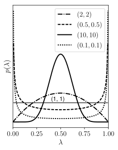

# Chương 4 Ước lượng tham số mô hình

> Ghi chú của người biên soạn: chương này lấy nguyên văn từ sách *Machine Learning cơ bản* của **Vũ Hữu Tiệp** ([mã nguồn LaTeX](https://github.com/tiepvupsu/ebookMLCB), giấy phép [CC BY-SA 4.0](https://creativecommons.org/licenses/by-sa/4.0/); trang gốc [machinelearningcoban.com](https://machinelearningcoban.com)). Người biên soạn chỉ đổi định dạng sang trang web: số chương, mục, công thức và hình giữ như bản PDF, hình vector được vẽ lại dưới dạng SVG.

## 4.1 Giới thiệu

Có rất nhiều mô hình machine learning được xây dựng dựa trên các mô hình thống kê. Các mô hình thống kê thường dựa trên các phân phối xác suất đã được đề cập trong Chương [3](math/ch03_vi) (*Ôn tập Xác suất*). Với một mô hình thông kê bất kỳ, ký hiệu $\theta$ là tập hợp tất cả các tham số của mô hình đó. Với phân phối Bernoulli, tham số là biến $\lambda$. Với phân phối chuẩn nhiều chiều, các tham số là vector kỳ vọng $\boldsymbol{\mu}$ và ma trận hiệp phương sai $\mathbf{\Sigma}$. “Learning” chính là quá trình ước lượng bộ tham số $\theta$ sao cho mô hình tìm được khớp với phân phối của dữ liệu nhất. Quá trình này còn được gọi là *ước lượng tham số* (parameter estimation).

Có hai cách ước lượng tham số thường được dùng trong các mô hình machine learning thống kê. Cách thứ nhất chỉ dựa trên dữ liệu đã biết trong tập huấn luyện, được gọi là *ước lượng hợp lý cực đại*(maximum likelihood estimation hay ML estimation hoặc *MLE*). Cách thứ hai không những dựa trên tập huấn luyện mà còn dựa trên những thông tin biết trước của các tham số. Những thông tin này có thể có được bằng cảm quan của người xây dựng mô hình. Cảm quan càng rõ ràng, càng hợp lý thì khả năng thu được bộ tham số tốt càng cao. Chẳng hạn, thông tin biết trước của $\lambda$ trong phân phối Bernoulli là việc nó là một số trong đoạn $[0, 1]$. Với bài toán tung đồng xu, với $\lambda$ là xác suất có được mặt xấp, ta dự đoán được rằng giá trị này là một số gần với $0.5$. Cách ước lượng tham số thứ hai này được gọi là *ước lượng hậu nghiệm cực đại* (maximum a posteriori estimation hay MAP estimation). Trong chương này, chúng ta cùng tìm hiểu ý tưởng và cách giải quyết bài toán ước lượng tham số mô hình theo MLE hoặc MAP.

## 4.2 Ước lượng hợp lý cực đại

### 4.2.1 Ý tưởng

Giả sử có các điểm dữ liệu $\mathbf{x}_1, \mathbf{x}_2, \dots, \mathbf{x}_N$ tuân theo một phân phối nào đó được mô tả bởi bộ tham số $\theta$. Ước lượng hợp lý cực đại là việc đi tìm bộ tham số $\theta$ để

$$
\theta = \operatorname*{argmax}_{\theta} p(\mathbf{x}_1, \dots, \mathbf{x}_N | \theta). \tag{4.1}
$$

Bài toán (4.1) có ý nghĩa như thế nào và vì sao việc này hợp lý?

Giả sử rằng ta đã biết rằng mô hình có dạng đặc biệt được mô tả bởi bộ tham số $\theta$. Xác suất có điều kiện $p(\mathbf{x}_1 | \theta)$ chính là xác suất xảy ra sự kiện $\mathbf{x}_1$ trong trường hợp mô hình được mô tả bởi bộ tham số $\theta$. Tương tự, $p(\mathbf{x}_1, \dots, \mathbf{x}_N | \theta)$ là xác suất để toàn bộ các sự kiện $\mathbf{x}_1, \mathbf{x}_2, \dots, \mathbf{x}_N$ đồng thời xảy ra, xác suất đồng thời này còn được gọi là *sự hợp lý* (likelihood).

Phân phối của dữ liệu và bản thân dữ liệu có thể lần lượt được coi là nguyên nhân và kết quả. Ta cần tìm nguyên nhân (bộ tham số $\theta$) để khả năng xảy ra kết quả (hàm hợp lý) là cao nhất.

### 4.2.2 Giả sử về sự độc lập và log-likelihood

Người ta thường ít khi giải trực tiếp bài toán (4.1) vì khó tìm được một mô hình xác suất đồng thời cho toàn bộ dữ liệu. Một cách tiếp cận phổ biến là đơn giản hoá mô hình bằng cách giả sử các điểm dữ liệu $\mathbf{x}_n$ độc lập với nhau khi biết bộ tham số $\theta$. Nói cách khác, hàm hợp lý trong (4.1) được xấp xỉ bởi1

$$
p(\mathbf{x}_1, \dots, \mathbf{x}_N | \theta) \approx \prod_{n = 1}^N p(\mathbf{x}_n |\theta). \tag{4.2}
$$

Lúc đó, bài toán (4.1) có thể được giải quyết bằng cách giải bài toán tối ưu

$$
\theta = \operatorname*{argmax}_{\theta} \prod_{n=1}^N p(\mathbf{x}_n| \theta) \tag{4.3}
$$

Mỗi giá trị $p(\mathbf{x}_n |\theta)$ là một số dương nhỏ hơn một. Khi $N$ lớn, tích của các số dương này rất gần với 0, máy tính có thể không lưu chính xác được do sai số tính toán. Để tránh hiện tượng này, việc tối đa hàm mục tiêu thường được chuyển về việc tối đa logarit2 của hàm mục tiêu:

$$
\theta = \operatorname*{argmax}_{\theta} \log\left(\prod_{n=1}^N p(\mathbf{x}_n| \theta)\right) = \operatorname*{argmax}_{\theta} \sum_{n = 1}^N \log\left(p(\mathbf{x}_n | \theta)
\right). \tag{4.4}
$$

### 4.2.3 Ví dụ

#### Ví dụ 1: Phân phối Bernoulli

**Bài toán**: Giả sử tung một đồng xu $N$ lần và nhận được $n$ mặt ngửa, hãy ước lượng xác suất nhận được mặt ngửa khi tung đồng xu đó.

***Lời giải:***

Một cách tự nhiên, ta có thể ước lượng xác suất đó là $\lambda = \frac{n}{N}$. Chúng ta cùng ước lượng giá trị này bằng phương pháp MLE.

Đặt $\lambda$ là xác suất để nhận được một mặt ngửa và $x_1, x_2, \dots, x_N$ là các đầu ra quan sát thấy. Trong $N$ giá trị này, có $n$ giá trị bằng 1 tương ứng với mặt ngửa và $m = N - n$ giá trị bằng 0 tương ứng với mặt xấp. Nhận thấy

$$
\sum_{i=1}^N x_i = n, ~~N - \sum_{i=1}^N x_i = N - n = m. \tag{4.5}
$$

Vì đây là một xác suất của biến ngẫu nhiên nhị phân rời rạc, sự kiện nhận được mặt ngửa hay xấp khi tung đồng xu tuân theo phân phối Bernoulli:

$$
p(x_i | \lambda) = \lambda^{x_i} ( 1- \lambda)^{1 - x_i}. \tag{4.6}
$$

Khi đó tham số mô hình $\lambda$ có thể được ước lượng bằng việc giải bài toán tối ưu sau đây, với giả sử rằng kết quả của các lần tung đồng xu độc lập với nhau:

$$
\begin{alignat*}{3}
\lambda & =  \operatorname*{argmax}_{\lambda}\left[ p(x_1, x_2, \dots, x_N | \lambda)\right]
&& =  \operatorname*{argmax}_{\lambda} \left[\prod_{i = 1}^N p(x_i | \lambda)\right] \tag{4.7} \\
& =  \operatorname*{argmax}_{\lambda} \left[\prod_{i=1}^N  \lambda^{x_i} ( 1- \lambda)^{1 - x_i}\right]
&& = \operatorname*{argmax}_{\lambda} \left[\lambda^{\sum_{i=1}^N x_i} (1 - \lambda)^{N - \sum_{i=1}^N x_i}\right] \tag{4.8} \\
& = \operatorname*{argmax}_{\lambda} \left[\lambda^{n} (1 - \lambda)^{m}\right]
&& = \operatorname*{argmax}_{\lambda} \left[ n\log(\lambda) + m\log(1 - \lambda) \right] \tag{4.9}
\end{alignat*}
$$

Tới đây, bài toán tối ưu (4.9) có thể được giải bằng cách giải phương trình đạo hàm của hàm mục tiêu bằng 0. Tức $\lambda$ là nghiệm của phương trình

$$
\begin{align*}
\frac{n}{\lambda} - \frac{m}{1 - \lambda}  =  0
\Leftrightarrow \frac{n}{\lambda}  =  \frac{m}{1 - \lambda}
\Leftrightarrow \lambda  =  \frac{n}{n + m} = \frac{n}{N} \tag{4.10}
\end{align*}
$$

Vậy kết quả ước lượng ban đầu là có cơ sở.

#### Ví dụ 2: Phân phối categorical

**Bài toán:** Giả sử tung một viên xúc xắc sáu mặt có xác suất rơi vào các mặt không đều nhau. Giả sử trong $N$ lần tung, số lượng xuất hiện các mặt thứ nhất, thứ hai,…, thứ sáu lần lượt là $n_1, n_2, \dots, n_6$ lần với $\displaystyle \sum_{i=1}^6 n_i = N$. Tính xác suất rơi vào mỗi mặt. Giả sử thêm rằng $n_i > 0, ~\forall i = 1, \dots, 6.$

***Lời giải***:

Bài toán này phức tạp hơn bài toán trên, nhưng ta cũng có thể dự đoán được ước lượng tốt nhất của xác suất rơi vào mặt thứ $i$ là $\lambda_i = \frac{n_i}{N}$.

Mã hoá mỗi kết quả đầu ra thứ $i$ bởi một vector 6 chiều $\mathbf{x}_i \in \{0, 1\}^6$ trong đó các phần tử của nó bằng 0 trừ phần tử tương ứng với mặt quan sát được bằng 1. Ta có $\sum_{i=1}^N x^j_i = n_j, ~ \forall j = 1, 2, \dots, 6$, trong đó $x^j_i$ là thành phần thứ $j$ của vector $\mathbf{x}_i$.

Nhận thấy rằng xác suất rơi vào mỗi mặt tuân theo phân phối categorical với các tham số $\lambda_j > 0, j = 1, 2, \dots, 6$. Ta dùng $\boldsymbol{\lambda}$ để thể hiện cho cả sáu tham số này.

Với các tham số $\boldsymbol{\lambda}$, xác suất để sự kiện $\mathbf{x}_i$ xảy ra là

$$
\begin{align*}
p(\mathbf{x}_i | \boldsymbol{\lambda}) = \prod_{j = 1}^6 \lambda_j^{x_i^j} \tag{4.11}
\end{align*}
$$

Khi đó, vẫn với giả sử về sự độc lập giữa các lần tung xúc xắc, ước lượng bộ tham số $\lambda$ dựa trên việc tối đa log-likelihood ta có:

$$
\begin{align*}
\boldsymbol{\lambda} & =  \operatorname*{argmax}_{\boldsymbol{\lambda}} \left[ \prod_{i=1}^N p(\mathbf{x}_i |
\boldsymbol{\lambda}) \right]
=  \operatorname*{argmax}_{\boldsymbol{\lambda}} \left[ \prod_{i=1}^N  \prod_{j = 1}^6 \lambda_j^{x_i^j} \right] \tag{4.12} \\
& =  \operatorname*{argmax}_{\boldsymbol{\lambda}} \left[  \prod_{j = 1}^6 \lambda_j^{\sum_{i=1}^N x_i^j} \right]
=  \operatorname*{argmax}_{\boldsymbol{\lambda}} \left[  \prod_{j = 1}^6 \lambda_j^{n_j} \right] \tag{4.13} \\
& =  \operatorname*{argmax}_{\boldsymbol{\lambda}} \left[  \sum_{j=1}^6 n_j\log(\lambda_j) \right]. \tag{4.14}
\end{align*}
$$

Khác với bài toán (4.9), chúng ta không được quên điều kiện $\sum_{j=1}^6 \lambda_j = 1$. Ta có bài toán tối ưu có ràng buộc sau đây:

$$
\begin{aligned}
\max_{\lambda}  \sum_{j=1}^6 n_j\log(\lambda_j) \quad
\text{thoả mãn:}  \sum_{j=1}^6 \lambda_j = 1
\end{aligned} \tag{4.15}
$$

Bài toán tối ưu này có thể được giải bằng phương pháp nhân tử Lagrange (xem Phụ lục [A](math/appendix_a_vi) (*Phương pháp nhân tử Lagrange*)).

Lagrangian của bài toán này là

$$
\mathcal{L}(\lambda, \mu) = \sum_{j=1}^6 n_j\log(\lambda_j) + \mu (1- \sum_{j=1}^6 \lambda_j) \tag{4.16}
$$

Nghiệm của bài toán là nghiệm của hệ đạo hàm $\mathcal{L}(.)$ theo từng biến bằng 0:

$$
\begin{alignat*}{3}
\frac{\partial \mathcal{L}(\lambda, \mu)}{\partial \lambda_j} &=   \frac{n_j}{\lambda_j} - \mu &&=  0,~ \forall j = 1, 2, \dots, 6; \tag{4.17} \\
\frac{\partial \mathcal{L}(\lambda, \mu)}{\partial \mu} &=  1-\sum_{j=1}^6 \lambda_j &&= 0. \tag{4.18}
\end{alignat*}
$$

Từ (4.17) ta có $\lambda_j = \frac{n_j}{\mu}$. Thay vào (4.18):

$$
\sum_{j=1}^6 \frac{n_j}{\mu} = 1 \Rightarrow \mu = \sum_{j=1}^6 n_j = N \tag{4.19}
$$

Từ đó ta có ước lượng $\lambda_j = \frac{n_j}{N}, ~~\forall j = 1, 2, \dots, 6$.

Qua hai ví dụ trên ta thấy MLE cho kết quả khá hợp lý.

#### Ví dụ 3: Phân phối chuẩn một chiều

**Bài toán:** Khi thực hiện một phép đo, giả sử rằng rất khó để có thể đo chính xác độ dài của một vật. Thay vào đó, người ta thường đo vật đó nhiều lần rồi suy ra kết quả, với giả thiết rằng các phép đo độc lập với nhau và kết quả mỗi phép đo tuân theo một phân phối chuẩn. Hãy ước lượng chiều dài của vật đó dựa trên các kết quả đo được.

***Lời giải***:

Vì đã biết kết quả phép đo tuân theo phân phối chuẩn, ta sẽ đi tìm phân phối chuẩn đó. Chiều dài của vật có thể được coi là giá trị mà hàm mật độ xác suất đạt giá trị cao nhất. Trong phân phối chuẩn, ta biết rằng hàm mật độ xác suất đạt giá trị lớn nhất tại kỳ vọng của phân phối đó. Chú ý rằng kỳ vọng của phân phối và kỳ vọng của dữ liệu quan sát được có thể không bằng nhau, nhưng rất gần nhau. Nếu ước lượng kỳ vọng của phân phối bằng MLE, ta sẽ thấy rằng kỳ vọng của dữ liệu chính là đánh giá tốt nhất cho kỳ vọng của phân phối.

Thật vậy, giả sử các kích thước quan sát được là $x_1, x_2, \dots, x_N$. Ta cần đi tìm một phân phối chuẩn, được mô tả bởi giá trị kỳ vọng $\mu$ và phương sai $\sigma^2$, sao cho các giá trị $x_1, x_2, \dots, x_N$ là hợp lý nhất. Ta đã biết rằng, hàm mật độ xác suất tại $x_i$ của môt phân phối chuẩn có kỳ vọng $\mu$ và phương sai $\sigma^2$ là

$$
p(x_i | \mu, \sigma^2) = \frac{1}{\sqrt{2\pi \sigma^2}} \exp\left(-\frac{(x_i - \mu)^2}{2\sigma^2}\right). \tag{4.20}
$$

Để đánh giá $\mu$ và $\sigma$, ta sử dụng MLE với giả thiết rằng kết quả các phép đo là độc lập:

$$
\begin{alignat*}{3}
\mu, \sigma & =
\operatorname*{argmax}_{\mu, \sigma} \left[ \prod_{i=1}^N p(x_i | \mu,
\sigma^2)\right] \tag{4.21} \\
& =  \operatorname*{argmax}_{\mu, \sigma} \left[ \frac{1}{(2\pi \sigma^2)^{N/2}} \exp\left(-\frac{\sum_{i=1}^N (x_i - \mu)^2}{2\sigma^2} \right) \right] \tag{4.22} \\
& =  \operatorname*{argmax}_{\mu, \sigma}\left[ -N\log(\sigma) - \frac{\sum_{i=1}^N (x_i - \mu)^2}{2\sigma^2} \triangleq J(\mu, \sigma) \right]. \tag{4.23}
\end{alignat*}
$$

Ta đã lấy logarit của hàm bên trong dấu ngoặc vuông của (4.22) để được (4.23), phần hằng số có chứa $2\pi$ cũng đã được bỏ đi vì không ảnh hưởng tới kết quả.

Để tìm $\mu$ và $\sigma$, ta giải hệ phương trình đạo hàm của $J(\mu, \sigma)$ theo mỗi biến bằng không:

$$
\begin{alignat*}{3}
\frac{\partial J}{\partial \mu} & = \frac{1}{\sigma^2}\sum_{i=1}^N(x_i - \mu) = 0 \tag{4.24} \\
\frac{\partial J}{\partial \sigma} & =  -\frac{N}{\sigma} + \frac{1}{\sigma^3}
\sum_{i=1}^N (x_i - \mu)^2  = 0 \tag{4.25} \\
\Rightarrow
\mu  &=  \frac{\sum_{i=1}^N x_i}{N}, \quad
\sigma^2  =  \frac{\sum_{i=1}^N (x_i - \mu)^2}{N}. \tag{4.26}
\end{alignat*}
$$

Kết quả thu được không có gì bất ngờ.

#### Ví dụ 4: Phân phối chuẩn nhiều chiều

**Bài toán:** Giả sử tập dữ liệu ta thu được là các giá trị nhiều chiều $\mathbf{x}_1, \dots, \mathbf{x}_N$ tuân theo phân phối chuẩn. Hãy đánh giá vector kỳ vọng $\boldsymbol{\mu}$ và ma trận hiệp phương sai $\mathbf{\Sigma}$ của phân phối này bằng MLE, giả sử rằng các $\mathbf{x}_1, \dots, \mathbf{x}_N$ độc lập.

***Lời giải***:

Việc chứng minh các công thức

$$
\begin{align*}
\boldsymbol{\mu} & =  \frac{\sum_{i=1}^N \mathbf{x}_i}{N}, \tag{4.27} \\
\mathbf{\Sigma} & =  \frac{1}{N}\sum_{i=1}^N (\mathbf{x} - \mu)(\mathbf{x} - \mu)^T \tag{4.28}
\end{align*}
$$

xin được dành lại cho bạn đọc như một bài tập nhỏ. Dưới đây là một vài gợi ý:

- Hàm mật độ xác suất của phân phối chuẩn nhiều chiều là

  $$
  p(\mathbf{x} | \boldsymbol{\mu}, \mathbf{\Sigma}) = \frac{1}{(2\pi)^{D/2} |\mathbf{\Sigma}|^{1/2}} \exp \left(-\frac{1}{2} (\mathbf{x} - \boldsymbol{\mu})^T \mathbf{\Sigma}^{-1} (\mathbf{x} - \boldsymbol{\mu})\right). \tag{4.29}
  $$

  Chú ý rằng ma trận hiệp phương sai $\mathbf{\Sigma}$ là xác định dương nên có nghịch đảo.

- Một vài đạo hàm theo ma trận:

  $$
  \begin{align*}
  \nabla_{\mathbf{\Sigma}} \log |\mathbf{\Sigma}| &= (\mathbf{\Sigma}^{-1})^T \triangleq
  \mathbf{\Sigma}^{-T}~~~ \text{(chuyển vị của nghịch đảo)} \tag{4.30} \\
  \nabla_{\mathbf{\Sigma}} (\mathbf{x}_i - \boldsymbol{\mu})^T \mathbf{\Sigma}^{-1} (\mathbf{x}_i-\boldsymbol{\mu}) &= -\mathbf{\Sigma}^{-T}(\mathbf{x}_i - \boldsymbol{\mu})(\mathbf{x}_i - \boldsymbol{\mu})^T\mathbf{\Sigma}^{-T} \tag{4.31}
  \end{align*}
  $$

(Xem thêm *Matrix Calculus*, mục D.2.1 và D.2.4 tại <https://goo.gl/JKg631>.)

## 4.3 Ước lượng hậu nghiệm cực đại

### 4.3.1 Ý tưởng

Quay lại với Ví dụ 1 về bài toán tung đồng xu. Nếu tung đồng xu 5000 lần và nhận được 1000 lần ngửa, ta có thể đánh giá xác suất nhận được mặt ngửa là $1/5$ và việc đánh giá này là đáng tin vì số mẫu lớn. Nếu tung năm lần và chỉ nhận được một mặt ngửa, theo MLE, xác suất để có một mặt ngửa được ước lượng là $1/5$. Tuy nhiên với chỉ năm kết quả, ước lượng này là không đáng tin. Khi tập huấn luyện quá nhỏ, ta cần quan tâm thêm tới một vài giả thiết của các tham số. Trong ví dụ này, một giả thiết hợp lý là xác suất nhận được mặt ngửa gần với $1/2$.

*Ước lượng hậu nghiệm cực đại* (maximum a posteriori, MAP) ra đời nhằm giải quyết vấn đề này. Trong MAP, ta giới thiệu một giả thiết biết trước của tham số $\theta$. Từ giả thiết này, ta có thể suy ra các khoảng giá trị và phân bố của tham số.

Khác với MLE, trong MAP, ta đánh giá tham số như một xác suất có điều kiện của dữ liệu:

$$
\theta = \operatorname*{argmax}_{\theta} \underbrace{p(\theta | \mathbf{x}_1, \dots, \mathbf{x}_N)}_{\text{hậu nghiệm}}. \tag{4.32}
$$

Biểu thức $p(\theta | \mathbf{x}_1, \dots, \mathbf{x}_N)$ còn được gọi là xác suất hậu nghiệm của $\theta$. Chính vì vậy, việc ước lượng $\theta$ theo (4.32) được gọi là ước lượng hậu nghiệm cực đại.

Thông thường, hàm tối ưu trong (4.32) khó xác định dạng một cách trực tiếp. Chúng ta thường biết điều ngược lại, tức nếu biết tham số, ta có thể tính được hàm mật độ xác suất của dữ liệu. Vì vậy, để giải bài toán MAP, quy tắc Bayes thường được sử dụng. Bài toán MAP được biến đổi thành

$$
\begin{align*}
\theta & =  \operatorname*{argmax}_{\theta} p(\theta | \mathbf{x}_1, \dots, \mathbf{x}_N)
=  \operatorname*{argmax}_{\theta} \left[ \frac{\overbrace{p(\mathbf{x}_1, \dots,
\mathbf{x}_N | \theta)}^{\text{hàm hợp lý}}
\overbrace{p(\theta)}^{\text{tiên nghiệm}}}{p(\mathbf{x}_1, \dots, \mathbf{x}_N)} \right] \tag{4.33} \\
& =  \operatorname*{argmax}_{\theta} \left[ p(\mathbf{x}_1, \dots, \mathbf{x}_N | \theta)
p(\theta) \right] \tag{4.34} \\
& =  \operatorname*{argmax}_{\theta} \left[ \prod_{i=1}^N p(\mathbf{x}_i | \theta) p(\theta) \right]. \tag{4.35}
\end{align*}
$$

Đẳng thức (4.33) xảy ra theo quy tắc Bayes. Đẳng thức (4.34) xảy ra vì mẫu số của (4.33) không phụ thuộc vào tham số $\theta$. Đẳng thức (4.35) xảy ra nếu có giả thiết về sự độc lập giữa các $\mathbf{x}_i$.

Như vậy, điểm khác biệt lớn nhất giữa hai bài toán tối ưu MLE và MAP là việc hàm mục tiêu của MAP có thêm $p(\theta)$, tức phân phối của $\theta$. Phân phối này chính là những thông tin biết trước về $\theta$ và được gọi là *tiên nghiệm* (prior). Ta kết luận rằng hậu nghiệm tỉ lệ thuận với tích của hàm hợp lý và tiên nghiệm.

Để chọn tiên nghiệm chúng ta cùng làm quen với một khái niệm mới: *tiên nghiệm liên hợp* (conjugate prior).

### 4.3.2 Tiên nghiệm liên hợp

Nếu phân phối hậu nghiệm $p(\theta | \mathbf{x}_1, \dots, \mathbf{x}_N)$ có cùng dạng với phân phối tiên nghiệm $p(\theta)$, hai phân phối này được gọi là cặp *phân phối liên hợp* (conjugate distribution), và $p(\theta)$ được gọi là *tiên nghiệm liên hợp* của hàm hợp lý $p(\mathbf{x}_1, \dots, \mathbf{x}_N | \theta)$. Ta sẽ thấy rằng bài toán MAP và MLE có cấu trúc giống nhau.

Một vài cặp phân phối liên hợp3:

- Nếu hàm hợp lý và tiên nghiệm cho vector kỳ vọng là các phân phối chuẩn thì phân phối hậu nghiệm cũng là một phân phối chuẩn. Ta nói rằng phân phối chuẩn liên hợp với chính nó, hay còn gọi là *tự liên hợp* (self-conjugate).

- Nếu hàm hợp lý là một phân phối chuẩn và tiên nghiệm cho phương sai là một phân phối gamma, phân phối hậu nghiệm cũng là một phân phối chuẩn. Ta nói rằng phân phối gamma là tiên nghiệm liên hợp cho phương sai của phân phối chuẩn.

- Phân phối beta là liên hợp của phân phối Bernoulli.

- Phân phối Dirichlet là liên hợp của phân phối categorical.

### 4.3.3 Siêu tham số

Xét phân phối Bernoulli với hàm mật độ xác suất

$$
p(x | \lambda) = \lambda^x ( 1 - \lambda)^{1 - x} \tag{4.36}
$$

và liên hợp của nó, phân phối beta, có hàm phân mật độ xác suất

$$
p(\lambda) = \frac{\Gamma(\alpha + \beta)}{\Gamma(\alpha) \Gamma(\beta)} \lambda^{\alpha - 1} ( 1 - \lambda) ^{\beta - 1}. \tag{4.37}
$$

Bỏ qua thành phần hằng số chỉ mang mục đích chuẩn hoá, ta có thể nhận thấy rằng phần còn lại của phân phối beta có cùng dạng với phân phối Bernoulli. Cụ thể, nếu sử dụng phân phối beta làm tiên nghiệm cho tham số $\lambda$, và bỏ qua phần thừa số hằng số, hậu nghiệm sẽ có dạng

$$
\begin{align*}
p(\lambda | x) & \propto  p(x | \lambda) p(\lambda) \\
& \propto  \lambda^{x + \alpha - 1}(1 - \lambda)^{1 - x + \beta - 1} \tag{4.38}
\end{align*}
$$

Nhận thấy (4.38) vẫn có dạng của một phân phối Bernoulli. Vì vậy, phân phối beta là một tiên nghiệm liên hợp của phân phối Bernoulli.

Trong ví dụ này, tham số $\lambda$ phụ thuộc vào hai tham số khác là $\alpha$ và $\beta$. Để tránh nhầm lẫn, hai tham số $(\alpha, \beta)$ được gọi là các *siêu tham số* (hyperparameter).

Quay trở lại ví dụ về bài toán tung đồng xu $N$ lần có $n$ lần nhận được mặt ngửa và $m = N - n$ lần nhận được mặt xấp. Nếu sử dụng MLE, ta nhận được ước lượng $\lambda = n/M$. Nếu sử dụng MAP với tiên nghiệm là một $\text{beta}[\alpha, \beta]$ thì kết quả sẽ thay đổi thế nào?

Bài toán tối ưu MAP

$$
\begin{align*}
\lambda & =  \operatorname*{argmax}_{\lambda} \left[p(x_1, \dots, x_N | \lambda) p(\lambda) \right] \\
& =  \operatorname*{argmax}_{\lambda} \left[\left(\prod_{i=1}^N \lambda^{x_i} ( 1- \lambda)^{1 - x_i}\right) \lambda^{\alpha - 1} ( 1 - \lambda)^{\beta - 1} \right] \\
& =  \operatorname*{argmax}_{\lambda} \left[ \lambda^{\sum_{i = 1}^N x_i + \alpha - 1} ( 1- \lambda)^{N - \sum_{i=1}^N x_i + \beta - 1} \right] \\
& =  \operatorname*{argmax}_{\lambda} \left[ \lambda^{n + \alpha - 1} ( 1- \lambda)^{m + \beta - 1} \right] \tag{4.39}
\end{align*}
$$

Bài toán tối ưu (4.39) chính là bài toán tối ưu (4.9) với tham số thay đổi một chút. Tương tự như (4.10), nghiệm của (4.39) là

$$
\lambda = \frac{n + \alpha - 1}{n + m + \alpha + \beta - 2}= \frac{n + \alpha - 1}{N + \alpha + \beta - 2} \tag{4.40}
$$

Việc chọn tiên nghiệm phù hợp đã khiến cho việc tối ưu bài toán MAP được thuận lợi.

Việc còn lại là chọn cặp siêu tham số $\alpha$ và $\beta$.

Chúng ta cùng xem lại dạng của phân phối beta và thấy rằng khi $\alpha = \beta > 1$, hàm mật độ xác suất của phân phối beta đối xứng qua điểm 0.5 và đạt giá trị cao nhất tại 0.5. Xét Hình 4.1, ta thấy rằng khi $\alpha =\beta > 1$, mật độ xác suất xung quanh điểm 0.5 nhận giá trị cao, điều này chứng tỏ $\lambda$ có xu hướng gần 0.5.

Nếu chọn $\alpha = \beta = 1$, ta nhận được phân phối đều vì đồ thị hàm mật độ xác suất là một đường thẳng. Lúc này, xác suất của $\lambda$ tại mọi vị trí trong khoảng $[0, 1]$ là như nhau. Thực chất, nếu ta thay $\alpha = \beta = 1$ vào (4.40) ta sẽ thu được $\lambda = n/N$, đây chính là ước lượng thu được bằng MLE. MLE là một trường hợp đặc biệt của MAP khi prior là một phân phối đều.

Hình 4.1: Đồ thị hàm mật độ xác suất của phân phối beta khi $\alpha = \beta$ và nhận các giá trị khác nhau. Khi cả hai giá trị này lớn, xác suất để $\lambda$ gần 0.5 sẽ cao hơn.

Nếu ta chọn $\alpha = \beta = 2$, ta sẽ thu được: $\displaystyle \lambda= \frac{n + 1}{N + 2}$. Chẳng hạn khi $N = 5, n = 1$ như trong ví dụ. MLE cho kết quả $\lambda = 1/5$, MAP sẽ cho kết quả $\lambda = 2/7$, gần với $1/2$ hơn.

Nếu chọn $\alpha = \beta = 10$ ta sẽ có $\lambda = (1 + 9)/(5 + 18) = 10/23$. Ta thấy rằng khi $\alpha = \beta$ và càng lớn thì ta sẽ thu được $\lambda$ càng gần $1/2$. Điều này có thể dễ nhận thấy vì prior nhận giá trị rất cao tại 0.5 khi các siêu tham số $\alpha = \beta$ lớn.

## 4.4 Tóm tắt

- Khi sử dụng các mô hình thống kê machine learning, chúng ta thường xuyên phải ước lượng các tham số của mô hình $\theta$. Có hai phương pháp phổ biến được sử dụng để ước lượng $\theta$ là ước lượng hợp lý cực đại (MLE) và ước lượng hậu nghiệ cực đại (MAP).

- Với MLE, việc xác định tham số $\theta$ được thực hiện bằng cách đi tìm các tham số sao cho xác suất của tập huấn luyện, được xác định bằng hàm hợp lý, là lớn nhất:

  $$
  \theta = \operatorname*{argmax}_{\theta} p(\mathbf{x}_1, \dots, \mathbf{x}_N |\theta). \tag{4.41}
  $$

- Để giải bài toán tối ưu này, giả thiết các dữ liệu $\mathbf{x}_i$ độc lập thường được sử dụng. Và bài toán MLE trở thành

  $$
  \theta = \operatorname*{argmax}_{\theta} \prod_{i=1}^N p(\mathbf{x}_i | \theta). \tag{4.42}
  $$

- Với MAP, các tham số được đánh giá bằng cách tối đa hậu nghiệm:

  $$
  \theta = \operatorname*{argmax}_{\theta} p(\theta | \mathbf{x}_1, \dots, \mathbf{x}_N) \tag{4.43}
  $$

- Quy tắc Bayes và giả thiết về sự độc lập của dữ liệu thường được sử dụng:

  $$
  \theta = \operatorname*{argmax}_{\theta}
  \left[\prod_{i=1}^N p(\mathbf{x}_i | \theta) p(\theta) \right] \tag{4.44}
  $$

  Hàm mục tiêu ở đây chính là tích của hàm hợp lý và tiên nghiệm.

- Tiên nghiệm thường được chọn dựa trên các thông tin biết trước của tham số, và phân phối được chọn thường là các phân phối liên hợp của likelihood.

- MAP có thể được coi như một phương pháp giúp tránh thiên lệch khi có ít dữ liệu huấn luyện.

---

**Chú thích**

1. Nhắc lại rằng nếu hai sự kiện $x, y$ là độc lập thì xác suất đồng thời bằng tích xác suất của từng sự kiện: $p(x, y) = p(x)p(y)$. Với xác suất có điều kiện, $p(x, y | z) = p(x|z)p(y|z)$.
2. Logarit là một hàm đồng biến.
3. Đọc thêm: *Conjugate prior – Wikipedia* (<https://goo.gl/E2SHbD>).
