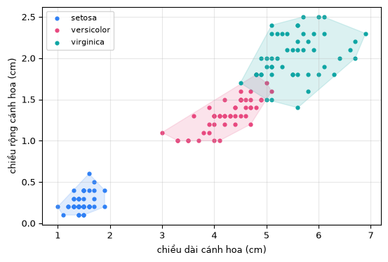

# Chương 23 · Ví dụ áp dụng: hai lớp dữ liệu có tách được bằng một siêu phẳng không?

> Ghi chú của người biên soạn: trang này do người biên soạn viết thêm, không có trong sách gốc. Trang dùng bao lồi và định lý siêu phẳng phân chia ([chương 23](math/ch23_vi), Định lý 23.1) để trả lời một câu hỏi thực tế: hai lớp trong bộ dữ liệu hoa Iris có tách được tuyến tính hay không. Câu trả lời quyết định thuật toán học perceptron ([chương 13](ml/ch13_vi)) có dừng hay không, và dẫn tới máy vector hỗ trợ ([chương 26](ml/ch26_vi) của khoá Học máy).

## Bài toán

Bộ dữ liệu Iris (Fisher, 1936) có 150 bông hoa thuộc 3 loài (setosa, versicolor, virginica), mỗi bông đo 4 đặc trưng: chiều dài và chiều rộng của đài hoa và cánh hoa. Ta hỏi: với hai loài cho trước, có siêu phẳng nào để mọi bông của loài này nằm một phía, mọi bông của loài kia nằm phía còn lại không?

Định lý 23.1 nói: nếu hai tập lồi không giao nhau thì có một siêu phẳng phân chia chúng. Áp dụng cho hai tập điểm hữu hạn: hai tập điểm **tách được tuyến tính khi và chỉ khi bao lồi của chúng không giao nhau**. (Chiều ngược lại hiển nhiên: nếu có siêu phẳng phân chia hai tập điểm thì nó cũng phân chia hai bao lồi, vì mỗi nửa không gian là tập lồi.)

## 1. Nhìn trong hai chiều

Dùng hai đặc trưng của cánh hoa và vẽ bao lồi của từng loài (`ConvexHull`, [trang Thư viện](math/ch23_lib_vi)).

<!-- run -->
```python
import numpy as np
import matplotlib.pyplot as plt
from scipy.spatial import ConvexHull
from scipy.optimize import linprog
from sklearn.datasets import load_iris

iris = load_iris()
X, y = iris.data, iris.target
names = ["setosa", "versicolor", "virginica"]
colors = ["#2f80f5", "#e8487f", "#0ea5a4"]
cols = [2, 3]                                          # chiều dài, chiều rộng cánh hoa

fig, ax = plt.subplots(figsize=(5.6, 3.8))
for c in range(3):
    P = X[y == c][:, cols]
    h = ConvexHull(P)
    ax.scatter(*P.T, s=12, color=colors[c], label=names[c])
    ax.fill(*P[h.vertices].T, color=colors[c], alpha=.15, edgecolor=colors[c])
ax.set_xlabel("chiều dài cánh hoa (cm)"); ax.set_ylabel("chiều rộng cánh hoa (cm)"); ax.legend(fontsize=8); ax.grid(alpha=.3)
fig.tight_layout()
```

<!-- output -->
<div align=center></div>
<!-- /output -->

Bao lồi của setosa nằm tách hẳn khỏi hai loài còn lại. Bao lồi của versicolor và virginica chồng lên nhau một phần.

## 2. Hai bao lồi có giao nhau không?

<small class="viz-ref">Định nghĩa 23.5 · Định lý 23.1</small>

Hai bao lồi giao nhau khi có một điểm $\mathbf{z}$ vừa là tổ hợp lồi của các điểm lớp A, vừa là tổ hợp lồi của các điểm lớp B:

$$
\mathbf{z} = \sum_i \theta_i \mathbf{a}_i = \sum_j \phi_j \mathbf{b}_j, \qquad \theta_i, \phi_j \ge 0,\ \sum_i \theta_i = \sum_j \phi_j = 1.
$$

Đây là một bài toán quy hoạch tuyến tính chỉ cần tìm điểm khả thi. Nó làm được trong không gian 4 chiều, nơi ta không vẽ được.

<!-- run -->
```python
def hulls_intersect(A, B):
    na, nb = len(A), len(B)
    A_eq = np.block([[A.T, -B.T],                                   # sum theta a - sum phi b = 0
                     [np.ones((1, na)), np.zeros((1, nb))],         # sum theta = 1
                     [np.zeros((1, na)), np.ones((1, nb))]])        # sum phi = 1
    b_eq = np.r_[np.zeros(A.shape[1]), 1, 1]
    res = linprog(np.zeros(na + nb), A_eq=A_eq, b_eq=b_eq, bounds=[(0, None)] * (na + nb))
    return res.status == 0, (res.x[:na] @ A if res.status == 0 else None)

pairs = [(0, 1), (0, 2), (1, 2)]
for feat, cs in [("2 đặc trưng cánh hoa", [2, 3]), ("cả 4 đặc trưng", [0, 1, 2, 3])]:
    for a, b in pairs:
        hit, z = hulls_intersect(X[y == a][:, cs], X[y == b][:, cs])
        print(f"{feat:22s} | {names[a]:10s} và {names[b]:10s}: " + ("bao lồi GIAO nhau, ví dụ điểm chung " + str(z.round(2)) if hit else "bao lồi rời nhau"))
```

<!-- output -->
```output
2 đặc trưng cánh hoa   | setosa     và versicolor: bao lồi rời nhau
2 đặc trưng cánh hoa   | setosa     và virginica : bao lồi rời nhau
2 đặc trưng cánh hoa   | versicolor và virginica : bao lồi GIAO nhau, ví dụ điểm chung [5.1 1.6]
cả 4 đặc trưng         | setosa     và versicolor: bao lồi rời nhau
cả 4 đặc trưng         | setosa     và virginica : bao lồi rời nhau
cả 4 đặc trưng         | versicolor và virginica : bao lồi GIAO nhau, ví dụ điểm chung [6.  2.7 5.1 1.6]
```
<!-- /output -->

Ngay cả khi dùng cả 4 đặc trưng, bao lồi của versicolor và virginica vẫn giao nhau. Theo định lý trên, **không có siêu phẳng nào** tách hoàn toàn hai loài này.

## 3. Tìm siêu phẳng phân chia

Khi hai bao lồi rời nhau, ta tìm siêu phẳng $\mathbf{w}^T\mathbf{x} + b = 0$ sao cho $y_i(\mathbf{w}^T\mathbf{x}_i + b) \ge 1$ với mọi điểm ($y_i = \pm 1$). Đây cũng là một bài toán khả thi tuyến tính. Nó có nghiệm khi và chỉ khi hai tập tách được.

<!-- run -->
```python
def separating_hyperplane(A, B):
    Z = np.vstack([A, B]); s = np.r_[np.ones(len(A)), -np.ones(len(B))]
    Zb = np.hstack([Z, np.ones((len(Z), 1))])                       # [x, 1] để gộp b vào w
    res = linprog(np.zeros(Zb.shape[1]), A_ub=-(s[:, None] * Zb), b_ub=-np.ones(len(Z)),
                  bounds=[(None, None)] * Zb.shape[1])
    return res.x if res.status == 0 else None

for a, b in pairs:
    wb = separating_hyperplane(X[y == a], X[y == b])
    if wb is None:
        print(f"{names[a]:10s} và {names[b]:10s}: không tồn tại (bài toán vô nghiệm)")
    else:
        Z = np.vstack([X[y == a], X[y == b]]); s = np.r_[np.ones(np.sum(y == a)), -np.ones(np.sum(y == b))]
        print(f"{names[a]:10s} và {names[b]:10s}: w = {wb[:4].round(3)}, b = {wb[4]:.3f}; mọi điểm đúng phía: {np.all(s * (Z @ wb[:4] + wb[4]) > 0)}")
```

<!-- output -->
```output
setosa     và versicolor: w = [ 0.682  0.    -1.045 -1.227], b = 0.000; mọi điểm đúng phía: True
setosa     và virginica : w = [ 0.463  0.    -0.573 -0.661], b = 0.000; mọi điểm đúng phía: True
versicolor và virginica : không tồn tại (bài toán vô nghiệm)
```
<!-- /output -->

Thuật toán học perceptron (PLA) chỉ dừng khi dữ liệu tách được ([chương 13](ml/ch13_vi)). Bài toán quy hoạch tuyến tính ở trên cho biết trước điều đó: với versicolor và virginica, PLA sẽ chạy mãi.

## 4. Khi không tách được: cho phép vi phạm

Với hai tập không tách được, ta nới lỏng ràng buộc bằng các biến $\xi_i \ge 0$: $y_i(\mathbf{w}^T\mathbf{x}_i + b) \ge 1 - \xi_i$, và cực tiểu tổng $\sum_i \xi_i$. Đây vẫn là một bài toán quy hoạch tuyến tính, và cũng là bài toán lồi, nên lời giải tìm được là tối ưu toàn cục. Ý tưởng này chính là cốt lõi của máy vector hỗ trợ lề mềm ([chương 27](ml/ch27_vi) của khoá Học máy).

<!-- run -->
```python
def soft_separation(A, B):
    Z = np.vstack([A, B]); s = np.r_[np.ones(len(A)), -np.ones(len(B))]
    N, d = Z.shape
    # biến: [w (d), b (1), xi (N)];  -s_i (w^T x_i + b) - xi_i <= -1
    A_ub = np.hstack([-(s[:, None] * Z), -s[:, None], -np.eye(N)])
    c = np.r_[np.zeros(d + 1), np.ones(N)]
    res = linprog(c, A_ub=A_ub, b_ub=-np.ones(N), bounds=[(None, None)] * (d + 1) + [(0, None)] * N)
    w, b, xi = res.x[:d], res.x[d], res.x[d + 1:]
    wrong = np.sum(s * (Z @ w + b) <= 0)
    return w, b, xi, wrong

w, b, xi, wrong = soft_separation(X[y == 1], X[y == 2])
print(f"versicolor và virginica: tổng vi phạm {xi.sum():.3f}; số điểm có xi > 0: {np.sum(xi > 1e-9)}; số điểm nằm sai phía: {wrong} / 100")
```

<!-- output -->
```output
versicolor và virginica: tổng vi phạm 5.600; số điểm có xi > 0: 3; số điểm nằm sai phía: 2 / 100
```
<!-- /output -->

Siêu phẳng tốt nhất theo tiêu chí này chỉ có 3 bông hoa vi phạm ràng buộc ($\xi_i > 0$), trong đó 2 bông nằm sai phía; bông còn lại nằm đúng phía nhưng quá gần siêu phẳng. Lưu ý: cực tiểu tổng $\sum_i \xi_i$ không giống cực tiểu *số điểm sai*. Bài toán thứ hai không lồi (nó là bài toán tổ hợp, rất khó giải), còn bài toán thứ nhất là một xấp xỉ lồi của nó.

## Rút ra được gì

- "Tách được tuyến tính" là một câu hỏi về tập lồi: hai bao lồi có giao nhau hay không.
- Câu hỏi này trả lời được chính xác bằng quy hoạch tuyến tính, trong không gian bao nhiêu chiều cũng được.
- Setosa tách được với hai loài còn lại. Versicolor và virginica thì không, kể cả với 4 đặc trưng. Đây là lý do các bộ phân loại tuyến tính trên Iris không đạt 100%.
- Khi không tách được, nới lỏng ràng buộc vẫn giữ bài toán ở dạng lồi. Các chương về tối ưu lồi tiếp theo ([chương 24](math/ch24_vi), [chương 25](math/ch25_vi)) và về SVM xây dựng trên ý tưởng này.
