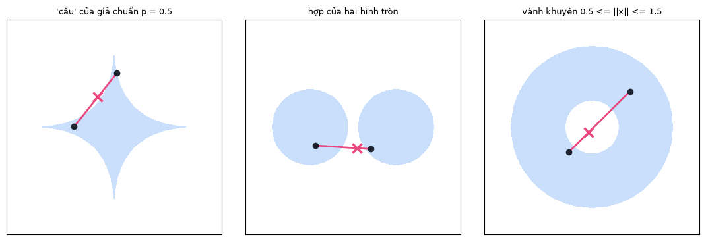
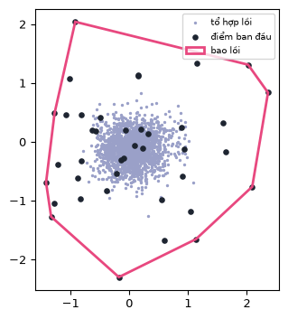

# Chương 23 · Code từ đầu

> Ghi chú của người biên soạn: trang này do người biên soạn viết thêm, không có trong sách gốc. Trang biến các định nghĩa của [chương 23](math/ch23_vi) thành những phép kiểm tra bằng số: kiểm tra một tập có lồi không, dựng bao lồi, và kiểm tra một hàm có lồi không theo định nghĩa, theo điều kiện bậc nhất và theo điều kiện bậc hai.

## Cách dùng trang này

Các khối chạy lần lượt từ trên xuống và dùng chung biến. Cần `numpy` và `matplotlib`.

Một lưu ý quan trọng: kiểm tra bằng số chỉ có thể **bác bỏ**. Tìm được một cặp điểm vi phạm định nghĩa là đủ chứng minh tập (hay hàm) không lồi. Còn không tìm thấy vi phạm sau hàng nghìn lần thử chỉ là bằng chứng, không phải chứng minh.

## 1. Kiểm tra một tập có lồi không

<small class="viz-ref">Mục 23.2 · Định nghĩa 23.1–23.4 · Hình 23.1–23.4</small>

Theo Định nghĩa 23.1: lấy ngẫu nhiên hai điểm $\mathbf{x}_1, \mathbf{x}_2$ trong tập và một $\theta \in [0, 1]$, rồi xem $\theta\mathbf{x}_1 + (1 - \theta)\mathbf{x}_2$ có còn trong tập không.

<!-- run -->
```python
import numpy as np
import matplotlib.pyplot as plt

rng = np.random.default_rng(0)

def find_violation(member, box=2.0, trials=20000, dim=2):
    """Tìm x1, x2 thuộc tập và theta sao cho điểm trên đoạn thẳng không thuộc tập."""
    P = rng.uniform(-box, box, size=(trials * 5, dim))
    P = P[[member(p) for p in P]]                         # các điểm thuộc tập
    for _ in range(trials):
        i, j = rng.integers(len(P), size=2)
        th = rng.random()
        z = th * P[i] + (1 - th) * P[j]
        if not member(z):
            return P[i], P[j], z
    return None

pnorm = lambda x, p: np.sum(np.abs(x) ** p) ** (1 / p)
sets = {
    "nửa không gian  x + 2y <= 1":           lambda x: x[0] + 2 * x[1] <= 1,
    "cầu chuẩn l2":                           lambda x: np.linalg.norm(x) <= 1.5,
    "cầu chuẩn l1":                           lambda x: np.abs(x).sum() <= 1.5,
    "cầu chuẩn l_inf":                        lambda x: np.abs(x).max() <= 1.5,
    "giao: l2 và nửa không gian":             lambda x: np.linalg.norm(x) <= 1.5 and x[0] + 2 * x[1] <= 1,
    "'cầu' của giả chuẩn p = 0.5":            lambda x: pnorm(x, 0.5) <= 1.5,
    "hợp của hai hình tròn":                  lambda x: np.linalg.norm(x - [-0.8, 0]) <= 0.7 or np.linalg.norm(x - [0.8, 0]) <= 0.7,
    "vành khuyên 0.5 <= ||x|| <= 1.5":        lambda x: 0.5 <= np.linalg.norm(x) <= 1.5,
}
found = {}
for name, member in sets.items():
    v = find_violation(member)
    found[name] = v
    print(f"{name:38s}: " + ("không tìm thấy vi phạm" if v is None else f"KHÔNG LỒI, ví dụ x1 = {v[0].round(2)}, x2 = {v[1].round(2)}"))
```

<!-- output -->
```output
nửa không gian  x + 2y <= 1           : không tìm thấy vi phạm
cầu chuẩn l2                          : không tìm thấy vi phạm
cầu chuẩn l1                          : không tìm thấy vi phạm
cầu chuẩn l_inf                       : không tìm thấy vi phạm
giao: l2 và nửa không gian            : không tìm thấy vi phạm
'cầu' của giả chuẩn p = 0.5           : KHÔNG LỒI, ví dụ x1 = [-0.75  0.01], x2 = [0.05 1.  ]
hợp của hai hình tròn                 : KHÔNG LỒI, ví dụ x1 = [ 0.33 -0.41], x2 = [-0.7  -0.34]
vành khuyên 0.5 <= ||x|| <= 1.5       : KHÔNG LỒI, ví dụ x1 = [-0.43 -0.46], x2 = [0.71 0.67]
```
<!-- /output -->

Ba tập cuối không lồi, đúng như Hình 23.2 và 23.3 của sách. Vẽ ra một vi phạm của mỗi tập:

<!-- run -->
```python
fig, axes = plt.subplots(1, 3, figsize=(11, 3.6))
g = np.linspace(-2, 2, 400); G = np.stack(np.meshgrid(g, g), -1)
for ax, name in zip(axes, list(sets)[-3:]):
    inside = np.array([[sets[name](p) for p in row] for row in G])
    ax.contourf(g, g, inside, levels=[0.5, 1.5], colors=["#2f80f5"], alpha=.25)
    x1, x2, z = found[name]
    ax.plot([x1[0], x2[0]], [x1[1], x2[1]], color="#e8487f", lw=2)
    ax.plot(*z, "x", color="#e8487f", ms=10, mew=2.5)
    ax.plot(*np.array([x1, x2]).T, "o", color="#1d2430")
    ax.set_title(name, fontsize=9); ax.set_aspect("equal"); ax.set_xticks([]); ax.set_yticks([])
fig.tight_layout()
```

<!-- output -->
<div align=center></div>
<!-- /output -->

Dấu × là một điểm trên đoạn thẳng nối hai điểm của tập nhưng nằm ngoài tập.

## 2. Bao lồi

<small class="viz-ref">Mục 23.2.4 · Định nghĩa 23.5 · Hình 23.5</small>

Bao lồi của một tập điểm là tập lồi nhỏ nhất chứa chúng, cũng là tập mọi tổ hợp lồi của chúng. Trong mặt phẳng, thuật toán *chuỗi đơn điệu* (monotone chain, Andrew, 1979) dựng bao lồi trong $O(N\log N)$: sắp các điểm theo hoành độ, rồi dựng nửa trên và nửa dưới. Mỗi khi ba điểm cuối tạo thành một "khúc rẽ phải" (không lồi), bỏ điểm giữa.

<!-- run -->
```python
def cross(o, a, b):
    """> 0 nếu o -> a -> b rẽ trái (ngược chiều kim đồng hồ)."""
    return (a[0] - o[0]) * (b[1] - o[1]) - (a[1] - o[1]) * (b[0] - o[0])

def convex_hull(points):
    pts = sorted(map(tuple, points))
    lower, upper = [], []
    for p in pts:
        while len(lower) >= 2 and cross(lower[-2], lower[-1], p) <= 0:
            lower.pop()
        lower.append(p)
    for p in reversed(pts):
        while len(upper) >= 2 and cross(upper[-2], upper[-1], p) <= 0:
            upper.pop()
        upper.append(p)
    return np.array(lower[:-1] + upper[:-1])           # các đỉnh, ngược chiều kim đồng hồ

pts = rng.standard_normal((40, 2))
H = convex_hull(pts)
print("số đỉnh của bao lồi:", len(H), "trên", len(pts), "điểm")

# Mọi tổ hợp lồi của các điểm đều nằm trong bao lồi: kiểm tra bằng các nửa mặt phẳng tạo bởi các cạnh
def in_hull(z, H):
    return all(cross(H[k], H[(k + 1) % len(H)], z) >= -1e-12 for k in range(len(H)))

W = rng.dirichlet(np.ones(len(pts)) * 0.3, size=2000)  # 2000 bộ trọng số không âm, tổng bằng 1
combos = W @ pts
print("2000 tổ hợp lồi ngẫu nhiên, số điểm nằm ngoài bao lồi:", sum(not in_hull(z, H) for z in combos))

fig, ax = plt.subplots(figsize=(4, 3.6))
ax.scatter(*combos.T, s=2, color="#9aa0c8", label="tổ hợp lồi")
ax.scatter(*pts.T, s=14, color="#1d2430", label="điểm ban đầu")
ax.fill(*H.T, fill=False, edgecolor="#e8487f", lw=2, label="bao lồi")
ax.set_aspect("equal"); ax.legend(fontsize=7)
fig.tight_layout()
```

<!-- output -->
```output
số đỉnh của bao lồi: 9 trên 40 điểm
2000 tổ hợp lồi ngẫu nhiên, số điểm nằm ngoài bao lồi: 0
```

<div align=center></div>
<!-- /output -->

Hàm `in_hull` cũng minh hoạ Hình 23.4(b): bao lồi của một tập hữu hạn điểm là **giao của các nửa mặt phẳng**, mỗi nửa mặt phẳng ứng với một cạnh.

## 3. Kiểm tra một hàm có lồi không theo định nghĩa

<small class="viz-ref">Mục 23.3.1–23.3.3 · Định nghĩa 23.6 · Hình 23.6–23.9</small>

Định nghĩa 23.6: $f(\theta\mathbf{x} + (1 - \theta)\mathbf{y}) \le \theta f(\mathbf{x}) + (1 - \theta)f(\mathbf{y})$. Ta thử các hàm ở mục 23.3.3 trên những cặp điểm ngẫu nhiên trong tập xác định của chúng.

<!-- run -->
```python
def chord_violation(f, sample, trials=20000):
    for _ in range(trials):
        x, y, th = sample(), sample(), rng.random()
        lhs, rhs = f(th * x + (1 - th) * y), th * f(x) + (1 - th) * f(y)
        if lhs > rhs + 1e-9 * (1 + abs(rhs)):
            return x, y, th, lhs - rhs
    return None

real = lambda: rng.uniform(-5, 5)
pos = lambda: rng.uniform(1e-3, 5)
vec = lambda: rng.uniform(-3, 3, size=3)
A_psd = (lambda B: B @ B.T)(rng.standard_normal((3, 3)))
A_ind = np.diag([2.0, 1.0, -0.5])
fns = [
    ("e^{2x}",                    lambda x: np.exp(2 * x),          real),
    ("x^3 trên x > 0",            lambda x: x ** 3,                 pos),
    ("x^{-1} trên x > 0",         lambda x: 1 / x,                  pos),
    ("x log x (entropy âm)",      lambda x: x * np.log(x),          pos),
    ("x^{0.5} trên x > 0",        lambda x: x ** 0.5,               pos),
    ("x^2 + 5 sin x",             lambda x: x ** 2 + 5 * np.sin(x), real),
    ("x^T A x, A nửa xđd",        lambda x: x @ A_psd @ x,          vec),
    ("x^T A x, A không xđd",      lambda x: x @ A_ind @ x,          vec),
    ("||x||_1",                   lambda x: np.abs(x).sum(),        vec),
    ("max(||x||_2, a^T x + 1)",   lambda x: max(np.linalg.norm(x), x.sum() + 1), vec),
    ("log-sum-exp",               lambda x: np.log(np.exp(x).sum()), vec),
]
for name, f, sample in fns:
    v = chord_violation(f, sample)
    print(f"{name:26s}: " + ("không tìm thấy vi phạm" if v is None else f"KHÔNG LỒI (dây cung nằm dưới đồ thị {v[3]:.3g})"))
```

<!-- output -->
```output
e^{2x}                    : không tìm thấy vi phạm
x^3 trên x > 0            : không tìm thấy vi phạm
x^{-1} trên x > 0         : không tìm thấy vi phạm
x log x (entropy âm)      : không tìm thấy vi phạm
x^{0.5} trên x > 0        : KHÔNG LỒI (dây cung nằm dưới đồ thị 0.0261)
x^2 + 5 sin x             : KHÔNG LỒI (dây cung nằm dưới đồ thị 0.0143)
x^T A x, A nửa xđd        : không tìm thấy vi phạm
x^T A x, A không xđd      : KHÔNG LỒI (dây cung nằm dưới đồ thị 0.0319)
||x||_1                   : không tìm thấy vi phạm
max(||x||_2, a^T x + 1)   : không tìm thấy vi phạm
log-sum-exp               : không tìm thấy vi phạm
```
<!-- /output -->

- $x^{0.5}$ không lồi (nó lõm, Hình 23.9): đúng như sách, $x^a$ lồi khi $a \ge 1$ hoặc $a \le 0$.
- $x^2 + 5\sin x$ là hàm ở [chương 12](ml/ch12_vi) có hai cực tiểu địa phương.
- $\max$ của hai hàm lồi là hàm lồi (Hình 23.7).
- Log-sum-exp là hàm lồi; đây là lý do hàm mất mát của hồi quy softmax lồi.

## 4. Điều kiện bậc nhất và bậc hai

<small class="viz-ref">Mục 23.3.6 · công thức (23.5)</small>

- **Điều kiện bậc nhất:** tiếp tuyến (mặt tiếp xúc) tại mọi điểm nằm dưới đồ thị.
- **Điều kiện bậc hai:** Hessian nửa xác định dương tại mọi điểm.

Ta kiểm tra cả hai cho các ví dụ ở cuối chương, dùng gradient và Hessian tính bằng số ([chương 2](math/ch02_vi)).

<!-- run -->
```python
def num_grad(f, x, e=1e-6):
    return np.array([(f(x + e * u) - f(x - e * u)) / (2 * e) for u in np.eye(len(x))])

def num_hess(f, x, e=1e-4):
    return np.column_stack([(num_grad(f, x + e * u) - num_grad(f, x - e * u)) / (2 * e) for u in np.eye(len(x))])

def first_order_violation(f, sample, trials=5000):
    for _ in range(trials):
        x, x0 = sample(), sample()
        if f(x) < f(x0) + num_grad(f, x0) @ (x - x0) - 1e-6:
            return x, x0
    return None

def min_hessian_eig(f, sample, trials=500):
    return min(np.linalg.eigvalsh(num_hess(f, sample())).min() for _ in range(trials))

pos2 = lambda: rng.uniform(0.05, 5, size=2)
real1 = lambda: rng.uniform(-5, 5, size=1)
vec2 = lambda: rng.uniform(-3, 3, size=2)
tests = [
    ("x log x + y log y",       lambda v: v[0] * np.log(v[0]) + v[1] * np.log(v[1]), pos2),
    ("x^2 + 5 sin x",           lambda v: v[0] ** 2 + 5 * np.sin(v[0]),              real1),
    ("log(e^x + e^y)",          lambda v: np.logaddexp(v[0], v[1]),                  vec2),
    ("x y (hàm yên ngựa)",       lambda v: v[0] * v[1],                               vec2),
]
for name, f, s in tests:
    v = first_order_violation(f, s)
    print(f"{name:22s}: bậc nhất {'không thấy vi phạm' if v is None else 'VI PHẠM'}; trị riêng nhỏ nhất của Hessian trên 500 điểm = {round(min_hessian_eig(f, s), 3) + 0.0:+.3f}")
```

<!-- output -->
```output
x log x + y log y     : bậc nhất không thấy vi phạm; trị riêng nhỏ nhất của Hessian trên 500 điểm = +0.200
x^2 + 5 sin x         : bậc nhất VI PHẠM; trị riêng nhỏ nhất của Hessian trên 500 điểm = -3.000
log(e^x + e^y)        : bậc nhất không thấy vi phạm; trị riêng nhỏ nhất của Hessian trên 500 điểm = +0.000
x y (hàm yên ngựa)    : bậc nhất VI PHẠM; trị riêng nhỏ nhất của Hessian trên 500 điểm = -1.000
```
<!-- /output -->

Trị riêng nhỏ nhất của Hessian của $x^2 + 5\sin x$ là $-3$, đúng bằng giá trị nhỏ nhất của $f''(x) = 2 - 5\sin x$. Với hàm $x\log x + y\log y$, Hessian là $\mathrm{diag}(1/x, 1/y)$ nên trị riêng nhỏ nhất là $1/5$ trên miền $(0, 5]^2$. Với log-sum-exp, trị riêng nhỏ nhất của Hessian bằng 0 (chứ không dương): hàm lồi nhưng không lồi chặt, vì nó tăng tuyến tính dọc theo phương $(1, 1)$.

## 5. Hàm tựa lồi

<small class="viz-ref">Mục 23.3.5 · Định lý 23.2 · Định nghĩa 23.9 · Hình 23.13</small>

Sách nêu ví dụ $f(x, y) = -e^{x + y}$: mọi tập dưới mức là nửa mặt phẳng (lồi) nhưng hàm không lồi. Kiểm tra cả định nghĩa hàm lồi lẫn định nghĩa hàm tựa lồi $f(\theta\mathbf{x} + (1 - \theta)\mathbf{y}) \le \max\{f(\mathbf{x}), f(\mathbf{y})\}$:

<!-- run -->
```python
def quasi_violation(f, sample, trials=20000):
    for _ in range(trials):
        x, y, th = sample(), sample(), rng.random()
        if f(th * x + (1 - th) * y) > max(f(x), f(y)) + 1e-12:
            return x, y
    return None

for name, f in [("-exp(x + y)", lambda v: -np.exp(v[0] + v[1])),
                ("-exp(-(x^2 + y^2))", lambda v: -np.exp(-(v[0] ** 2 + v[1] ** 2))),
                ("x y", lambda v: v[0] * v[1])]:
    c, q = chord_violation(f, vec2), quasi_violation(f, vec2)
    print(f"{name:20s}: lồi? {'có thể' if c is None else 'không'};  tựa lồi? {'có thể' if q is None else 'không'}")
```

<!-- output -->
```output
-exp(x + y)         : lồi? không;  tựa lồi? có thể
-exp(-(x^2 + y^2))  : lồi? không;  tựa lồi? có thể
x y                 : lồi? không;  tựa lồi? không
```
<!-- /output -->

Hàm $-e^{-(x^2 + y^2)}$ (một "cái phễu" kiểu Hình 23.13) có mọi tập dưới mức là hình tròn, nên tựa lồi, nhưng không lồi. Hàm $xy$ thì không lồi cũng không tựa lồi: tập dưới mức $\{xy \le 0\}$ là hai góc phần tư đối nhau, không lồi.
