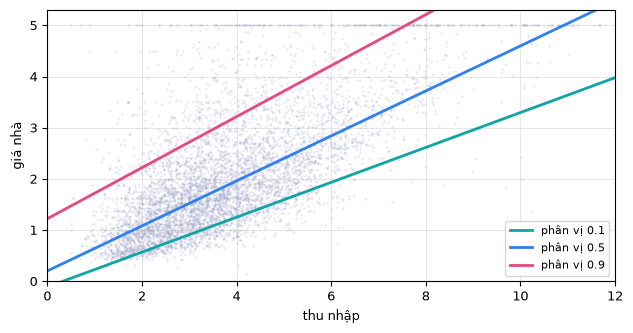

# Chương 24 · Ví dụ áp dụng: hồi quy bằng quy hoạch tuyến tính

> Ghi chú của người biên soạn: trang này do người biên soạn viết thêm, không có trong sách gốc. Trang cho thấy hai mô hình hồi quy hay dùng trong thực tế thực chất là bài toán quy hoạch tuyến tính ([chương 24](math/ch24_vi)): hồi quy trị tuyệt đối nhỏ nhất (bền vững với dữ liệu lỗi) và hồi quy phân vị (dự đoán một khoảng thay vì một con số).

## Bài toán

Hồi quy tuyến tính ở [chương 7](ml/ch07_vi) cực tiểu tổng **bình phương** sai số. Một điểm dữ liệu sai lệch lớn (do nhập liệu lỗi chẳng hạn) có sai số bình phương rất lớn, nên kéo cả mô hình về phía nó. Cực tiểu tổng **trị tuyệt đối** sai số thì bền vững hơn:

$$
\min_{\mathbf{w}} \sum_{i=1}^N |y_i - \mathbf{x}_i^T\mathbf{w}|.
$$

Hàm này lồi nhưng không khả vi, nên không giải được bằng cách cho đạo hàm bằng 0. Đặt thêm biến $e_i \ge |y_i - \mathbf{x}_i^T\mathbf{w}|$, tức hai ràng buộc tuyến tính $-e_i \le y_i - \mathbf{x}_i^T\mathbf{w} \le e_i$, ta được một bài toán quy hoạch tuyến tính:

$$
\min_{\mathbf{w}, \mathbf{e}} \sum_i e_i \quad \text{thoả mãn:}\ \ \mathbf{x}_i^T\mathbf{w} - e_i \le y_i,\ \ -\mathbf{x}_i^T\mathbf{w} - e_i \le -y_i.
$$

Ta dùng dữ liệu giá nhà California ([ví dụ áp dụng chương 7](ml/ch07_app_vi)).

## 1. Dữ liệu và bài toán quy hoạch tuyến tính

Với 14 000 điểm huấn luyện, bài toán có hơn 14 000 biến và 28 000 ràng buộc. Ma trận ràng buộc hầu hết là số 0, nên ta lưu nó ở dạng thưa (`scipy.sparse`); bộ giải HiGHS của `linprog` làm việc trực tiếp với dạng này.

<!-- run -->
```python
import numpy as np
import matplotlib.pyplot as plt
import scipy.sparse as sp
from time import perf_counter
from scipy.optimize import linprog
from sklearn.datasets import fetch_california_housing
from sklearn.model_selection import train_test_split
from sklearn.preprocessing import StandardScaler

X, y = fetch_california_housing(return_X_y=True)
X_tr, X_te, y_tr, y_te = train_test_split(X, y, test_size=0.3, random_state=0)
sc = StandardScaler().fit(X_tr)
add1 = lambda Z: np.hstack([sc.transform(Z), np.ones((len(Z), 1))])
A_tr, A_te = add1(X_tr), add1(X_te)
print("huấn luyện:", A_tr.shape, " kiểm tra:", A_te.shape)

def lad(A, y):
    """min sum |y - A w| bằng quy hoạch tuyến tính. Biến: [w (d), e (N)]."""
    N, d = A.shape
    I = sp.identity(N, format="csr")
    A_ub = sp.vstack([sp.hstack([sp.csr_matrix(A), -I]), sp.hstack([sp.csr_matrix(-A), -I])], format="csr")
    b_ub = np.r_[y, -y]
    c = np.r_[np.zeros(d), np.ones(N)]
    res = linprog(c, A_ub=A_ub, b_ub=b_ub, bounds=[(None, None)] * d + [(0, None)] * N, method="highs")
    return res.x[:d], res

t = perf_counter(); w_lad, res = lad(A_tr, y_tr); t_lad = perf_counter() - t
w_ols = np.linalg.lstsq(A_tr, y_tr, rcond=None)[0]
print(f"LP: {res.message}  ({t_lad:.1f} s)")
print(f"tổng |sai số| trên tập huấn luyện: LAD {res.fun:.1f}, OLS {np.abs(y_tr - A_tr @ w_ols).sum():.1f}")
```

<!-- output -->
```output
huấn luyện: (14448, 9)  kiểm tra: (6192, 9)
LP: Optimization terminated successfully. (HiGHS Status 7: Optimal)  (15.1 s)
tổng |sai số| trên tập huấn luyện: LAD 7318.0, OLS 7648.0
```
<!-- /output -->

LAD có tổng trị tuyệt đối sai số nhỏ hơn OLS trên tập huấn luyện. Điều này đương nhiên, vì đó chính là hàm mục tiêu nó cực tiểu. Câu hỏi thực sự là: hai mô hình khác nhau thế nào trên dữ liệu mới, và khi dữ liệu huấn luyện có lỗi?

## 2. Khi dữ liệu huấn luyện có lỗi

Giả lập lỗi nhập liệu: với 3% số khu dân cư trong tập huấn luyện, giá nhà bị ghi nhầm đơn vị (gấp 10 lần). Tập kiểm tra giữ nguyên.

<!-- run -->
```python
def metrics(w, A, y):
    r = y - A @ w
    return np.mean(np.abs(r)), np.sqrt(np.mean(r ** 2))

rng = np.random.default_rng(0)
y_bad = y_tr.copy()
bad = rng.choice(len(y_tr), int(0.03 * len(y_tr)), replace=False)
y_bad[bad] *= 10

w_ols_bad = np.linalg.lstsq(A_tr, y_bad, rcond=None)[0]
w_lad_bad, _ = lad(A_tr, y_bad)
print(f"{'':28s} {'MAE kiểm tra':>13s} {'RMSE kiểm tra':>14s}")
for name, w in [("OLS, dữ liệu sạch", w_ols), ("OLS, 3% nhãn lỗi", w_ols_bad), ("LAD, dữ liệu sạch", w_lad), ("LAD, 3% nhãn lỗi", w_lad_bad)]:
    mae, rmse = metrics(w, A_te, y_te)
    print(f"{name:28s} {mae:13.3f} {rmse:14.3f}")
print("\nhệ số của thu nhập (MedInc): OLS", round(w_ols[0], 3), "->", round(w_ols_bad[0], 3), "| LAD", round(w_lad[0], 3), "->", round(w_lad_bad[0], 3))
```

<!-- output -->
```output
                              MAE kiểm tra  RMSE kiểm tra
OLS, dữ liệu sạch                    0.536          0.737
OLS, 3% nhãn lỗi                     0.804          0.970
LAD, dữ liệu sạch                    0.522          1.943
LAD, 3% nhãn lỗi                     0.523          1.905

hệ số của thu nhập (MedInc): OLS 0.845 -> 1.022 | LAD 0.9 -> 0.904
```
<!-- /output -->

Chỉ 3% nhãn lỗi làm MAE kiểm tra của OLS tăng 50% và hệ số của thu nhập lệch đi đáng kể, còn LAD gần như không bị ảnh hưởng. Với trị tuyệt đối, mỗi điểm chỉ "kéo" mô hình với lực không đổi (đạo hàm của $|r|$ là $\pm 1$), bất kể nó sai lệch bao xa. Với bình phương, lực kéo tỉ lệ với độ sai lệch.

Nhưng có một con số lạ: RMSE kiểm tra của LAD (1.9) lớn hơn hẳn của OLS (0.74), dù MAE của LAD nhỏ hơn. RMSE rất nhạy với vài sai số lớn, nên ta tìm những điểm kiểm tra mà LAD đoán sai nhiều nhất:

<!-- run -->
```python
names = fetch_california_housing().feature_names
r_lad, r_ols = y_te - A_te @ w_lad, y_te - A_te @ w_ols
k = np.argmax(np.abs(r_lad))
print(f"điểm tệ nhất: sai số LAD {r_lad[k]:.1f}, sai số OLS {r_ols[k]:.2f}")
print("đặc trưng của nó (đã chuẩn hoá):", {n: float(v) for n, v in zip(names, A_te[k, :8].round(1))})
print("hệ số của AveOccup: LAD", round(w_lad[5], 3), "| OLS", round(w_ols[5], 3))

typical = np.abs(A_te[:, :8]).max(axis=1) < 5           # bỏ các điểm có đặc trưng lệch quá 5 độ lệch chuẩn
print(f"\nchỉ tính {typical.mean():.1%} điểm kiểm tra có đặc trưng bình thường:")
for name, w in [("OLS", w_ols), ("LAD", w_lad)]:
    mae, rmse = metrics(w, A_te[typical], y_te[typical])
    print(f"  {name}: MAE {mae:.3f}, RMSE {rmse:.3f}")
```

<!-- output -->
```output
điểm tệ nhất: sai số LAD 141.7, sai số OLS 1.42
đặc trưng của nó (đã chuẩn hoá): {'MedInc': 3.4, 'HouseAge': 1.3, 'AveRooms': -1.0, 'AveBedrms': -0.6, 'Population': 5.2, 'AveOccup': 180.6, 'Latitude': 1.3, 'Longitude': -1.2}
hệ số của AveOccup: LAD -0.806 | OLS -0.028

chỉ tính 98.5% điểm kiểm tra có đặc trưng bình thường:
  OLS: MAE 0.528, RMSE 0.719
  LAD: MAE 0.490, RMSE 0.708
```
<!-- /output -->

Thủ phạm là một khu dân cư có số người trung bình mỗi hộ (AveOccup) lớn bất thường, lệch tới 180 độ lệch chuẩn (cùng loại điểm bất thường đã làm gradient descent phân kỳ ở [ví dụ áp dụng chương 12](ml/ch12_app_vi)). LAD gán cho AveOccup một hệ số lớn hơn OLS khoảng 30 lần; trong vùng dữ liệu thông thường điều này không sao, nhưng ở điểm bất thường kia nó cho một dự đoán vô lý. Bỏ khoảng 1.5% điểm có đặc trưng bất thường, LAD tốt hơn OLS ở cả hai thước đo.

Bài học: LAD bền vững với **nhãn** bất thường, nhưng không bền vững với **đặc trưng** bất thường. Với dữ liệu thật, cần xử lý cả hai, chẳng hạn lấy log hoặc cắt ngưỡng các đặc trưng có phân phối lệch.

## 3. Hồi quy phân vị: dự đoán một khoảng

Thay trị tuyệt đối bằng một hàm "lệch" với tham số $\tau \in (0, 1)$:

$$
\rho_\tau(r) = \begin{cases} \tau r & r \ge 0 \\ (\tau - 1) r & r < 0 \end{cases}
$$

Cực tiểu $\sum_i \rho_\tau(y_i - \mathbf{x}_i^T\mathbf{w})$ cho đường **phân vị** $\tau$: khoảng $\tau$ phần dữ liệu nằm dưới nó. Với $\tau = 0.5$ ta được lại LAD (trung vị). Đây vẫn là một bài toán quy hoạch tuyến tính, chỉ khác LAD ở hệ số của hàm mục tiêu: tách $r_i = u_i - v_i$ với $u_i, v_i \ge 0$ và cực tiểu $\sum_i \tau u_i + (1 - \tau)v_i$.

<!-- run -->
```python
def quantile_lp(A, y, tau):
    N, d = A.shape
    I = sp.identity(N, format="csr")
    A_eq = sp.hstack([sp.csr_matrix(A), I, -I], format="csr")          # A w + u - v = y
    c = np.r_[np.zeros(d), tau * np.ones(N), (1 - tau) * np.ones(N)]
    res = linprog(c, A_eq=A_eq, b_eq=y, bounds=[(None, None)] * d + [(0, None)] * (2 * N), method="highs")
    return res.x[:d]

inc_tr = X_tr[:, 0]; inc_te = X_te[:, 0]
B_tr = np.c_[inc_tr, np.ones(len(inc_tr))]; B_te = np.c_[inc_te, np.ones(len(inc_te))]
taus = [0.1, 0.5, 0.9]
W = {tau: quantile_lp(B_tr, y_tr, tau) for tau in taus}

from sklearn.linear_model import QuantileRegressor
q = QuantileRegressor(quantile=0.9, alpha=0, solver="highs").fit(inc_tr[:, None], y_tr)
print("tau = 0.9: LP tự viết", W[0.9].round(4), "| sklearn QuantileRegressor", np.r_[q.coef_, q.intercept_].round(4))
for tau in taus:
    print(f"tau = {tau}: tỉ lệ điểm kiểm tra nằm dưới đường = {np.mean(y_te < B_te @ W[tau]):.3f}")
inside = np.mean((y_te >= B_te @ W[0.1]) & (y_te <= B_te @ W[0.9]))
print(f"tỉ lệ điểm kiểm tra nằm trong khoảng [phân vị 0.1, phân vị 0.9]: {inside:.3f}")

fig, ax = plt.subplots(figsize=(6.4, 3.4))
ax.scatter(inc_te, y_te, s=1, alpha=.15, color="#9aa0c8")
t_ = np.linspace(0, 15, 2)
for tau, c in zip(taus, ["#0ea5a4", "#2f80f5", "#e8487f"]):
    ax.plot(t_, W[tau][0] * t_ + W[tau][1], color=c, lw=2, label=f"phân vị {tau}")
ax.set_xlim(0, 12); ax.set_ylim(0, 5.3); ax.set_xlabel("thu nhập"); ax.set_ylabel("giá nhà"); ax.legend(fontsize=8); ax.grid(alpha=.3)
fig.tight_layout()
```

<!-- output -->
```output
tau = 0.9: LP tự viết [0.4987 1.2207] | sklearn QuantileRegressor [0.4987 1.2207]
tau = 0.1: tỉ lệ điểm kiểm tra nằm dưới đường = 0.103
tau = 0.5: tỉ lệ điểm kiểm tra nằm dưới đường = 0.498
tau = 0.9: tỉ lệ điểm kiểm tra nằm dưới đường = 0.897
tỉ lệ điểm kiểm tra nằm trong khoảng [phân vị 0.1, phân vị 0.9]: 0.794
```

<div align=center></div>
<!-- /output -->

Khoảng giữa đường phân vị 0.1 và 0.9 chứa khoảng 80% số khu dân cư của tập kiểm tra, đúng như thiết kế. Khoảng này rộng dần khi thu nhập tăng, tức giá nhà ở các khu thu nhập cao khó đoán hơn. Đây là điều mà [ví dụ áp dụng chương 3](math/ch03_app_vi) đã quan sát được, nhưng một mô hình hồi quy thông thường (chỉ dự đoán kỳ vọng) không cho biết.

## Rút ra được gì

- Nhiều mô hình học máy là bài toán tối ưu lồi trá hình. Nhận ra dạng của chúng (LP, QP...) cho phép dùng các bộ giải chuyên dụng, nhanh và cho nghiệm tối ưu toàn cục.
- Kỹ thuật đặt biến phụ ($e_i \ge |r_i|$, hay $r_i = u_i - v_i$) biến hàm trị tuyệt đối không khả vi thành các ràng buộc tuyến tính. Đó cũng là cách chuyển dạng tổng quát (24.12) về dạng tiêu chuẩn (24.15) trong sách.
- LAD bền vững hơn bình phương tối thiểu khi nhãn có lỗi, nhưng vẫn nhạy với đặc trưng bất thường. Hồi quy phân vị cho biết độ bất định của dự đoán.
