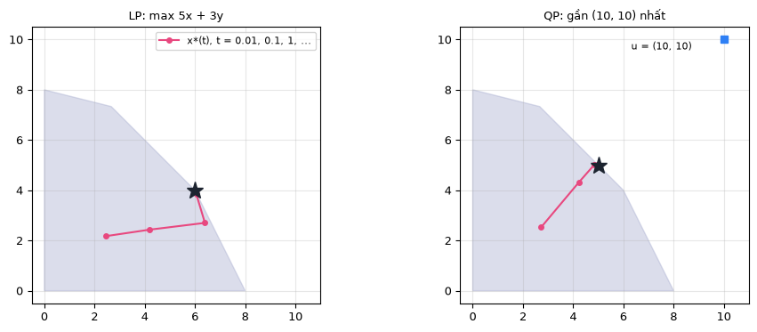

# Chương 24 · Code từ đầu

> Ghi chú của người biên soạn: trang này do người biên soạn viết thêm, không có trong sách gốc. Sách giải các ví dụ của [chương 24](math/ch24_vi) bằng thư viện CVXOPT. Trang này tự viết hai cách giải: liệt kê đỉnh của tập khả thi cho quy hoạch tuyến tính, và **phương pháp hàm chắn** (barrier method), một thuật toán điểm trong dùng được cho cả quy hoạch tuyến tính, quy hoạch toàn phương và quy hoạch hình học. Mọi kết quả được so với kết quả in trong sách.

## Cách dùng trang này

Các khối chạy lần lượt từ trên xuống và dùng chung biến. Chỉ cần `numpy` và `matplotlib`.

## 1. Quy hoạch tuyến tính: nghiệm nằm ở một đỉnh

<small class="viz-ref">Mục 24.1.2, 24.4.3 · Bài toán canh tác (24.2) · Hình 24.1, 24.3</small>

Tập khả thi của một bài toán quy hoạch tuyến tính là một đa diện lồi. Nếu bài toán có nghiệm (và tập khả thi có đỉnh), luôn có một nghiệm nằm ở một đỉnh. Trong $\mathbb{R}^n$, mỗi đỉnh là giao của $n$ siêu phẳng ràng buộc. Với ít biến và ít ràng buộc, ta có thể liệt kê hết các đỉnh.

<!-- run -->
```python
import numpy as np
import matplotlib.pyplot as plt
from itertools import combinations

def lp_vertices(G, h, A=None, b=None, tol=1e-9):
    """Mọi đỉnh của {x : Gx <= h, Ax = b}: chọn đủ ràng buộc chặt để có n phương trình, giải, giữ lại điểm khả thi."""
    n = G.shape[1]
    A = np.zeros((0, n)) if A is None else A
    b = np.zeros(0) if b is None else b
    verts = []
    for rows in combinations(range(len(G)), n - len(A)):
        M = np.vstack([A, G[list(rows)]]); r = np.concatenate([b, h[list(rows)]])
        if abs(np.linalg.det(M)) < tol:
            continue
        x = np.linalg.solve(M, r)
        if np.all(G @ x <= h + 1e-7):
            verts.append(x)
    V = np.unique(np.round(verts, 9), axis=0)
    return np.where(np.abs(V) < 1e-9, 0.0, V)               # bỏ dấu của -0.0

# Bài toán canh tác: max 5x + 3y, tức min -5x - 3y
G = np.array([[1., 1], [2, 1], [1, 4], [-1, 0], [0, -1]])
h = np.array([10., 16, 32, 0, 0])
c = np.array([-5., -3])
V = lp_vertices(G, h)
for v in V:
    print(f"đỉnh {v.round(3)}: lợi nhuận 5x + 3y = {-c @ v:.2f}")
best = V[np.argmin(V @ c)]
print("nghiệm:", best, "; lợi nhuận", -c @ best, "(sách: x = 6, y = 4, lợi nhuận 42)")
```

<!-- output -->
```output
đỉnh [0. 0.]: lợi nhuận 5x + 3y = 0.00
đỉnh [0. 8.]: lợi nhuận 5x + 3y = 24.00
đỉnh [2.667 7.333]: lợi nhuận 5x + 3y = 35.33
đỉnh [6. 4.]: lợi nhuận 5x + 3y = 42.00
đỉnh [8. 0.]: lợi nhuận 5x + 3y = 40.00
nghiệm: [6. 4.] ; lợi nhuận 42.0 (sách: x = 6, y = 4, lợi nhuận 42)
```
<!-- /output -->

Bài toán nhà xuất bản (24.1) có 4 biến và 2 ràng buộc đẳng thức, nên mỗi đỉnh cần thêm 2 ràng buộc bất đẳng thức chặt:

<!-- run -->
```python
# biến (x, y, z, t); chi phí 5x + 10y + 15z + 4t
c_nxb = np.array([5., 10, 15, 4])
A_nxb = np.array([[1., 0, 1, 0], [0, 1, 0, 1]]); b_nxb = np.array([600., 400])
G_nxb = np.vstack([[1, 1, 0, 0], [0, 0, 1, 1], -np.eye(4)]); h_nxb = np.array([800., 700, 0, 0, 0, 0])
V = lp_vertices(G_nxb, h_nxb, A_nxb, b_nxb)
for v in V:
    print(f"đỉnh (x, y, z, t) = {v.round(1)}: chi phí {c_nxb @ v:7.0f} (x 10k)")
best = V[np.argmin(V @ c_nxb)]
print("nghiệm:", best, "; chi phí", c_nxb @ best, "x 10k =", f"{c_nxb @ best * 1e4:,.0f} đồng")
```

<!-- output -->
```output
đỉnh (x, y, z, t) = [  0. 300. 600. 100.]: chi phí   12400 (x 10k)
đỉnh (x, y, z, t) = [  0. 400. 600.   0.]: chi phí   13000 (x 10k)
đỉnh (x, y, z, t) = [300.   0. 300. 400.]: chi phí    7600 (x 10k)
đỉnh (x, y, z, t) = [400. 400. 200.   0.]: chi phí    9000 (x 10k)
đỉnh (x, y, z, t) = [600.   0.   0. 400.]: chi phí    4600 (x 10k)
đỉnh (x, y, z, t) = [600. 200.   0. 200.]: chi phí    5800 (x 10k)
nghiệm: [600.   0.   0. 400.] ; chi phí 4600.0 x 10k = 46,000,000 đồng
```
<!-- /output -->

Nam Định gửi cả 600 cuốn tới Thái Bình, Hải Dương gửi cả 400 cuốn tới Hải Phòng, tổng chi phí 46 triệu đồng: mỗi kho phục vụ điểm đến có đơn giá rẻ của mình. (Sách để bài toán này làm bài tập cho bạn đọc.) Nghiệm này là số nguyên, nên giả sử "các biến là số thực" của sách không làm mất gì ở đây. Số đỉnh tăng theo tổ hợp với số biến và số ràng buộc, nên cách liệt kê chỉ dùng được cho bài toán nhỏ. Các thuật toán thực tế (simplex, điểm trong) đi qua rất ít đỉnh hoặc đi xuyên qua bên trong tập khả thi.

## 2. Phương pháp hàm chắn

Ý tưởng: thay ràng buộc cứng $\mathbf{g}_i^T\mathbf{x} \le h_i$ bằng một hàm phạt tăng lên vô cùng khi $\mathbf{x}$ tiến tới biên:

$$
\min_{\mathbf{x}}\ t f_0(\mathbf{x}) - \sum_i \log(h_i - \mathbf{g}_i^T\mathbf{x}).
$$

Với mỗi $t$, đây là bài toán không ràng buộc, lồi nếu $f_0$ lồi, và giải nhanh bằng phương pháp Newton ([ví dụ áp dụng chương 2](math/ch02_app_vi)). Nghiệm $\mathbf{x}^*(t)$ luôn nằm *bên trong* tập khả thi. Tăng dần $t$ thì hàm chắn có trọng số tương đối nhỏ dần, và $\mathbf{x}^*(t)$ tiến về nghiệm của bài toán gốc. Đường đi của $\mathbf{x}^*(t)$ gọi là **đường trung tâm** (central path). Có thể chứng minh $f_0(\mathbf{x}^*(t))$ cách giá trị tối ưu không quá $m/t$, với $m$ là số ràng buộc ([chương 25](math/ch25_vi) giải thích vì sao).

<!-- run -->
```python
def barrier_method(f_grad_hess, G, h, x0, t0=0.01, mu=10.0, tol=1e-8):
    """min f0(x) s.t. Gx <= h. f_grad_hess(x) -> (f, grad, Hessian). x0 phải khả thi chặt."""
    x, t, m = x0.astype(float), t0, len(h)
    path = []                                                 # x*(t) với t = t0, mu t0, mu^2 t0, ...
    while m / t > tol:
        for _ in range(100):                                  # Newton cho bài toán có hàm chắn
            s = h - G @ x                                     # khoảng cách tới từng ràng buộc (> 0)
            f, g, H = f_grad_hess(x)
            grad = t * g + G.T @ (1 / s)
            hess = t * H + G.T @ np.diag(1 / s ** 2) @ G
            dx = -np.linalg.solve(hess, grad)
            if -grad @ dx / 2 < 1e-12:
                break
            step = 1.0                                        # lùi bước: vẫn khả thi chặt và hàm mục tiêu giảm
            phi = lambda z: t * f_grad_hess(z)[0] - np.sum(np.log(h - G @ z))
            while np.any(h - G @ (x + step * dx) <= 0) or phi(x + step * dx) > phi(x) + 0.25 * step * grad @ dx:
                step *= 0.5
            x = x + step * dx
        path.append(x.copy())
        t *= mu
    return x, np.array(path)

lp = lambda x: (c @ x, c, np.zeros((2, 2)))                     # f0 = c^T x
x_lp, path_lp = barrier_method(lp, G, h, x0=np.array([1.0, 1.0]))
print("LP canh tác: x =", x_lp.round(6), "; lợi nhuận", round(-c @ x_lp, 6), f"; {len(path_lp) - 1} lần tăng t")

u = np.array([10., 10])                                         # QP của mục 24.5.2: (x - 10)^2 + (y - 10)^2
qp = lambda x: (np.sum((x - u) ** 2), 2 * (x - u), 2 * np.eye(2))
x_qp, path_qp = barrier_method(qp, G, h, x0=np.array([1.0, 1.0]))
print("QP:          x =", x_qp.round(6), "(sách: [5, 5])")
```

<!-- output -->
```output
LP canh tác: x = [6. 4.] ; lợi nhuận 42.0 ; 10 lần tăng t
QP:          x = [5. 5.] (sách: [5, 5])
```
<!-- /output -->

Vẽ đường trung tâm của hai bài toán trên tập khả thi (đa giác của Hình 24.1):

<!-- run -->
```python
V2 = lp_vertices(G, h)
order = np.argsort(np.arctan2(V2[:, 1] - V2[:, 1].mean(), V2[:, 0] - V2[:, 0].mean()))
fig, axes = plt.subplots(1, 2, figsize=(10, 3.8))
for ax, path, title in [(axes[0], path_lp, "LP: max 5x + 3y"), (axes[1], path_qp, "QP: gần (10, 10) nhất")]:
    ax.fill(*V2[order].T, color="#9aa0c8", alpha=.35)
    ax.plot(*path.T, "o-", color="#e8487f", ms=4, label="x*(t), t = 0.01, 0.1, 1, ...")
    ax.plot(*path[-1], "*", color="#1d2430", ms=14)
    ax.set_title(title, fontsize=9); ax.set_xlim(-0.5, 11); ax.set_ylim(-0.5, 10.5); ax.set_aspect("equal"); ax.grid(alpha=.3)
axes[1].plot(*u, "s", color="#2f80f5"); axes[1].annotate("u = (10, 10)", u, xytext=(-75, -8), textcoords="offset points", fontsize=8)
axes[0].legend(fontsize=8, loc="upper right")
fig.tight_layout()
```

<!-- output -->
<div align=center></div>
<!-- /output -->

Với $t$ nhỏ, nghiệm nằm sâu trong tập khả thi (hàm chắn chiếm ưu thế). Khi $t$ tăng, nghiệm đi dần ra biên và dừng ở đỉnh $(6, 4)$ với LP, ở điểm $(5, 5)$ trên cạnh $x + y = 10$ với QP. Nghiệm của QP không phải là một đỉnh: đó là hình chiếu của $\mathbf{u}$ lên tập khả thi.

## 3. Quy hoạch hình học: đổi biến để được bài toán lồi

<small class="viz-ref">Mục 24.1.3, 24.6 · Bài toán đóng thùng (24.3)</small>

Hàm $f(x, y, z) = 40x^{-1}y^{-1}z^{-1} + 2(xy + yz + zx)$ không lồi theo $(x, y, z)$. Đặt $x = e^{u_1}, y = e^{u_2}, z = e^{u_3}$, mỗi đơn thức trở thành $c\,e^{\mathbf{a}^T\mathbf{u}}$, và tổng của chúng là một hàm lồi theo $\mathbf{u}$ (hàm mũ của một hàm affine là lồi; tổng các hàm lồi là lồi). Bài toán không có ràng buộc, nên chỉ cần phương pháp Newton.

<!-- run -->
```python
coef = np.array([40., 2, 2, 2])
Aexp = np.array([[-1., -1, -1], [1, 1, 0], [0, 1, 1], [1, 0, 1]])      # số mũ của x, y, z trong từng đơn thức

def gp(u):
    terms = coef * np.exp(Aexp @ u)
    return terms.sum(), Aexp.T @ terms, Aexp.T @ (terms[:, None] * Aexp)

u = np.zeros(3)
for it in range(30):
    f, g, H = gp(u)
    if np.linalg.norm(g) < 1e-12:
        break
    u -= np.linalg.solve(H, g)
print(f"Newton: {it} vòng, x = y = z = {np.exp(u).round(8)}")
print(f"sách (bất đẳng thức Cauchy): x = y = z = 10^(1/5) = {10 ** 0.2:.8f}")
print(f"chi phí nhỏ nhất {gp(u)[0]:.6f} = 5 x 3200^(1/5) = {5 * 3200 ** 0.2:.6f} (triệu đồng)")
print("kiểm tra như sách: x^5 =", (np.exp(u) ** 5).round(6))
print("trị riêng của Hessian theo u tại nghiệm:", np.linalg.eigvalsh(gp(u)[2]).round(3), "(dương: lồi chặt)")
```

<!-- output -->
```output
Newton: 5 vòng, x = y = z = [1.58489319 1.58489319 1.58489319]
sách (bất đẳng thức Cauchy): x = y = z = 10^(1/5) = 1.58489319
chi phí nhỏ nhất 25.118864 = 5 x 3200^(1/5) = 25.118864 (triệu đồng)
kiểm tra như sách: x^5 = [10. 10. 10.]
trị riêng của Hessian theo u tại nghiệm: [ 5.024  5.024 50.238] (dương: lồi chặt)
```
<!-- /output -->

## 4. Bài toán lồi: cực tiểu địa phương là cực tiểu toàn cục

<small class="viz-ref">Mục 24.3.2</small>

Chạy gradient descent từ nhiều điểm xuất phát ngẫu nhiên. Với hàm lồi (bài toán đóng thùng sau khi đổi biến), mọi lần chạy về cùng một giá trị. Với một hàm không lồi (cùng hàm đó cộng thêm số hạng dao động $3\sum_i \sin 4u_i$), các lần chạy có thể dừng ở những cực tiểu địa phương khác nhau.

<!-- run -->
```python
rng = np.random.default_rng(0)
def run_gd(grad, x0, eta, iters=20000):
    x = x0.copy()
    for _ in range(iters):
        x -= eta * grad(x)
    return x

finals_convex = [gp(run_gd(lambda v: gp(v)[1], rng.uniform(-1, 1.5, 3), 0.005))[0] for _ in range(10)]
wavy = lambda v: gp(v)[0] + 3 * np.sin(4 * v).sum()                    # thêm dao động: không còn lồi
wavy_grad = lambda v: gp(v)[1] + 12 * np.cos(4 * v)
finals_wavy = [wavy(run_gd(wavy_grad, rng.uniform(-1, 1.5, 3), 0.005)) for _ in range(10)]
print("hàm lồi,       giá trị cuối của 10 lần chạy:", np.round(finals_convex, 3))
print("hàm không lồi, giá trị cuối của 10 lần chạy:", np.round(finals_wavy, 3))
```

<!-- output -->
```output
hàm lồi,       giá trị cuối của 10 lần chạy: [25.119 25.119 25.119 25.119 25.119 25.119 25.119 25.119 25.119 25.119]
hàm không lồi, giá trị cuối của 10 lần chạy: [22.637 22.637 22.5   22.637 22.637 22.5   22.5   22.637 22.637 22.637]
```
<!-- /output -->

Mười lần chạy trên hàm lồi cho cùng một giá trị 25.119. Trên hàm không lồi, các lần chạy dừng ở hai giá trị khác nhau (22.5 và 22.637), tuỳ điểm xuất phát; không có cách nào biết một lần chạy đã tới cực tiểu toàn cục hay chưa.

## Tóm tắt

| Bài toán trong sách | Kết quả của sách | Trên trang này |
| --- | --- | --- |
| Canh tác (LP) | $(6, 4)$, lợi nhuận 42 | liệt kê đỉnh; phương pháp hàm chắn |
| Nhà xuất bản (LP) | (để làm bài tập) | liệt kê đỉnh: $(600, 0, 0, 400)$, 46 triệu đồng |
| QP mục 24.5.2 | $(5, 5)$ | phương pháp hàm chắn |
| Đóng thùng (GP) | $x = y = z = \sqrt[5]{10} \approx 1.5849$ | đổi biến $x = e^u$ + Newton |
