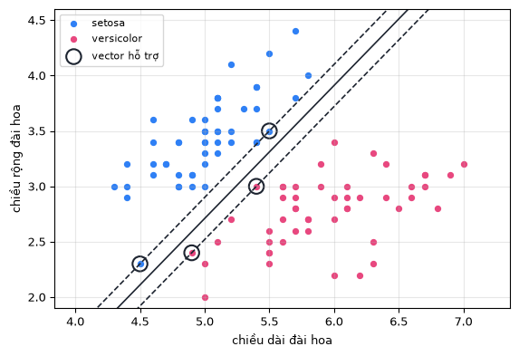

# Chương 25 · Ví dụ áp dụng: đối ngẫu trong máy vector hỗ trợ

> Ghi chú của người biên soạn: trang này do người biên soạn viết thêm, không có trong sách gốc. Trang giải cùng một bài toán phân loại thật theo hai cách, bài toán gốc và bài toán đối ngẫu ([chương 25](math/ch25_vi)), rồi dùng điều kiện lỏng lẻo bù trừ để giải thích vì sao chỉ vài điểm dữ liệu quyết định cả mô hình. Đây là ý tưởng trung tâm của máy vector hỗ trợ (SVM, [chương 26](ml/ch26_vi) của khoá Học máy).

## Bài toán

Ở [ví dụ áp dụng chương 23](math/ch23_app_vi), ta thấy hoa setosa và versicolor tách được tuyến tính. Có vô số siêu phẳng phân chia chúng. SVM chọn siêu phẳng có **lề** lớn nhất, tức xa các điểm gần nhất của hai lớp nhất. Bài toán có thể viết thành một quy hoạch toàn phương:

$$
\min_{\mathbf{w}, b}\ \frac{1}{2}\|\mathbf{w}\|_2^2 \quad \text{thoả mãn:}\ \ y_i(\mathbf{w}^T\mathbf{x}_i + b) \ge 1,\ \ i = 1, \dots, N,
$$

với $y_i = \pm 1$. Độ rộng của lề là $2 / \|\mathbf{w}\|_2$. [Chương 26](ml/ch26_vi) sẽ dẫn ra bài toán này chi tiết; ở đây ta tập trung vào đối ngẫu của nó.

## 1. Dữ liệu và bài toán gốc

Dùng hai đặc trưng của đài hoa (chiều dài, chiều rộng) để có thể vẽ được.

<!-- run -->
```python
import numpy as np
import matplotlib.pyplot as plt
from scipy.optimize import minimize, LinearConstraint, Bounds
from sklearn.datasets import load_iris

iris = load_iris()
mask = iris.target < 2                                     # setosa (0) và versicolor (1)
X = iris.data[mask][:, :2]
y = np.where(iris.target[mask] == 0, 1.0, -1.0)
N = len(y)
print("số điểm:", N)

# Bài toán gốc: biến (w1, w2, b), N ràng buộc tuyến tính y_i (w^T x_i + b) >= 1
A = y[:, None] * np.hstack([X, np.ones((N, 1))])
primal = minimize(lambda v: 0.5 * v[:2] @ v[:2], x0=np.zeros(3), jac=lambda v: np.r_[v[:2], 0],
                  constraints=[LinearConstraint(A, 1, np.inf)], method="SLSQP", options={"ftol": 1e-12, "maxiter": 500})
w_p, b_p = primal.x[:2], primal.x[2]
print(f"bài toán gốc: w = {w_p.round(4)}, b = {b_p:.4f}, p* = {primal.fun:.6f}, lề = {2 / np.linalg.norm(w_p):.4f}")
```

<!-- output -->
```output
số điểm: 100
bài toán gốc: w = [-6.3158  5.2632], b = 17.3158, p* = 33.795014, lề = 0.2433
```
<!-- /output -->

## 2. Bài toán đối ngẫu

<small class="viz-ref">Mục 25.2, 25.3</small>

Hàm Lagrange với nhân tử $\alpha_i \ge 0$ cho mỗi ràng buộc:

$$
\mathcal{L}(\mathbf{w}, b, \boldsymbol{\alpha}) = \frac{1}{2}\|\mathbf{w}\|_2^2 - \sum_i \alpha_i\left(y_i(\mathbf{w}^T\mathbf{x}_i + b) - 1\right).
$$

Cho gradient theo $\mathbf{w}$ và $b$ bằng 0: $\mathbf{w} = \sum_i \alpha_i y_i \mathbf{x}_i$ và $\sum_i \alpha_i y_i = 0$. Thay ngược lại, hàm đối ngẫu chỉ còn phụ thuộc $\boldsymbol{\alpha}$:

$$
g(\boldsymbol{\alpha}) = \sum_i \alpha_i - \frac{1}{2}\sum_{i, j} \alpha_i\alpha_j y_i y_j \mathbf{x}_i^T\mathbf{x}_j, \qquad \boldsymbol{\alpha} \succeq \mathbf{0},\ \ \sum_i \alpha_i y_i = 0.
$$

Bài toán đối ngẫu có $N = 100$ biến (thay vì 3), nhưng dữ liệu chỉ xuất hiện qua các **tích vô hướng** $\mathbf{x}_i^T\mathbf{x}_j$. Chính điều này cho phép SVM dùng "thủ thuật hạt nhân" ở [chương 28](ml/ch28_vi) của khoá Học máy.

<!-- run -->
```python
K = (y[:, None] * X) @ (y[:, None] * X).T                 # K_ij = y_i y_j x_i^T x_j
neg_g = lambda a: 0.5 * a @ K @ a - a.sum()
neg_g_grad = lambda a: K @ a - 1
dual = minimize(neg_g, x0=np.zeros(N), jac=neg_g_grad, bounds=Bounds(0, np.inf),
                constraints=[LinearConstraint(y[None, :], 0, 0)], method="SLSQP", options={"ftol": 1e-14, "maxiter": 1000})
alpha = np.where(dual.x > 1e-6, dual.x, 0.0)
w_d = (alpha * y) @ X                                      # w = sum alpha_i y_i x_i
sv = np.flatnonzero(alpha > 0)
b_d = np.mean(y[sv] - X[sv] @ w_d)                        # tại điểm có alpha_i > 0: y_i (w^T x_i + b) = 1
print(f"bài toán đối ngẫu: d* = {-dual.fun:.6f}  (p* = {primal.fun:.6f})")
print(f"w từ alpha = {w_d.round(4)}, b = {b_d:.4f}")
print("số alpha_i > 0:", len(sv), "trên", N, "; chỉ số:", sv, "; giá trị:", alpha[sv].round(4))
```

<!-- output -->
```output
bài toán đối ngẫu: d* = 33.795014  (p* = 33.795014)
w từ alpha = [-6.3158  5.2632], b = 17.3158
số alpha_i > 0: 4 trên 100 ; chỉ số: [36 41 57 84] ; giá trị: [15.9003 17.8947 16.3989 17.3961]
```
<!-- /output -->

$d^* = p^*$: đối ngẫu mạnh xảy ra, đúng như tiêu chuẩn Slater dự đoán (bài toán lồi, ràng buộc tuyến tính, có điểm khả thi). Siêu phẳng tìm từ bài toán đối ngẫu trùng với siêu phẳng của bài toán gốc.

## 3. Lỏng lẻo bù trừ: các vector hỗ trợ

<small class="viz-ref">Mục 25.4.1</small>

Điều kiện lỏng lẻo bù trừ nói $\alpha_i \left(y_i(\mathbf{w}^T\mathbf{x}_i + b) - 1\right) = 0$: hoặc $\alpha_i = 0$, hoặc điểm $i$ nằm đúng trên biên của lề. Vì $\mathbf{w} = \sum_i \alpha_i y_i\mathbf{x}_i$, chỉ những điểm có $\alpha_i > 0$, gọi là **vector hỗ trợ**, mới ảnh hưởng tới mô hình.

<!-- run -->
```python
margin_val = y * (X @ w_d + b_d)
print("y_i (w^T x_i + b) tại các vector hỗ trợ:", margin_val[sv].round(4))
print("giá trị nhỏ nhất tại các điểm còn lại:   ", margin_val[alpha == 0].min().round(4))
print("max |alpha_i (y_i(w^T x_i + b) - 1)|:     ", f"{np.abs(alpha * (margin_val - 1)).max():.1e}")

# Bỏ mọi điểm không phải vector hỗ trợ rồi huấn luyện lại: mô hình không đổi
keep = sv
A2 = y[keep, None] * np.hstack([X[keep], np.ones((len(keep), 1))])
r2 = minimize(lambda v: 0.5 * v[:2] @ v[:2], x0=np.zeros(3), jac=lambda v: np.r_[v[:2], 0],
              constraints=[LinearConstraint(A2, 1, np.inf)], method="SLSQP", options={"ftol": 1e-12})
print(f"\nchỉ giữ {len(keep)} vector hỗ trợ: w = {r2.x[:2].round(4)}, b = {r2.x[2]:.4f}")

from sklearn.svm import SVC
svc = SVC(kernel="linear", C=1e8).fit(X, y)
print(f"sklearn SVC: w = {svc.coef_.ravel().round(4)}, b = {svc.intercept_[0]:.4f}, vector hỗ trợ {np.sort(svc.support_)}")

fig, ax = plt.subplots(figsize=(5.8, 4))
for lab, col, name in [(1, "#2f80f5", "setosa"), (-1, "#e8487f", "versicolor")]:
    ax.scatter(*X[y == lab].T, s=18, color=col, label=name)
ax.scatter(*X[sv].T, s=140, facecolors="none", edgecolors="#1d2430", lw=1.5, label="vector hỗ trợ")
t = np.linspace(4, 7.2, 2)
for off, ls in [(0, "-"), (1, "--"), (-1, "--")]:
    ax.plot(t, (off - b_d - w_d[0] * t) / w_d[1], ls, color="#1d2430", lw=1.2)
ax.set_xlabel("chiều dài đài hoa"); ax.set_ylabel("chiều rộng đài hoa"); ax.set_ylim(1.9, 4.6); ax.legend(fontsize=8); ax.grid(alpha=.3)
fig.tight_layout()
```

<!-- output -->
```output
y_i (w^T x_i + b) tại các vector hỗ trợ: [1. 1. 1. 1.]
giá trị nhỏ nhất tại các điểm còn lại:    1.1053
max |alpha_i (y_i(w^T x_i + b) - 1)|:      3.7e-06

chỉ giữ 4 vector hỗ trợ: w = [-6.3158  5.2632], b = 17.3158
sklearn SVC: w = [-6.3141  5.2622], b = 17.3098, vector hỗ trợ [36 41 57 84]
```

<div align=center></div>
<!-- /output -->

Chỉ 4 trong 100 bông hoa nằm trên biên của lề ($y_i(\mathbf{w}^T\mathbf{x}_i + b) = 1$); mọi điểm khác có $\alpha_i = 0$ và nằm hẳn ngoài lề. scikit-learn chọn đúng 4 vector hỗ trợ này. Bỏ hết những điểm này đi và huấn luyện lại, ta được đúng mô hình cũ.

## Rút ra được gì

- Bài toán đối ngẫu của SVM có số biến bằng số điểm dữ liệu và chỉ dùng dữ liệu qua tích vô hướng.
- Đối ngẫu mạnh cho phép giải bài toán đối ngẫu rồi suy ra nghiệm của bài toán gốc ($\mathbf{w} = \sum_i \alpha_i y_i\mathbf{x}_i$).
- Lỏng lẻo bù trừ giải thích vì sao nghiệm "thưa": chỉ các vector hỗ trợ có $\alpha_i > 0$. Các chương [26](ml/ch26_vi)–[29](ml/ch29_vi) xây dựng SVM đầy đủ trên những ý tưởng này.
