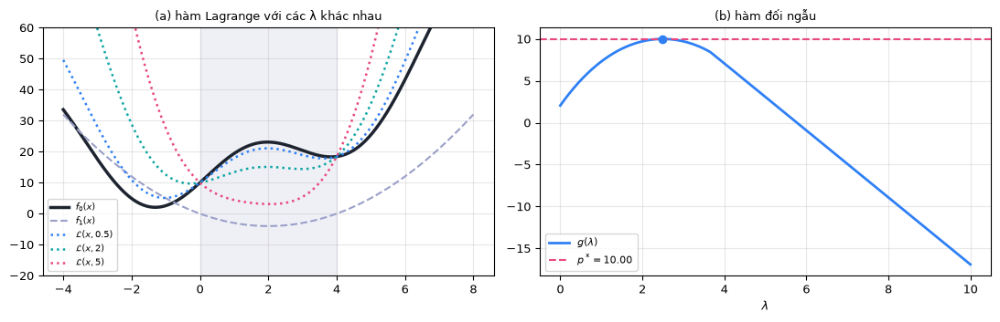
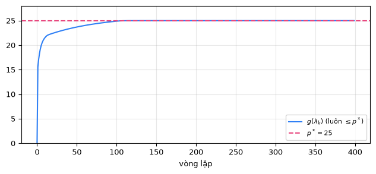

# Chương 25 · Code từ đầu

> Ghi chú của người biên soạn: trang này do người biên soạn viết thêm, không có trong sách gốc. Trang tính bằng số hàm đối ngẫu của Ví dụ 1 trong [chương 25](math/ch25_vi) (vẽ lại Hình 25.1), dựng và giải bài toán đối ngẫu của bài toán canh tác ([chương 24](math/ch24_vi)), giải một bài toán quy hoạch toàn phương bằng cách đi lên theo hàm đối ngẫu, và kiểm tra các điều kiện KKT tại nghiệm.

## Cách dùng trang này

Các khối chạy lần lượt từ trên xuống và dùng chung biến. Chỉ cần `numpy` và `matplotlib`.

## 1. Ví dụ 1: hàm đối ngẫu của một bài toán không lồi

<small class="viz-ref">Mục 25.2.4 · công thức (25.8) · Hình 25.1</small>

Bài toán: $\min_x\ x^2 + 10\sin x + 10$ thoả mãn $(x - 2)^2 \le 4$. Hàm đối ngẫu $g(\lambda) = \inf_x \mathcal{L}(x, \lambda)$ được tính bằng cách lấy giá trị nhỏ nhất của $\mathcal{L}$ trên một lưới $x$ rất mịn.

<!-- run -->
```python
import numpy as np
import matplotlib.pyplot as plt

f0 = lambda x: x ** 2 + 10 * np.sin(x) + 10
f1 = lambda x: (x - 2) ** 2 - 4
xs = np.linspace(-10, 10, 200001)
L = lambda x, lam: f0(x) + lam * f1(x)

lams = np.linspace(0, 10, 1001)
g = np.array([L(xs, lam).min() for lam in lams])            # g(lambda) = inf_x L(x, lambda)

feas = (xs >= 0) & (xs <= 4)
p_star = f0(xs[feas]).min(); x_star = xs[feas][np.argmin(f0(xs[feas]))]
d_star = g.max(); lam_star = lams[np.argmax(g)]
print(f"giá trị tối ưu của bài toán gốc p* = {p_star:.4f} tại x = {x_star:.4f}")
print(f"giá trị tối ưu của bài toán đối ngẫu d* = {d_star:.4f} tại lambda = {lam_star:.2f}")
print(f"khoảng cách đối ngẫu p* - d* = {p_star - d_star:.4f}")
print("g(lambda) <= p* với mọi lambda:", np.all(g <= p_star + 1e-9))
print("g lõm (sai phân bậc hai <= 0):", np.all(np.diff(g, 2) <= 1e-6))

fig, axes = plt.subplots(1, 2, figsize=(11, 3.6))
t = np.linspace(-4, 8, 600)
axes[0].plot(t, f0(t), color="#1d2430", lw=2.5, label="$f_0(x)$")
axes[0].plot(t, f1(t), "--", color="#9aa0c8", label="$f_1(x)$")
for lam, c in [(0.5, "#2f80f5"), (2, "#0ea5a4"), (5, "#e8487f")]:
    axes[0].plot(t, L(t, lam), ":", color=c, lw=1.8, label=f"$\\mathcal{{L}}(x, {lam})$")
axes[0].axvspan(0, 4, color="#9aa0c8", alpha=.15); axes[0].set_ylim(-20, 60); axes[0].legend(fontsize=7); axes[0].set_title("(a) hàm Lagrange với các λ khác nhau", fontsize=9)
axes[1].plot(lams, g, color="#2f80f5", lw=2, label=r"$g(\lambda)$")
axes[1].axhline(p_star, color="#e8487f", ls="--", label=f"$p^* = {p_star:.2f}$")
axes[1].plot(lam_star, d_star, "o", color="#2f80f5"); axes[1].set_xlabel(r"$\lambda$"); axes[1].legend(fontsize=8); axes[1].set_title("(b) hàm đối ngẫu", fontsize=9)
for ax in axes: ax.grid(alpha=.3)
fig.tight_layout()
```

<!-- output -->
```output
giá trị tối ưu của bài toán gốc p* = 10.0000 tại x = 0.0000
giá trị tối ưu của bài toán đối ngẫu d* = 10.0000 tại lambda = 2.50
khoảng cách đối ngẫu p* - d* = 0.0000
g(lambda) <= p* với mọi lambda: True
g lõm (sai phân bậc hai <= 0): True
```

<div align=center></div>
<!-- /output -->

Kết quả khớp với hai nhận xét của sách về Hình 25.1: $g(\lambda)$ luôn nằm dưới $p^*$ (đối ngẫu yếu), và $g$ là hàm lõm dù bài toán gốc không lồi (hàm mục tiêu có $\sin$).

Nghiệm $x^* = 0$ nằm trên biên của tập khả thi $[0, 4]$: nếu không có ràng buộc, $f_0$ đạt cực tiểu tại $x \approx -1.3$, ngoài tập khả thi. Ràng buộc chặt nên $\lambda^* = 2.5 > 0$. Ở bài toán này, $d^* = p^* = 10$: đối ngẫu mạnh vẫn xảy ra dù bài toán không lồi. Đó là một sự may mắn, không phải điều được đảm bảo; tiêu chuẩn Slater chỉ áp dụng cho bài toán lồi.

## 2. Ví dụ 2: bài toán đối ngẫu của một quy hoạch tuyến tính

<small class="viz-ref">Mục 25.2.4 · công thức (25.9)–(25.11)</small>

Bài toán canh tác viết dưới dạng $\min\ \mathbf{c}^T\mathbf{x}$ thoả mãn $\mathbf{G}\mathbf{x} \preceq \mathbf{h}$ (biến $\mathbf{x}$ tự do; các ràng buộc $x, y \ge 0$ nằm trong $\mathbf{G}$). Hàm Lagrange là $\mathbf{c}^T\mathbf{x} + \boldsymbol{\lambda}^T(\mathbf{G}\mathbf{x} - \mathbf{h})$, tuyến tính theo $\mathbf{x}$, nên

$$
g(\boldsymbol{\lambda}) = \inf_{\mathbf{x}} \left((\mathbf{c} + \mathbf{G}^T\boldsymbol{\lambda})^T\mathbf{x} - \mathbf{h}^T\boldsymbol{\lambda}\right) =
\begin{cases} -\mathbf{h}^T\boldsymbol{\lambda} & \text{nếu } \mathbf{G}^T\boldsymbol{\lambda} + \mathbf{c} = \mathbf{0} \\ -\infty & \text{ngược lại.} \end{cases}
$$

Bài toán đối ngẫu: $\max\ -\mathbf{h}^T\boldsymbol{\lambda}$ thoả mãn $\mathbf{G}^T\boldsymbol{\lambda} = -\mathbf{c}$, $\boldsymbol{\lambda} \succeq \mathbf{0}$. Đây lại là một quy hoạch tuyến tính, với 5 biến (mỗi ràng buộc của bài toán gốc một biến). Giải nó bằng cách liệt kê đỉnh như ở [trang Code chương 24](math/ch24_code_vi):

<!-- run -->
```python
from itertools import combinations

c = np.array([-5., -3])
G = np.array([[1., 1], [2, 1], [1, 4], [-1, 0], [0, -1]])
h = np.array([10., 16, 32, 0, 0])
names = ["x + y <= 10", "2x + y <= 16", "x + 4y <= 32", "x >= 0", "y >= 0"]

def vertices(Gi, hi, A, b):
    n = Gi.shape[1]; out = []
    for rows in combinations(range(len(Gi)), n - len(A)):
        M = np.vstack([A, Gi[list(rows)]]); r = np.r_[b, hi[list(rows)]]
        if abs(np.linalg.det(M)) > 1e-9:
            z = np.linalg.solve(M, r)
            if np.all(Gi @ z <= hi + 1e-9): out.append(z)
    return np.array(out)

# Đối ngẫu: biến lambda (5), ràng buộc G^T lambda = -c, -lambda <= 0
V = vertices(-np.eye(5), np.zeros(5), G.T, -c)
lam = V[np.argmax(-V @ h)]
lam = np.where(np.abs(lam) < 1e-12, 0.0, lam)                   # bỏ dấu của -0.0
print("nghiệm đối ngẫu lambda* =", lam.round(6))
print("d* = -h^T lambda* =", -h @ lam)

x_star = np.array([6., 4])                                      # nghiệm bài toán gốc (chương 24)
print("p* = c^T x* =", c @ x_star, " -> đối ngẫu mạnh: p* = d*")
```

<!-- output -->
```output
nghiệm đối ngẫu lambda* = [1. 2. 0. 0. 0.]
d* = -h^T lambda* = -42.0
p* = c^T x* = -42.0  -> đối ngẫu mạnh: p* = d*
```
<!-- /output -->

Giá trị tối ưu của bài toán gốc ($-42$, tức lợi nhuận 42) bằng giá trị tối ưu của bài toán đối ngẫu: **đối ngẫu mạnh** xảy ra, đúng như tiêu chuẩn Slater (bài toán lồi và có điểm khả thi chặt, chẳng hạn $(1, 1)$). Ý nghĩa của $\boldsymbol{\lambda}^*$ sẽ được bàn ở [trang Ví dụ áp dụng](math/ch25_app_vi).

## 3. Các điều kiện KKT

<small class="viz-ref">Mục 25.4 · công thức (25.13)–(25.17)</small>

Với bài toán lồi thoả mãn Slater, $(\mathbf{x}^*, \boldsymbol{\lambda}^*)$ là nghiệm khi và chỉ khi thoả mãn bốn nhóm điều kiện KKT:

<!-- run -->
```python
def kkt_report(grad_f0, G, h, x, lam, names):
    s = h - G @ x
    print("khả thi của bài toán gốc (G x <= h):    ", np.all(s >= -1e-9))
    print("khả thi của bài toán đối ngẫu (lambda >= 0):", np.all(lam >= -1e-9))
    print("lỏng lẻo bù trừ (lambda_i (h - Gx)_i = 0):", np.allclose(lam * s, 0, atol=1e-8))
    print("gradient của L theo x bằng 0:           ", np.allclose(grad_f0(x) + G.T @ lam, 0, atol=1e-8))
    for n_, li, si in zip(names, lam, s):
        print(f"   {n_:14s}: lambda = {li:6.3f}, phần dư h - Gx = {si:6.3f}" + ("   <- chặt" if abs(si) < 1e-9 else ""))

kkt_report(lambda x: c, G, h, x_star, lam, names)
```

<!-- output -->
```output
khả thi của bài toán gốc (G x <= h):     True
khả thi của bài toán đối ngẫu (lambda >= 0): True
lỏng lẻo bù trừ (lambda_i (h - Gx)_i = 0): True
gradient của L theo x bằng 0:            True
   x + y <= 10   : lambda =  1.000, phần dư h - Gx =  0.000   <- chặt
   2x + y <= 16  : lambda =  2.000, phần dư h - Gx =  0.000   <- chặt
   x + 4y <= 32  : lambda =  0.000, phần dư h - Gx = 10.000
   x >= 0        : lambda =  0.000, phần dư h - Gx =  6.000
   y >= 0        : lambda =  0.000, phần dư h - Gx =  4.000
```
<!-- /output -->

Lỏng lẻo bù trừ hiện rõ trên bảng: ràng buộc nào có $\lambda_i > 0$ thì chặt (phần dư bằng 0); ràng buộc nào còn dư thì $\lambda_i = 0$.

## 4. Giải bài toán gốc bằng cách đi lên theo hàm đối ngẫu

Với bài toán quy hoạch toàn phương của mục 24.5.2, $\min \frac{1}{2}\|\mathbf{x} - \mathbf{u}\|_2^2$ thoả mãn $\mathbf{G}\mathbf{x} \preceq \mathbf{h}$, hàm Lagrange đạt cực tiểu theo $\mathbf{x}$ tại $\mathbf{x}(\boldsymbol{\lambda}) = \mathbf{u} - \mathbf{G}^T\boldsymbol{\lambda}$, và

$$
g(\boldsymbol{\lambda}) = -\frac{1}{2}\|\mathbf{G}^T\boldsymbol{\lambda}\|_2^2 + \boldsymbol{\lambda}^T(\mathbf{G}\mathbf{u} - \mathbf{h}), \qquad \nabla g(\boldsymbol{\lambda}) = \mathbf{G}\mathbf{x}(\boldsymbol{\lambda}) - \mathbf{h}.
$$

Bài toán đối ngẫu chỉ có ràng buộc đơn giản $\boldsymbol{\lambda} \succeq \mathbf{0}$. Ta giải nó bằng gradient *ascent* rồi chiếu về $\boldsymbol{\lambda} \succeq \mathbf{0}$ sau mỗi bước (cắt các giá trị âm về 0). Gradient của $g$ chính là mức độ vi phạm ràng buộc của $\mathbf{x}(\boldsymbol{\lambda})$: ràng buộc nào bị vi phạm thì nhân tử của nó tăng lên, như một mức "phạt" tự điều chỉnh.

<!-- run -->
```python
u = np.array([10., 10])
x_of = lambda lam: u - G.T @ lam
g_qp = lambda lam: -0.5 * np.sum((G.T @ lam) ** 2) + lam @ (G @ u - h)
f_qp = lambda x: 0.5 * np.sum((x - u) ** 2)

lam_k = np.zeros(5); eta = 0.05; hist = []
for k in range(400):
    x_k = x_of(lam_k)
    hist.append((g_qp(lam_k), f_qp(x_k), np.max(G @ x_k - h)))
    lam_k = np.maximum(0, lam_k + eta * (G @ x_k - h))       # bước đi lên + chiếu về lambda >= 0
x_k = x_of(lam_k)
print("lambda =", lam_k.round(4))
print("x(lambda) =", x_k.round(4), "(sách: [5, 5])")
hist = np.array(hist)
print(f"vòng cuối: g(lambda) = {hist[-1, 0]:.6f}, f0(x) = {f_qp(x_k):.6f}, vi phạm ràng buộc lớn nhất = {hist[-1, 2]:.1e}")

fig, ax = plt.subplots(figsize=(6.4, 3))
ax.plot(hist[:, 0], color="#2f80f5", label=r"$g(\lambda_k)$ (luôn $\leq p^*$)")
ax.axhline(25, color="#e8487f", ls="--", label="$p^* = 25$")
ax.set_xlabel("vòng lặp"); ax.set_ylim(0, 28); ax.legend(fontsize=8); ax.grid(alpha=.3)
fig.tight_layout()
kkt_report(lambda x: x - u, G, h, np.array([5., 5]), np.r_[5., 0, 0, 0, 0], names)
```

<!-- output -->
```output
lambda = [5. 0. 0. 0. 0.]
x(lambda) = [5. 5.] (sách: [5, 5])
vòng cuối: g(lambda) = 25.000000, f0(x) = 25.000000, vi phạm ràng buộc lớn nhất = 1.4e-14
khả thi của bài toán gốc (G x <= h):     True
khả thi của bài toán đối ngẫu (lambda >= 0): True
lỏng lẻo bù trừ (lambda_i (h - Gx)_i = 0): True
gradient của L theo x bằng 0:            True
   x + y <= 10   : lambda =  5.000, phần dư h - Gx =  0.000   <- chặt
   2x + y <= 16  : lambda =  0.000, phần dư h - Gx =  1.000
   x + 4y <= 32  : lambda =  0.000, phần dư h - Gx =  7.000
   x >= 0        : lambda =  0.000, phần dư h - Gx =  5.000
   y >= 0        : lambda =  0.000, phần dư h - Gx =  5.000
```

<div align=center></div>
<!-- /output -->

Mọi giá trị $g(\boldsymbol{\lambda}_k)$ đều là chặn dưới của $p^* = \frac{1}{2}\|(5, 5) - (10, 10)\|_2^2 = 25$, và chúng tăng dần tới $p^*$. Nhân tử $\lambda_1 = 5$ của ràng buộc $x + y \le 10$ là ràng buộc duy nhất khác 0, đúng với ràng buộc chặt duy nhất. Ở các vòng đầu, $\mathbf{x}(\boldsymbol{\lambda})$ nằm ngoài tập khả thi; nó chỉ trở thành khả thi khi thuật toán hội tụ. Cách làm này (giải bài toán đối ngẫu, rồi suy ra nghiệm của bài toán gốc) chính là cách máy vector hỗ trợ được huấn luyện ([chương 26](ml/ch26_vi) của khoá Học máy).
