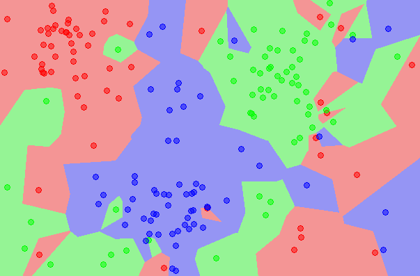
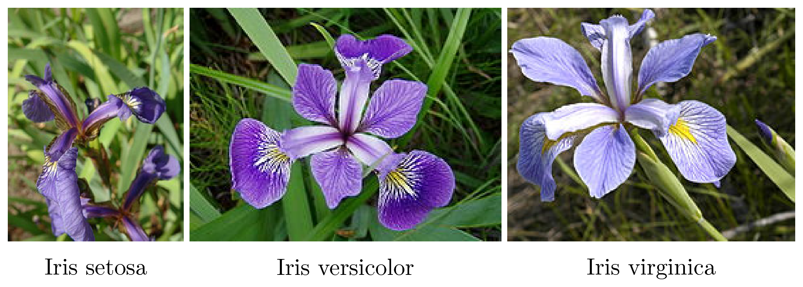
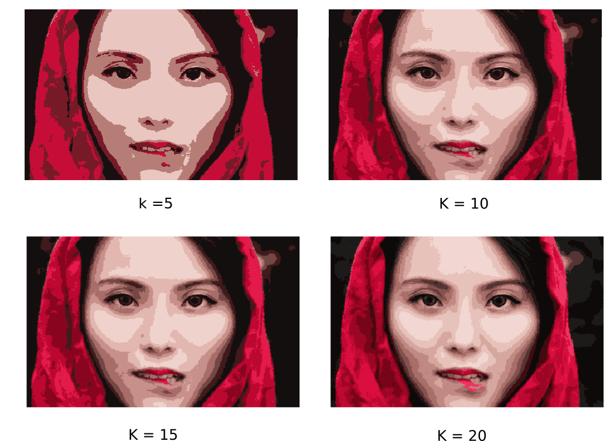
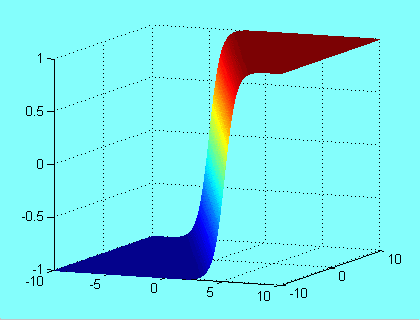
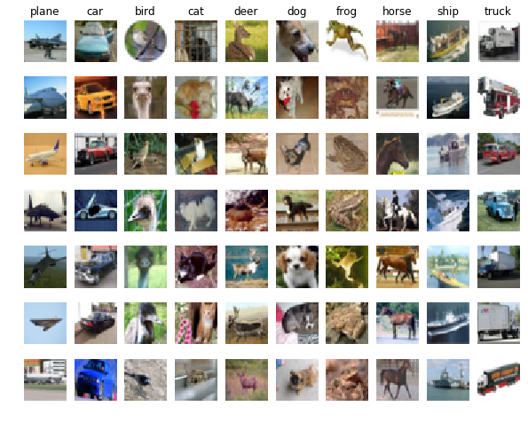

# Phụ lục B Ảnh màu

> Ghi chú của người biên soạn: chương này lấy nguyên văn từ sách *Machine Learning cơ bản* của **Vũ Hữu Tiệp** ([mã nguồn LaTeX](https://github.com/tiepvupsu/ebookMLCB), giấy phép [CC BY-SA 4.0](https://creativecommons.org/licenses/by-sa/4.0/); trang gốc [machinelearningcoban.com](https://machinelearningcoban.com)). Người biên soạn chỉ đổi định dạng sang trang web: số chương, mục, công thức và hình giữ như bản PDF.

Hình B.1: Ví dụ về 1NN. Các hình tròn khác màu thể hiện các điểm dữ liệu huấn luyện của các lớp khác nhau. Các vùng nền thể hiện những điểm được phân loại vào lớp có màu tương ứng khi sử dụng 1NN (Nguồn: K-nearest neighbors algorithm – Wikipedia (<https://goo.gl/Ba4xhX>), ảnh màu của Hình B.1.).

Hình B.2: Ba loại hoa lan trong bộ cơ sở dữ liệu hoa Iris (ảnh màu của Hình 9.2 (chương [9](ml/ch09_vi), *$K$ lân cận*)).

Hình B.3: *Ảnh:Trọng Vũ* (<https://goo.gl/9D8aXW>, ảnh màu của Hình 10.7 (chương [10](ml/ch10_vi), *Phân cụm $K$-means*)) .

Hình B.4: Kết quả nhận được sau khi thực hiện phân cụm K-means cho các điểm dữ liệu. Có ba cụm dữ liệu tương ứng với ba màu đỏ, hồng, đen (ảnh màu của Hình 10.8 (chương [10](ml/ch10_vi), *Phân cụm $K$-means*)).

Hình B.5: Chất lượng nén ảnh với số lượng cụm khác nhau (ảnh màu của Hình 10.9 (chương [10](ml/ch10_vi), *Phân cụm $K$-means*)).

Hình B.6: Đồ thị hàm sigmoid trong không gian hai chiều (ảnh màu của Hình 14.4(b) (chương [14](ml/ch14_vi), *Hồi quy logistic*)).

Hình B.7: Ví dụ về các bức ảnh trong 10 lớp của bộ dữ liệu CIFAR10 (ảnh màu của Hình 29.1 (chương [29](ml/ch29_vi), *Máy vector hỗ trợ đa lớp*)).

Hình B.8: Minh họa hệ số tìm được dưới dạng các bức ảnh (ảnh màu của Hình B.8).

