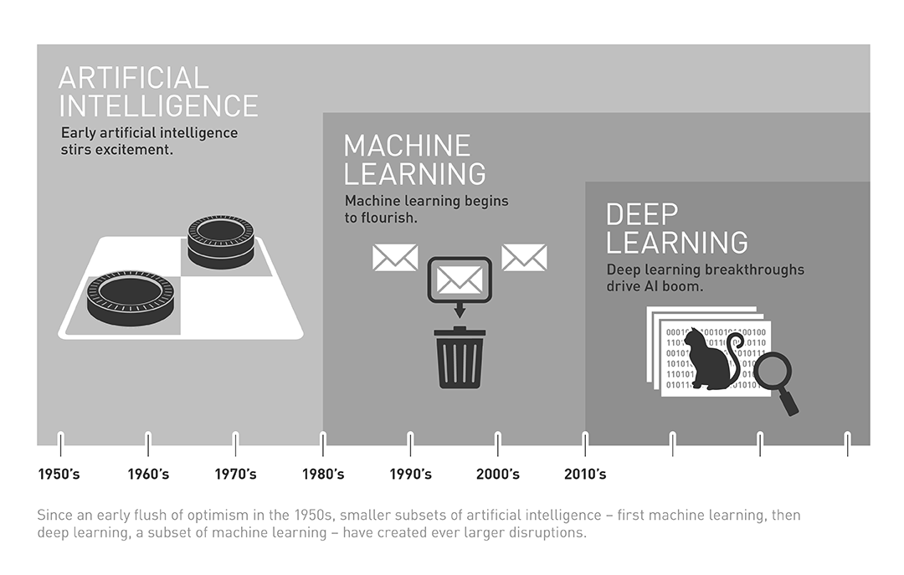

# Chương 0 Lời nói đầu

> Ghi chú của người biên soạn: chương này lấy nguyên văn từ sách *Machine Learning cơ bản* của **Vũ Hữu Tiệp** ([mã nguồn LaTeX](https://github.com/tiepvupsu/ebookMLCB), giấy phép [CC BY-SA 4.0](https://creativecommons.org/licenses/by-sa/4.0/); trang gốc [machinelearningcoban.com](https://machinelearningcoban.com)). Người biên soạn chỉ đổi định dạng sang trang web: số chương, mục, công thức và hình giữ như bản PDF.

Những năm gần đây, ***trí tuệ nhân tạo*** (artificial intelligence, AI) dần nổi lên như một minh chứng cho cuộc cách mạng công nghiệp lần thứ tư, sau động cơ hơi nước, năng lượng điện và công nghệ thông tin. Trí tuệ nhân tạo đã và đang trở thành nhân tố cốt lõi trong các hệ thống công nghệ cao. Thậm chí, nó đã len lỏi vào hầu hết các lĩnh vực của đời sống mà có thể chúng ta không nhận ra. Xe tự hành của Google và Tesla, hệ thống tự tag khuôn mặt trong ảnh của Facebook, trợ lý ảo Siri của Apple, hệ thống gợi ý sản phẩm của Amazon, hệ thống gợi ý phim của Netflix, hệ thống dịch đa ngôn ngữ Google Translate, máy chơi cờ vây AlphaGo và gần đây là AlphaGo Zero của Google DeepMind,... chỉ là một vài ứng dụng nổi bật trong vô vàn những ứng dụng của trí tuệ nhân tạo.

***Học máy*** (machine learning, ML) là một tập con của trí tuệ nhân tạo. Machine learning là một lĩnh vực nhỏ trong khoa học máy tính, có khả năng tự học hỏi dựa trên dữ liệu được đưa vào mà không cần phải được lập trình cụ thể (*Machine Learning is the subfield of computer science, that “gives computers the ability to learn without being explicitly programmed”* – Wikipedia).

Những năm gần đây, sự phát triển của các hệ thống tính toán cùng lượng dữ liệu khổng lồ được thu thập bởi các hãng công nghệ lớn đã giúp machine learning tiến thêm một bước dài. Một lĩnh vực mới được ra đời được gọi là ***học sâu*** (deep learning, DL). Deep learning đã giúp máy tính thực thi những việc vào mười năm trước tưởng chừng là không thể: phân loại cả ngàn vật thể khác nhau trong các bức ảnh, tự tạo chú thích cho ảnh, bắt chước giọng nói và chữ viết, giao tiếp với con người, chuyển đổi ngôn ngữ, hay thậm chí cả sáng tác văn thơ và âm nhạc<sup>1</sup>.

<div align=center>

</div>
<div align=center>Hình 0.1: Mối quan hệ giữa AI, ML, và DL. (Nguồn *What’s the Difference Between Artificial Intelligence, Machine Learning, and Deep Learning?* – <https://goo.gl/NNwGCi>).</div>

> **Mối quan hệ AI-ML-DL**
>
> DL là một tập con của ML. ML là một tập con của AI (xem Hình 0.1).

## 0.1 Mục đích của cuốn sách

Những phát triển thần kỳ của trí tuệ nhân tạo dẫn tới nhu cầu cao về mặt nhần lực làm việc trong các ngành liên quan tới machine learning ở Việt Nam cũng như trên thế giới. Đó cũng là nguồn động lực để tác giả gây dựng và phát triển blog Machine Learning cơ bản từ đầu năm 2017 (<https://machinelearningcoban.com>). Tính tới thời điểm đặt bút viết những dòng này, blog đã có hơn một triệu lượt ghé thăm. Facebook page Machine Learning cơ bản<sup>2</sup> chạm mốc 14 nghìn lượt likes, Forum Machine Learning cơ bản<sup>3</sup> đạt tới 17 nghìn thành viên. Trong quá trình viết blog và duy trì các trang Facebook, tác giả đã nhận được nhiều sự ủng hộ của bạn đọc về tinh thần cũng như vật chất. Nhiều bạn đọc cũng khuyến khích tác giả tổng hợp kiến thức trên blog thành một cuốn sách cho cộng đồng những người tiếp cận với ML bằng tiếng Việt. Sự ủng hộ và những lời động viên đó là động lực lớn cho tác giả khi bắt tay vào thực hiện và hoàn thành cuốn sách này.

Lĩnh vực ML nói chung và DL nói riêng là cực kỳ lớn và có nhiều nhánh nhỏ. Phạm vi một cuốn sách chắc chắn không thể bao quát hết mọi vấn đề và đi sâu vào từng nhánh cụ thể. Do vậy, cuốn sách này chỉ nhằm cung cấp cho bạn đọc những khái niệm, kỹ thuật chung và các thuật toán cơ bản nhất của ML. Từ đó, bạn đọc có thể tự tìm thêm các cuốn sách và khóa học liên quan nếu muốn đi sâu vào từng vấn đề.

Hãy nhớ rằng *luôn bắt đầu từ những điều đơn giản*. Khi bắt tay vào giải quyết một bài toán ML hay bất cứ bài toán nào, chúng ta nên bắt đầu từ những thuật toán đơn giản. Không phải chỉ có những thuật toán phức tạp mới có thể giải quyết được vấn đề. Những thuật toán phức tạp thường có yêu cầu cao về khả năng tính toán và đôi khi nhạy cảm với cách chọn tham số. Ngược lại, những thuật toán đơn giản giúp chúng ta nhanh chóng có một bộ khung cho mỗi bài toán. Kết quả của các thuật toán đơn giản cũng mang lại cái nhìn sơ bộ về sự phức tạp của mỗi bài toán. Việc cải thiện kết quả sẽ được thực hiện dần ở các bước sau. Cuốn sách này sẽ trang bị cho bạn đọc những kiến thức khái quát và một số hướng tiếp cận cơ bản cho các bài toán ML. Để tạo ra các sản phẩm thực tiễn, chúng ta cần học hỏi và thực hành thêm nhiều.

## 0.2 Hướng tiếp cận của cuốn sách

Để giải quyết mỗi bài toán ML, chúng ta cần chọn một mô hình phù hợp. Mô hình này được mô tả bởi bộ các tham số mà chúng ta cần đi tìm. Thông thường, lượng tham số có thể lên tới hàng triệu và được tìm bằng cách giải một bài toán tối ưu.

Khi viết về các thuật toán ML, tác giả sẽ bắt đầu từ những ý tưởng trực quan. Những ý tưởng này được mô hình hoá dưới dạng một bài toán tối ưu. Các suy luận toán học và ví dụ mẫu trên Python ở cuối mỗi chương sẽ giúp bạn đọc hiểu rõ hơn về nguồn gốc, ý nghĩa, và cách sử dụng mỗi thuật toán. Xen kẽ giữa những thuật toán ML, tác giả sẽ trình bày các kỹ thuật tối ưu cơ bản, với hy vọng giúp bạn đọc hiểu rõ hơn bản chất của vấn đề.

## 0.3 Đối tượng của cuốn sách

Cuốn sách được thực hiện hướng tới nhiều nhóm độc giả khác nhau. Nếu bạn không thực sự muốn đi sâu vào phần toán, bạn vẫn có thể tham khảo mã nguồn và cách sử dụng các thư viện. Nhưng để sử dụng các thư viện một cách hiệu quả, bạn cũng cần hiểu nguồn gốc của mô hình và ý nghĩa của các tham số. Còn nếu bạn thực sự muốn tìm hiểu nguồn gốc, ý nghĩa của các thuật toán, bạn có thể học được nhiều điều từ cách xây dựng và tối ưu các mô hình. Phần tổng hợp các kiến thức toán cần thiết trong Phần 1 (*Kiến thức toán cơ bản*) sẽ là một nguồn tham khảo súc tích bất cứ khi nào bạn có thắc mắc về các dẫn giải toán học. Phần 7 (*Tối ưu lồi*) được dành riêng để nói về tối ưu lồi – một mảng quan trọng trong tối ưu, phù hợp với các bạn thực sự muốn đi sâu thêm về tối ưu.

Các dẫn giải toán học được xây dựng phù hợp với chương trình toán phổ thông và đại học ở Việt Nam. Các từ khóa khi được dịch sang tiếng Việt đều dựa trên những tài liệu tác giả được học trong nhiều năm tại Việt Nam.

Phần cuối cùng của sách có mục Index các thuật ngữ quan trọng và thuật ngữ tiếng Anh đi kèm giúp bạn dần làm quen khi đọc các tài liệu tiếng Anh.

## 0.4 Yêu cầu về kiến thức

Để có thể bắt đầu đọc cuốn sách này, bạn cần có một kiến thức nhất định về đại số tuyến tính, giải tích ma trận, xác suất thống kê, và kỹ năng lập trình.

Phần 1 (*Kiến thức toán cơ bản*) của cuốn sách ôn tập lại các kiến thức toán quan trọng được dùng trong ML. Khi gặp khó khăn về toán, bạn được khuyến khích đọc lại các chương trong phần này.

Ngôn ngữ lập trình được sử dụng trong cuốn sách là Python. Python là một ngôn ngữ lập trình miễn phí, có thể được cài đặt dễ dàng trên các nền tảng hệ điều hành khác nhau. Quan trọng hơn, có rất nhiều thư viện hỗ trợ ML cũng như DL trên Python. Có hai thư viện Python chính thường được sử dụng trong cuốn sách là numpy và scikit-learn.

Numpy (<http://www.numpy.org/>) là một thư viện phổ biến giúp xử lý các phép toán liên quan đến các mảng nhiều chiều, hỗ trợ các hàm gần gũi với đại số tuyến tính.

Scikit-learn, hay sklearn (<http://scikit-learn.org/>), là một thư viện chứa đầy đủ các thuật toán ML cơ bản và rất dễ sử dụng. Tài liệu của scikit-learn cũng là một nguồn tham khảo chất lượng cho các bạn làm ML. Scikit-learn sẽ được dùng trong cuốn sách để kiểm chứng các suy luận toán học và các mô hình được xây dựng thông qua numpy.

Có rất nhiều thư viện giúp chúng ta tạo ra các sản phẩm ML/DL mà không yêu cầu nhiều kiến thức toán. Tuy nhiên, cuốn sách này hướng tới việc giúp bạn đọc hiểu bản chất toán học đằng sau mỗi mô hình trước khi áp dụng các thư viện sẵn có. Việc sử dụng thư viện cũng yêu cầu kiến thức nhất định về việc lựa chọn mô hình và điều chỉnh các tham số.

## 0.5 Mã nguồn đi kèm

Toàn bộ mã nguồn trong cuốn sách có thể được tìm thấy tại <https://goo.gl/Fb2p4H>. Các file có đuôi `.ipynb` là các Jupyter notebook chứa mã nguồn. Các file có đuôi `.pdf`, và `.png` là các hình vẽ được sử dụng trong cuốn sách.

## 0.6 Bố cục của cuốn sách

Cuốn sách này được chia thành 8 phần và sẽ tiếp tục được cập nhật:

Phần 1 (*Kiến thức toán cơ bản*) ôn tập lại những kiến thức quan trọng trong đại số tuyến tính, giải tích ma trận, xác suất, và hai phương pháp phổ biến trong việc ước lượng tham số cho các mô hình ML dựa trên thống kê.

Phần 2 (*Tổng quan*) giới thiệu các khái niệm cơ bản trong ML, các kỹ thuật xây dựng vector đặc trưng cho dữ liệu, một mô hình ML cơ bản – hồi quy, và một hiện tượng cần tránh khi xây dựng các mô hình ML.

Phần 3 (*Khởi động*) giúp các bạn làm quen với các mô hình ML không yêu cầu nhiều kiến thức toán phức tạp. Qua đây, bạn đọc sẽ có cái nhìn sơ bộ về việc xây dựng các mô hình ML.

Phần 4 (*Mạng neuron nhân tạo*) đề cập tới một nhóm các thuật toán ML phổ biến nhất – mạng neuron nhân tạo, là nền tảng cho các mô hình DL phức tạp hiện nay. Phần này cũng giới thiệu một kỹ thuật tối ưu phổ biến cho các bài toán tối ưu không ràng buộc.

Phần 5 (*Hệ thống gợi ý*) giới thiệu về các kỹ thuật thường dùng trong các hệ thống gợi ý sản phẩm.

Phần 6 (*Giảm chiều dữ liệu*) giới thiệu các kỹ thuật giảm chiều dữ liệu.

Phần 7 (*Tối ưu lồi*) trình bày cụ thể hơn về tối ưu, đặc biệt là tối ưu lồi. Các bài toán tối ưu lồi có ràng buộc cũng được giới thiệu trong phần này.

Phần 8 (*Máy vector hỗ trợ*) giới thiệu các thuật toán phân loại dựa trên máy vector hỗ trợ.

## 0.7 Các lưu ý về ký hiệu

Các ký hiệu toán học trong sách được mô tả ở Bảng 0.1 và đầu Chương [1](math/ch01_vi) (*Ôn tập Đại số tuyến tính*). Các khung với font chữ có cùng chiều rộng được dùng để chứa các đoạn mã nguồn.

```text
text in a box with constant width represents source codes.
```

Các đoạn ký tự với `constant width` (có cùng chiều rộng) được dùng để chỉ các biến, hàm số, chuỗi,... trong các đoạn mã.

> **Đóng khung và in nghiêng**
>
> Các khái niệm, định nghĩa, định lý, và lưu ý quan trọng được đóng khung và in nghiêng.
>
> Ký tự phân cách giữa phần nguyên và phần thập phân của các số thực là dấu chấm (.) thay vì dấu phẩy (,) như trong các tài liệu tiếng Việt khác. Cách làm này thống nhất với các tài liệu tiếng Anh và các ngôn ngữ lập trình.

## 0.8 Tham khảo thêm

Có nhiều cuốn sách, khóa học, website hay về machine learning/deep learning. Trong đó, tôi xin đặc biệt nhấn mạnh các nguồn tham khảo sau:

### 0.8.1 Khoá học

1.  Khoá học *Machine Learning* của Andrew Ng trên Coursera (<https://goo.gl/WBwU3K>).

2.  Khoá học mới *Deep Learning Specialization* cũng của Andrew Ng trên Coursera (<https://goo.gl/ssXfYN>).

3.  Các khóa *CS224n: Natural Language Processing with Deep Learning* (<https://goo.gl/6XTNkH>); *CS231n: Convolutional Neural Networks for Visual Recognition* (<http://cs231n.stanford.edu/>); *CS246: Mining Massive Data Sets* (<https://goo.gl/TEMQ9H>) của Stanford.

### 0.8.2 Sách

1.  C. Bishop, *Pattern Recognition and Machine Learning* (<https://goo.gl/pjgqRr>), Springer, 2006 .

2.  I. Goodfellow , *Deep Learning* (<https://goo.gl/sXaGwV>), MIT press, 2016 .

3.  J. Friedman , *The Elements of Statistical Learning* (<https://goo.gl/Qh9EkB>), Springer, 2001 .

4.  Y. Abu-Mostafa , *Learning from data* (<https://goo.gl/SRfNFJ>), AMLBook New York, 2012 .

5.  S. JD Prince, *Computer Vision: Models, Learning, and Inference* (<https://goo.gl/9Fchf3>), Cambridge University Press, 2012 .

6.  S. Boyd , *Convex Optimization* (<https://goo.gl/NomDpC>), Cambridge university press, 2004 .

Ngoài ra, các website *Machine Learning Mastery* (<https://goo.gl/5DwGbU>), *Pyimagesearch* (<https://goo.gl/5DwGbU>). *Kaggle* (<https://www.kaggle.com/>), *Scikit-learn* (<http://scikit-learn.org/>) cũng là các nguồn thông tin hữu ích.

## 0.9 Đóng góp ý kiến

Các bạn có thể gửi các đóng góp tới địa chỉ email *vuhuutiep@gmail.com* hoặc tạo một *GitHub issue* mới tại <https://goo.gl/zPYWKV>.

## 0.10 Lời cảm ơn

Trước hết, tôi xin được cảm ơn sự ủng hộ và chia sẻ nhiệt tình của bạn bè trên Facebook từ những ngày đầu ra mắt blog. Xin được gửi lời cảm ơn chân thành tới bạn đọc Machine Learning cơ bản đã đồng hành trong hơn một năm qua.

Tôi cũng may mắn nhận được những góp ý và phản hồi tích cực từ các thầy cô tại các trường đại học lớn trong và ngoài nước. Xin phép được gửi lời cảm ơn tới thầy Phạm Ngọc Nam và cô Nguyễn Việt Hương (ĐH Bách Khoa Hà Nội), thầy Chế Viết Nhật Anh (ĐH Bách Khoa TP.HCM), thầy Nguyễn Thanh Tùng (ĐH Thuỷ Lợi), và thầy Trần Duy Trác (ĐH Johns Hopkins).

Đặc biệt, xin cảm ơn Nguyễn Hoàng Linh và Hoàng Đức Huy, Đại học Waterloo, Canada đã nhiệt tình giúp tôi xây dựng trang FundaML, cho phép độc giả học Python/Numpy trực tiếp trên trình duyệt. Xin cảm ơn các bạn Nguyễn Tiến Cường, Nguyễn Văn Giang, Vũ Đình Quyền, Lê Việt Hải, và Đinh Hoàng Phong đã góp ý sửa đổi nhiều điểm trong các bản nháp.

Ngoài ta, cũng xin cảm ơn những người bạn thân của tôi tại Penn State (ĐH bang Pennsylvania) đã luôn bên cạnh tôi trong thời gian tôi thực hiện dự án, bao gồm gia đình anh Triệu Thanh Quang, gia đình anh Trần Quốc Long, bạn thân Nguyễn Phương Chi, và các đồng nghiệp tại Phòng nghiên cứu Xử lý Thông tin và Thuật toán (Information Processing and Algorithm Laboratory, iPAL).

Cuối cùng và quan trọng nhất, xin gửi lời cảm ơn sâu sắc nhất tới gia đình tôi, những người luôn ủng hộ vô điều kiện và hỗ trợ tôi hết mình trong quá trình thực hiện dự án này.

## 0.11 Bảng các ký hiệu

Các ký hiệu sử dụng trong sách được liệt kê trong Bảng 0.1 ở trang tiếp theo.

<div align=center>Bảng 0.1: Các quy ước ký hiệu và tên gọi được sử dụng trong sách</div>

|                   Ký hiệu                    | Ý nghĩa                                                                     |
|:--------------------------------------------:|:----------------------------------------------------------------------------|
|                 $x, y, N, k$                 | in nghiêng, thường hoặc hoa, là các số vô hướng                             |
|                  $\mathbf{x}, \mathbf{y}$                  | in đậm, chữ thường, là các vector                                           |
|                  $\mathbf{X}, \mathbf{Y}$                  | in đậm, chữ hoa, là các ma trận                                             |
|                 $\mathbb{R}$                 | tập hợp các số thực                                                         |
|                 $\mathbb{N}$                 | tập hợp các số tự nhiên                                                     |
|                 $\mathbb{C}$                 | tập hợp các số phức                                                         |
|               $\mathbb{R}^{m}$               | tập hợp các vector thực có $m$ phần tử                                      |
|           $\mathbb{R}^{m\times n}$           | tập hợp các ma trận thực có $m$ hàng, $n$ cột                               |
|                $\mathbb{S}^n$                | tập hợp các ma trận vuông đối xứng bậc $n$                                  |
|              $\mathbb{S}^n_{+}$              | tập hợp các ma trận nửa xác định dương bậc $n$                              |
|             $\mathbb{S}^n_{++}$              | tập hợp các ma trận xác định dương bậc $n$                                  |
|                    $\in$                     | phần tử thuộc tập hợp                                                       |
|                  $\exists$                   | tồn tại                                                                     |
|                  $\forall$                   | mọi                                                                         |
|                 $\triangleq$                 | ký hiệu là/bởi. Ví dụ $a\triangleq f(x)$ nghĩa là “ký hiệu $f(x)$ bởi $a$”. |
|                    $x_i$                     | phần tử thứ $i$ (tính từ 1) của vector $\mathbf{x}$                                |
|                  $\text{sgn}(x)$                   | hàm xác định dấu. Bằng 1 nếu $x \geq 0$, bằng -1 nếu $x < 0$.               |
|                  $\exp(x)$                   | $e^x$                                                                       |
|                  $\log(x)$                   | logarit *tự nhiên* của số thực dương $x$                                    |
|        $\displaystyle \operatorname*{argmin}_xf(x)$         | giá trị của $x$ để hàm $f(x)$ đạt giá trị nhỏ nhất                          |
|        $\displaystyle \operatorname*{argmax}_xf(x)$         | giá trị của $x$ để hàm $f(x)$ đạt giá trị lớn nhất                          |
|                   $a_{ij}$                   | phần tử hàng thứ $i$, cột thứ $j$ của ma trận $\mathbf{A}$                         |
|                   $\mathbf{A}^T$                    | chuyển vị của ma trận $\mathbf{A}$                                                 |
|                   $\mathbf{A}^H$                    | chuyển vị liên hợp (Hermitian) của ma trận phức $\mathbf{A}$                       |
|                  $\mathbf{A}^{-1}$                  | nghịch đảo của ma trận vuông $\mathbf{A}$, nếu tồn tại                             |
|               $\mathbf{A}^{\dagger}$                | giả nghịch đảo của ma trận không nhất thiết vuông $\mathbf{A}$                     |
|                  $\mathbf{A}^{-T}$                  | chuyển vị của nghịch đảo của ma trận $\mathbf{A}$, nếu tồn tại                     |
|                 $\|\mathbf{x}\|_p$                  | $\ell_p$ norm của vector $\mathbf{x}$                                              |
|                 $\|\mathbf{A}\|_F$                  | Frobenius norm của ma trận $\mathbf{A}$                                            |
|                 $\text{diag}(\mathbf{A})$                 | đường chéo chính của ma trận $\mathbf{A}$                                          |
|                $\text{trace}(\mathbf{A})$                 | trace của ma trận $\mathbf{A}$                                                     |
|                 $\det(\mathbf{A})$                  | định thức của ma trận vuông $\mathbf{A}$                                           |
|              $\text{rank}(\mathbf{A})$              | hạng của ma trận $\mathbf{A}$                                                      |
|                     o.w                      | *otherwise* – trong các trường hợp còn lại                                  |
| $\displaystyle\frac{\partial f}{\partial x}$ | đạo hàm của hàm số $f$ theo $x \in \mathbb{R}$                              |
|               $\nabla_{\mathbf{x}}f$                | gradient của hàm số $f$ theo $\mathbf{x}$ ($\mathbf{x}$ là vector hoặc ma trận)           |
|              $\nabla^2_{\mathbf{x}}f$               | gradient bậc hai của hàm số $f$ theo $\mathbf{x}$, còn được gọi là *Hesse*         |
|                   $\odot$                    |                                                                             |
| của hai vector hoặc ma trận cùng kích thước. |                                                                             |
|                  $\propto$                   | tỉ lệ với                                                                   |
|                                              | đường nét liền                                                              |
|                                              | đường nét đứt                                                               |
|                                              | đường nét chấm (đường chấm chấm)                                            |
|                                              | đường chấm gạch                                                             |
|                                              | nền chấm                                                                    |
|                                              | nền sọc chéo                                                                |

---

**Chú thích**

1. Đọc thêm: *8 Inspirational Applications of Deep Learning* (<https://goo.gl/Ds3rRy>).
2. <https://goo.gl/wyUEjr>
3. <https://goo.gl/gDPTKX>
