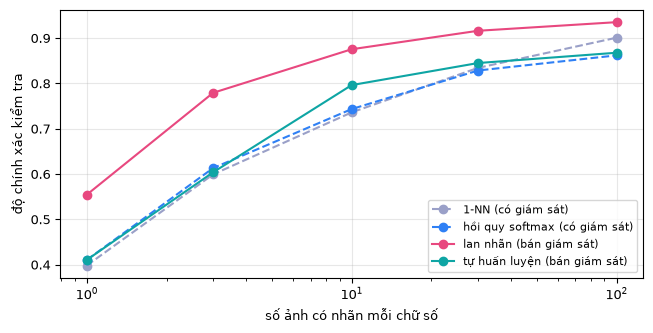

# Chương 5 · Ví dụ áp dụng: khi nhãn đắt đỏ

> Ghi chú của người biên soạn: trang này do người biên soạn viết thêm, không có trong sách gốc. Trang thử nghiệm *học bán giám sát* ([mục 5.4.3](ml/ch05_vi)) trên ảnh chữ số MNIST: có rất nhiều ảnh nhưng chỉ vài chục ảnh có nhãn. Câu hỏi: ảnh chưa có nhãn có giúp được gì không, và khi nào?

## Bài toán

Sách nêu một tình huống phổ biến: thu thập dữ liệu thì rẻ, gán nhãn thì đắt. Một bệnh viện có hàng nghìn ảnh chụp nhưng chỉ vài chục ảnh được bác sĩ chẩn đoán; một trang web có hàng triệu bình luận nhưng chỉ vài trăm được đánh dấu là spam hay không.

Ta mô phỏng tình huống này với 10 000 ảnh MNIST làm "kinh nghiệm", trong đó chỉ $n$ ảnh mỗi chữ số có nhãn. Kiểm tra trên 10 000 ảnh khác.

## 1. Dữ liệu

<!-- run -->
```python
import numpy as np
import matplotlib.pyplot as plt
from sklearn.datasets import fetch_openml
from sklearn.decomposition import PCA

X, y = fetch_openml("mnist_784", version=1, return_X_y=True, as_frame=False)
X = X / 255.0; y = y.astype(int)
Xpool, ypool = X[:10000], y[:10000]                      # "kinh nghiệm": 10 000 ảnh
Xte, yte = X[60000:], y[60000:]                         # tập kiểm tra chuẩn của MNIST

# Giảm xuống 50 chiều để tính khoảng cách nhanh và ít nhiễu hơn (PCA học không cần nhãn, nên dùng được toàn bộ 10 000 ảnh)
pca = PCA(50, random_state=0).fit(Xpool)
Zpool, Zte = pca.transform(Xpool), pca.transform(Xte)
print("dữ liệu:", Zpool.shape, "; tỉ lệ phương sai giữ lại sau PCA:", pca.explained_variance_ratio_.sum().round(3))
```

<!-- output -->
```output
dữ liệu: (10000, 50) ; tỉ lệ phương sai giữ lại sau PCA: 0.828
```
<!-- /output -->

PCA ([chương 21](ml/ch21_vi)) cũng là một thuật toán học không giám sát: nó chỉ dùng ảnh, không dùng nhãn. Đây đã là một cách tận dụng dữ liệu chưa có nhãn.

## 2. Học có giám sát và học bán giám sát

<small class="viz-ref">Mục 5.4.1, 5.4.3</small>

<!-- run -->
```python
from sklearn.linear_model import LogisticRegression
from sklearn.neighbors import KNeighborsClassifier
from sklearn.semi_supervised import LabelSpreading, SelfTrainingClassifier

rng = np.random.default_rng(0)
by_class = [np.flatnonzero(ypool == c) for c in range(10)]
rows = []
for n in [1, 3, 10, 30, 100]:
    res = {"1-NN (có giám sát)": [], "hồi quy softmax (có giám sát)": [], "lan nhãn (bán giám sát)": [], "tự huấn luyện (bán giám sát)": []}
    for rep in range(3):
        lab = np.concatenate([rng.choice(ix, n, replace=False) for ix in by_class])
        y_part = np.full_like(ypool, -1); y_part[lab] = ypool[lab]
        res["1-NN (có giám sát)"].append(KNeighborsClassifier(1).fit(Zpool[lab], ypool[lab]).score(Zte, yte))
        res["hồi quy softmax (có giám sát)"].append(LogisticRegression(max_iter=3000).fit(Zpool[lab], ypool[lab]).score(Zte, yte))
        res["lan nhãn (bán giám sát)"].append(LabelSpreading(kernel="knn", n_neighbors=10, alpha=0.2).fit(Zpool, y_part).score(Zte, yte))
        res["tự huấn luyện (bán giám sát)"].append(SelfTrainingClassifier(LogisticRegression(max_iter=3000), threshold=0.95).fit(Zpool, y_part).score(Zte, yte))
    rows.append((n, {k: np.mean(v) for k, v in res.items()}))
    print(f"{n:3d} ảnh có nhãn mỗi chữ số: " + " | ".join(f"{k.split(' (')[0]} {v:.3f}" for k, v in rows[-1][1].items()))

fig, ax = plt.subplots(figsize=(6.6, 3.4))
for (k, c, ls) in zip(rows[0][1], ["#9aa0c8", "#2f80f5", "#e8487f", "#0ea5a4"], ["--", "--", "-", "-"]):
    ax.semilogx([r[0] for r in rows], [r[1][k] for r in rows], "o", ls=ls, color=c, label=k)
ax.set_xlabel("số ảnh có nhãn mỗi chữ số"); ax.set_ylabel("độ chính xác kiểm tra"); ax.grid(alpha=.3); ax.legend(fontsize=8)
fig.tight_layout()
```

<!-- output -->
```output
  1 ảnh có nhãn mỗi chữ số: 1-NN 0.398 | hồi quy softmax 0.411 | lan nhãn 0.555 | tự huấn luyện 0.411
  3 ảnh có nhãn mỗi chữ số: 1-NN 0.599 | hồi quy softmax 0.613 | lan nhãn 0.779 | tự huấn luyện 0.604
 10 ảnh có nhãn mỗi chữ số: 1-NN 0.736 | hồi quy softmax 0.744 | lan nhãn 0.876 | tự huấn luyện 0.796
 30 ảnh có nhãn mỗi chữ số: 1-NN 0.834 | hồi quy softmax 0.829 | lan nhãn 0.916 | tự huấn luyện 0.845
100 ảnh có nhãn mỗi chữ số: 1-NN 0.901 | hồi quy softmax 0.862 | lan nhãn 0.935 | tự huấn luyện 0.868
```

<div align=center></div>
<!-- /output -->

Lan nhãn thắng rõ rệt khi nhãn hiếm: với 3 ảnh có nhãn mỗi chữ số, nó đúng 78% so với khoảng 60% của các phương pháp chỉ dùng ảnh có nhãn. Lan nhãn với 10 nhãn mỗi chữ số (87.6%) tốt ngang hồi quy softmax với 100 nhãn mỗi chữ số (86.2%): ảnh chưa có nhãn "thay thế" được khoảng 90% công gán nhãn. Tự huấn luyện giúp ít hơn nhiều. Khi có nhiều nhãn hơn, khoảng cách giữa các phương pháp thu hẹp dần.

## 3. Vì sao lan nhãn có tác dụng

Lan nhãn dựa trên một giả thiết: các điểm gần nhau (theo một chuỗi láng giềng) thì có cùng nhãn. Nếu các ảnh của một chữ số tạo thành những vùng liên thông, tách biệt với vùng của chữ số khác, thì một ảnh có nhãn đủ để "nhuộm màu" cả vùng. Ta kiểm tra giả thiết này: với mỗi ảnh, bao nhiêu trong 10 láng giềng gần nhất của nó có cùng nhãn?

<!-- run -->
```python
from sklearn.neighbors import NearestNeighbors

nn = NearestNeighbors(n_neighbors=11).fit(Zpool)
_, idx = nn.kneighbors(Zpool)
same = (ypool[idx[:, 1:]] == ypool[:, None]).mean(1)
print(f"tỉ lệ láng giềng cùng nhãn, trung bình: {same.mean():.3f}")
for c in range(10):
    print(f"  chữ số {c}: {same[ypool == c].mean():.3f}")
```

<!-- output -->
```output
tỉ lệ láng giềng cùng nhãn, trung bình: 0.918
  chữ số 0: 0.977
  chữ số 1: 0.986
  chữ số 2: 0.904
  chữ số 3: 0.882
  chữ số 4: 0.875
  chữ số 5: 0.884
  chữ số 6: 0.972
  chữ số 7: 0.928
  chữ số 8: 0.856
  chữ số 9: 0.894
```
<!-- /output -->

Trung bình hơn 90% láng giềng của một ảnh có cùng chữ số: cấu trúc của dữ liệu (không cần nhãn) đã chứa phần lớn thông tin về nhãn. Chữ số 0 và 1 có vùng tách biệt nhất (trên 97%), còn 8, 4, 3, 5 hay nằm sát các chữ số khác.

## 4. Khi giả thiết sai

Học bán giám sát không phải lúc nào cũng có lợi. Ta làm một thí nghiệm đối chứng: giữ nguyên ảnh, nhưng xáo trộn ngẫu nhiên cấu trúc láng giềng bằng cách dùng một biểu diễn không liên quan tới nội dung ảnh (một phép chiếu ngẫu nhiên xuống 2 chiều).

<!-- run -->
```python
R = np.random.default_rng(1).standard_normal((50, 2))
Zbad, Zbad_te = Zpool @ R, Zte @ R
lab = np.concatenate([rng.choice(ix, 10, replace=False) for ix in by_class])
y_part = np.full_like(ypool, -1); y_part[lab] = ypool[lab]
print("biểu diễn 2 chiều ngẫu nhiên, 10 nhãn mỗi chữ số:")
print("  hồi quy softmax (có giám sát):", round(LogisticRegression(max_iter=3000).fit(Zbad[lab], ypool[lab]).score(Zbad_te, yte), 3))
print("  lan nhãn (bán giám sát):      ", round(LabelSpreading(kernel="knn", n_neighbors=10, alpha=0.2).fit(Zbad, y_part).score(Zbad_te, yte), 3))
```

<!-- output -->
```output
biểu diễn 2 chiều ngẫu nhiên, 10 nhãn mỗi chữ số:
  hồi quy softmax (có giám sát): 0.206
  lan nhãn (bán giám sát):       0.166
```
<!-- /output -->

Khi các lớp chồng lên nhau trong không gian đặc trưng, láng giềng của một điểm thường thuộc lớp khác, và lan nhãn không còn lợi thế; ở đây nó còn kém hơn học có giám sát (16.6% so với 20.6%), vì nó lan nhãn sai đi khắp nơi. Học bán giám sát chỉ có ích khi cấu trúc của dữ liệu (phân cụm, đa tạp) phù hợp với nhãn, và điều này phụ thuộc vào cách xây dựng đặc trưng ([chương 6](ml/ch06_vi)).

## Rút ra được gì

- Khi nhãn hiếm, dữ liệu chưa có nhãn có thể cải thiện đáng kể kết quả, nhờ các thuật toán bán giám sát hoặc chỉ đơn giản là học biểu diễn (như PCA) trên toàn bộ dữ liệu.
- Lợi ích lớn nhất khi có rất ít nhãn, và giảm dần khi có nhiều nhãn.
- Học bán giám sát dựa trên giả thiết các điểm gần nhau thì cùng nhãn. Kiểm tra giả thiết đó (như ở mục 3) trước khi tin vào nó.
