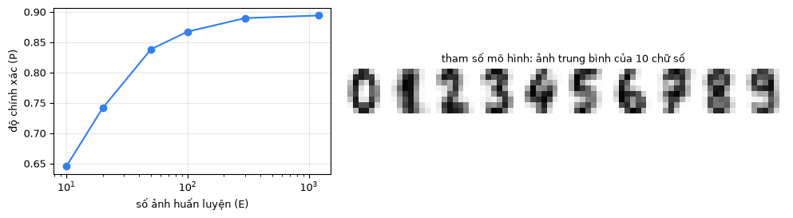
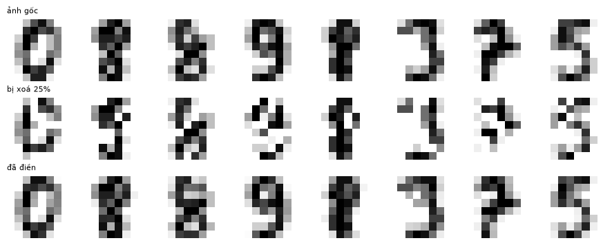
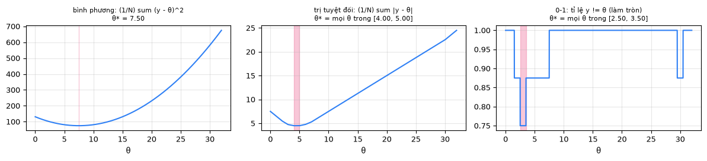

# Chương 5 · Code từ đầu

> Ghi chú của người biên soạn: trang này do người biên soạn viết thêm, không có trong sách gốc. [Chương 5](ml/ch05_vi) chủ yếu là định nghĩa. Trang biến các định nghĩa đó thành code chạy được, chỉ với NumPy: thế nào là "học" theo Mitchell, vai trò của tập huấn luyện, xác thực và kiểm tra, bốn loại bài toán cơ bản, và hàm mất mát quyết định tham số mô hình ra sao.

## Cách dùng trang này

Các khối chạy lần lượt từ trên xuống và dùng chung biến. Cần `numpy`, `matplotlib`, và `scikit-learn` (chỉ để lấy dữ liệu).

## 1. Nhiệm vụ, kinh nghiệm, phép đánh giá

<small class="viz-ref">Mục 5.1</small>

Theo định nghĩa của Mitchell, một chương trình "học" nếu hiệu quả $P$ của nó với nhiệm vụ $T$ tăng lên theo kinh nghiệm $E$. Ta chọn:

- **$T$:** nhận dạng chữ số viết tay $8 \times 8$.
- **$E$:** một số ảnh đã có nhãn.
- **$P$:** tỉ lệ ảnh đoán đúng trên một tập kiểm tra cố định.

Thuật toán đơn giản nhất có thể: **tâm lớp gần nhất** (nearest centroid). Tính ảnh trung bình của mỗi chữ số, rồi gán ảnh mới cho chữ số có ảnh trung bình gần nó nhất.

<!-- run -->
```python
import numpy as np
import matplotlib.pyplot as plt
from sklearn.datasets import load_digits

X, y = load_digits(return_X_y=True)
rng = np.random.default_rng(0)
perm = rng.permutation(len(X))
test, pool = perm[:500], perm[500:]                           # tập kiểm tra cố định; phần còn lại là "kinh nghiệm"

class NearestCentroid:
    def fit(self, X, y):
        self.classes = np.unique(y)
        self.C = np.array([X[y == c].mean(0) for c in self.classes])
        return self
    def predict(self, X):
        d = ((X[:, None, :] - self.C[None]) ** 2).sum(-1)
        return self.classes[np.argmin(d, axis=1)]

by_class = [pool[y[pool] == c] for c in range(10)]
sizes = [10, 20, 50, 100, 300, 1200]                         # tổng số ảnh, chia đều cho 10 chữ số
accs = []
for n in sizes:
    acc = []
    for rep in range(20):                                     # lặp lại với các mẫu kinh nghiệm khác nhau
        idx = np.concatenate([rng.choice(ix, n // 10, replace=False) for ix in by_class])
        acc.append(np.mean(NearestCentroid().fit(X[idx], y[idx]).predict(X[test]) == y[test]))
    accs.append(np.mean(acc))
    print(f"E = {n:4d} ảnh có nhãn: P = {accs[-1]:.3f}")

fig, axes = plt.subplots(1, 2, figsize=(10, 2.8), gridspec_kw={"width_ratios": [1, 1.6]})
axes[0].semilogx(sizes, accs, "o-", color="#2f80f5"); axes[0].set_xlabel("số ảnh huấn luyện (E)"); axes[0].set_ylabel("độ chính xác (P)"); axes[0].grid(alpha=.3)
C = NearestCentroid().fit(X[pool], y[pool]).C
axes[1].imshow(np.hstack([c.reshape(8, 8) for c in C]), cmap="gray_r"); axes[1].axis("off"); axes[1].set_title("tham số mô hình: ảnh trung bình của 10 chữ số", fontsize=9)
fig.tight_layout()
```

<!-- output -->
```output
E =   10 ảnh có nhãn: P = 0.646
E =   20 ảnh có nhãn: P = 0.742
E =   50 ảnh có nhãn: P = 0.839
E =  100 ảnh có nhãn: P = 0.867
E =  300 ảnh có nhãn: P = 0.890
E = 1200 ảnh có nhãn: P = 0.894
```

<div align=center></div>
<!-- /output -->

Hiệu quả $P$ tăng theo kinh nghiệm $E$: chương trình này "học" theo đúng định nghĩa. Tham số của mô hình là 10 ảnh trung bình (hình bên phải).

## 2. Tập huấn luyện, xác thực và kiểm tra

<small class="viz-ref">Mục 5.2</small>

Ba tập dữ liệu có ba vai trò khác nhau. Ví dụ: chọn số láng giềng $k$ cho thuật toán $K$ lân cận ([chương 9](ml/ch09_vi)).

- **Tập huấn luyện:** dữ liệu mà mô hình "nhớ".
- **Tập xác thực:** dùng để chọn $k$.
- **Tập kiểm tra:** chỉ dùng một lần ở cuối, để báo cáo kết quả.

<!-- run -->
```python
def split(n, fracs=(0.6, 0.2, 0.2), seed=0):
    p = np.random.default_rng(seed).permutation(n)
    a, b = int(fracs[0] * n), int((fracs[0] + fracs[1]) * n)
    return p[:a], p[a:b], p[b:]

def knn_predict(Xtr, ytr, Xq, k):
    d = ((Xq[:, None, :] - Xtr[None]) ** 2).sum(-1)
    nn = np.argsort(d, axis=1)[:, :k]
    return np.array([np.bincount(ytr[row], minlength=10).argmax() for row in nn])

tr, va, te = split(len(X))
print("kích thước:", len(tr), len(va), len(te))
scores = {}
for k in [1, 3, 5, 9, 15, 31, 61]:
    scores[k] = (np.mean(knn_predict(X[tr], y[tr], X[tr], k) == y[tr]), np.mean(knn_predict(X[tr], y[tr], X[va], k) == y[va]))
    print(f"k = {k:2d}: huấn luyện {scores[k][0]:.3f}, xác thực {scores[k][1]:.3f}")
best = max(scores, key=lambda k: scores[k][1])
print(f"\nchọn k = {best} theo tập xác thực; độ chính xác trên tập kiểm tra: {np.mean(knn_predict(X[tr], y[tr], X[te], best) == y[te]):.3f}")
```

<!-- output -->
```output
kích thước: 1078 359 360
k =  1: huấn luyện 1.000, xác thực 0.992
k =  3: huấn luyện 0.994, xác thực 0.989
k =  5: huấn luyện 0.991, xác thực 0.986
k =  9: huấn luyện 0.985, xác thực 0.975
k = 15: huấn luyện 0.978, xác thực 0.964
k = 31: huấn luyện 0.962, xác thực 0.950
k = 61: huấn luyện 0.929, xác thực 0.930

chọn k = 1 theo tập xác thực; độ chính xác trên tập kiểm tra: 0.978
```
<!-- /output -->

Với $k = 1$, độ chính xác trên tập huấn luyện bằng 1: mỗi điểm là láng giềng gần nhất của chính nó. Con số này vô nghĩa để chọn $k$. Ở đây tập xác thực cũng chọn $k = 1$, nhưng ta chỉ biết được điều đó nhờ tập xác thực. Đó là lý do cần một tập xác thực tách riêng; tập kiểm tra thì chỉ được nhìn một lần, sau khi mọi lựa chọn đã xong.

## 3. Bốn loại bài toán trên cùng một bộ dữ liệu

<small class="viz-ref">Mục 5.3, 5.4</small>

Cùng các ảnh chữ số, bốn bài toán khác nhau, mỗi bài một thuật toán tối giản viết tay:

<!-- run -->
```python
Xtr, ytr, Xte, yte = X[tr], y[tr], X[te], y[te]

# Phân loại (học có giám sát, đầu ra rời rạc): đoán chữ số
print("phân loại, tâm lớp gần nhất:", np.mean(NearestCentroid().fit(Xtr, ytr).predict(Xte) == yte).round(3))

# Hồi quy (học có giám sát, đầu ra liên tục): đoán tổng độ sáng nửa dưới ảnh từ nửa trên
top, bot = Xtr[:, :32], Xtr[:, 32:].sum(1)
A = np.c_[top, np.ones(len(top))]
w = np.linalg.lstsq(A, bot, rcond=None)[0]
pred = np.c_[Xte[:, :32], np.ones(len(Xte))] @ w
print(f"hồi quy, bình phương tối thiểu: sai số tuyệt đối trung bình {np.abs(pred - Xte[:, 32:].sum(1)).mean():.1f} (độ lớn trung bình {Xte[:, 32:].sum(1).mean():.1f})")

# Phân cụm (học không giám sát): chia ảnh thành 10 nhóm mà không dùng nhãn
C = Xtr[np.random.default_rng(1).choice(len(Xtr), 10, replace=False)]
for _ in range(50):
    lab = np.argmin(((Xtr[:, None] - C[None]) ** 2).sum(-1), 1)
    C = np.array([Xtr[lab == j].mean(0) if np.any(lab == j) else C[j] for j in range(10)])
purity = sum(np.bincount(ytr[lab == j]).max() for j in range(10) if np.any(lab == j)) / len(ytr)
print(f"phân cụm, K-means: độ thuần khiết của cụm (so với nhãn thật, vốn không được dùng) {purity:.3f}")

# Hoàn thiện dữ liệu: xoá 1/4 số điểm ảnh rồi điền lại bằng trung bình của 5 ảnh gần nhất (theo phần còn lại)
mask = np.random.default_rng(2).random(Xte.shape) < 0.25
filled = Xte.copy()
for i in range(len(Xte)):
    keep = ~mask[i]
    d = ((Xtr[:, keep] - Xte[i, keep]) ** 2).sum(1)
    filled[i, mask[i]] = Xtr[np.argsort(d)[:5]][:, mask[i]].mean(0)
print(f"hoàn thiện dữ liệu: sai số trung bình ở các điểm bị xoá {np.abs(filled - Xte)[mask].mean():.2f} "
      f"(điền bằng trung bình toàn tập: {np.abs(Xtr.mean(0)[None].repeat(len(Xte), 0) - Xte)[mask].mean():.2f})")

fig, axes = plt.subplots(3, 8, figsize=(9, 3.6))
for k in range(8):
    for r, (img, t) in enumerate([(Xte[k], "ảnh gốc"), (np.where(mask[k], np.nan, Xte[k]), "bị xoá 25%"), (filled[k], "đã điền")]):
        axes[r, k].imshow(img.reshape(8, 8), cmap="gray_r", vmin=0, vmax=16); axes[r, k].axis("off")
        if k == 0: axes[r, k].set_title(t, fontsize=8, loc="left")
fig.tight_layout()
```

<!-- output -->
```output
phân loại, tâm lớp gần nhất: 0.908
hồi quy, bình phương tối thiểu: sai số tuyệt đối trung bình 21.1 (độ lớn trung bình 155.8)
phân cụm, K-means: độ thuần khiết của cụm (so với nhãn thật, vốn không được dùng) 0.794
hoàn thiện dữ liệu: sai số trung bình ở các điểm bị xoá 1.29 (điền bằng trung bình toàn tập: 3.13)
```

<div align=center></div>
<!-- /output -->

## 4. Hàm mất mát quyết định tham số mô hình

<small class="viz-ref">Mục 5.5 · công thức (5.1)</small>

Công thức (5.1): $\theta^* = \operatorname*{argmin}_\theta \mathcal{L}(\theta)$. Mô hình đơn giản nhất có một tham số: dự đoán cùng một giá trị $\theta$ cho mọi điểm. Với dữ liệu $y_1, \dots, y_N$, các hàm mất mát khác nhau cho các $\theta^*$ khác nhau:

<!-- run -->
```python
yv = np.array([2., 3, 3, 4, 5, 6, 7, 30])                    # một giá trị bất thường: 30
thetas = np.linspace(0, 32, 32001)
losses = {
    "bình phương: (1/N) sum (y - θ)^2": lambda t: np.mean((yv[None] - t[:, None]) ** 2, 1),
    "trị tuyệt đối: (1/N) sum |y - θ|":  lambda t: np.mean(np.abs(yv[None] - t[:, None]), 1),
    "0-1: tỉ lệ y != θ (làm tròn)":      lambda t: np.mean(np.rint(t[:, None]) != yv[None], 1),
}
fig, axes = plt.subplots(1, 3, figsize=(12, 2.8))
for ax, (name, L) in zip(axes, losses.items()):
    v = L(thetas); best = thetas[v <= v.min() + 1e-12]       # mọi θ đạt giá trị nhỏ nhất
    ax.plot(thetas, v, color="#2f80f5"); ax.axvspan(best.min(), best.max() + 1e-2, color="#e8487f", alpha=.3)
    txt = f"{best.min():.2f}" if best.max() - best.min() < 1e-2 else f"mọi θ trong [{best.min():.2f}, {best.max():.2f}]"
    ax.set_title(f"{name}\nθ* = {txt}", fontsize=8); ax.set_xlabel("θ"); ax.grid(alpha=.3)
    print(f"{name:36s}: θ* = {txt}")
fig.tight_layout()
print(f"\ntrung bình = {yv.mean():.3f}, trung vị = {np.median(yv):.3f}, giá trị hay gặp nhất = 3")
```

<!-- output -->
```output
bình phương: (1/N) sum (y - θ)^2    : θ* = 7.50
trị tuyệt đối: (1/N) sum |y - θ|    : θ* = mọi θ trong [4.00, 5.00]
0-1: tỉ lệ y != θ (làm tròn)        : θ* = mọi θ trong [2.50, 3.50]

trung bình = 7.500, trung vị = 4.500, giá trị hay gặp nhất = 3
```

<div align=center></div>
<!-- /output -->

- Mất mát bình phương cho trung bình (bị giá trị 30 kéo lên).
- Mất mát trị tuyệt đối cho trung vị. Mọi $\theta$ giữa 4 và 5 đều đạt cùng giá trị nhỏ nhất: đây là trường hợp "đạt giá trị nhỏ nhất tại nhiều giá trị $\theta$" mà sách nhắc tới.
- Mất mát 0-1 cho giá trị hay gặp nhất (mọi $\theta$ làm tròn thành 3). Hàm này hằng số từng khúc, đạo hàm bằng 0 gần như khắp nơi, nên không tối ưu được bằng gradient. Vì vậy các thuật toán phân loại tối ưu một hàm thay thế trơn hơn (như cross-entropy ở [chương 14](ml/ch14_vi)).

Chọn hàm mất mát chính là chọn mô hình sẽ "quan tâm" tới điều gì.
