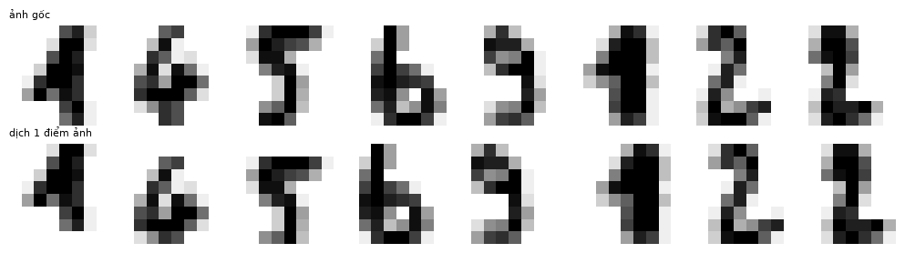

# Chương 6 · Ví dụ áp dụng: đặc trưng quyết định kết quả

> Ghi chú của người biên soạn: trang này do người biên soạn viết thêm, không có trong sách gốc. Trang làm hai thí nghiệm trên dữ liệu thật để thấy cách xây dựng vector đặc trưng ([chương 6](ml/ch06_vi)) ảnh hưởng tới kết quả thế nào, với cùng một thuật toán phân loại: chuẩn hoá đặc trưng cho $K$ lân cận, và túi từ thị giác cho ảnh chữ số bị dịch chuyển.

## Bài toán

Sách mở đầu chương 6 bằng nhận xét: các thuật toán cần đầu vào là vector có cùng số chiều, và chất lượng của vector đặc trưng ảnh hưởng lớn tới kết quả. Ta giữ nguyên thuật toán, chỉ thay đổi đặc trưng, và đo sự khác biệt.

## 1. Chuẩn hoá đặc trưng cho $K$ lân cận

<small class="viz-ref">Mục 6.5</small>

Dữ liệu *Wine* (Forina và cộng sự, UCI) gồm 178 mẫu rượu vang từ ba giống nho, mỗi mẫu có 13 kết quả phân tích hoá học. Các đặc trưng có thang đo rất khác nhau: độ cồn khoảng 11–15, còn proline khoảng 280–1700.

$K$ lân cận ([chương 9](ml/ch09_vi)) dựa trên khoảng cách Euclid, nên đặc trưng nào có khoảng giá trị lớn sẽ chi phối khoảng cách.

<!-- run -->
```python
import numpy as np
import matplotlib.pyplot as plt
from sklearn.datasets import load_wine
from sklearn.model_selection import cross_val_score, StratifiedKFold
from sklearn.neighbors import KNeighborsClassifier
from sklearn.pipeline import make_pipeline
from sklearn.preprocessing import MinMaxScaler, StandardScaler, Normalizer, FunctionTransformer

wine = load_wine()
X, y = wine.data, wine.target
print("độ lệch chuẩn của các đặc trưng:", {n: float(v) for n, v in zip(wine.feature_names, X.std(0).round(2))})

cv = StratifiedKFold(5, shuffle=True, random_state=0)
variants = [("không chuẩn hoá", FunctionTransformer()), ("min-max (6.5.1)", MinMaxScaler()),
            ("chuẩn hoá (6.5.2)", StandardScaler()), ("độ dài 1 (6.5.3)", Normalizer())]
for name, sc in variants:
    acc = cross_val_score(make_pipeline(sc, KNeighborsClassifier(5)), X, y, cv=cv).mean()
    print(f"{name:20s}: độ chính xác 5-NN = {acc:.3f}")
```

<!-- output -->
```output
độ lệch chuẩn của các đặc trưng: {'alcohol': 0.81, 'malic_acid': 1.11, 'ash': 0.27, 'alcalinity_of_ash': 3.33, 'magnesium': 14.24, 'total_phenols': 0.62, 'flavanoids': 1.0, 'nonflavanoid_phenols': 0.12, 'proanthocyanins': 0.57, 'color_intensity': 2.31, 'hue': 0.23, 'od280/od315_of_diluted_wines': 0.71, 'proline': 314.02}
không chuẩn hoá     : độ chính xác 5-NN = 0.663
min-max (6.5.1)     : độ chính xác 5-NN = 0.972
chuẩn hoá (6.5.2)   : độ chính xác 5-NN = 0.961
độ dài 1 (6.5.3)    : độ chính xác 5-NN = 0.787
```
<!-- /output -->

Không chuẩn hoá, 5-NN chỉ đúng 66%; chuẩn hoá min-max hoặc theo phân phối chuẩn đưa nó lên 96–97%, chỉ bằng một dòng code. Ta xem vì sao:

<!-- run -->
```python
i_pro = list(wine.feature_names).index("proline")
d_raw = np.abs(X[:, None, :] - X[None, :, :]) ** 2
share = d_raw[..., i_pro].sum() / d_raw.sum()
print(f"không chuẩn hoá: proline chiếm {share:.1%} tổng bình phương khoảng cách giữa các cặp điểm")
Z = StandardScaler().fit_transform(X)
d_z = np.abs(Z[:, None, :] - Z[None, :, :]) ** 2
print(f"sau chuẩn hoá:   proline chiếm {d_z[..., i_pro].sum() / d_z.sum():.1%} (1/13 = {1 / 13:.1%})")

acc_pro = cross_val_score(KNeighborsClassifier(5), X[:, [i_pro]], y, cv=cv).mean()
print(f"5-NN chỉ dùng mỗi proline: {acc_pro:.3f}")
```

<!-- output -->
```output
không chuẩn hoá: proline chiếm 99.8% tổng bình phương khoảng cách giữa các cặp điểm
sau chuẩn hoá:   proline chiếm 7.7% (1/13 = 7.7%)
5-NN chỉ dùng mỗi proline: 0.646
```
<!-- /output -->

Không chuẩn hoá, khoảng cách gần như chỉ là hiệu số proline; 12 đặc trưng còn lại gần như bị bỏ qua. Mô hình khi đó chẳng khác gì 5-NN chỉ dùng mỗi proline. Chuẩn hoá về độ dài 1 (6.5.3) chỉ cải thiện một phần (79%): nó chia mỗi mẫu cho độ dài của chính nó, mà độ dài này gần như là giá trị proline, nên các đặc trưng vẫn không cùng thang đo. Phương pháp chuẩn hoá phải phù hợp với dữ liệu: 6.5.3 hợp với vector đếm từ (văn bản dài ngắn khác nhau), không hợp với số đo hoá học.

## 2. Túi từ thị giác: đặc trưng chịu được dịch chuyển

<small class="viz-ref">Mục 6.3.5 · Hình 6.2, 6.3</small>

Bộ ảnh chữ số $8 \times 8$ của scikit-learn (1797 ảnh). Hai cách biểu diễn một ảnh:

- **Điểm ảnh thô:** vector 64 chiều.
- **Túi từ thị giác:** cắt ảnh thành 36 patch $3 \times 3$, gán mỗi patch vào một trong $K$ "từ" (dựng bằng $K$-means trên các patch của tập huấn luyện), rồi đếm. Vector có $K$ chiều.

Bộ phân loại giống nhau: hồi quy softmax ([chương 15](ml/ch15_vi)) trên đặc trưng đã chuẩn hoá. Ta kiểm tra trên ảnh gốc và trên ảnh bị dịch 1 điểm ảnh theo một hướng ngẫu nhiên, một thay đổi mà mắt người gần như không để ý.

<!-- run -->
```python
from sklearn.datasets import load_digits
from sklearn.model_selection import train_test_split
from sklearn.cluster import KMeans
from sklearn.linear_model import LogisticRegression

digits = load_digits()
I = digits.images / 16.0
Itr, Ite, ytr, yte = train_test_split(I, digits.target, test_size=0.3, random_state=0, stratify=digits.target)

def shift(im, dx, dy):
    out = np.zeros_like(im)                                     # dịch, phần trống được điền 0 (nền đen)
    out[max(dy, 0):8 + min(dy, 0), max(dx, 0):8 + min(dx, 0)] = im[max(-dy, 0):8 + min(-dy, 0), max(-dx, 0):8 + min(-dx, 0)]
    return out

rng = np.random.default_rng(0)
dirs = [(1, 0), (-1, 0), (0, 1), (0, -1)]
Ite_shift = np.array([shift(im, *dirs[rng.integers(4)]) for im in Ite])

def patches(im, p=3):
    return np.array([im[i:i + p, j:j + p].ravel() for i in range(8 - p + 1) for j in range(8 - p + 1)])

P = np.vstack([patches(im) for im in Itr])
raw = make_pipeline(StandardScaler(), LogisticRegression(max_iter=5000)).fit(Itr.reshape(len(Itr), -1), ytr)
print(f"điểm ảnh thô (64 chiều):    ảnh gốc {raw.score(Ite.reshape(len(Ite), -1), yte):.3f}, ảnh dịch 1 điểm ảnh {raw.score(Ite_shift.reshape(len(Ite), -1), yte):.3f}")

results = {}
for K in [16, 64, 256]:
    km = KMeans(K, n_init=3, random_state=0).fit(P)
    feat = lambda imgs: np.array([np.bincount(km.predict(patches(im)), minlength=K) for im in imgs])
    clf = make_pipeline(StandardScaler(), LogisticRegression(max_iter=5000)).fit(feat(Itr), ytr)
    results[K] = (clf.score(feat(Ite), yte), clf.score(feat(Ite_shift), yte))
    print(f"túi từ thị giác, K = {K:3d}:     ảnh gốc {results[K][0]:.3f}, ảnh dịch 1 điểm ảnh {results[K][1]:.3f}")

fig, axes = plt.subplots(2, 8, figsize=(10, 2.8))
for k in range(8):
    axes[0, k].imshow(Ite[k], cmap="gray_r"); axes[1, k].imshow(Ite_shift[k], cmap="gray_r")
    axes[0, k].axis("off"); axes[1, k].axis("off")
axes[0, 0].set_title("ảnh gốc", fontsize=8, loc="left"); axes[1, 0].set_title("dịch 1 điểm ảnh", fontsize=8, loc="left")
fig.tight_layout()
```

<!-- output -->
```output
điểm ảnh thô (64 chiều):    ảnh gốc 0.972, ảnh dịch 1 điểm ảnh 0.376
túi từ thị giác, K =  16:     ảnh gốc 0.737, ảnh dịch 1 điểm ảnh 0.494
túi từ thị giác, K =  64:     ảnh gốc 0.911, ảnh dịch 1 điểm ảnh 0.711
túi từ thị giác, K = 256:     ảnh gốc 0.935, ảnh dịch 1 điểm ảnh 0.883
```

<div align=center></div>
<!-- /output -->

Trên ảnh gốc, điểm ảnh thô tốt hơn (97.2% so với 93.5% của túi từ tốt nhất): túi từ bỏ đi thông tin về *vị trí* của các nét, giống như BoW cho văn bản bỏ đi thứ tự từ (nhược điểm sách đã nêu). Nhưng chỉ cần dịch ảnh 1 điểm ảnh, độ chính xác của điểm ảnh thô sụp đổ xuống 37.6%, trong khi túi từ với $K = 256$ vẫn giữ được 88.3%. Lý do: mỗi đặc trưng là "điểm ảnh ở hàng $i$, cột $j$", và sau khi dịch, mọi đặc trưng đều đổi giá trị. Túi từ chỉ đếm *có những nét gì*, nên ít bị ảnh hưởng.

Đây là lý do các đặc trưng thủ công cho ảnh (SIFT, HOG, BoW mà sách nhắc tới) được thiết kế để bất biến với dịch chuyển, xoay, thay đổi độ sáng. Mạng tích chập (CNN) học được những đặc trưng như vậy từ dữ liệu, như mục 6.4 của sách mô tả.

## 3. Học lại với dữ liệu tăng cường

Một cách khác để có mô hình bền vững với dịch chuyển: giữ đặc trưng điểm ảnh thô, nhưng **tăng cường dữ liệu** (data augmentation): thêm vào tập huấn luyện các bản dịch của mỗi ảnh.

<!-- run -->
```python
aug = [Itr] + [np.array([shift(im, dx, dy) for im in Itr]) for dx, dy in dirs]
Xaug = np.concatenate(aug).reshape(-1, 64); yaug = np.tile(ytr, len(aug))
raw_aug = make_pipeline(StandardScaler(), LogisticRegression(max_iter=5000)).fit(Xaug, yaug)
print(f"điểm ảnh thô + tăng cường dữ liệu: ảnh gốc {raw_aug.score(Ite.reshape(len(Ite), -1), yte):.3f}, ảnh dịch {raw_aug.score(Ite_shift.reshape(len(Ite), -1), yte):.3f}")
```

<!-- output -->
```output
điểm ảnh thô + tăng cường dữ liệu: ảnh gốc 0.906, ảnh dịch 0.778
```
<!-- /output -->

Tăng cường dữ liệu giúp nhiều (từ 37.6% lên 77.8% trên ảnh dịch), nhưng vẫn kém túi từ, và độ chính xác trên ảnh gốc giảm từ 97.2% xuống 90.6%. Một mô hình tuyến tính trên điểm ảnh thô không đủ sức vừa nhận ra chữ số vừa bỏ qua vị trí; cần một mô hình mạnh hơn (như mạng tích chập) để tận dụng hết dữ liệu tăng cường.

## Rút ra được gì

- Cùng một thuật toán, chỉ đổi cách xây dựng đặc trưng, độ chính xác có thể chênh nhau hàng chục điểm phần trăm.
- Chuẩn hoá là bắt buộc với các thuật toán dựa trên khoảng cách ($K$ lân cận, $K$-means) và có ích cho các thuật toán dựa trên gradient. Chọn phương pháp chuẩn hoá phù hợp với ý nghĩa của dữ liệu.
- Đặc trưng tốt mã hoá đúng những điều *không* nên ảnh hưởng tới nhãn (như vị trí chính xác của chữ số trong khung ảnh). Có hai cách: thiết kế đặc trưng bất biến (túi từ), hoặc dạy mô hình bằng dữ liệu tăng cường.
