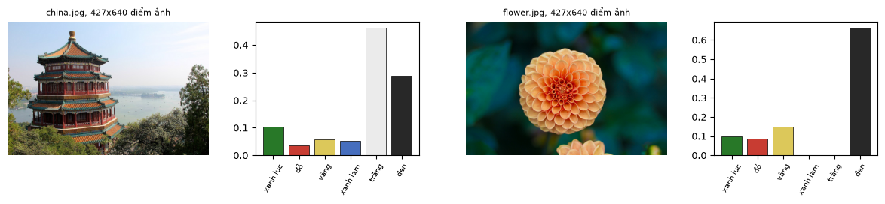
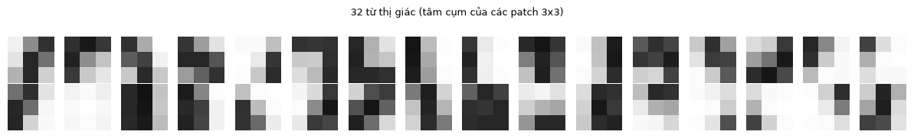
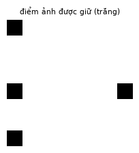

# Chương 6 · Code từ đầu

> Ghi chú của người biên soạn: trang này do người biên soạn viết thêm, không có trong sách gốc. Trang cài đặt bằng NumPy những kỹ thuật xây dựng đặc trưng của [chương 6](ml/ch06_vi): túi từ cho văn bản (và TF-IDF, cải tiến mà sách nhắc tới), túi từ cho ảnh theo màu và theo patch, lựa chọn đặc trưng, và ba cách chuẩn hoá vector đặc trưng.

## Cách dùng trang này

Các khối chạy lần lượt từ trên xuống và dùng chung biến. Cần `numpy`, `matplotlib`, và `scikit-learn` (chỉ để lấy dữ liệu mẫu).

## 1. Túi từ cho văn bản

<small class="viz-ref">Mục 6.3.4</small>

Chạy lại ví dụ của sách, với từ điển theo đúng thứ tự sách liệt kê:

<!-- run -->
```python
import re
import numpy as np
import matplotlib.pyplot as plt

docs = ["John likes to watch movies. Mary likes movies too.",
        "John also likes to watch football games."]
tokenize = lambda s: re.findall(r"[A-Za-z]+", s)
dictionary = ["John", "likes", "to", "watch", "movies", "also", "football", "games", "Mary", "too"]

def bow(doc, dictionary):
    words = tokenize(doc)
    return np.array([words.count(w) for w in dictionary])

for i, d in enumerate(docs, 1):
    print(f"({i})", bow(d, dictionary))
```

<!-- output -->
```output
(1) [1 2 1 1 2 0 0 0 1 1]
(2) [1 1 1 1 0 1 1 1 0 0]
```
<!-- /output -->

Kết quả trùng với hai vector trong sách: `[1, 2, 1, 1, 2, 0, 0, 0, 1, 1]` và `[1, 1, 1, 1, 0, 1, 1, 1, 0, 0]`.

Sách nhắc tới nhược điểm của BoW: các từ hiếm mang nhiều thông tin nhưng có trọng số như các từ phổ biến, và cải tiến *term frequency–inverse document frequency* (TF-IDF). TF-IDF nhân số lần xuất hiện của từ $t$ trong văn bản với $\log\frac{N}{n_t}$, trong đó $N$ là số văn bản và $n_t$ là số văn bản chứa từ $t$. Từ có mặt ở mọi văn bản bị giảm trọng số về 0.

<!-- run -->
```python
def tfidf(docs, dictionary, smooth=True):
    tf = np.array([bow(d, dictionary) for d in docs], float)
    n_t = (tf > 0).sum(axis=0)                                # số văn bản chứa mỗi từ
    N = len(docs)
    idf = np.log((1 + N) / (1 + n_t)) + 1 if smooth else np.log(N / n_t)   # bản "smooth" giống scikit-learn
    W = tf * idf
    return W / np.linalg.norm(W, axis=1, keepdims=True)      # chuẩn hoá về độ dài 1 (mục 6.5.3)

W = tfidf(docs, dictionary, smooth=False)
for w, a, b in zip(dictionary, *W):
    print(f"{w:9s} {a:6.3f} {b:6.3f}")
```

<!-- output -->
```output
John       0.000  0.000
likes      0.000  0.000
to         0.000  0.000
watch      0.000  0.000
movies     0.816  0.000
also       0.000  0.577
football   0.000  0.577
games      0.000  0.577
Mary       0.408  0.000
too        0.408  0.000
```
<!-- /output -->

Bốn từ chung của hai văn bản ("John", "likes", "to", "watch") có trọng số bằng 0: chúng không giúp phân biệt hai văn bản. Trọng số chỉ còn ở những từ riêng của mỗi văn bản.

## 2. Túi từ cho ảnh: đếm màu

<small class="viz-ref">Mục 6.3.5, Ví dụ 1</small>

Sách mô tả cách phân biệt ảnh rừng và sa mạc: với mỗi điểm ảnh, xem nó gần màu tham chiếu nào nhất, rồi đếm. Vector đặc trưng có số chiều bằng số màu tham chiếu, bất kể ảnh lớn bao nhiêu. Thử với hai ảnh mẫu của scikit-learn:

<!-- run -->
```python
from sklearn.datasets import load_sample_images

imgs = load_sample_images()
refs = np.array([[40, 120, 40], [200, 60, 50], [220, 200, 90], [70, 110, 190], [235, 235, 235], [40, 40, 40]], float)
ref_names = ["xanh lục", "đỏ", "vàng", "xanh lam", "trắng", "đen"]

def color_bow(img, refs):
    px = img.reshape(-1, 3).astype(float)
    nearest = np.argmin(((px[:, None, :] - refs[None]) ** 2).sum(-1), axis=1)   # màu tham chiếu gần nhất
    return np.bincount(nearest, minlength=len(refs)) / len(px)

fig, axes = plt.subplots(1, 4, figsize=(12, 2.6), gridspec_kw={"width_ratios": [1.4, 1, 1.4, 1]})
for k, (img, name) in enumerate(zip(imgs.images, ["china.jpg", "flower.jpg"])):
    h = color_bow(img, refs)
    axes[2 * k].imshow(img); axes[2 * k].axis("off"); axes[2 * k].set_title(f"{name}, {img.shape[0]}x{img.shape[1]} điểm ảnh", fontsize=8)
    axes[2 * k + 1].bar(range(len(refs)), h, color=refs / 255, edgecolor="k", lw=.5)
    axes[2 * k + 1].set_xticks(range(len(refs))); axes[2 * k + 1].set_xticklabels(ref_names, rotation=60, fontsize=7)
    print(f"{name}: vector đặc trưng 6 chiều = {h.round(3)}")
fig.tight_layout()
```

<!-- output -->
```output
china.jpg: vector đặc trưng 6 chiều = [0.105 0.036 0.058 0.051 0.461 0.289]
flower.jpg: vector đặc trưng 6 chiều = [0.098 0.088 0.149 0.    0.002 0.662]
```

<div align=center></div>
<!-- /output -->

Hơn 270 000 điểm ảnh của mỗi ảnh được tóm lại thành 6 con số.

## 3. Túi từ cho ảnh: "từ thị giác" từ các patch

<small class="viz-ref">Mục 6.3.5, Ví dụ 2 · Hình 6.2, 6.3</small>

Màu sắc không đủ để nhận ra hình dáng. Cách làm thứ hai của sách: cắt ảnh thành các patch nhỏ, phân cụm tất cả các patch bằng $K$-means ([chương 10](ml/ch10_vi)) để được $K$ "từ thị giác", rồi biểu diễn mỗi ảnh bằng số patch rơi vào mỗi cụm. Thử với ảnh chữ số $8 \times 8$ và patch $3 \times 3$:

<!-- run -->
```python
from sklearn.datasets import load_digits

digits = load_digits()
I = digits.images / 16.0                                   # 1797 ảnh 8x8, giá trị trong [0, 1]

def patches(im, p=3):
    return np.array([im[i:i + p, j:j + p].ravel() for i in range(im.shape[0] - p + 1) for j in range(im.shape[1] - p + 1)])

def kmeans(X, K, iters=30, seed=0):
    r = np.random.default_rng(seed)
    C = X[r.choice(len(X), K, replace=False)]
    for _ in range(iters):
        lab = np.argmin(((X[:, None, :] - C[None]) ** 2).sum(-1), axis=1)
        C = np.array([X[lab == k].mean(0) if np.any(lab == k) else C[k] for k in range(K)])
    return C

P = np.vstack([patches(im) for im in I[:600]])
print("số patch dùng để dựng từ điển:", P.shape)
K = 32
codebook = kmeans(P, K)

def visual_bow(im, codebook):
    pt = patches(im)
    return np.bincount(np.argmin(((pt[:, None, :] - codebook[None]) ** 2).sum(-1), axis=1), minlength=len(codebook))

h = visual_bow(I[0], codebook)
print(f"ảnh đầu tiên (chữ số {digits.target[0]}): {I[0].size} điểm ảnh -> {(I[0].shape[0] - 2) ** 2} patch -> vector {K} chiều")
print("vector túi từ:", h)

fig, axes = plt.subplots(2, 16, figsize=(12, 1.8))
for k, ax in enumerate(axes.ravel()):
    ax.imshow(codebook[k].reshape(3, 3), cmap="gray_r", vmin=0, vmax=1); ax.axis("off")
fig.suptitle("32 từ thị giác (tâm cụm của các patch 3x3)", fontsize=9)
fig.tight_layout()
```

<!-- output -->
```output
số patch dùng để dựng từ điển: (21600, 9)
ảnh đầu tiên (chữ số 0): 64 điểm ảnh -> 36 patch -> vector 32 chiều
vector túi từ: [5 1 1 1 3 1 0 1 2 0 3 1 2 0 1 0 3 0 0 1 2 1 1 2 0 0 0 0 0 0 2 2]
```

<div align=center></div>
<!-- /output -->

Các "từ" là những mảnh nét cơ bản: nét ngang, nét dọc, nét chéo, góc, vùng trống, vùng đặc. Ở [trang Ví dụ áp dụng](ml/ch06_app_vi), ta dùng các vector này để phân loại chữ số.

## 4. Lựa chọn đặc trưng

<small class="viz-ref">Mục 6.3.2</small>

Hai cách lọc đơn giản: bỏ những đặc trưng gần như không đổi (không mang thông tin), và bỏ một trong hai đặc trưng tương quan quá mạnh (lặp lại thông tin của nhau).

<!-- run -->
```python
X = digits.data
var = X.var(axis=0)
keep = var > 1e-3
print(f"đặc trưng có phương sai ~ 0: {np.sum(~keep)} trên {X.shape[1]} (các điểm ảnh ở rìa luôn tối)")

Xk = X[:, keep]
R = np.corrcoef(Xk.T)
drop = set()
for i in range(R.shape[0]):
    for j in range(i + 1, R.shape[0]):
        if abs(R[i, j]) > 0.9 and i not in drop:
            drop.add(j)
print(f"sau đó, số đặc trưng bị bỏ vì tương quan > 0.9 với một đặc trưng khác: {len(drop)}")
mask = np.zeros(64, bool); mask[np.flatnonzero(keep)] = True
plt.figure(figsize=(2.4, 2.4)); plt.imshow(mask.reshape(8, 8), cmap="Greys_r"); plt.title("điểm ảnh được giữ (trắng)", fontsize=8); plt.axis("off")
```

<!-- output -->
```output
đặc trưng có phương sai ~ 0: 4 trên 64 (các điểm ảnh ở rìa luôn tối)
sau đó, số đặc trưng bị bỏ vì tương quan > 0.9 với một đặc trưng khác: 1
```

<div align=center></div>
<!-- /output -->

## 5. Chuẩn hoá vector đặc trưng

<small class="viz-ref">Mục 6.5</small>

Ba công thức của sách. Điều quan trọng mà công thức không nói rõ: các thống kê ($\min$, $\max$, kỳ vọng, độ lệch chuẩn) phải được tính **trên tập huấn luyện**, rồi áp dụng nguyên như vậy cho tập kiểm tra và dữ liệu mới.

<!-- run -->
```python
class MinMax:                                             # 6.5.1
    def fit(self, X): self.lo, self.hi = X.min(0), X.max(0); return self
    def transform(self, X): return (X - self.lo) / np.where(self.hi > self.lo, self.hi - self.lo, 1)

class Standard:                                           # 6.5.2
    def fit(self, X): self.mu, self.sd = X.mean(0), X.std(0); return self
    def transform(self, X): return (X - self.mu) / np.where(self.sd > 0, self.sd, 1)

def unit_norm(X):                                         # 6.5.3: áp dụng cho từng vector, không cần thống kê
    return X / np.linalg.norm(X, axis=1, keepdims=True)

from sklearn.datasets import load_wine
Xw = load_wine().data
rng = np.random.default_rng(0); idx = rng.permutation(len(Xw)); tr, te = idx[:120], idx[120:]
print("khoảng giá trị ban đầu của 3 đặc trưng đầu:", [(float(a), float(b)) for a, b in zip(Xw.min(0)[:3], Xw.max(0)[:3])], "... proline:", (float(Xw[:, 12].min()), float(Xw[:, 12].max())))
mm = MinMax().fit(Xw[tr]); st = Standard().fit(Xw[tr])
print("min-max, tập huấn luyện: min", mm.transform(Xw[tr]).min().round(3), "max", mm.transform(Xw[tr]).max().round(3))
print("min-max, tập kiểm tra:   min", mm.transform(Xw[te]).min().round(3), "max", mm.transform(Xw[te]).max().round(3), "(có thể ra ngoài [0, 1])")
print("chuẩn hoá, tập huấn luyện: kỳ vọng", st.transform(Xw[tr]).mean(0)[:3].round(6) + 0.0, "độ lệch chuẩn", st.transform(Xw[tr]).std(0)[:3].round(6))
print("độ dài các vector sau unit_norm:", np.linalg.norm(unit_norm(Xw[:3]), axis=1))
```

<!-- output -->
```output
khoảng giá trị ban đầu của 3 đặc trưng đầu: [(11.03, 14.83), (0.74, 5.8), (1.36, 3.23)] ... proline: (278.0, 1680.0)
min-max, tập huấn luyện: min 0.0 max 1.0
min-max, tập kiểm tra:   min -0.224 max 1.586 (có thể ra ngoài [0, 1])
chuẩn hoá, tập huấn luyện: kỳ vọng [0. 0. 0.] độ lệch chuẩn [1. 1. 1.]
độ dài các vector sau unit_norm: [1. 1. 1.]
```
<!-- /output -->

Tập kiểm tra sau khi chuẩn hoá min-max có thể có giá trị nằm ngoài $[0, 1]$, vì các giá trị nhỏ nhất và lớn nhất được tính trên tập huấn luyện. Đây là hành vi đúng: nếu tính lại thống kê trên tập kiểm tra, ta đã vô tình dùng thông tin của tập kiểm tra để xây dựng mô hình.

## Tóm tắt

| Kỹ thuật trong sách | Trên trang này |
| --- | --- |
| Túi từ (6.3.4) | đếm từ theo từ điển; TF-IDF |
| BoW cho ảnh theo màu (6.3.5, ví dụ 1) | đếm điểm ảnh theo màu tham chiếu gần nhất |
| BoW cho ảnh theo patch (6.3.5, ví dụ 2) | $K$-means trên patch, đếm patch theo cụm |
| Lựa chọn đặc trưng (6.3.2) | lọc theo phương sai và tương quan |
| Chuẩn hoá (6.5) | min-max, chuẩn hoá, chuẩn hoá về độ dài 1 |
