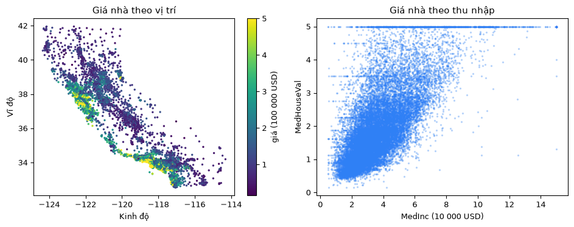
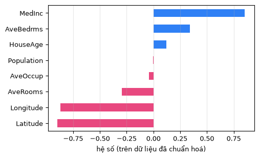
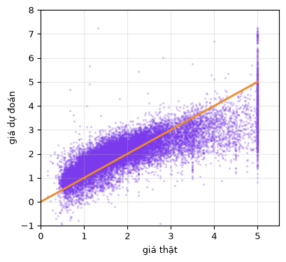
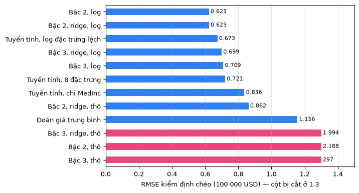
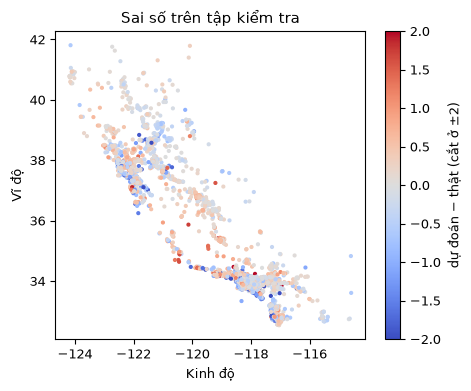

# Chương 7 · Ví dụ áp dụng: dự đoán giá nhà ở California

> Ghi chú của người biên soạn: trang này do người biên soạn viết thêm, không có trong sách gốc. Trang dùng bộ dữ liệu *California Housing* (Pace và Barry, 1997; lấy từ kho StatLib, có sẵn trong scikit-learn) để quay lại đúng bài toán mở đầu [chương 7](ml/ch07_vi): dự đoán giá nhà từ các đặc trưng của nó.

## Bài toán

Mỗi điểm dữ liệu là một **khu dân cư** (block group) trong cuộc điều tra dân số Mỹ năm 1990. Có 20 640 khu và 8 đặc trưng:

| Đặc trưng | Ý nghĩa |
| --- | --- |
| `MedInc` | Thu nhập trung vị của hộ gia đình (đơn vị 10 000 USD) |
| `HouseAge` | Tuổi trung vị của nhà (năm) |
| `AveRooms`, `AveBedrms` | Số phòng và số phòng ngủ trung bình mỗi hộ |
| `Population`, `AveOccup` | Dân số của khu và số người trung bình mỗi hộ |
| `Latitude`, `Longitude` | Vĩ độ và kinh độ |

Đầu ra cần dự đoán là `MedHouseVal`, giá nhà trung vị của khu, tính bằng **100 000 USD**. Đây là bài toán hồi quy như (7.1), chỉ khác là có $d = 8$ đặc trưng thay vì 3.

Quy trình gồm sáu bước, đi từ đơn giản đến phức tạp. Mỗi bước được đo bằng **RMSE** (tính bằng 100 000 USD; nhỏ hơn là tốt hơn):

1. Xem dữ liệu.
2. Chia tập huấn luyện và tập kiểm tra.
3. Đặt một mốc so sánh ngây thơ.
4. Thử hồi quy tuyến tính.
5. Cải thiện đặc trưng.
6. Đánh giá lần cuối trên tập kiểm tra.

## 1. Xem dữ liệu

<!-- run -->
```python
import numpy as np
import pandas as pd
import matplotlib.pyplot as plt
from sklearn.datasets import fetch_california_housing

data = fetch_california_housing(as_frame=True)     # tải về lần đầu (~400 KB), sau đó đọc từ máy
df = data.frame
print(df.shape)
print(df.describe().T[["mean", "50%", "min", "max"]].round(2))
print(f"\nTỉ lệ khu có giá đúng bằng 5.0: {(df.MedHouseVal >= 5.0).mean():.1%}")
```

<!-- output -->
```output
(20640, 9)
                mean      50%     min       max
MedInc          3.87     3.53    0.50     15.00
HouseAge       28.64    29.00    1.00     52.00
AveRooms        5.43     5.23    0.85    141.91
AveBedrms       1.10     1.05    0.33     34.07
Population   1425.48  1166.00    3.00  35682.00
AveOccup        3.07     2.82    0.69   1243.33
Latitude       35.63    34.26   32.54     41.95
Longitude    -119.57  -118.49 -124.35   -114.31
MedHouseVal     2.07     1.80    0.15      5.00

Tỉ lệ khu có giá đúng bằng 5.0: 4.8%
```
<!-- /output -->

Có hai điều đáng chú ý trước khi làm mô hình:

- **Giá nhà bị chặn trên ở 5.0** (500 000 USD). Khoảng 5% số khu có giá đúng bằng 5.0, nghĩa là giá thật có thể cao hơn nhưng đã bị cắt. Không mô hình nào dự đoán đúng được những khu này.
- **Một số đặc trưng lệch rất mạnh.** `AveRooms` có trung vị khoảng 5 nhưng lớn nhất tới 142, còn `AveOccup` có giá trị lớn nhất tới 1243. Ở [mục 7.4.2](ml/ch07_vi?id=_742-hạn-chế-của-hồi-quy-tuyến-tính) ta đã thấy mất mát bình phương rất nhạy với những giá trị cực đoan như vậy.

Vẽ giá nhà theo toạ độ và theo thu nhập:

<!-- run -->
```python
fig, axes = plt.subplots(1, 2, figsize=(9.5, 3.8))
sc = axes[0].scatter(df.Longitude, df.Latitude, c=df.MedHouseVal, s=2, cmap="viridis")
axes[0].set_xlabel("Kinh độ"); axes[0].set_ylabel("Vĩ độ"); axes[0].set_title("Giá nhà theo vị trí")
fig.colorbar(sc, ax=axes[0], label="giá (100 000 USD)")
axes[1].scatter(df.MedInc, df.MedHouseVal, s=2, alpha=.25, color="#2f80f5")
axes[1].set_xlabel("MedInc (10 000 USD)"); axes[1].set_ylabel("MedHouseVal"); axes[1].set_title("Giá nhà theo thu nhập")
fig.tight_layout()
```

<!-- output -->
<div align=center></div>
<!-- /output -->

Nhà đắt tập trung ở ven biển, quanh vịnh San Francisco và Los Angeles. Giá tăng gần như tuyến tính theo thu nhập. Đường ngang ở mức 5.0 chính là ngưỡng bị cắt.

## 2. Chia tập huấn luyện và tập kiểm tra

Giữ riêng 20% số khu làm tập kiểm tra và **không đụng tới** cho đến bước cuối. Mọi so sánh và lựa chọn mô hình ở các bước 3–5 chỉ dùng tập huấn luyện, thông qua **kiểm định chéo 5 phần** (5-fold cross-validation): chia tập huấn luyện thành 5 phần, lần lượt học trên 4 phần và đo trên phần còn lại, rồi lấy trung bình. Nếu chọn mô hình dựa trên tập kiểm tra thì điểm số cuối cùng sẽ lạc quan hơn thực tế.

<!-- run -->
```python
from sklearn.model_selection import train_test_split, cross_val_score

X = df.drop(columns="MedHouseVal")
y = df.MedHouseVal
X_train, X_test, y_train, y_test = train_test_split(X, y, test_size=0.2, random_state=42)
print("huấn luyện:", X_train.shape, " kiểm tra:", X_test.shape)

def cv_rmse(model, X_tr=X_train):
    """RMSE trung bình qua kiểm định chéo 5 phần trên tập huấn luyện."""
    scores = cross_val_score(model, X_tr, y_train, cv=5, scoring="neg_root_mean_squared_error")
    return -scores.mean()

results = {}          # tên mô hình -> RMSE kiểm định chéo
```

<!-- output -->
```output
huấn luyện: (16512, 8)  kiểm tra: (4128, 8)
```
<!-- /output -->

## 3. Mốc so sánh

Mô hình ngây thơ nhất là đoán mọi khu đều có giá bằng giá trung bình. Một mô hình chỉ có ý nghĩa nếu tốt hơn hẳn mốc này. Bước tiếp theo là hồi quy tuyến tính với **một** đặc trưng, thu nhập, giống ví dụ chiều cao và cân nặng trong sách.

<!-- run -->
```python
from sklearn.dummy import DummyRegressor
from sklearn.linear_model import LinearRegression

results["Đoán giá trung bình"] = cv_rmse(DummyRegressor(strategy="mean"))
results["Tuyến tính, chỉ MedInc"] = cv_rmse(LinearRegression(), X_train[["MedInc"]])

one = LinearRegression().fit(X_train[["MedInc"]], y_train)
print(f"giá ≈ {one.coef_[0]:.3f} × MedInc {one.intercept_:+.3f}")
for k, v in results.items():
    print(f"{k:28s} RMSE = {v:.3f}")
```

<!-- output -->
```output
giá ≈ 0.419 × MedInc +0.445
Đoán giá trung bình          RMSE = 1.156
Tuyến tính, chỉ MedInc       RMSE = 0.836
```
<!-- /output -->

Thu nhập tăng 10 000 USD thì giá nhà trung bình tăng khoảng 42 000 USD. Chỉ với một đặc trưng, sai số đã giảm khoảng một phần tư so với cách đoán trung bình.

## 4. Hồi quy tuyến tính với cả 8 đặc trưng

Các đặc trưng có thang đo rất khác nhau, ví dụ dân số tính bằng nghìn còn số phòng chỉ vài đơn vị. Vì vậy ta chuẩn hoá mỗi cột về trung bình 0 và độ lệch chuẩn 1 bằng `StandardScaler`. Chuẩn hoá không làm đổi dự đoán của hồi quy tuyến tính thường, nhưng giúp **so sánh được độ lớn các hệ số**: mỗi hệ số cho biết giá thay đổi bao nhiêu khi đặc trưng tăng một độ lệch chuẩn.

<!-- run -->
```python
from sklearn.pipeline import make_pipeline
from sklearn.preprocessing import StandardScaler

linear = make_pipeline(StandardScaler(), LinearRegression())
results["Tuyến tính, 8 đặc trưng"] = cv_rmse(linear)
linear.fit(X_train, y_train)

coef = pd.Series(linear[-1].coef_, index=X.columns).sort_values()
print(coef.round(3).to_string())
print(f"\nRMSE kiểm định chéo = {results['Tuyến tính, 8 đặc trưng']:.3f}")

fig, ax = plt.subplots(figsize=(5.2, 3.2))
coef.plot.barh(ax=ax, color=["#e8487f" if c < 0 else "#2f80f5" for c in coef])
ax.set_xlabel("hệ số (trên dữ liệu đã chuẩn hoá)"); ax.grid(alpha=.3, axis="x")
```

<!-- output -->
```output
Latitude     -0.897
Longitude    -0.870
AveRooms     -0.294
AveOccup     -0.041
Population   -0.002
HouseAge      0.123
AveBedrms     0.339
MedInc        0.854

RMSE kiểm định chéo = 0.721
```

<div align=center></div>
<!-- /output -->

Cách đọc các hệ số:

- `MedInc` có hệ số dương lớn: thu nhập vẫn là yếu tố quan trọng nhất.
- `Latitude` và `Longitude` có hệ số âm và lớn không kém. Đi lên phía bắc hoặc vào sâu trong đất liền thì giá giảm, khớp với bản đồ ở bước 1.
- `AveRooms` âm còn `AveBedrms` dương, nghe có vẻ ngược đời. Nguyên nhân là hai đặc trưng này tương quan rất mạnh với nhau (hệ số tương quan khoảng 0.85). Mô hình có thể tăng hệ số của cột này và giảm hệ số của cột kia mà dự đoán gần như không đổi, nên dấu của từng hệ số không còn mang nhiều ý nghĩa. Vì vậy **không nên đọc từng hệ số tách rời** khi các đặc trưng phụ thuộc nhau.

Xem dự đoán so với giá thật:

<!-- run -->
```python
pred = linear.predict(X_train)
fig, ax = plt.subplots(figsize=(4.4, 4))
ax.scatter(y_train, pred, s=2, alpha=.2, color="#7c3aed")
ax.plot([0, 5], [0, 5], color="#f08a24", lw=2)
ax.set_xlabel("giá thật"); ax.set_ylabel("giá dự đoán"); ax.set_xlim(0, 5.5); ax.set_ylim(-1, 8)
ax.grid(alpha=.3)
print(f"dự đoán nhỏ nhất {pred.min():.2f}, lớn nhất {pred.max():.2f}  (giá thật nằm trong [0.15, 5.0])")
```

<!-- output -->
```output
dự đoán nhỏ nhất -0.94, lớn nhất 7.26  (giá thật nằm trong [0.15, 5.0])
```

<div align=center></div>
<!-- /output -->

Mô hình đoán ra cả giá **âm** lẫn giá vượt xa 5.0. Một hàm tuyến tính không biết rằng giá nhà phải dương và đã bị chặn trên. Nó cũng bị các khu có `AveRooms` hay `AveOccup` cực đoan kéo lệch.

## 5. Cải thiện đặc trưng

### 5.1 Lấy logarit các đặc trưng lệch

Lấy $\log(1 + x)$ của các cột lệch mạnh sẽ nén các giá trị cực đoan lại. Mô hình vẫn là hồi quy tuyến tính, chỉ có đặc trưng đầu vào thay đổi, đúng tinh thần [mục 7.4.1](ml/ch07_vi?id=_741-các-bài-toán-có-thể-giải-bằng-hồi-quy-tuyến-tính).

<!-- run -->
```python
SKEWED = ["AveRooms", "AveBedrms", "Population", "AveOccup"]

def log_skewed(X):
    X = X.copy()
    X[SKEWED] = np.log1p(X[SKEWED])
    return X

Xl_train, Xl_test = log_skewed(X_train), log_skewed(X_test)
results["Tuyến tính, log đặc trưng lệch"] = cv_rmse(make_pipeline(StandardScaler(), LinearRegression()), Xl_train)
print(f"RMSE kiểm định chéo = {results['Tuyến tính, log đặc trưng lệch']:.3f}")
```

<!-- output -->
```output
RMSE kiểm định chéo = 0.673
```
<!-- /output -->

### 5.2 Thêm đặc trưng đa thức, và vì sao cần ridge

Thêm tích và bình phương của các đặc trưng giúp mô hình bắt được tương tác, ví dụ "thu nhập cao **và** gần biển". Đa thức bậc 2 biến 8 cột thành 44 cột, bậc 3 thành 164 cột. Nhưng càng nhiều cột thì mô hình càng dễ quá khớp. Ta thử cả hai loại đặc trưng (thô và đã lấy log), có và không có ridge:

<!-- run -->
```python
from sklearn.preprocessing import PolynomialFeatures
from sklearn.linear_model import RidgeCV

def poly_model(degree, ridge):
    last = RidgeCV(alphas=np.logspace(-2, 4, 25)) if ridge else LinearRegression()
    return make_pipeline(StandardScaler(), PolynomialFeatures(degree, include_bias=False), StandardScaler(), last)

specs = {}            # tên -> (bậc, ridge, dùng log)
for use_log in (False, True):
    for deg in (2, 3):
        for ridge in (False, True):
            name = f"Bậc {deg}{', ridge' if ridge else ''}, {'log' if use_log else 'thô'}"
            specs[name] = (deg, ridge, use_log)
            results[name] = cv_rmse(poly_model(deg, ridge), Xl_train if use_log else X_train)
            print(f"{name:22s} RMSE kiểm định chéo = {results[name]:9.3f}")
```

<!-- output -->
```output
Bậc 2, thô             RMSE kiểm định chéo =     2.188
Bậc 2, ridge, thô      RMSE kiểm định chéo =     0.862
Bậc 3, thô             RMSE kiểm định chéo =   297.342
Bậc 3, ridge, thô      RMSE kiểm định chéo =     1.994
Bậc 2, log             RMSE kiểm định chéo =     0.623
Bậc 2, ridge, log      RMSE kiểm định chéo =     0.623
Bậc 3, log             RMSE kiểm định chéo =     0.709
Bậc 3, ridge, log      RMSE kiểm định chéo =     0.699
```
<!-- /output -->

`RidgeCV` tự chọn $\lambda$ (tham số `alpha`) bằng kiểm định chéo bên trong tập huấn luyện. Bảng trên cho thấy ba điều:

- **Đặc trưng thô cộng đa thức là một thảm hoạ.** Bình phương hay lập phương của `AveOccup = 1243` là những con số khổng lồ. Mô hình có hàng chục đến hàng trăm trọng số tự do và khớp theo những điểm cực đoan đó, nên sai số trên phần dữ liệu chưa thấy lớn hơn cả cách đoán giá trung bình, có khi gấp hàng trăm lần.
- **Ridge cứu được phần lớn.** Ridge kéo các trọng số về gần 0 (mục 7.4.3), nên sai số giảm hẳn, dù vẫn chưa tốt bằng mô hình tuyến tính đơn giản. Đây là ví dụ thực tế cho câu cuối của mục 7.4.3: ridge "giúp mô hình tránh được overfitting".
- **Sửa đặc trưng có tác dụng hơn.** Sau khi lấy log, đa thức bậc 2 cho kết quả tốt nhất, có hay không có ridge đều như nhau. Bậc 3 lại kém hơn bậc 2: thêm cột không phải lúc nào cũng tốt hơn.

<!-- run -->
```python
summary = pd.Series(results).sort_values(ascending=False)
fig, ax = plt.subplots(figsize=(6.4, 4.2))
summary.clip(upper=1.3).plot.barh(ax=ax, color=["#e8487f" if v > 1.3 else "#2f80f5" for v in summary])
for i, v in enumerate(summary):
    ax.text(min(v, 1.3) + 0.01, i, f"{v:.3f}" if v < 10 else f"{v:.0f}", va="center", fontsize=8)
ax.set_xlabel("RMSE kiểm định chéo (100 000 USD) — cột bị cắt ở 1.3"); ax.set_xlim(0, 1.5); ax.grid(alpha=.3, axis="x")
```

<!-- output -->
<div align=center></div>
<!-- /output -->

## 6. Đánh giá lần cuối trên tập kiểm tra

Chọn mô hình có RMSE kiểm định chéo nhỏ nhất, huấn luyện lại trên toàn bộ tập huấn luyện, rồi đo **một lần duy nhất** trên tập kiểm tra.

<!-- run -->
```python
from sklearn.metrics import mean_squared_error, r2_score

best_name = summary.idxmin()
deg, ridge, use_log = specs.get(best_name, (1, False, True))
best = poly_model(deg, ridge).fit(Xl_train if use_log else X_train, y_train)
pred = best.predict(Xl_test if use_log else X_test)
print("mô hình được chọn:", best_name)
print(f"tập kiểm tra: RMSE = {np.sqrt(mean_squared_error(y_test, pred)):.3f}, R² = {r2_score(y_test, pred):.3f}")

base = make_pipeline(StandardScaler(), LinearRegression()).fit(X_train, y_train).predict(X_test)
print(f"so với tuyến tính 8 đặc trưng ban đầu: RMSE = {np.sqrt(mean_squared_error(y_test, base)):.3f}, R² = {r2_score(y_test, base):.3f}")

err = pred - y_test
fig, ax = plt.subplots(figsize=(5, 4))
sc = ax.scatter(X_test.Longitude, X_test.Latitude, c=err.clip(-2, 2), cmap="coolwarm", s=4)
fig.colorbar(sc, ax=ax, label="dự đoán − thật (cắt ở ±2)")
ax.set_xlabel("Kinh độ"); ax.set_ylabel("Vĩ độ"); ax.set_title("Sai số trên tập kiểm tra")
```

<!-- output -->
```output
mô hình được chọn: Bậc 2, log
tập kiểm tra: RMSE = 0.615, R² = 0.711
so với tuyến tính 8 đặc trưng ban đầu: RMSE = 0.746, R² = 0.576
```

<div align=center></div>
<!-- /output -->

## Rút ra được gì

- Hồi quy tuyến tính trong sách áp dụng thẳng được cho bài toán thật với 8 đặc trưng và hơn 16 000 điểm dữ liệu, chỉ cần vài dòng code.
- Phần lớn cải thiện đến từ **đặc trưng** (lấy log, thêm tích và bình phương) chứ không đến từ một thuật toán mới. Mô hình cuối cùng vẫn tuyến tính theo $\mathbf{w}$.
- Thêm đặc trưng mà không kiểm soát sẽ dẫn đến quá khớp. Ridge, kiểm định chéo và một tập kiểm tra để riêng là ba công cụ cơ bản để phát hiện và tránh điều đó. Chương 8 sẽ bàn kỹ hơn.
- Vẫn còn những hạn chế mà mô hình tuyến tính khó vượt qua: giá bị chặn ở 5.0, mô hình đoán ra giá âm, và quan hệ phức tạp giữa vị trí với giá. Các mô hình phi tuyến ở những chương sau (KNN ở chương 9, mạng nơ-ron ở chương 16) xử lý những điểm này tốt hơn.

**Thử thêm:** thay `Latitude`, `Longitude` bằng khoảng cách tới San Francisco (37.77, −122.42) và Los Angeles (34.05, −118.24) rồi xem RMSE thay đổi thế nào.
