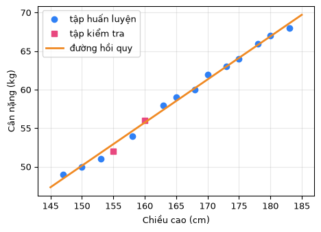
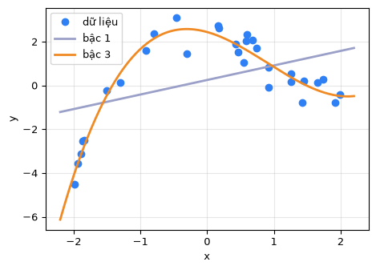
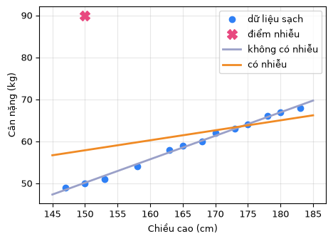
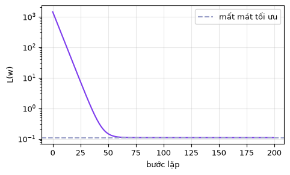

# Chương 7 · Code từ đầu

> Ghi chú của người biên soạn: trang này do người biên soạn viết thêm, không có trong sách gốc. Code dựa trên ví dụ ở [mục 7.3](ml/ch07_vi?id=_73-ví-dụ-trên-python) và notebook [`linear_regression`](https://github.com/tiepvupsu/ebookMLCB/tree/master/ebookML_src/src/linear_regression) của sách (Vũ Hữu Tiệp, CC BY-SA 4.0), viết lại cho Python 3 và chỉ dùng NumPy.

## Cách dùng trang này

Mỗi khối code đã được chạy sẵn. Kết quả nằm ngay bên dưới, trong khung "kết quả" và các hình. Các khối chạy lần lượt từ trên xuống và dùng chung biến, giống các ô của một notebook. Muốn tự chạy, chép lần lượt các khối vào một notebook. Chỉ cần `numpy` và `matplotlib`.

**Một điểm dễ nhầm về ký hiệu.** Sách xếp dữ liệu theo **cột**: $\mathbf{X} = [\mathbf{x}_1, \dots, \mathbf{x}_N] \in \mathbb{R}^{d \times N}$, nên nghiệm là $\mathbf{w} = (\mathbf{X}\mathbf{X}^T)^{\dagger}\mathbf{X}\mathbf{y}$. Còn NumPy và scikit-learn quen xếp mỗi điểm dữ liệu thành một **hàng**. Trên trang này, mảng `X` có kích thước `(N, d)`, tức là $\mathbf{X}^T$ của sách. Công thức (7.12) vì vậy được viết thành `pinv(X.T @ X) @ X.T @ y`.

## 1. Dữ liệu chiều cao và cân nặng

<small class="viz-ref">Mục 7.3.1 · bảng 7.1</small>

Có 13 người trong tập huấn luyện và 2 người (cao 155 cm và 160 cm) trong tập kiểm tra. Người cao 170 cm nặng 62 kg, giống code của sách (xem phần đính chính ở đầu [bài đọc](ml/ch07_vi)).

<!-- run -->
```python
import numpy as np
import matplotlib.pyplot as plt

# Tập huấn luyện: mỗi hàng là một người
height = np.array([147, 150, 153, 158, 163, 165, 168, 170, 173, 175, 178, 180, 183], dtype=float)
weight = np.array([ 49,  50,  51,  54,  58,  59,  60,  62,  63,  64,  66,  67,  68], dtype=float)
X = height[:, None]          # kích thước (N, d) = (13, 1)
y = weight                   # kích thước (N,)

# Tập kiểm tra
X_test = np.array([[155.0], [160.0]])
y_test = np.array([52.0, 56.0])

print("X:", X.shape, " y:", y.shape)
```

<!-- output -->
```output
X: (13, 1)  y: (13,)
```
<!-- /output -->

## 2. Nghiệm theo công thức (7.12)

<small class="viz-ref">Mục 7.2.3–7.2.4 · công thức (7.9), (7.12)</small>

Theo thủ thuật gộp hệ số điều chỉnh, ta thêm vào đầu mỗi điểm dữ liệu một đặc trưng $x_0 = 1$ rồi giải phương trình gradient bằng không (7.8). Có ba cách tính cho cùng một nghiệm:

- `inv`: nghịch đảo thật. Chỉ dùng được khi $\bar{\mathbf{X}}\bar{\mathbf{X}}^T$ khả nghịch.
- `pinv`: giả nghịch đảo, đúng như (7.12). Luôn có nghiệm.
- `lstsq`: hàm bình phương tối thiểu của NumPy. Hàm này giải thẳng $\min \|\mathbf{y} - \bar{\mathbf{X}}^T\bar{\mathbf{w}}\|$ mà không tạo ra ma trận $\bar{\mathbf{X}}\bar{\mathbf{X}}^T$, nên ổn định số hơn. Thực tế nên dùng cách này.

<!-- run -->
```python
def add_bias(X):
    """Thủ thuật gộp hệ số điều chỉnh: thêm cột x0 = 1 vào đầu."""
    return np.hstack([np.ones((X.shape[0], 1)), X])

Xbar = add_bias(X)                          # (13, 2), hàng i là [1, chiều cao_i]
A = Xbar.T @ Xbar                           # chính là  X̄ X̄ᵀ  trong ký hiệu của sách
b = Xbar.T @ y                              #           X̄ y

w_inv   = np.linalg.inv(A) @ b
w_pinv  = np.linalg.pinv(A) @ b
w_lstsq = np.linalg.lstsq(Xbar, y, rcond=None)[0]

for name, w in [("inv", w_inv), ("pinv", w_pinv), ("lstsq", w_lstsq)]:
    print(f"{name:6s} w_0 = {w[0]:.8f}, w_1 = {w[1]:.8f}")

w_0, w_1 = w_pinv
print(f"\n(cân nặng) ≈ {w_1:.4f} × (chiều cao) {w_0:+.4f}")
```

<!-- output -->
```output
inv    w_0 = -33.73541021, w_1 = 0.55920496
pinv   w_0 = -33.73541021, w_1 = 0.55920496
lstsq  w_0 = -33.73541021, w_1 = 0.55920496

(cân nặng) ≈ 0.5592 × (chiều cao) -33.7354
```
<!-- /output -->

Ba cách cho cùng một nghiệm, cũng chính là nghiệm in trong sách.

Mất mát (7.4) tại nghiệm này, và gradient (7.7) ở đó gần như bằng 0:

<!-- run -->
```python
def loss(w, Xbar, y):
    """Công thức (7.4): L(w) = 1/(2N) · Σ (y_i − x̄_iᵀ w)²"""
    r = y - Xbar @ w
    return r @ r / (2 * len(y))

def grad(w, Xbar, y):
    """Công thức (7.7): ∇L(w) = 1/N · X̄ (X̄ᵀ w − y)"""
    return Xbar.T @ (Xbar @ w - y) / len(y)

print(f"L(w*)    = {loss(w_pinv, Xbar, y):.4f}")
print("∇L(w*)   =", grad(w_pinv, Xbar, y))
print(f"L(w*+0.01 ở w_1) = {loss(w_pinv + [0, 0.01], Xbar, y):.4f}   ← lệch khỏi nghiệm thì mất mát tăng")
```

<!-- output -->
```output
L(w*)    = 0.1092
∇L(w*)   = [-3.54943425e-12 -2.21533014e-10]
L(w*+0.01 ở w_1) = 1.4997   ← lệch khỏi nghiệm thì mất mát tăng
```
<!-- /output -->

## 3. Vẽ lại hình 7.1 và dự đoán tập kiểm tra

<small class="viz-ref">Mục 7.3.2–7.3.3 · hình 7.1</small>

<!-- run -->
```python
def predict(w, X):
    return add_bias(X) @ w

xs = np.linspace(145, 185, 2)[:, None]
fig, ax = plt.subplots(figsize=(5.2, 3.6))
ax.plot(X[:, 0], y, "o", color="#2f80f5", label="tập huấn luyện")
ax.plot(X_test[:, 0], y_test, "s", color="#e8487f", label="tập kiểm tra")
ax.plot(xs[:, 0], predict(w_pinv, xs), color="#f08a24", lw=2, label="đường hồi quy")
ax.set_xlabel("Chiều cao (cm)"); ax.set_ylabel("Cân nặng (kg)")
ax.legend(); ax.grid(alpha=.3)

for h, t, p in zip(X_test[:, 0], y_test, predict(w_pinv, X_test)):
    print(f"Chiều cao {h:.0f} cm: thực tế {t:.0f} kg, dự đoán {p:.2f} kg, sai {p - t:+.2f} kg")
```

<!-- output -->
```output
Chiều cao 155 cm: thực tế 52 kg, dự đoán 52.94 kg, sai +0.94 kg
Chiều cao 160 cm: thực tế 56 kg, dự đoán 55.74 kg, sai -0.26 kg
```

<div align=center></div>
<!-- /output -->

Kết quả khớp với sách (52.94 kg và 55.74 kg).

## 4. Gói lại thành một lớp

Gói các bước trên vào một lớp có `fit` và `predict`, cùng giao diện với scikit-learn. Lớp có thêm tham số `lam` cho hồi quy ridge ở [mục 7.4.3](ml/ch07_vi?id=_743-hồi-quy-ridge). Với `lam > 0`, nghiệm là $(\bar{\mathbf{X}}\bar{\mathbf{X}}^T + \lambda\mathbf{I})^{-1}\bar{\mathbf{X}}\mathbf{y}$. Giống sách, hệ số điều chỉnh $b$ cũng bị phạt vì đã được gộp vào $\bar{\mathbf{w}}$.

<!-- run -->
```python
class LinearRegressionScratch:
    """Hồi quy tuyến tính (và ridge nếu lam > 0) giải bằng công thức đóng."""

    def __init__(self, lam=0.0):
        self.lam = lam

    def fit(self, X, y):
        Xbar = add_bias(np.asarray(X, dtype=float))
        A = Xbar.T @ Xbar + self.lam * np.eye(Xbar.shape[1])
        self.w_ = np.linalg.pinv(A) @ Xbar.T @ y
        self.intercept_, self.coef_ = self.w_[0], self.w_[1:]
        return self

    def predict(self, X):
        return add_bias(np.asarray(X, dtype=float)) @ self.w_

model = LinearRegressionScratch().fit(X, y)
print("intercept_ =", round(model.intercept_, 4), " coef_ =", model.coef_.round(4))
print("dự đoán tập kiểm tra:", model.predict(X_test).round(2))
```

<!-- output -->
```output
intercept_ = -33.7354  coef_ = [0.5592]
dự đoán tập kiểm tra: [52.94 55.74]
```
<!-- /output -->

## 5. Khi $\bar{\mathbf{X}}\bar{\mathbf{X}}^T$ không khả nghịch

<small class="viz-ref">Mục 7.2.3 và 7.4.3 · giả nghịch đảo và hồi quy ridge</small>

Giả sử chiều cao được ghi hai lần, một lần bằng cm và một lần bằng mét. Hai cột này tỉ lệ với nhau, nên $\bar{\mathbf{X}}\bar{\mathbf{X}}^T$ suy biến và phương trình (7.8) có vô số nghiệm. Khi đó:

- `inv` vẫn chạy mà không báo lỗi, nhưng do sai số làm tròn nên cho ra một nghiệm vô nghĩa.
- `pinv` chọn nghiệm có $\ell_2$ norm nhỏ nhất.
- Ridge với $\lambda > 0$ làm ma trận khả nghịch trở lại.

<!-- run -->
```python
X2 = np.hstack([X, X / 100])                 # cột 2 = cột 1 / 100  → hai cột phụ thuộc tuyến tính
A2 = add_bias(X2).T @ add_bias(X2)
print("hạng của X̄X̄ᵀ:", np.linalg.matrix_rank(A2), "trên", A2.shape[0], "  số điều kiện:", f"{np.linalg.cond(A2):.1e}")

w_bad = np.linalg.inv(A2) @ add_bias(X2).T @ y       # NumPy không báo lỗi, nhưng kết quả sai
print("inv  : w =", w_bad.round(3), " sai số trung bình trên tập huấn luyện:", round((add_bias(X2) @ w_bad - y).mean(), 2), "kg")

m_pinv  = LinearRegressionScratch().fit(X2, y)
m_ridge = LinearRegressionScratch(lam=1e-3).fit(X2, y)
print("pinv : w =", m_pinv.w_.round(5), " ‖w‖ =", round(np.linalg.norm(m_pinv.w_), 4))
print("ridge: w =", m_ridge.w_.round(5), " ‖w‖ =", round(np.linalg.norm(m_ridge.w_), 4))
print("dự đoán (pinv, ridge):", m_pinv.predict(X_test[:, [0, 0]] / [1, 100]).round(2),
      m_ridge.predict(X_test[:, [0, 0]] / [1, 100]).round(2))
```

<!-- output -->
```output
hạng của X̄X̄ᵀ: 2 trên 3   số điều kiện: 3.1e+19
inv  : w = [-86.484   0.601   3.656]  sai số trung bình trên tập huấn luyện: -39.66 kg
pinv : w = [-3.373541e+01  5.591500e-01  5.590000e-03]  ‖w‖ = 33.74
ridge: w = [-3.317185e+01  5.557800e-01  5.560000e-03]  ‖w‖ = 33.1765
dự đoán (pinv, ridge): [52.94 55.74] [52.98 55.76]
```
<!-- /output -->

Dù trọng số khác hẳn mục 2, nghiệm `pinv` vẫn cho đúng dự đoán như trước. Lý do là mọi nghiệm của (7.8) đều cho cùng một đường thẳng trên dữ liệu này. Ridge lệch đi một chút vì nó tối thiểu một hàm mất mát khác, là (7.14). Đáng chú ý là nghiệm `inv` cho dự đoán sai khoảng 40 kg mà không hề có cảnh báo nào.

## 6. Hồi quy đa thức

<small class="viz-ref">Mục 7.4.1 · hình 7.2(a)</small>

Mô hình (7.13) chỉ cần tuyến tính theo $\mathbf{w}$. Vì vậy chỉ cần biến đổi đặc trưng thành $[x, x^2, x^3]$ là dùng lại được đúng lớp ở trên. Dữ liệu dưới đây là dữ liệu tự sinh theo một hàm bậc ba cộng nhiễu.

<!-- run -->
```python
rng = np.random.default_rng(0)
x = np.sort(rng.uniform(-2, 2, 30))
t = 0.5 * x**3 - x**2 - x + 2 + rng.normal(0, 0.6, x.size)

def poly_features(x, degree):
    return np.stack([x**k for k in range(1, degree + 1)], axis=1)   # [x, x², …, x^degree]

xs = np.linspace(-2.2, 2.2, 200)
fig, ax = plt.subplots(figsize=(5.2, 3.6))
ax.plot(x, t, "o", color="#2f80f5", label="dữ liệu")
for deg, color in [(1, "#9aa0c8"), (3, "#f08a24")]:
    m = LinearRegressionScratch().fit(poly_features(x, deg), t)
    ax.plot(xs, m.predict(poly_features(xs, deg)), color=color, lw=2, label=f"bậc {deg}")
    print(f"bậc {deg}: w =", m.w_.round(3), f" mất mát = {loss(m.w_, add_bias(poly_features(x, deg)), t):.3f}")
ax.legend(); ax.grid(alpha=.3); ax.set_xlabel("x"); ax.set_ylabel("y")
```

<!-- output -->
```output
bậc 1: w = [0.25  0.664]  mất mát = 1.519
bậc 3: w = [ 2.442 -0.847 -1.188  0.44 ]  mất mát = 0.120
```

<div align=center></div>
<!-- /output -->

Dữ liệu sinh từ $0.5x^3 - x^2 - x + 2$, và nghiệm bậc 3 tìm lại được các hệ số gần với hàm đó.

## 7. Nhạy cảm với nhiễu

<small class="viz-ref">Mục 7.4.2 · hình 7.2(b)</small>

Thêm một điểm nhiễu (150 cm, 90 kg) như trong sách rồi giải lại:

<!-- run -->
```python
X_noisy = np.vstack([X, [[150.0]]])
y_noisy = np.append(y, 90.0)
m_noisy = LinearRegressionScratch().fit(X_noisy, y_noisy)

xs = np.linspace(145, 185, 2)[:, None]
fig, ax = plt.subplots(figsize=(5.2, 3.6))
ax.plot(X[:, 0], y, "o", color="#2f80f5", label="dữ liệu sạch")
ax.plot([150], [90], "X", ms=10, color="#e8487f", label="điểm nhiễu")
ax.plot(xs[:, 0], model.predict(xs), color="#9aa0c8", lw=2, label="không có nhiễu")
ax.plot(xs[:, 0], m_noisy.predict(xs), color="#f08a24", lw=2, label="có nhiễu")
ax.set_xlabel("Chiều cao (cm)"); ax.set_ylabel("Cân nặng (kg)"); ax.legend(); ax.grid(alpha=.3)

print("không nhiễu: w_1 =", model.coef_.round(4), " dự đoán 160 cm:", model.predict([[160]]).round(2))
print("có nhiễu   : w_1 =", m_noisy.coef_.round(4), " dự đoán 160 cm:", m_noisy.predict([[160]]).round(2))
```

<!-- output -->
```output
không nhiễu: w_1 = [0.5592]  dự đoán 160 cm: [55.74]
có nhiễu   : w_1 = [0.2378]  dự đoán 160 cm: [60.26]
```

<div align=center></div>
<!-- /output -->

Chỉ một điểm sai đã làm đường thẳng nghiêng hẳn đi: mất mát bình phương phạt rất nặng những điểm ở xa. Ở trang [Dùng thư viện](ml/ch07_lib_vi) có hồi quy Huber để khắc phục chuyện này.

## 8. Xem trước: giải bằng gradient descent

<small class="viz-ref">Mục 7.4.4 · gradient descent được học kỹ ở chương 12</small>

Thay vì giải $\nabla\mathcal{L} = \mathbf{0}$, ta có thể đi ngược hướng gradient (7.7) từng bước nhỏ: $\mathbf{w} \leftarrow \mathbf{w} - \eta\nabla\mathcal{L}(\mathbf{w})$. Chiều cao có giá trị khoảng 150–180, nên phải chuẩn hoá trước. Nếu không, bước học phải nhỏ đến mức thuật toán gần như đứng yên.

<!-- run -->
```python
mu, sd = X.mean(), X.std()
Xs_bar = add_bias((X - mu) / sd)             # chiều cao đã chuẩn hoá

w = np.zeros(2)
eta, history = 0.1, []
for it in range(200):
    w -= eta * grad(w, Xs_bar, y)
    history.append(loss(w, Xs_bar, y))

# Đổi nghiệm về thang đo gốc (cm) để so với công thức đóng
w1 = w[1] / sd
w0 = w[0] - w[1] * mu / sd
print(f"gradient descent: w_0 = {w0:.4f}, w_1 = {w1:.5f}   (sau 200 bước)")
print(f"công thức đóng  : w_0 = {w_pinv[0]:.4f}, w_1 = {w_pinv[1]:.5f}")

fig, ax = plt.subplots(figsize=(5.2, 3))
ax.semilogy(history, color="#7c3aed")
ax.axhline(loss(w_pinv, Xbar, y), ls="--", color="#9aa0c8", label="mất mát tối ưu")
ax.set_xlabel("bước lặp"); ax.set_ylabel("L(w)"); ax.legend(); ax.grid(alpha=.3)
```

<!-- output -->
```output
gradient descent: w_0 = -33.7354, w_1 = 0.55920   (sau 200 bước)
công thức đóng  : w_0 = -33.7354, w_1 = 0.55920
```

<div align=center></div>
<!-- /output -->

## Tóm tắt

| Việc | Code |
| --- | --- |
| Thêm cột $x_0 = 1$ | `np.hstack([np.ones((N, 1)), X])` |
| Nghiệm (7.12) | `np.linalg.pinv(Xbar.T @ Xbar) @ Xbar.T @ y` |
| Cách ổn định hơn | `np.linalg.lstsq(Xbar, y, rcond=None)[0]` |
| Ridge | `np.linalg.solve(Xbar.T @ Xbar + lam * np.eye(d + 1), Xbar.T @ y)` |
| Mất mát (7.4) | `((y - Xbar @ w) ** 2).mean() / 2` |
