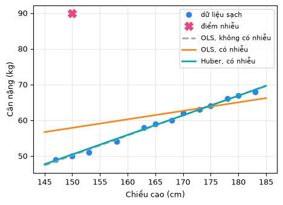
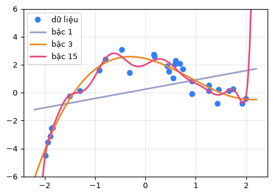

# Chương 7 · Dùng thư viện

> Ghi chú của người biên soạn: trang này do người biên soạn viết thêm, không có trong sách gốc. Trang giải lại các bài toán của [chương 7](ml/ch07_vi) bằng scikit-learn và PyTorch, rồi so với nghiệm tự viết ở trang [Code từ đầu](ml/ch07_code_vi). Các khối code đã chạy sẵn với scikit-learn 1.9 và PyTorch 2.14.

## Cách dùng trang này

Các khối chạy lần lượt từ trên xuống và dùng chung biến. Cần `numpy`, `matplotlib`, `scikit-learn` và (ở mục 6) `torch`.

Điều cần nhớ khi chuyển từ sách sang thư viện:

- **Hình dạng dữ liệu.** scikit-learn nhận `X` kích thước `(N, d)`, mỗi **hàng** là một điểm dữ liệu. Đó là $\mathbf{X}^T$ trong ký hiệu của sách.
- **Hệ số điều chỉnh.** Không cần tự thêm cột $x_0 = 1$. Mặc định `fit_intercept=True` sẽ tự học $b$ (lưu trong `intercept_`), còn $\mathbf{w}$ nằm trong `coef_`.

## 1. `LinearRegression`: cùng nghiệm với công thức (7.12)

<small class="viz-ref">Mục 7.3.4</small>

<!-- run -->
```python
import numpy as np
import matplotlib.pyplot as plt
from sklearn.linear_model import LinearRegression

height = np.array([147, 150, 153, 158, 163, 165, 168, 170, 173, 175, 178, 180, 183], dtype=float)
weight = np.array([ 49,  50,  51,  54,  58,  59,  60,  62,  63,  64,  66,  67,  68], dtype=float)
X, y = height[:, None], weight
X_test, y_test = np.array([[155.0], [160.0]]), np.array([52.0, 56.0])

regr = LinearRegression().fit(X, y)
print("scikit-learn: w_1 =", regr.coef_[0], " w_0 =", regr.intercept_)

# Nghiệm theo công thức (7.12), để đối chiếu
Xbar = np.hstack([np.ones((len(X), 1)), X])
w = np.linalg.pinv(Xbar.T @ Xbar) @ Xbar.T @ y
print("công thức   : w_1 =", w[1], " w_0 =", w[0])
print("dự đoán tập kiểm tra:", regr.predict(X_test).round(2))
```

<!-- output -->
```output
scikit-learn: w_1 = 0.5592049619396674  w_0 = -33.73541020580774
công thức   : w_1 = 0.5592049619426046  w_0 = -33.735410206299385
dự đoán tập kiểm tra: [52.94 55.74]
```
<!-- /output -->

Bên trong, `LinearRegression` giải bài toán bình phương tối thiểu bằng `scipy.linalg.lstsq`, tức không tạo ra ma trận $\bar{\mathbf{X}}\bar{\mathbf{X}}^T$. Vì vậy nó ổn định hơn cách viết thẳng công thức.

### Đánh giá mô hình hồi quy

Ba thước đo hay gặp nhất, đều có trong `sklearn.metrics`:

| Thước đo | Công thức | Ý nghĩa |
| --- | --- | --- |
| MSE | $\frac{1}{N}\sum (y_i - \hat y_i)^2$ | Bằng $2\mathcal{L}(\mathbf{w})$ của (7.4) |
| RMSE | $\sqrt{\text{MSE}}$ | Cùng đơn vị với $y$ (ở đây là kg) |
| $R^2$ | $1 - \frac{\sum (y_i - \hat y_i)^2}{\sum (y_i - \bar y)^2}$ | Tỉ lệ phương sai của $y$ mà mô hình giải thích được, tối đa là 1 |

<!-- run -->
```python
from sklearn.metrics import mean_squared_error, r2_score

y_hat = regr.predict(X)
mse = mean_squared_error(y, y_hat)
print(f"MSE  = {mse:.4f}   (= 2·L(w), L(w) = {mse / 2:.4f})")
print(f"RMSE = {np.sqrt(mse):.4f} kg")
print(f"R²   = {r2_score(y, y_hat):.4f}   (regr.score(X, y) = {regr.score(X, y):.4f})")
```

<!-- output -->
```output
MSE  = 0.2184   (= 2·L(w), L(w) = 0.1092)
RMSE = 0.4673 kg
R²   = 0.9945   (regr.score(X, y) = 0.9945)
```
<!-- /output -->

## 2. `Ridge`: hồi quy ridge

<small class="viz-ref">Mục 7.4.3 · công thức (7.14)–(7.15)</small>

`Ridge(alpha=α)` tối thiểu $\|\mathbf{y} - \mathbf{X}^T\mathbf{w} - b\|_2^2 + \alpha\|\mathbf{w}\|_2^2$. Hàm này khác (7.14) của sách ở hai điểm:

1. Không có hệ số $\frac{1}{2N}$. Nhân cả hàm mất mát với một hằng số dương không làm đổi nghiệm, nên điểm này không quan trọng: $\alpha$ đóng vai trò của $\lambda$.
2. **Không phạt hệ số điều chỉnh $b$.** Sách gộp $b$ vào $\bar{\mathbf{w}}$ nên $b$ cũng bị phạt.

Muốn có đúng nghiệm của sách, ta tự thêm cột 1 và tắt `fit_intercept`:

<!-- run -->
```python
from sklearn.linear_model import Ridge

lam = 10.0
w_book = np.linalg.solve(Xbar.T @ Xbar + lam * np.eye(2), Xbar.T @ y)       # (7.15) với X̄
r_book = Ridge(alpha=lam, fit_intercept=False).fit(Xbar, y)                  # phạt cả b, giống sách
r_skl  = Ridge(alpha=lam).fit(X, y)                                          # mặc định: không phạt b

print("công thức (7.15)      : w_0 = %.4f, w_1 = %.5f" % tuple(w_book))
print("Ridge, fit_intercept=0: w_0 = %.4f, w_1 = %.5f" % tuple(r_book.coef_))
print("Ridge mặc định        : w_0 = %.4f, w_1 = %.5f" % (r_skl.intercept_, r_skl.coef_[0]))
print("không ridge           : w_0 = %.4f, w_1 = %.5f" % (regr.intercept_, regr.coef_[0]))
```

<!-- output -->
```output
công thức (7.15)      : w_0 = -0.1953, w_1 = 0.35853
Ridge, fit_intercept=0: w_0 = -0.1953, w_1 = 0.35853
Ridge mặc định        : w_0 = -33.1705, w_1 = 0.55581
không ridge           : w_0 = -33.7354, w_1 = 0.55920
```
<!-- /output -->

Dòng đầu và dòng thứ hai trùng nhau. Ridge mặc định gần như không đổi gì: dữ liệu có 13 điểm, chiều cao ở mức trăm cm, nên $\alpha = 10$ là rất nhỏ so với $\mathbf{X}\mathbf{X}^T$. Ngược lại, khi $b$ bị phạt thì nó bị kéo về gần 0 (từ $-33.7$ còn $-0.2$). Đường thẳng gần như phải đi qua gốc toạ độ, nên $w_1$ đổi từ $0.56$ thành $0.36$ để vẫn khớp dữ liệu tốt nhất có thể. Cả mô hình bị méo chỉ vì một tham số lẽ ra không cần phạt. Đây là lý do thư viện mặc định không phạt $b$. Muốn ridge có tác dụng đồng đều lên mọi đặc trưng thì nên chuẩn hoá dữ liệu trước (xem mục 4 và trang [Ví dụ áp dụng](ml/ch07_app_vi)).

## 3. `HuberRegressor`: chống nhiễu

<small class="viz-ref">Mục 7.4.2 · hình 7.2(b)</small>

Mất mát Huber giống bình phương khi sai số nhỏ, nhưng chỉ tăng **tuyến tính** khi sai số lớn hơn một ngưỡng (tham số `epsilon`, tính theo đơn vị độ lệch chuẩn của sai số). Nhờ vậy điểm nhiễu ở xa không kéo lệch nghiệm nhiều.

<!-- run -->
```python
from sklearn.linear_model import HuberRegressor

X_noisy = np.vstack([X, [[150.0]]])
y_noisy = np.append(y, 90.0)

ols   = LinearRegression().fit(X_noisy, y_noisy)
huber = HuberRegressor(epsilon=1.35, max_iter=1000).fit(X_noisy, y_noisy)

xs = np.linspace(145, 185, 2)[:, None]
fig, ax = plt.subplots(figsize=(5.2, 3.6))
ax.plot(X[:, 0], y, "o", color="#2f80f5", label="dữ liệu sạch")
ax.plot([150], [90], "X", ms=10, color="#e8487f", label="điểm nhiễu")
ax.plot(xs[:, 0], regr.predict(xs), color="#9aa0c8", lw=2, ls="--", label="OLS, không có nhiễu")
ax.plot(xs[:, 0], ols.predict(xs), color="#f08a24", lw=2, label="OLS, có nhiễu")
ax.plot(xs[:, 0], huber.predict(xs), color="#0ea5a4", lw=2, label="Huber, có nhiễu")
ax.set_xlabel("Chiều cao (cm)"); ax.set_ylabel("Cân nặng (kg)"); ax.legend(fontsize=8); ax.grid(alpha=.3)

for name, m in [("OLS, không nhiễu", regr), ("OLS, có nhiễu", ols), ("Huber, có nhiễu", huber)]:
    print(f"{name:17s}: w_1 = {m.coef_[0]:.4f}, dự đoán 155/160 cm = {m.predict(X_test).round(2)}")
print("Huber đánh dấu là ngoại lai:", X_noisy[huber.outliers_, 0])
```

<!-- output -->
```output
OLS, không nhiễu : w_1 = 0.5592, dự đoán 155/160 cm = [52.94 55.74]
OLS, có nhiễu    : w_1 = 0.2378, dự đoán 155/160 cm = [59.07 60.26]
Huber, có nhiễu  : w_1 = 0.5477, dự đoán 155/160 cm = [53.17 55.91]
Huber đánh dấu là ngoại lai: [153. 158. 170. 150.]
```

<div align=center></div>
<!-- /output -->

Huber gần như lấy lại được đường thẳng ban đầu ($w_1$ từ $0.24$ về $0.55$). Cũng thấy rằng Huber coi cả ba điểm sạch có sai số hơi lớn là "ngoại lai". Điều này không sao: Huber không bỏ những điểm đó đi, chỉ tính mất mát của chúng tuyến tính thay vì bình phương.

## 4. `PolynomialFeatures` và `Pipeline`: hồi quy đa thức

<small class="viz-ref">Mục 7.4.1 · hình 7.2(a)</small>

Cách làm ở trang Code (tự tạo các cột $x, x^2, x^3$) được scikit-learn gói sẵn trong `PolynomialFeatures`. Ghép nó với `StandardScaler` và `LinearRegression` trong một `Pipeline` sẽ được một mô hình duy nhất với `fit`/`predict`. Như vậy các bước biến đổi luôn được áp dụng giống nhau cho cả tập huấn luyện lẫn tập kiểm tra.

<!-- run -->
```python
from sklearn.pipeline import make_pipeline
from sklearn.preprocessing import PolynomialFeatures, StandardScaler

rng = np.random.default_rng(0)
x = np.sort(rng.uniform(-2, 2, 30))
t = 0.5 * x**3 - x**2 - x + 2 + rng.normal(0, 0.6, x.size)

xs = np.linspace(-2.2, 2.2, 200)[:, None]
fig, ax = plt.subplots(figsize=(5.2, 3.6))
ax.plot(x, t, "o", color="#2f80f5", label="dữ liệu")
for deg, color in [(1, "#9aa0c8"), (3, "#f08a24"), (15, "#e8487f")]:
    model = make_pipeline(PolynomialFeatures(deg, include_bias=False), StandardScaler(), LinearRegression())
    model.fit(x[:, None], t)
    ax.plot(xs, model.predict(xs), color=color, lw=2, label=f"bậc {deg}")
    print(f"bậc {deg:2d}: R² trên tập huấn luyện = {model.score(x[:, None], t):.3f}")
ax.set_ylim(-6, 6); ax.legend(); ax.grid(alpha=.3)

poly3 = make_pipeline(PolynomialFeatures(3, include_bias=False), LinearRegression()).fit(x[:, None], t)
lr = poly3[-1]
print("bậc 3, hệ số trên thang đo gốc: b =", round(lr.intercept_, 3), " w =", lr.coef_.round(3))
```

<!-- output -->
```output
bậc  1: R² trên tập huấn luyện = 0.189
bậc  3: R² trên tập huấn luyện = 0.936
bậc 15: R² trên tập huấn luyện = 0.956
bậc 3, hệ số trên thang đo gốc: b = 2.442  w = [-0.847 -1.188  0.44 ]
```

<div align=center></div>
<!-- /output -->

Bậc 3 có hệ số khớp với kết quả ở trang Code. Bậc 15 có $R^2$ trên tập huấn luyện cao nhất, nhưng đường cong uốn lượn vô lý ở hai đầu. Đó là **quá khớp** (overfitting), chủ đề của chương 8.

## 5. `SGDRegressor`: tối ưu bằng gradient

<small class="viz-ref">Mục 7.4.4</small>

Khi dữ liệu quá lớn, không thể tính $\bar{\mathbf{X}}\bar{\mathbf{X}}^T$. `SGDRegressor` tối ưu cùng hàm mất mát bình phương bằng stochastic gradient descent (chương 12), mỗi lần chỉ dùng một điểm dữ liệu.

<!-- run -->
```python
from sklearn.linear_model import SGDRegressor

sgd = make_pipeline(StandardScaler(), SGDRegressor(alpha=0.0, max_iter=1000, tol=1e-6, random_state=0))
sgd.fit(X, y)
sc, reg = sgd[0], sgd[1]
w1 = reg.coef_[0] / sc.scale_[0]                     # đổi về thang đo cm
w0 = reg.intercept_[0] - reg.coef_[0] * sc.mean_[0] / sc.scale_[0]
print(f"SGDRegressor    : w_0 = {w0:.4f}, w_1 = {w1:.5f}  ({reg.n_iter_} vòng qua dữ liệu)")
print(f"LinearRegression: w_0 = {regr.intercept_:.4f}, w_1 = {regr.coef_[0]:.5f}")
```

<!-- output -->
```output
SGDRegressor    : w_0 = -33.7291, w_1 = 0.55913  (469 vòng qua dữ liệu)
LinearRegression: w_0 = -33.7354, w_1 = 0.55920
```
<!-- /output -->

## 6. PyTorch: cùng mô hình, theo cách của học sâu

Trong PyTorch, hồi quy tuyến tính là một lớp `nn.Linear(d, 1)`, tức một nơ-ron không có hàm kích hoạt, huấn luyện bằng gradient với mất mát `MSELoss`. Đây cũng là "viên gạch" để xây mạng nơ-ron nhiều tầng ở chương 16.

<!-- run -->
```python
import torch
from torch import nn

torch.manual_seed(0)
mu, sd = X.mean(), X.std()
Xt = torch.tensor((X - mu) / sd, dtype=torch.float32)   # chuẩn hoá, giống mục 8 của trang Code
yt = torch.tensor(y, dtype=torch.float32)[:, None]

net = nn.Linear(1, 1)
opt = torch.optim.SGD(net.parameters(), lr=0.1)
loss_fn = nn.MSELoss()
for step in range(300):
    opt.zero_grad()
    loss = loss_fn(net(Xt), yt)
    loss.backward()                                     # PyTorch tự tính gradient (7.7)
    opt.step()

a, c = net.weight.item(), net.bias.item()
print(f"PyTorch         : w_0 = {c - a * mu / sd:.4f}, w_1 = {a / sd:.5f}   MSE = {loss.item():.4f}")
print(f"LinearRegression: w_0 = {regr.intercept_:.4f}, w_1 = {regr.coef_[0]:.5f}   MSE = {mse:.4f}")
```

<!-- output -->
```output
PyTorch         : w_0 = -33.7354, w_1 = 0.55920   MSE = 0.2184
LinearRegression: w_0 = -33.7354, w_1 = 0.55920   MSE = 0.2184
```
<!-- /output -->

## Tóm tắt

| Nhu cầu | Công cụ | Ghi chú |
| --- | --- | --- |
| Hồi quy tuyến tính thường | `LinearRegression()` | Nghiệm đúng như (7.12) |
| Hồi quy ridge | `Ridge(alpha=λ)` | Không phạt $b$; nên chuẩn hoá dữ liệu trước |
| Chống nhiễu | `HuberRegressor(epsilon=1.35)` | `outliers_` cho biết điểm nào bị coi là ngoại lai |
| Hồi quy đa thức | `make_pipeline(PolynomialFeatures(k), StandardScaler(), LinearRegression())` | Bậc cao dễ quá khớp |
| Dữ liệu rất lớn | `SGDRegressor()` | Bắt buộc chuẩn hoá |
| Đánh giá | `mean_squared_error`, `r2_score`, `model.score` | `score` trả về $R^2$ |
