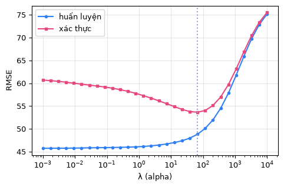
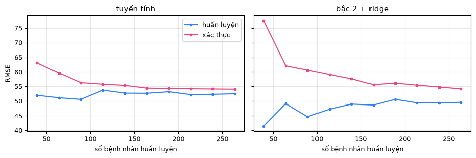

# Chương 8 · Ví dụ áp dụng: dự đoán tiến triển bệnh tiểu đường

> Ghi chú của người biên soạn: trang này do người biên soạn viết thêm, không có trong sách gốc. Dữ liệu là bộ *Diabetes* (Efron và cộng sự, 2004, *Least Angle Regression*), có sẵn trong scikit-learn.

## Bài toán

Bộ dữ liệu có 442 bệnh nhân tiểu đường. Mỗi người có 10 đặc trưng đo lúc ban đầu: tuổi, giới tính, chỉ số khối cơ thể (BMI), huyết áp trung bình và sáu chỉ số trong máu (`s1`–`s6`). Đầu ra cần dự đoán là một chỉ số đo mức tiến triển của bệnh sau một năm.

Với chỉ 442 điểm, một mô hình nhiều tham số rất dễ quá khớp. Đây là tình huống thực tế của [chương 8](ml/ch08_vi): phải chọn độ phức tạp của mô hình bằng xác thực, không phải bằng sai số huấn luyện.

## 1. Dữ liệu

<!-- run -->
```python
import numpy as np
import pandas as pd
import matplotlib.pyplot as plt
from sklearn.datasets import load_diabetes
from sklearn.model_selection import train_test_split, KFold, cross_validate

data = load_diabetes(as_frame=True, scaled=False)
df = data.frame
print(df.shape)
print(df.describe().T[["mean", "std", "min", "max"]].round(1))

X, y = df.drop(columns="target"), df.target
X_train, X_test, y_train, y_test = train_test_split(X, y, test_size=0.25, random_state=0)
cv = KFold(5, shuffle=True, random_state=0)
print("\nhuấn luyện:", X_train.shape, " kiểm tra:", X_test.shape)
```

<!-- output -->
```output
(442, 11)
         mean   std   min    max
age      48.5  13.1  19.0   79.0
sex       1.5   0.5   1.0    2.0
bmi      26.4   4.4  18.0   42.2
bp       94.6  13.8  62.0  133.0
s1      189.1  34.6  97.0  301.0
s2      115.4  30.4  41.6  242.4
s3       49.8  12.9  22.0   99.0
s4        4.1   1.3   2.0    9.1
s5        4.6   0.5   3.3    6.1
s6       91.3  11.5  58.0  124.0
target  152.1  77.1  25.0  346.0

huấn luyện: (331, 10)  kiểm tra: (111, 10)
```
<!-- /output -->

## 2. So sánh mô hình bằng xác thực chéo

Ta thử bốn mô hình, từ đơn giản đến phức tạp:

1. Hồi quy tuyến tính trên 10 đặc trưng: 11 tham số.
2. Đa thức bậc 2, tức thêm mọi tích và bình phương của đặc trưng: 65 tham số.
3. Đa thức bậc 3: 285 tham số, **nhiều hơn số bệnh nhân** trong tập huấn luyện.
4. Bậc 2 và bậc 3 có suy giảm trọng số, với $\lambda$ chọn bằng xác thực chéo lồng bên trong (`RidgeCV`).

Với mỗi mô hình, ta in sai số trên phần huấn luyện và phần xác thực của xác thực chéo.

<!-- run -->
```python
from sklearn.pipeline import make_pipeline
from sklearn.preprocessing import PolynomialFeatures, StandardScaler
from sklearn.linear_model import LinearRegression, RidgeCV

alphas = np.logspace(-3, 4, 30)
models = {
    "tuyến tính": make_pipeline(StandardScaler(), LinearRegression()),
    "bậc 2": make_pipeline(StandardScaler(), PolynomialFeatures(2, include_bias=False), StandardScaler(), LinearRegression()),
    "bậc 3": make_pipeline(StandardScaler(), PolynomialFeatures(3, include_bias=False), StandardScaler(), LinearRegression()),
    "bậc 2 + ridge": make_pipeline(StandardScaler(), PolynomialFeatures(2, include_bias=False), StandardScaler(), RidgeCV(alphas=alphas)),
    "bậc 3 + ridge": make_pipeline(StandardScaler(), PolynomialFeatures(3, include_bias=False), StandardScaler(), RidgeCV(alphas=alphas)),
}
rows = []
for name, m in models.items():
    r = cross_validate(m, X_train, y_train, cv=cv, scoring="neg_root_mean_squared_error", return_train_score=True)
    rows.append((name, -r["train_score"].mean(), -r["test_score"].mean()))
res = pd.DataFrame(rows, columns=["mô hình", "RMSE huấn luyện", "RMSE xác thực"]).set_index("mô hình")
print(res.round(1))
print(f"\n(độ lệch chuẩn của y trên tập huấn luyện: {y_train.std():.1f})")
```

<!-- output -->
```output
               RMSE huấn luyện  RMSE xác thực
mô hình                                      
tuyến tính                52.6           54.1
bậc 2                     45.7           61.1
bậc 3                      0.8         2674.1
bậc 2 + ridge             49.3           54.0
bậc 3 + ridge             48.2           58.5

(độ lệch chuẩn của y trên tập huấn luyện: 79.2)
```
<!-- /output -->

Bảng trên cho thấy:

- **Bậc 3** có 285 tham số, nhiều hơn số bệnh nhân trong mỗi lần huấn luyện (264). Nó khớp gần hoàn hảo tập huấn luyện nhưng sai số xác thực lên tới hàng nghìn: hoàn toàn vô dụng.
- **Bậc 2** khớp tập huấn luyện tốt hơn mô hình tuyến tính, nhưng lại kém hơn trên phần xác thực. Đây cũng là quá khớp, chỉ nhẹ hơn.
- **Thêm ridge** kéo sai số xác thực của cả hai mô hình về mức của mô hình tuyến tính.

Không mô hình nào tốt hơn hẳn mô hình tuyến tính đơn giản. Với bài toán này và lượng dữ liệu này, độ phức tạp thêm vào chưa mang lại lợi ích.

## 3. Suy giảm trọng số: chọn $\lambda$

Xem kỹ mô hình bậc 2 với `Ridge`. Ta vẽ sai số theo $\lambda$ để thấy đường cong chữ U, giống [mục 4 trang Code](ml/ch08_code_vi).

<!-- run -->
```python
from sklearn.linear_model import Ridge
from sklearn.model_selection import validation_curve

ridge2 = make_pipeline(StandardScaler(), PolynomialFeatures(2, include_bias=False), StandardScaler(), Ridge())
tr, va = validation_curve(ridge2, X_train, y_train, param_name="ridge__alpha", param_range=alphas,
                          cv=cv, scoring="neg_root_mean_squared_error")
tr, va = -tr.mean(1), -va.mean(1)
best_alpha = alphas[np.argmin(va)]

fig, ax = plt.subplots(figsize=(5.4, 3.3))
ax.semilogx(alphas, tr, "o-", ms=3, color="#2f80f5", label="huấn luyện")
ax.semilogx(alphas, va, "s-", ms=3, color="#e8487f", label="xác thực")
ax.axvline(best_alpha, ls=":", color="#9aa0c8")
ax.set_xlabel("λ (alpha)"); ax.set_ylabel("RMSE"); ax.legend(); ax.grid(alpha=.3)
print(f"λ tốt nhất ≈ {best_alpha:.1f}, RMSE xác thực = {va.min():.1f}")
```

<!-- output -->
```output
λ tốt nhất ≈ 67.2, RMSE xác thực = 53.7
```

<div align=center></div>
<!-- /output -->

Đường cong có dạng chữ U như mọi ví dụ trong chương. $\lambda$ nhỏ thì quá khớp (khoảng cách lớn giữa hai đường), $\lambda$ lớn thì chưa khớp (hai đường cùng tăng).

## 4. Đường cong học

Mô hình tốt nhất có bị giới hạn bởi lượng dữ liệu không? Vẽ đường cong học cho mô hình tuyến tính và mô hình bậc 2 + ridge:

<!-- run -->
```python
from sklearn.model_selection import learning_curve

fig, axes = plt.subplots(1, 2, figsize=(9.5, 3.2), sharey=True)
for ax, name in zip(axes, ["tuyến tính", "bậc 2 + ridge"]):
    sizes, tr, va = learning_curve(models[name], X_train, y_train, cv=cv, train_sizes=np.linspace(0.15, 1, 10),
                                   scoring="neg_root_mean_squared_error")
    ax.plot(sizes, -tr.mean(1), "o-", ms=3, color="#2f80f5", label="huấn luyện")
    ax.plot(sizes, -va.mean(1), "s-", ms=3, color="#e8487f", label="xác thực")
    ax.set_title(name); ax.set_xlabel("số bệnh nhân huấn luyện"); ax.grid(alpha=.3)
    print(f"{name:14s}: khoảng cách xác thực − huấn luyện ở {sizes[-1]} điểm = {(-va.mean(1) + tr.mean(1))[-1]:.1f}")
axes[0].set_ylabel("RMSE"); axes[0].legend(); fig.tight_layout()
```

<!-- output -->
```output
tuyến tính    : khoảng cách xác thực − huấn luyện ở 264 điểm = 1.6
bậc 2 + ridge : khoảng cách xác thực − huấn luyện ở 264 điểm = 4.6
```

<div align=center></div>
<!-- /output -->

Hai mô hình cho hai tín hiệu khác nhau:

- **Mô hình tuyến tính:** khoảng cách giữa hai đường rất nhỏ và cả hai đã gần như nằm ngang. Thêm bệnh nhân khó cải thiện được nhiều. Giới hạn nằm ở lượng thông tin chứa trong 10 đặc trưng này.
- **Bậc 2 + ridge:** khoảng cách lớn hơn và sai số xác thực vẫn đang giảm ở cuối đường. Với nhiều dữ liệu hơn, mô hình này có thể vượt mô hình tuyến tính.

## 5. Đánh giá lần cuối trên tập kiểm tra

<!-- run -->
```python
from sklearn.metrics import mean_squared_error, r2_score

for name in res.index:
    m = models[name].fit(X_train, y_train)
    pred = m.predict(X_test)
    print(f"{name:14s} RMSE kiểm tra = {np.sqrt(mean_squared_error(y_test, pred)):7.1f}   R² = {r2_score(y_test, pred):6.3f}")
```

<!-- output -->
```output
tuyến tính     RMSE kiểm tra =    56.4   R² =  0.359
bậc 2          RMSE kiểm tra =    61.3   R² =  0.244
bậc 3          RMSE kiểm tra =   393.3   R² = -30.157
bậc 2 + ridge  RMSE kiểm tra =    57.1   R² =  0.344
bậc 3 + ridge  RMSE kiểm tra =    57.1   R² =  0.342
```
<!-- /output -->

Kết quả trên tập kiểm tra khớp với những gì xác thực chéo đã dự báo: tuyến tính và hai mô hình có ridge ngang nhau, bậc 2 không có ridge kém hơn, còn bậc 3 không có ridge thì sai hoàn toàn ($R^2$ âm, tức tệ hơn cả cách đoán giá trị trung bình).

## Rút ra được gì

- **Sai số huấn luyện không đáng tin để chọn mô hình.** Mô hình bậc 3 có sai số huấn luyện gần 0 nhưng là mô hình tệ nhất.
- **Xác thực chéo và đường cong học trả lời hai câu hỏi khác nhau.** Xác thực chéo cho biết mô hình nào tốt nhất *với lượng dữ liệu hiện có*. Đường cong học cho biết thu thập thêm dữ liệu có đáng không.
- **Suy giảm trọng số là "tấm lưới an toàn".** Với $\lambda$ chọn bằng xác thực chéo, thêm đặc trưng gần như không làm mô hình tệ đi.
- Chỉ khoảng một phần ba phương sai của chỉ số bệnh ($R^2 \approx 0.35$) được giải thích bởi 10 đặc trưng đo lúc đầu. Đây là giới hạn của dữ liệu, không phải của mô hình.
