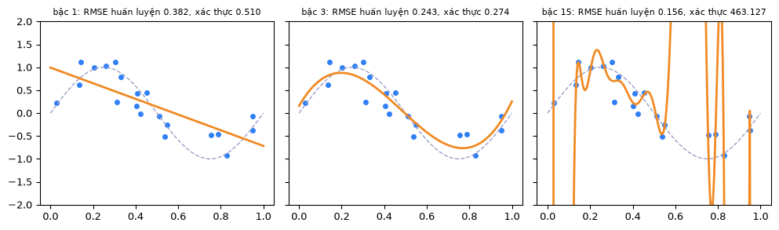
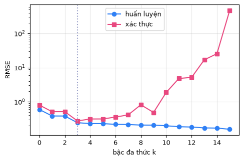
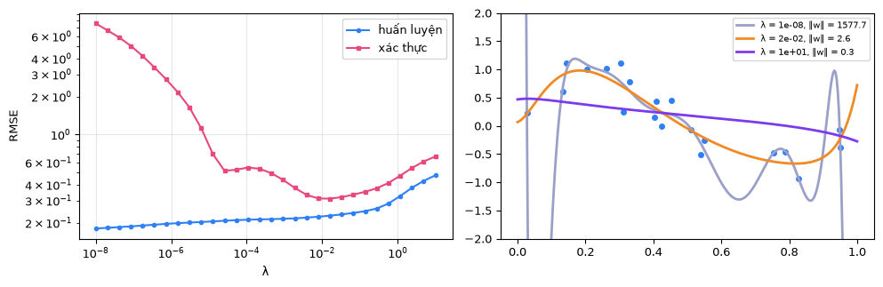
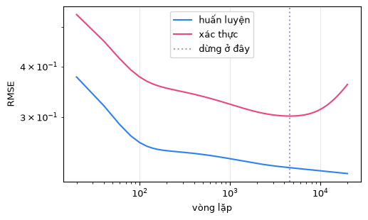

# Chương 8 · Code từ đầu

> Ghi chú của người biên soạn: trang này do người biên soạn viết thêm, không có trong sách gốc. Trang cài đặt bằng NumPy các ý chính của [chương 8](ml/ch08_vi): đo sai số trên tập xác thực, xác thực chéo, suy giảm trọng số và kết thúc sớm.

## Cách dùng trang này

Mỗi khối code đã được chạy sẵn, kết quả nằm ngay bên dưới. Các khối chạy lần lượt từ trên xuống và dùng chung biến, giống các ô của một notebook. Chỉ cần `numpy` và `matplotlib`.

Ví dụ xuyên suốt là hồi quy đa thức giống [mục 7.4.1](ml/ch07_vi): dữ liệu sinh từ $y = \sin(2\pi x)$ cộng nhiễu. Mô hình bậc $k$ có $k + 1$ tham số. Bậc càng cao thì mô hình càng linh hoạt, và càng dễ quá khớp.

## 1. Dữ liệu và mô hình đa thức

<!-- run -->
```python
import numpy as np
import matplotlib.pyplot as plt

rng = np.random.default_rng(1)

def make_data(n, rng):
    x = rng.uniform(0, 1, n)
    return x, np.sin(2 * np.pi * x) + rng.normal(0, 0.25, n)

x_train, y_train = make_data(20, rng)      # tập huấn luyện: rất ít điểm
x_val, y_val = make_data(100, rng)         # tập xác thực
x_test, y_test = make_data(100, rng)       # tập kiểm tra: chỉ dùng ở cuối

def poly(x, k):
    """Ma trận đặc trưng [1, x, x², …, x^k], với x đã đưa về [-1, 1] cho ổn định số."""
    return np.vander(2 * x - 1, k + 1, increasing=True)

def fit(x, y, k, lam=0.0):
    """Hồi quy đa thức bậc k; lam > 0 là hồi quy ridge (không phạt hệ số tự do)."""
    A = poly(x, k)
    P = lam * np.eye(k + 1); P[0, 0] = 0
    return np.linalg.solve(A.T @ A + P, A.T @ y) if lam > 0 else np.linalg.lstsq(A, y, rcond=None)[0]

def rmse(w, x, y):
    return np.sqrt(np.mean((poly(x, len(w) - 1) @ w - y) ** 2))

xs = np.linspace(0, 1, 300)
fig, axes = plt.subplots(1, 3, figsize=(10, 3), sharey=True)
for ax, k in zip(axes, [1, 3, 15]):
    w = fit(x_train, y_train, k)
    ax.plot(x_train, y_train, "o", color="#2f80f5", ms=4)
    ax.plot(xs, np.sin(2 * np.pi * xs), "--", color="#9aa0c8", lw=1)
    ax.plot(xs, poly(xs, k) @ w, color="#f08a24", lw=2)
    ax.set_ylim(-2, 2); ax.set_title(f"bậc {k}: RMSE huấn luyện {rmse(w, x_train, y_train):.3f}, xác thực {rmse(w, x_val, y_val):.3f}", fontsize=8)
fig.tight_layout()
```

<!-- output -->
<div align=center></div>
<!-- /output -->

Bậc 1 quá đơn giản, không bắt được hình sin: đó là **chưa khớp** (underfitting). Bậc 3 bám sát hàm thật. Bậc 15 có 16 tham số cho 20 điểm, nên đi qua gần như mọi điểm huấn luyện nhưng dao động dữ dội giữa các điểm: đó là **quá khớp**.

## 2. Sai số huấn luyện và sai số xác thực theo bậc

<small class="viz-ref">Mục 8.2.1</small>

Sai số trên tập huấn luyện luôn giảm khi bậc tăng, vì mô hình bậc cao chứa mô hình bậc thấp. Sai số trên tập xác thực mới cho biết mô hình **tổng quát hoá** tốt đến đâu.

<!-- run -->
```python
degrees = range(0, 16)
tr = [rmse(fit(x_train, y_train, k), x_train, y_train) for k in degrees]
va = [rmse(fit(x_train, y_train, k), x_val, y_val) for k in degrees]
best_k = int(np.argmin(va))

fig, ax = plt.subplots(figsize=(5.4, 3.4))
ax.semilogy(degrees, tr, "o-", color="#2f80f5", label="huấn luyện")
ax.semilogy(degrees, va, "s-", color="#e8487f", label="xác thực")
ax.axvline(best_k, ls=":", color="#9aa0c8")
ax.set_xlabel("bậc đa thức k"); ax.set_ylabel("RMSE"); ax.legend(); ax.grid(alpha=.3)
for k in sorted({1, 3, best_k, 9, 15}):
    print(f"bậc {k:2d}: huấn luyện {tr[k]:.3f}   xác thực {va[k]:.3f}")
print("bậc tốt nhất theo tập xác thực:", best_k)
```

<!-- output -->
```output
bậc  1: huấn luyện 0.382   xác thực 0.510
bậc  3: huấn luyện 0.243   xác thực 0.274
bậc  9: huấn luyện 0.206   xác thực 0.485
bậc 15: huấn luyện 0.156   xác thực 463.127
bậc tốt nhất theo tập xác thực: 3
```

<div align=center></div>
<!-- /output -->

Sai số huấn luyện giảm đều khi bậc tăng. Sai số xác thực thì nhỏ nhất ở bậc 3, sau đó tăng vọt: mô hình bậc 15 có sai số xác thực tới hàng trăm, dù sai số huấn luyện của nó là nhỏ nhất. Nếu chỉ nhìn sai số huấn luyện, ta sẽ chọn đúng mô hình tệ nhất.

## 3. Xác thực chéo $K$-fold, tự viết

<small class="viz-ref">Mục 8.2.2</small>

Khi dữ liệu ít, giữ riêng 100 điểm để xác thực là quá xa xỉ. Xác thực chéo chia **chính tập huấn luyện** thành $K$ phần. Mỗi lần, ta lấy một phần làm tập xác thực, học trên $K-1$ phần còn lại, rồi lấy trung bình sai số qua $K$ lần.

<!-- run -->
```python
def kfold_indices(n, K, rng):
    idx = rng.permutation(n)
    return np.array_split(idx, K)

def cv_rmse(x, y, k, K=5, lam=0.0, seed=0):
    folds = kfold_indices(len(x), K, np.random.default_rng(seed))
    errs = []
    for i in range(K):
        val = folds[i]
        trn = np.concatenate([folds[j] for j in range(K) if j != i])
        w = fit(x[trn], y[trn], k, lam)
        errs.append(rmse(w, x[val], y[val]))
    return np.mean(errs)

cv = [cv_rmse(x_train, y_train, k) for k in range(0, 12)]
k_cv = int(np.argmin(cv))
print("RMSE xác thực chéo 5-fold theo bậc:", np.round(cv, 3))
print("bậc chọn bằng xác thực chéo:", k_cv, "  bậc chọn bằng tập xác thực riêng:", best_k)
```

<!-- output -->
```output
RMSE xác thực chéo 5-fold theo bậc: [ 0.598  0.414  0.47   0.306  0.276  0.498  0.287  1.356  1.125  4.401
  8.062 22.192]
bậc chọn bằng xác thực chéo: 4   bậc chọn bằng tập xác thực riêng: 3
```
<!-- /output -->

Xác thực chéo chọn bậc 4, rất gần bậc 3 chọn bằng tập xác thực riêng, mà không cần tốn thêm dữ liệu. Với chỉ 20 điểm, mỗi lần học chỉ thấy 16 điểm, nên sai số dao động khá nhiều giữa các bậc gần nhau. Đây là cái giá của việc ít dữ liệu.

## 4. Suy giảm trọng số (weight decay)

<small class="viz-ref">Mục 8.3.2</small>

Thay vì giảm bậc, ta giữ mô hình bậc 15 nhưng phạt các hệ số lớn bằng số hạng $\lambda\|\mathbf{w}\|_2^2$, giống hồi quy ridge ở [mục 7.4.3](ml/ch07_vi). $\lambda$ lớn thì mô hình bị ép đơn giản lại.

<!-- run -->
```python
lams = np.logspace(-8, 1, 30)
tr_l = [rmse(fit(x_train, y_train, 15, l), x_train, y_train) for l in lams]
va_l = [rmse(fit(x_train, y_train, 15, l), x_val, y_val) for l in lams]
best_lam = lams[int(np.argmin(va_l))]

fig, axes = plt.subplots(1, 2, figsize=(10, 3.3))
axes[0].loglog(lams, tr_l, "o-", ms=3, color="#2f80f5", label="huấn luyện")
axes[0].loglog(lams, va_l, "s-", ms=3, color="#e8487f", label="xác thực")
axes[0].set_xlabel("λ"); axes[0].set_ylabel("RMSE"); axes[0].legend(); axes[0].grid(alpha=.3)
axes[1].plot(x_train, y_train, "o", color="#2f80f5", ms=4)
for lam, c in [(1e-8, "#9aa0c8"), (best_lam, "#f08a24"), (10, "#7c3aed")]:
    w = fit(x_train, y_train, 15, lam)
    axes[1].plot(xs, poly(xs, 15) @ w, color=c, lw=2, label=f"λ = {lam:.0e}, ‖w‖ = {np.linalg.norm(w[1:]):.1f}")
axes[1].set_ylim(-2, 2); axes[1].legend(fontsize=7); fig.tight_layout()
print(f"λ tốt nhất ≈ {best_lam:.1e}: RMSE xác thực {min(va_l):.3f}  (bậc 15 không phạt: {va[15]:.3f})")
```

<!-- output -->
```output
λ tốt nhất ≈ 1.6e-02: RMSE xác thực 0.311  (bậc 15 không phạt: 463.127)
```

<div align=center></div>
<!-- /output -->

Biểu đồ trái có dạng chữ U giống mục 2. $\lambda$ quá nhỏ thì mô hình vẫn quá khớp: chuẩn của $\mathbf{w}$ lên tới hàng nghìn. $\lambda$ quá lớn thì đường cong gần như phẳng, tức chưa khớp. Ở $\lambda$ vừa phải, mô hình bậc 15 cho sai số xác thực ngang mô hình bậc 3.

## 5. Kết thúc sớm (early stopping)

<small class="viz-ref">Mục 8.3.1</small>

Khi tối ưu bằng gradient descent (chương 12), mô hình bắt đầu từ các hệ số bằng 0 và phức tạp dần lên theo số vòng lặp. Ta theo dõi sai số xác thực sau mỗi vòng và giữ lại tham số ở vòng có sai số xác thực nhỏ nhất.

<!-- run -->
```python
A_tr, A_va = poly(x_train, 15), poly(x_val, 15)
w = np.zeros(16)
eta = 0.3
hist_tr, hist_va = [], []
best = (np.inf, 0, w.copy())
for it in range(20000):
    w -= eta * A_tr.T @ (A_tr @ w - y_train) / len(y_train)       # gradient của (7.4)
    if it % 20 == 0:
        e_tr, e_va = rmse(w, x_train, y_train), rmse(w, x_val, y_val)
        hist_tr.append(e_tr); hist_va.append(e_va)
        if e_va < best[0]:
            best = (e_va, it, w.copy())

fig, ax = plt.subplots(figsize=(5.4, 3.2))
its = np.arange(len(hist_tr)) * 20
ax.loglog(its[1:], hist_tr[1:], color="#2f80f5", label="huấn luyện")
ax.loglog(its[1:], hist_va[1:], color="#e8487f", label="xác thực")
ax.axvline(best[1], ls=":", color="#9aa0c8", label="dừng ở đây")
ax.set_xlabel("vòng lặp"); ax.set_ylabel("RMSE"); ax.legend(); ax.grid(alpha=.3)
print(f"sai số xác thực nhỏ nhất {best[0]:.3f} ở vòng {best[1]}; nếu chạy hết 20000 vòng: {hist_va[-1]:.3f}")
```

<!-- output -->
```output
sai số xác thực nhỏ nhất 0.302 ở vòng 4600; nếu chạy hết 20000 vòng: 0.361
```

<div align=center></div>
<!-- /output -->

Sai số huấn luyện giảm mãi, còn sai số xác thực giảm đến khoảng vòng 4600 rồi tăng trở lại. Dừng ở đó cho một mô hình bậc 15 mà không cần đổi hàm mất mát. Kết thúc sớm có tác dụng tương tự suy giảm trọng số: tham số chưa kịp đi xa khỏi điểm xuất phát $\mathbf{w} = \mathbf{0}$.

## 6. Đánh giá lần cuối trên tập kiểm tra

Ba cách chọn mô hình ở trên đều dùng tập xác thực (hoặc xác thực chéo). Tập kiểm tra chỉ được dùng một lần ở bước cuối để báo cáo.

<!-- run -->
```python
cands = {
    f"bậc {best_k} (chọn bằng tập xác thực)": fit(x_train, y_train, best_k),
    f"bậc 15, λ = {best_lam:.0e}": fit(x_train, y_train, 15, best_lam),
    f"bậc 15, kết thúc sớm ở vòng {best[1]}": best[2],
    "bậc 15, không kiểm soát": fit(x_train, y_train, 15),
}
for name, w in cands.items():
    print(f"{name:38s} RMSE kiểm tra = {rmse(w, x_test, y_test):.3f}")
print(f"{'(độ lệch chuẩn của nhiễu)':38s}              0.250")
```

<!-- output -->
```output
bậc 3 (chọn bằng tập xác thực)         RMSE kiểm tra = 0.285
bậc 15, λ = 2e-02                      RMSE kiểm tra = 0.309
bậc 15, kết thúc sớm ở vòng 4600       RMSE kiểm tra = 0.296
bậc 15, không kiểm soát                RMSE kiểm tra = 250.165
(độ lệch chuẩn của nhiễu)                           0.250
```
<!-- /output -->

Cả ba cách kiểm soát (chọn bậc, suy giảm trọng số, kết thúc sớm) đều cho sai số kiểm tra gần độ lệch chuẩn của nhiễu (0.25). Đó là giới hạn dưới mà không mô hình nào vượt qua được. Mô hình bậc 15 không kiểm soát thì sai lệch tới hàng trăm.
