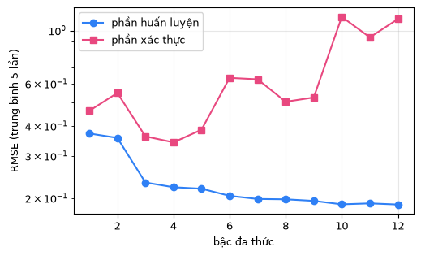
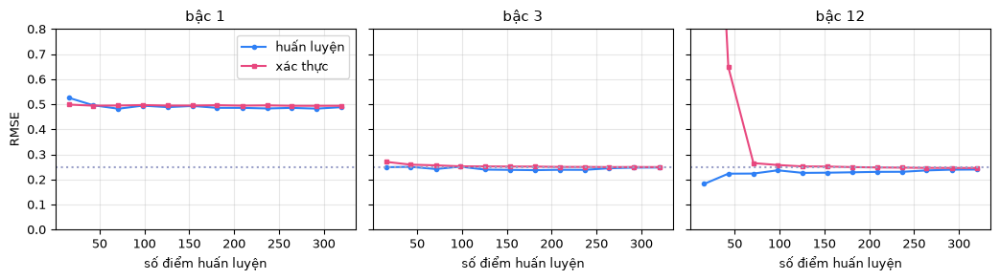

# Chương 8 · Dùng thư viện

> Ghi chú của người biên soạn: trang này do người biên soạn viết thêm, không có trong sách gốc. Trang làm lại các thí nghiệm của trang [Code từ đầu](ml/ch08_code_vi) bằng các công cụ chọn mô hình của scikit-learn (`sklearn.model_selection`).

## Cách dùng trang này

Các khối chạy lần lượt từ trên xuống và dùng chung biến. Cần `numpy`, `matplotlib` và `scikit-learn`. Dữ liệu giống trang Code: $y = \sin(2\pi x)$ cộng nhiễu, 20 điểm huấn luyện.

| Việc ở trang Code | Công cụ của scikit-learn |
| --- | --- |
| Chia tập huấn luyện/xác thực | `train_test_split` |
| Xác thực chéo $K$-fold | `KFold`, `cross_val_score` |
| Quét bậc đa thức, quét $\lambda$ | `validation_curve`, `GridSearchCV` |
| Suy giảm trọng số | `Ridge(alpha=λ)` |
| Kết thúc sớm | `SGDRegressor(early_stopping=True)` |

## 1. Mô hình dạng `Pipeline` và xác thực chéo

<small class="viz-ref">Mục 8.2.2</small>

Gói các bước biến đổi và mô hình vào một `Pipeline`. Nhờ vậy, khi xác thực chéo, các bước biến đổi (ở đây là chuẩn hoá) chỉ học từ phần huấn luyện của mỗi lần chia, không "nhìn trộm" phần xác thực.

<!-- run -->
```python
import numpy as np
import matplotlib.pyplot as plt
from sklearn.pipeline import make_pipeline
from sklearn.preprocessing import PolynomialFeatures, StandardScaler
from sklearn.linear_model import LinearRegression, Ridge
from sklearn.model_selection import KFold, cross_val_score

rng = np.random.default_rng(1)
def make_data(n, rng):
    x = rng.uniform(0, 1, n)
    return x[:, None], np.sin(2 * np.pi * x) + rng.normal(0, 0.25, n)
X_train, y_train = make_data(20, rng)
X_val, y_val = make_data(100, rng)
X_test, y_test = make_data(100, rng)

def poly_model(k, alpha=None):
    last = LinearRegression() if alpha is None else Ridge(alpha=alpha)
    return make_pipeline(PolynomialFeatures(k, include_bias=False), StandardScaler(), last)

cv = KFold(n_splits=5, shuffle=True, random_state=0)
for k in [1, 3, 4, 9]:
    scores = -cross_val_score(poly_model(k), X_train, y_train, cv=cv, scoring="neg_root_mean_squared_error")
    print(f"bậc {k}: RMSE 5 lần = {scores.round(3)}, trung bình {scores.mean():.3f}")
```

<!-- output -->
```output
bậc 1: RMSE 5 lần = [0.392 0.424 0.438 0.615 0.444], trung bình 0.463
bậc 3: RMSE 5 lần = [0.228 0.397 0.383 0.6   0.201], trung bình 0.362
bậc 4: RMSE 5 lần = [0.165 0.337 0.36  0.539 0.308], trung bình 0.342
bậc 9: RMSE 5 lần = [0.246 1.306 0.409 0.319 0.348], trung bình 0.526
```
<!-- /output -->

Năm lần chia cho sai số chênh nhau khá nhiều. Ví dụ ở bậc 3, sai số dao động từ 0.20 đến 0.60. Mỗi lần chia chỉ có 4 điểm xác thực, nên một điểm khó cũng đủ làm lệch kết quả. Vì vậy phải lấy trung bình.

scikit-learn quy ước "điểm càng lớn càng tốt", nên các thước đo sai số có dạng âm: `neg_root_mean_squared_error`. Đổi dấu là được RMSE.

## 2. `validation_curve`: quét một siêu tham số

<small class="viz-ref">Mục 8.2.1–8.2.2 · hình 8.1</small>

`validation_curve` làm đúng việc của mục 2–3 trang Code: với mỗi giá trị của một siêu tham số, nó chạy xác thực chéo và trả về điểm trên phần huấn luyện lẫn phần xác thực.

<!-- run -->
```python
from sklearn.model_selection import validation_curve

degrees = np.arange(1, 13)              # bậc 0 không còn đặc trưng nào (include_bias=False) nên bỏ
tr, va = validation_curve(poly_model(1), X_train, y_train, param_name="polynomialfeatures__degree",
                          param_range=degrees, cv=cv, scoring="neg_root_mean_squared_error")
tr, va = -tr.mean(axis=1), -va.mean(axis=1)

fig, ax = plt.subplots(figsize=(5.4, 3.3))
ax.semilogy(degrees, tr, "o-", color="#2f80f5", label="phần huấn luyện")
ax.semilogy(degrees, va, "s-", color="#e8487f", label="phần xác thực")
ax.set_xlabel("bậc đa thức"); ax.set_ylabel("RMSE (trung bình 5 lần)"); ax.legend(); ax.grid(alpha=.3)
print("bậc có RMSE xác thực chéo nhỏ nhất:", degrees[np.argmin(va)])
```

<!-- output -->
```output
bậc có RMSE xác thực chéo nhỏ nhất: 4
```

<div align=center></div>
<!-- /output -->

Bậc được chọn là 4, giống xác thực chéo tự viết ở trang Code. Biểu đồ có cùng dạng chữ U: sai số trên phần huấn luyện giảm mãi, còn sai số trên phần xác thực có đáy rồi tăng lại.

Tên tham số có dạng `<tên bước>__<tham số>`. Tên bước do `make_pipeline` tự đặt bằng tên lớp viết thường.

## 3. `GridSearchCV`: chọn nhiều siêu tham số cùng lúc

<small class="viz-ref">Mục 8.3.2</small>

Ta tìm đồng thời bậc đa thức và hệ số suy giảm trọng số $\lambda$ (`alpha` của `Ridge`). `GridSearchCV` thử mọi tổ hợp bằng xác thực chéo, rồi huấn luyện lại mô hình tốt nhất trên toàn bộ tập huấn luyện.

<!-- run -->
```python
from sklearn.model_selection import GridSearchCV

grid = GridSearchCV(poly_model(3, alpha=1.0),
                    {"polynomialfeatures__degree": [3, 6, 9, 15], "ridge__alpha": np.logspace(-6, 2, 17)},
                    cv=cv, scoring="neg_root_mean_squared_error")
grid.fit(X_train, y_train)
print("tổ hợp tốt nhất:", grid.best_params_, f" RMSE xác thực chéo = {-grid.best_score_:.3f}")

for k in [3, 15]:
    m = grid.cv_results_["param_polynomialfeatures__degree"] == k
    i = np.argmax(grid.cv_results_["mean_test_score"] * m - 1e9 * ~m)
    print(f"bậc {k:2d}: α tốt nhất = {grid.cv_results_['param_ridge__alpha'][i]:.0e}, "
          f"RMSE = {-grid.cv_results_['mean_test_score'][i]:.3f}")
print(f"RMSE trên tập kiểm tra của mô hình được chọn: {-grid.score(X_test, y_test):.3f}")
```

<!-- output -->
```output
tổ hợp tốt nhất: {'polynomialfeatures__degree': 6, 'ridge__alpha': np.float64(1e-05)}  RMSE xác thực chéo = 0.290
bậc  3: α tốt nhất = 1e-06, RMSE = 0.362
bậc 15: α tốt nhất = 3e+00, RMSE = 0.378
RMSE trên tập kiểm tra của mô hình được chọn: 0.295
```
<!-- /output -->

`GridSearchCV` chọn bậc 6 với $\lambda$ rất nhỏ. Bậc 15 cần $\lambda$ lớn hơn hàng trăm nghìn lần mới không quá khớp. Mô hình được chọn có sai số kiểm tra gần mức nhiễu 0.25. Sau khi `fit`, đối tượng `grid` dùng được như một mô hình bình thường (`predict`, `score`).

## 4. `learning_curve`: thêm dữ liệu có giúp không?

Một cách khác để chẩn đoán quá khớp là vẽ sai số theo **số điểm huấn luyện**. Mô hình quá khớp có khoảng cách lớn giữa sai số huấn luyện và sai số xác thực, và khoảng cách đó thu hẹp khi có thêm dữ liệu. Mô hình chưa khớp thì cả hai sai số đều cao và gần nhau, nên thêm dữ liệu không giúp được gì.

<!-- run -->
```python
from sklearn.model_selection import learning_curve

X_big, y_big = make_data(400, np.random.default_rng(7))
fig, axes = plt.subplots(1, 3, figsize=(10.5, 3), sharey=True)
for ax, (k, title) in zip(axes, [(1, "bậc 1"), (3, "bậc 3"), (12, "bậc 12")]):
    sizes, tr, va = learning_curve(poly_model(k), X_big, y_big, train_sizes=np.linspace(0.05, 1, 12),
                                   cv=KFold(5, shuffle=True, random_state=0), scoring="neg_root_mean_squared_error")
    ax.plot(sizes, -tr.mean(1), "o-", ms=3, color="#2f80f5", label="huấn luyện")
    ax.plot(sizes, -va.mean(1), "s-", ms=3, color="#e8487f", label="xác thực")
    ax.axhline(0.25, ls=":", color="#9aa0c8")
    ax.set_title(title); ax.set_xlabel("số điểm huấn luyện"); ax.set_ylim(0, 0.8); ax.grid(alpha=.3)
    print(f"{title:7s}: với {sizes[0]:3d} điểm  huấn luyện {-tr.mean(1)[0]:.3f}, xác thực {-va.mean(1)[0]:8.3f}   |"
          f"  với {sizes[-1]} điểm  huấn luyện {-tr.mean(1)[-1]:.3f}, xác thực {-va.mean(1)[-1]:.3f}")
axes[0].set_ylabel("RMSE"); axes[0].legend(); fig.tight_layout()
```

<!-- output -->
```output
bậc 1  : với  16 điểm  huấn luyện 0.525, xác thực    0.498   |  với 320 điểm  huấn luyện 0.488, xác thực 0.494
bậc 3  : với  16 điểm  huấn luyện 0.249, xác thực    0.270   |  với 320 điểm  huấn luyện 0.247, xác thực 0.249
bậc 12 : với  16 điểm  huấn luyện 0.182, xác thực    2.526   |  với 320 điểm  huấn luyện 0.239, xác thực 0.246
```

<div align=center></div>
<!-- /output -->

Ba kiểu đường cong học:

- **Bậc 1 (chưa khớp):** hai đường gần nhau và nằm ngang ở mức khoảng 0.49, xa mức nhiễu 0.25. Thêm dữ liệu không giúp gì. Cần một mô hình linh hoạt hơn.
- **Bậc 12 (quá khớp khi ít dữ liệu):** với 16 điểm, sai số xác thực lớn gấp hơn chục lần sai số huấn luyện. Khoảng cách này biến mất khi có vài trăm điểm. Thêm dữ liệu là cách chữa quá khớp tự nhiên nhất.
- **Bậc 3:** tốt ở mọi cỡ dữ liệu, vì nó khớp đúng độ phức tạp của hàm thật.

## 5. Kết thúc sớm với `MLPRegressor`

<small class="viz-ref">Mục 8.3.1</small>

Kết thúc sớm có ích nhất với các mô hình có rất nhiều tham số được huấn luyện bằng gradient, như mạng neuron (chương 16). Với `early_stopping=True`, mô hình tự tách `validation_fraction` dữ liệu huấn luyện làm tập xác thực. Sau mỗi vòng qua dữ liệu, nó đo điểm trên tập này và dừng khi điểm không cải thiện sau `n_iter_no_change` vòng. Dưới đây là một mạng hai tầng ẩn, mỗi tầng 200 neuron (hơn 40 000 tham số), học từ 60 điểm:

<!-- run -->
```python
import warnings
from sklearn.neural_network import MLPRegressor

X60, y60 = make_data(60, np.random.default_rng(7))
for es in [False, True]:
    net = MLPRegressor(hidden_layer_sizes=(200, 200), alpha=0, max_iter=5000, learning_rate_init=3e-3, tol=1e-7,
                       early_stopping=es, validation_fraction=0.2, n_iter_no_change=50, random_state=0)
    with warnings.catch_warnings():
        warnings.simplefilter("ignore")
        net.fit(X60, y60)
    rm = lambda X, y: np.sqrt(np.mean((net.predict(X) - y) ** 2))
    print(f"early_stopping={es!s:5}: dừng sau {net.n_iter_:4d} vòng, RMSE huấn luyện = {rm(X60, y60):.3f}, kiểm tra = {rm(X_test, y_test):.3f}")
```

<!-- output -->
```output
early_stopping=False: dừng sau 4257 vòng, RMSE huấn luyện = 0.158, kiểm tra = 0.259
early_stopping=True : dừng sau  226 vòng, RMSE huấn luyện = 0.201, kiểm tra = 0.236
```
<!-- /output -->

Không kết thúc sớm, mạng chạy hàng nghìn vòng và bám theo cả nhiễu: sai số huấn luyện xuống dưới mức nhiễu 0.25, còn sai số kiểm tra cao hơn. Kết thúc sớm dừng sau vài trăm vòng và tổng quát hoá tốt hơn. Cái giá phải trả là 20% dữ liệu bị giữ lại để xác thực. Với dữ liệu ít, cái giá này có thể lớn hơn lợi ích. Người biên soạn đã thử thêm vài cỡ dữ liệu khác (40, 100 điểm), và kết thúc sớm không phải lúc nào cũng thắng. Vì vậy hãy luôn so sánh bằng xác thực.

## Tóm tắt

| Nhu cầu | Công cụ |
| --- | --- |
| Đánh giá một mô hình bằng xác thực chéo | `cross_val_score(model, X, y, cv=KFold(5, shuffle=True))` |
| Vẽ sai số theo một siêu tham số | `validation_curve` |
| Chọn nhiều siêu tham số | `GridSearchCV` (hoặc `RandomizedSearchCV` khi lưới quá lớn) |
| Có nên thu thập thêm dữ liệu? | `learning_curve` |
| Suy giảm trọng số | `Ridge`, `RidgeCV`; tham số `alpha`/`C` ở các mô hình khác |
| Kết thúc sớm | `early_stopping=True` ở `SGDRegressor`, `SGDClassifier`, `MLPClassifier` |
