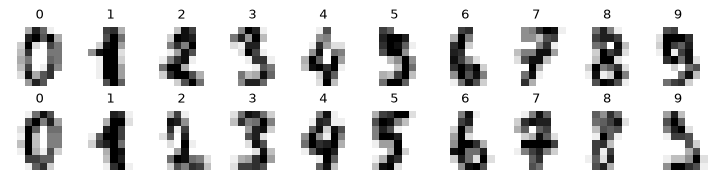
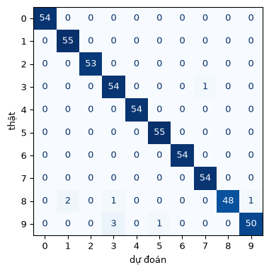
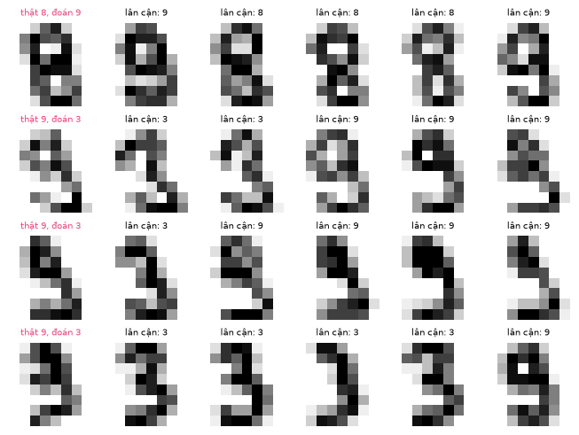

# Chương 9 · Ví dụ áp dụng: nhận dạng chữ số viết tay

> Ghi chú của người biên soạn: trang này do người biên soạn viết thêm, không có trong sách gốc. Dữ liệu là bộ *Optical Recognition of Handwritten Digits* (UCI), có sẵn trong scikit-learn dưới tên `load_digits`.

## Bài toán

Bộ dữ liệu có 1797 ảnh chữ số viết tay từ 0 đến 9. Mỗi ảnh có kích thước $8 \times 8$ điểm ảnh, mỗi điểm nhận giá trị từ 0 đến 16. Trải phẳng mỗi ảnh thành một vector 64 chiều rồi phân loại bằng KNN. Câu hỏi đặt ra: "ảnh gần nhất" theo khoảng cách $\ell_2$ có phải là ảnh cùng chữ số không?

Đây là phiên bản thu nhỏ của bài toán MNIST mà sách dùng ở chương 10 và 14.

## 1. Xem dữ liệu

<!-- run -->
```python
import numpy as np
import matplotlib.pyplot as plt
from sklearn.datasets import load_digits
from sklearn.model_selection import train_test_split

digits = load_digits()
X, y = digits.data, digits.target
print("dữ liệu:", X.shape, " số ảnh mỗi chữ số:", np.bincount(y))

fig, axes = plt.subplots(2, 10, figsize=(9, 2))
for i, ax in enumerate(axes.flat):
    ax.imshow(digits.images[i], cmap="gray_r"); ax.set_title(y[i], fontsize=9); ax.axis("off")

X_train, X_test, y_train, y_test = train_test_split(X, y, test_size=0.3, random_state=0, stratify=y)
print("huấn luyện:", X_train.shape[0], " kiểm tra:", X_test.shape[0])
```

<!-- output -->
```output
dữ liệu: (1797, 64)  số ảnh mỗi chữ số: [178 182 177 183 181 182 181 179 174 180]
huấn luyện: 1257  kiểm tra: 540
```

<div align=center></div>
<!-- /output -->

## 2. Chọn $K$ và cách bỏ phiếu

Các điểm ảnh có cùng thang đo (0–16), nên ở đây không bắt buộc phải chuẩn hoá. Ta thử cả hai cách cho chắc.

<!-- run -->
```python
from sklearn.neighbors import KNeighborsClassifier
from sklearn.model_selection import GridSearchCV, StratifiedKFold
from sklearn.pipeline import make_pipeline
from sklearn.preprocessing import StandardScaler

cv = StratifiedKFold(5, shuffle=True, random_state=0)
params = {"n_neighbors": [1, 3, 5, 7, 9, 15], "weights": ["uniform", "distance"]}
raw = GridSearchCV(KNeighborsClassifier(), params, cv=cv).fit(X_train, y_train)
scaled = GridSearchCV(make_pipeline(StandardScaler(), KNeighborsClassifier()),
                      {"kneighborsclassifier__" + k: v for k, v in params.items()}, cv=cv).fit(X_train, y_train)
print("không chuẩn hoá:", raw.best_params_, f" xác thực chéo {raw.best_score_:.4f}")
print("có chuẩn hoá   :", {k.split("__")[1]: v for k, v in scaled.best_params_.items()}, f" xác thực chéo {scaled.best_score_:.4f}")

res = raw.cv_results_
for w in ["uniform", "distance"]:
    m = np.array(res["param_weights"]) == w
    print(f"{w:8s}:", "  ".join(f"K={k}: {s:.3f}" for k, s in zip(np.array(res["param_n_neighbors"])[m], res["mean_test_score"][m])))
```

<!-- output -->
```output
không chuẩn hoá: {'n_neighbors': 1, 'weights': 'uniform'}  xác thực chéo 0.9841
có chuẩn hoá   : {'n_neighbors': 9, 'weights': 'uniform'}  xác thực chéo 0.9698
uniform : K=1: 0.984  K=3: 0.982  K=5: 0.981  K=7: 0.984  K=9: 0.979  K=15: 0.970
distance: K=1: 0.984  K=3: 0.984  K=5: 0.982  K=7: 0.984  K=9: 0.981  K=15: 0.974
```
<!-- /output -->

Mọi $K$ từ 1 đến 9 đều cho độ chính xác khoảng 98%, cách bỏ phiếu gần như không ảnh hưởng, còn chuẩn hoá lại làm kết quả kém đi một chút. Lý do: các điểm ảnh vốn đã cùng thang đo, và điểm ảnh ở mép ảnh gần như luôn bằng 0. Chuẩn hoá phóng đại những điểm ảnh ít thông tin này lên ngang các điểm ảnh ở giữa.

## 3. Kết quả trên tập kiểm tra

<!-- run -->
```python
from sklearn.metrics import confusion_matrix, ConfusionMatrixDisplay

best = raw.best_estimator_
pred = best.predict(X_test)
print(f"độ chính xác trên tập kiểm tra: {np.mean(pred == y_test):.4f}  ({np.sum(pred != y_test)} ảnh sai trên {len(y_test)})")

fig, ax = plt.subplots(figsize=(4.6, 4.2))
ConfusionMatrixDisplay(confusion_matrix(y_test, pred)).plot(ax=ax, colorbar=False, cmap="Blues")
ax.set_xlabel("dự đoán"); ax.set_ylabel("thật")
```

<!-- output -->
```output
độ chính xác trên tập kiểm tra: 0.9833  (9 ảnh sai trên 540)
```

<div align=center></div>
<!-- /output -->

Ma trận nhầm lẫn cho biết chữ số nào bị nhầm thành chữ số nào: hàng là nhãn thật, cột là nhãn dự đoán. Các ô ngoài đường chéo là lỗi.

## 4. Những ảnh bị nhận sai, và hàng xóm của chúng

KNN có một ưu điểm lớn: mọi dự đoán đều **giải thích được** bằng các lân cận. Với mỗi ảnh bị nhận sai, ta xem các ảnh huấn luyện gần nó nhất:

<!-- run -->
```python
wrong = np.where(pred != y_test)[0][:4]
k = 5                                  # xem 5 lân cận gần nhất (mô hình tốt nhất có thể dùng K nhỏ hơn)
fig, axes = plt.subplots(len(wrong), k + 1, figsize=(1.1 * (k + 1), 1.25 * len(wrong)))
for row, i in zip(np.atleast_2d(axes), wrong):
    row[0].imshow(X_test[i].reshape(8, 8), cmap="gray_r")
    row[0].set_title(f"thật {y_test[i]}, đoán {pred[i]}", fontsize=7, color="#e8487f")
    _, idx = best.kneighbors(X_test[i:i + 1], n_neighbors=k)
    for ax, j in zip(row[1:], idx[0]):
        ax.imshow(X_train[j].reshape(8, 8), cmap="gray_r"); ax.set_title(f"lân cận: {y_train[j]}", fontsize=7)
    for ax in row: ax.axis("off")
fig.tight_layout()
```

<!-- output -->
<div align=center></div>
<!-- /output -->

Phần lớn lỗi là những ảnh viết xấu, trông giống chữ số khác thật. Có một điều thú vị: ở ba hàng đầu, lân cận *gần nhất* mang nhãn sai (mô hình $K = 1$ chỉ nhìn lân cận này), nhưng đa số trong 5 lân cận lại mang nhãn đúng. Với $K = 5$, ba ảnh này sẽ được đoán đúng. Đổi lại, $K = 5$ lại sai ở những ảnh khác, nên tổng thể hai mô hình ngang nhau, như xác thực chéo ở mục 2 đã cho thấy.

## 5. Chi phí: KNN "học" nhanh nhưng đoán chậm

<small class="viz-ref">Mục 9.4.3</small>

So sánh thời gian huấn luyện và dự đoán của KNN với hồi quy logistic (chương 14), một mô hình phải học tham số:

<!-- run -->
```python
from time import perf_counter
from sklearn.linear_model import LogisticRegression

Xb = np.tile(X_train, (10, 1)) + np.random.default_rng(0).normal(0, 0.5, (10 * len(X_train), 64))   # dữ liệu lớn gấp 10
yb = np.tile(y_train, 10)
for name, m in [("KNN (K=3)", KNeighborsClassifier(3)), ("hồi quy logistic", make_pipeline(StandardScaler(), LogisticRegression(max_iter=2000)))]:
    t = perf_counter(); m.fit(Xb, yb); t_fit = perf_counter() - t
    t = perf_counter(); acc = m.score(X_test, y_test); t_pred = perf_counter() - t
    print(f"{name:17s} huấn luyện {1000 * t_fit:7.0f} ms   dự đoán {len(X_test)} ảnh {1000 * t_pred:6.0f} ms   độ chính xác {acc:.3f}")
```

<!-- output -->
```output
KNN (K=3)         huấn luyện       3 ms   dự đoán 540 ảnh     21 ms   độ chính xác 0.983
hồi quy logistic  huấn luyện    1328 ms   dự đoán 540 ảnh      9 ms   độ chính xác 0.967
```
<!-- /output -->

KNN "học" gần như tức thì, vì chỉ lưu lại dữ liệu. Nhưng thời gian dự đoán tăng theo kích thước tập huấn luyện. Hồi quy logistic thì ngược lại: học lâu nhưng dự đoán gần như tức thì, vì chỉ cần một phép nhân ma trận. Trong ứng dụng thực tế, thời gian dự đoán thường quan trọng hơn.

## Rút ra được gì

- Với một bài toán "dễ" như chữ số 8×8, KNN không cần học tham số nào mà vẫn đạt khoảng 98%. Đây là một mốc so sánh tốt trước khi thử mô hình phức tạp hơn.
- Chuẩn hoá không phải lúc nào cũng tốt hơn. Nó cần thiết khi các đặc trưng có thang đo khác nhau (bộ *Wine*), nhưng có thể có hại khi các đặc trưng vốn đã cùng đơn vị (điểm ảnh).
- KNN tự giải thích được: luôn xem được "vì sao" một dự đoán sai.
- Cái giá phải trả là bộ nhớ (phải lưu toàn bộ dữ liệu) và thời gian dự đoán. Với dữ liệu lớn và nhiều chiều như MNIST đầy đủ (70 000 ảnh, 784 chiều), các mô hình học tham số ở những chương sau sẽ thực tế hơn.
