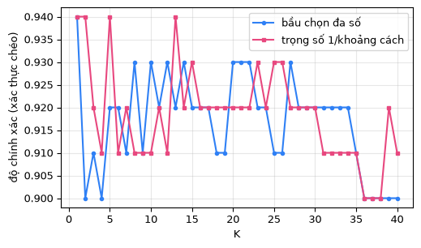
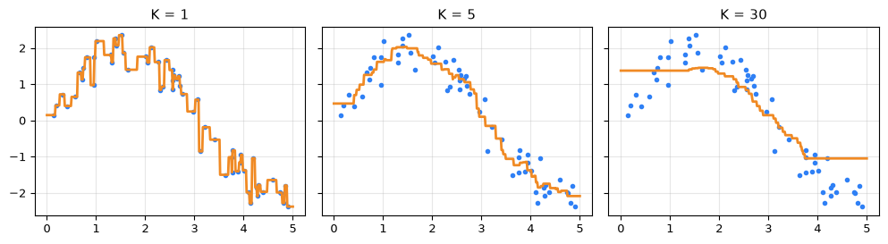

# Chương 9 · Code từ đầu

> Ghi chú của người biên soạn: trang này do người biên soạn viết thêm, không có trong sách gốc. Trang cài đặt $K$ lân cận (KNN) chỉ bằng NumPy rồi chạy lại thí nghiệm trên bộ Iris của [mục 9.3](ml/ch09_vi), để so với các con số in trong sách (sách dùng scikit-learn).

## Cách dùng trang này

Các khối chạy lần lượt từ trên xuống và dùng chung biến. Cần `numpy`, `matplotlib`, và `scikit-learn` (chỉ để tải dữ liệu và chia tập).

KNN không có pha huấn luyện thật sự. "Học" chỉ là ghi nhớ toàn bộ dữ liệu. Mọi tính toán dồn vào lúc dự đoán: tính khoảng cách từ điểm cần dự đoán tới mọi điểm huấn luyện, lấy $K$ điểm gần nhất, rồi bỏ phiếu.

## 1. Tính khoảng cách nhanh

<small class="viz-ref">Mục 9.2</small>

Tính trực tiếp $\|\mathbf{z} - \mathbf{x}_i\|_2^2$ cho từng cặp điểm bằng vòng lặp Python rất chậm. Mục 9.2 dùng đẳng thức

$$
\|\mathbf{z} - \mathbf{x}\|_2^2 = \|\mathbf{z}\|_2^2 + \|\mathbf{x}\|_2^2 - 2\mathbf{z}^T\mathbf{x}
$$

để đưa mọi thứ về phép nhân ma trận. Dưới đây ta so sánh vòng lặp, broadcasting trực tiếp và đẳng thức trên:

<!-- run -->
```python
import numpy as np
import matplotlib.pyplot as plt
from time import perf_counter

rng = np.random.default_rng(0)
X = rng.normal(size=(5000, 100))      # 5000 điểm huấn luyện, 100 chiều
Z = rng.normal(size=(200, 100))       # 200 điểm cần dự đoán

def dist_loop(Z, X):
    return np.array([[np.sum((z - x) ** 2) for x in X] for z in Z])

def dist_broadcast(Z, X):
    return ((Z[:, None, :] - X[None, :, :]) ** 2).sum(-1)      # tạo mảng trung gian (M, N, d)

def dist_fast(Z, X):
    """‖z‖² + ‖x‖² − 2 zᵀx cho mọi cặp, như mục 9.2."""
    return (Z ** 2).sum(1)[:, None] + (X ** 2).sum(1)[None, :] - 2 * Z @ X.T

for f in [dist_loop, dist_broadcast, dist_fast]:
    t = perf_counter(); D = f(Z, X); dt = perf_counter() - t
    print(f"{f.__name__:15s} {dt * 1000:8.1f} ms   sai khác so với dist_fast: {np.abs(D - dist_fast(Z, X)).max():.1e}")
```

<!-- output -->
```output
dist_loop         4260.8 ms   sai khác so với dist_fast: 1.7e-13
dist_broadcast     547.1 ms   sai khác so với dist_fast: 1.7e-13
dist_fast           15.6 ms   sai khác so với dist_fast: 0.0e+00
```
<!-- /output -->

Cả ba cách cho cùng kết quả (sai khác chỉ ở mức làm tròn số). Cách dùng đẳng thức nhanh hơn vòng lặp hàng trăm lần. Broadcasting trực tiếp cũng chậm, vì phải tạo một mảng trung gian $200 \times 5000 \times 100$ phần tử.

## 2. Bộ phân loại KNN tự viết

<small class="viz-ref">Mục 9.1.1 và 9.3.2</small>

Lớp dưới đây cài đặt hai cách bỏ phiếu như mục 9.3.2:

- `weights="uniform"`: mỗi lân cận một phiếu, gọi là bầu chọn đa số (major voting).
- `weights="distance"`: phiếu tỉ lệ với $1/\text{khoảng cách}$. Nếu điểm cần dự đoán trùng với một điểm huấn luyện thì lấy luôn nhãn của điểm đó.

Ngoài ra, `weights` cũng nhận một hàm của khoảng cách, giống `myweight` trong sách.

<!-- run -->
```python
class KNNClassifier:
    def __init__(self, k=5, weights="uniform"):
        self.k, self.weights = k, weights

    def fit(self, X, y):
        self.X, self.y = np.asarray(X, float), np.asarray(y)
        self.classes_ = np.unique(self.y)
        return self

    def kneighbors(self, Z):
        D = np.maximum(dist_fast(np.asarray(Z, float), self.X), 0)       # bình phương khoảng cách, cắt sai số âm
        idx = np.argpartition(D, self.k - 1, axis=1)[:, :self.k]          # k chỉ số nhỏ nhất, chưa sắp xếp
        return np.sqrt(np.take_along_axis(D, idx, 1)), idx

    def predict_proba(self, Z):
        dist, idx = self.kneighbors(Z)
        if self.weights == "uniform":
            w = np.ones_like(dist)
        elif self.weights == "distance":
            with np.errstate(divide="ignore"):
                w = 1.0 / dist
            exact = np.isinf(w)                                           # trùng điểm huấn luyện
            w[exact.any(1)] = exact[exact.any(1)].astype(float)
        else:
            w = self.weights(dist)                                        # hàm tự định nghĩa
        votes = np.zeros((len(dist), len(self.classes_)))
        labels = np.searchsorted(self.classes_, self.y[idx])
        np.add.at(votes, (np.arange(len(dist))[:, None], labels), w)
        return votes / votes.sum(1, keepdims=True)

    def predict(self, Z):
        return self.classes_[self.predict_proba(Z).argmax(1)]

def accuracy(y, y_hat):
    return np.mean(y == y_hat)
```

## 3. Thí nghiệm trên bộ Iris, giống sách

<small class="viz-ref">Mục 9.3.2</small>

Sách dùng 20 điểm huấn luyện và 130 điểm kiểm tra, chia bằng `np.random.seed(7)`. Ta chia đúng như vậy rồi chạy KNN tự viết với bốn cấu hình của sách:

<!-- run -->
```python
from sklearn.datasets import load_iris
from sklearn.model_selection import train_test_split

iris = load_iris()
np.random.seed(7)                                     # cách chia của sách
X_train, X_test, y_train, y_test = train_test_split(iris.data, iris.target, test_size=130)
print("huấn luyện:", X_train.shape[0], " kiểm tra:", X_test.shape[0])

def myweight(distances):                              # trọng số tự định nghĩa của sách
    return np.exp(-distances ** 2 / 0.4)

configs = [("1NN", 1, "uniform", "92.31"), ("7NN, bầu chọn đa số", 7, "uniform", "93.85"),
           ("7NN, trọng số 1/khoảng cách", 7, "distance", "94.62"), ("7NN, trọng số tự định nghĩa", 7, myweight, "95.38")]
for name, k, w, book in configs:
    acc = accuracy(y_test, KNNClassifier(k, w).fit(X_train, y_train).predict(X_test))
    print(f"{name:30s} độ chính xác {100 * acc:.2f}%   (sách: {book}%)")
```

<!-- output -->
```output
huấn luyện: 20  kiểm tra: 130
1NN                            độ chính xác 92.31%   (sách: 92.31%)
7NN, bầu chọn đa số            độ chính xác 93.85%   (sách: 93.85%)
7NN, trọng số 1/khoảng cách    độ chính xác 94.62%   (sách: 94.62%)
7NN, trọng số tự định nghĩa    độ chính xác 95.38%   (sách: 95.38%)
```
<!-- /output -->

KNN tự viết cho **đúng từng chữ số** kết quả của scikit-learn in trong sách. Lưu ý rằng sách cố ý dùng rất ít điểm huấn luyện (20 điểm) để thấy rõ khác biệt giữa các cách bỏ phiếu. Với từng ấy dữ liệu, chênh lệch một vài phần trăm chỉ ứng với một hai điểm kiểm tra.

## 4. Chọn $K$ bằng xác thực chéo

$K$ là một siêu tham số. Như ở [chương 8](ml/ch08_vi), ta chọn nó bằng xác thực chéo trên tập huấn luyện, không dùng tập kiểm tra. Lần này ta dùng cách chia hợp lý hơn: 100 điểm huấn luyện, 50 điểm kiểm tra.

<!-- run -->
```python
X_tr, X_te, y_tr, y_te = train_test_split(iris.data, iris.target, test_size=50, random_state=0, stratify=iris.target)

def cv_accuracy(make_model, X, y, K=5, seed=0):
    folds = np.array_split(np.random.default_rng(seed).permutation(len(X)), K)
    accs = []
    for i in range(K):
        trn = np.concatenate([folds[j] for j in range(K) if j != i])
        accs.append(accuracy(y[folds[i]], make_model().fit(X[trn], y[trn]).predict(X[folds[i]])))
    return np.mean(accs)

ks = np.arange(1, 41)
cv_u = [cv_accuracy(lambda: KNNClassifier(k), X_tr, y_tr) for k in ks]
cv_d = [cv_accuracy(lambda: KNNClassifier(k, "distance"), X_tr, y_tr) for k in ks]

fig, ax = plt.subplots(figsize=(5.6, 3.2))
ax.plot(ks, cv_u, "o-", ms=3, color="#2f80f5", label="bầu chọn đa số")
ax.plot(ks, cv_d, "s-", ms=3, color="#e8487f", label="trọng số 1/khoảng cách")
ax.set_xlabel("K"); ax.set_ylabel("độ chính xác (xác thực chéo)"); ax.legend(); ax.grid(alpha=.3)
k_best = ks[int(np.argmax(cv_u))]
print("K tốt nhất (bầu chọn đa số):", k_best, f" độ chính xác xác thực chéo {max(cv_u):.3f}")
print(f"độ chính xác trên tập kiểm tra với K = {k_best}: {accuracy(y_te, KNNClassifier(k_best).fit(X_tr, y_tr).predict(X_te)):.3f}")
```

<!-- output -->
```output
K tốt nhất (bầu chọn đa số): 1  độ chính xác xác thực chéo 0.940
độ chính xác trên tập kiểm tra với K = 1: 0.980
```

<div align=center></div>
<!-- /output -->

Đường cong rất răng cưa: mọi $K$ từ 1 đến khoảng 35 đều cho độ chính xác 0.90–0.94. Mỗi phần xác thực chỉ có 20 điểm, nên một điểm đúng hay sai đã làm thay đổi 1% độ chính xác trung bình. Chênh lệch giữa các $K$ ở đây phần lớn là nhiễu. Thực tế, người ta thường chọn một $K$ ở giữa vùng tốt thay vì đúng điểm cao nhất. $K$ quá lớn (trên 35, tức gần một nửa số điểm của mỗi lớp) thì độ chính xác bắt đầu giảm.

## 5. Chuẩn hoá dữ liệu: điểm yếu lớn của KNN

<small class="viz-ref">Mục 9.4.3</small>

KNN dựa hoàn toàn vào khoảng cách. Đặc trưng nào có thang đo lớn sẽ áp đảo khoảng cách. Bộ *Wine* có 13 đặc trưng hoá học: cột `proline` có giá trị vài trăm đến hơn một nghìn, trong khi nhiều cột khác nhỏ hơn 1.

<!-- run -->
```python
from sklearn.datasets import load_wine

wine = load_wine()
Xw, yw = wine.data, wine.target
print("độ lệch chuẩn từng cột:", Xw.std(0).round(2).tolist())

def standardize(X_fit, *Xs):
    mu, sd = X_fit.mean(0), X_fit.std(0)
    return [(X - mu) / sd for X in (X_fit,) + Xs]

for k in [1, 5, 15]:
    raw = cv_accuracy(lambda: KNNClassifier(k), Xw, yw)
    # chuẩn hoá bên trong từng lần chia: trung bình và độ lệch chuẩn chỉ tính trên phần huấn luyện
    class Scaled(KNNClassifier):
        def fit(self, X, y):
            self.mu, self.sd = X.mean(0), X.std(0)
            return super().fit((X - self.mu) / self.sd, y)
        def predict(self, Z):
            return super().predict((Z - self.mu) / self.sd)
    sc = cv_accuracy(lambda: Scaled(k), Xw, yw)
    print(f"K = {k:2d}: chưa chuẩn hoá {raw:.3f}   đã chuẩn hoá {sc:.3f}")
```

<!-- output -->
```output
độ lệch chuẩn từng cột: [0.81, 1.11, 0.27, 3.33, 14.24, 0.62, 1.0, 0.12, 0.57, 2.31, 0.23, 0.71, 314.02]
K =  1: chưa chuẩn hoá 0.748   đã chuẩn hoá 0.938
K =  5: chưa chuẩn hoá 0.702   đã chuẩn hoá 0.949
K = 15: chưa chuẩn hoá 0.675   đã chuẩn hoá 0.943
```
<!-- /output -->

Chưa chuẩn hoá, khoảng cách gần như chỉ do cột `proline` quyết định (độ lệch chuẩn 314, các cột khác nhỏ hơn 15). Mười hai đặc trưng còn lại gần như bị bỏ qua. Chuẩn hoá nâng độ chính xác từ khoảng 0.70 lên khoảng 0.94. Chú ý rằng trung bình và độ lệch chuẩn chỉ được tính trên phần huấn luyện của mỗi lần chia, giống `Pipeline` ở [chương 8](ml/ch08_lib_vi).

## 6. KNN cho bài toán hồi quy

<small class="viz-ref">Mục 9.4.1 · hình 9.3</small>

Với hồi quy, đầu ra là trung bình (có trọng số) đầu ra của $K$ lân cận. $K$ nhỏ thì đường dự đoán bám theo cả nhiễu. $K$ lớn thì đường bị làm trơn quá mức.

<!-- run -->
```python
class KNNRegressor(KNNClassifier):
    def predict(self, Z):
        dist, idx = self.kneighbors(Z)
        return self.y[idx].mean(1)

r = np.random.default_rng(1)
x = np.sort(r.uniform(0, 5, 60)); t = np.sin(x) * 2 + r.normal(0, 0.4, 60)
xs = np.linspace(0, 5, 400)[:, None]
fig, axes = plt.subplots(1, 3, figsize=(10, 2.8), sharey=True)
for ax, k in zip(axes, [1, 5, 30]):
    ax.plot(x, t, "o", ms=3, color="#2f80f5")
    ax.plot(xs, KNNRegressor(k).fit(x[:, None], t).predict(xs), color="#f08a24", lw=2)
    ax.set_title(f"K = {k}"); ax.grid(alpha=.3)
fig.tight_layout()
```

<!-- output -->
<div align=center></div>
<!-- /output -->

$K = 1$ đi qua mọi điểm huấn luyện (quá khớp), còn $K = 30$ (một nửa dữ liệu) làm phẳng mất các đỉnh của hình sin (chưa khớp). Vai trò của $K$ giống bậc đa thức ở chương 8, nhưng theo chiều ngược lại: $K$ càng nhỏ thì mô hình càng phức tạp.
