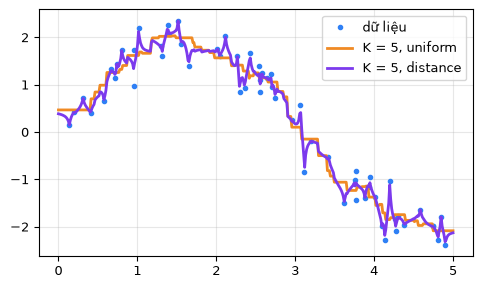

# Chương 9 · Dùng thư viện

> Ghi chú của người biên soạn: trang này do người biên soạn viết thêm, không có trong sách gốc. Trang dùng `sklearn.neighbors` cho các việc ở trang [Code từ đầu](ml/ch09_code_vi), cộng thêm cách chọn siêu tham số và cấu trúc dữ liệu giúp tìm lân cận nhanh.

## Cách dùng trang này

Các khối chạy lần lượt từ trên xuống và dùng chung biến. Cần `numpy`, `matplotlib`, `scikit-learn`.

| Tham số của `KNeighborsClassifier` | Ý nghĩa |
| --- | --- |
| `n_neighbors` | $K$ |
| `weights` | `"uniform"` (bầu chọn đa số), `"distance"` ($1/\text{khoảng cách}$), hoặc một hàm |
| `p`, `metric` | Khoảng cách Minkowski bậc `p`: `p=2` là $\ell_2$, `p=1` là $\ell_1$ |
| `algorithm` | Cách tìm lân cận: `"brute"`, `"kd_tree"`, `"ball_tree"`, hoặc `"auto"` |

## 1. `KNeighborsClassifier` trên bộ Iris

<small class="viz-ref">Mục 9.3.2</small>

Chạy lại đúng các thí nghiệm của sách (20 điểm huấn luyện, `np.random.seed(7)`), thêm khoảng cách $\ell_1$:

<!-- run -->
```python
import numpy as np
import matplotlib.pyplot as plt
from sklearn.datasets import load_iris
from sklearn.model_selection import train_test_split
from sklearn.neighbors import KNeighborsClassifier

iris = load_iris()
np.random.seed(7)
X_train, X_test, y_train, y_test = train_test_split(iris.data, iris.target, test_size=130)

for k, w, p in [(1, "uniform", 2), (7, "uniform", 2), (7, "distance", 2), (7, "distance", 1)]:
    model = KNeighborsClassifier(n_neighbors=k, weights=w, p=p).fit(X_train, y_train)
    print(f"K = {k}, weights = {w:8s}, p = {p}: độ chính xác {100 * model.score(X_test, y_test):.2f}%")

model = KNeighborsClassifier(n_neighbors=7).fit(X_train, y_train)
dist, idx = model.kneighbors(X_test[:1])
print("\n7 lân cận của điểm kiểm tra đầu tiên:", idx[0], "  nhãn:", y_train[idx[0]], "  thật:", y_test[0])
print("xác suất dự đoán (tỉ lệ phiếu):", model.predict_proba(X_test[:1]).round(3))
```

<!-- output -->
```output
K = 1, weights = uniform , p = 2: độ chính xác 92.31%
K = 7, weights = uniform , p = 2: độ chính xác 93.85%
K = 7, weights = distance, p = 2: độ chính xác 94.62%
K = 7, weights = distance, p = 1: độ chính xác 95.38%

7 lân cận của điểm kiểm tra đầu tiên: [ 7 15 17 11 13  3  9]   nhãn: [2 2 2 2 1 1 2]   thật: 2
xác suất dự đoán (tỉ lệ phiếu): [[0.    0.286 0.714]]
```
<!-- /output -->

`kneighbors` trả về khoảng cách và chỉ số của các lân cận, rất tiện để giải thích một dự đoán. `predict_proba` là tỉ lệ phiếu của mỗi lớp.

## 2. Chuẩn hoá và chọn siêu tham số với `Pipeline` + `GridSearchCV`

<small class="viz-ref">Mục 9.4.3</small>

Với bộ *Wine* (thang đo các cột rất khác nhau), ta tìm đồng thời $K$, cách bỏ phiếu và loại khoảng cách. Bộ chuẩn hoá nằm trong `Pipeline`, nên được học lại trong từng lần chia của xác thực chéo.

<!-- run -->
```python
from sklearn.datasets import load_wine
from sklearn.pipeline import make_pipeline
from sklearn.preprocessing import StandardScaler
from sklearn.model_selection import GridSearchCV, StratifiedKFold, cross_val_score

Xw, yw = load_wine(return_X_y=True)
Xw_tr, Xw_te, yw_tr, yw_te = train_test_split(Xw, yw, test_size=0.3, random_state=0, stratify=yw)
cv = StratifiedKFold(5, shuffle=True, random_state=0)

raw = cross_val_score(KNeighborsClassifier(5), Xw_tr, yw_tr, cv=cv).mean()
print(f"KNN (K=5) chưa chuẩn hoá: độ chính xác xác thực chéo {raw:.3f}")

pipe = make_pipeline(StandardScaler(), KNeighborsClassifier())
grid = GridSearchCV(pipe, {"kneighborsclassifier__n_neighbors": range(1, 31, 2),
                           "kneighborsclassifier__weights": ["uniform", "distance"],
                           "kneighborsclassifier__p": [1, 2]}, cv=cv)
grid.fit(Xw_tr, yw_tr)
print("tổ hợp tốt nhất:", {k.split("__")[1]: v for k, v in grid.best_params_.items()},
      f" độ chính xác xác thực chéo {grid.best_score_:.3f}")
print(f"độ chính xác trên tập kiểm tra: {grid.score(Xw_te, yw_te):.3f}")
```

<!-- output -->
```output
KNN (K=5) chưa chuẩn hoá: độ chính xác xác thực chéo 0.742
tổ hợp tốt nhất: {'n_neighbors': 7, 'p': 1, 'weights': 'uniform'}  độ chính xác xác thực chéo 0.976
độ chính xác trên tập kiểm tra: 0.981
```
<!-- /output -->

Chưa chuẩn hoá, độ chính xác chỉ khoảng 0.74, khớp với trang Code. Sau khi chuẩn hoá và chọn tham số, độ chính xác lên khoảng 0.98. Tổ hợp tốt nhất dùng khoảng cách $\ell_1$ (`p=1`). Khoảng cách này ít bị chi phối bởi một chiều đơn lẻ có chênh lệch lớn.

## 3. `KNeighborsRegressor`

<small class="viz-ref">Mục 9.4.1</small>

<!-- run -->
```python
from sklearn.neighbors import KNeighborsRegressor

r = np.random.default_rng(1)
x = np.sort(r.uniform(0, 5, 60))[:, None]; t = np.sin(x[:, 0]) * 2 + r.normal(0, 0.4, 60)
xs = np.linspace(0, 5, 400)[:, None]
fig, ax = plt.subplots(figsize=(5.6, 3.2))
ax.plot(x, t, "o", ms=3, color="#2f80f5", label="dữ liệu")
for w, c in [("uniform", "#f08a24"), ("distance", "#7c3aed")]:
    ax.plot(xs, KNeighborsRegressor(5, weights=w).fit(x, t).predict(xs), color=c, lw=2, label=f"K = 5, {w}")
ax.legend(); ax.grid(alpha=.3)
```

<!-- output -->
<div align=center></div>
<!-- /output -->

Với `weights="distance"`, đường dự đoán đi đúng qua mọi điểm huấn luyện, vì tại đó khoảng cách bằng 0 và trọng số bằng vô cùng. Đường bậc thang của `"uniform"` thì mượt hơn.

## 4. Tìm lân cận nhanh: `kd_tree` và `ball_tree`

<small class="viz-ref">Mục 9.4.3–9.4.4</small>

Mục 9.4.3 nói rằng KNN tốn nhiều thời gian ở pha dự đoán. scikit-learn có thể dựng trước một cây chia không gian (kd-tree, ball tree) để không phải tính khoảng cách tới mọi điểm. Cây rất hiệu quả khi số chiều nhỏ, nhưng mất dần lợi thế khi số chiều lớn: đó là "lời nguyền số chiều".

<!-- run -->
```python
from time import perf_counter
from sklearn.neighbors import NearestNeighbors

rng = np.random.default_rng(0)
for d in [2, 10, 50]:
    X = rng.normal(size=(50000, d)); Q = rng.normal(size=(2000, d))
    line = f"d = {d:2d}:"
    for algo in ["brute", "kd_tree", "ball_tree"]:
        nn = NearestNeighbors(n_neighbors=5, algorithm=algo).fit(X)
        t = perf_counter(); nn.kneighbors(Q); line += f"  {algo} {1000 * (perf_counter() - t):7.0f} ms"
    print(line)
```

<!-- output -->
```output
d =  2:  brute     183 ms  kd_tree      15 ms  ball_tree      57 ms
d = 10:  brute     139 ms  kd_tree     614 ms  ball_tree    1447 ms
d = 50:  brute     195 ms  kd_tree   17224 ms  ball_tree   15420 ms
```
<!-- /output -->

Với 2 chiều, kd-tree nhanh hơn duyệt toàn bộ khoảng 40 lần. Với 10 chiều, nó đã chậm hơn. Với 50 chiều, nó chậm hơn gần 100 lần, vì cây gần như phải duyệt hết các nhánh. Mặc định `algorithm="auto"` của scikit-learn tự chọn theo số chiều và kích thước dữ liệu. Với dữ liệu nhiều chiều và rất lớn, người ta dùng các thư viện tìm lân cận *xấp xỉ* (approximate nearest neighbors) như FAISS hay Annoy.

## Tóm tắt

| Nhu cầu | Công cụ |
| --- | --- |
| Phân loại, hồi quy | `KNeighborsClassifier`, `KNeighborsRegressor` |
| Luôn chuẩn hoá trước | `make_pipeline(StandardScaler(), KNeighbors...)` |
| Chọn $K$, `weights`, `p` | `GridSearchCV` |
| Giải thích một dự đoán | `model.kneighbors(X)` |
| Chỉ cần tìm lân cận (không dự đoán) | `NearestNeighbors` |
| Số chiều nhỏ, dữ liệu lớn | `algorithm="kd_tree"` hoặc `"ball_tree"` |
