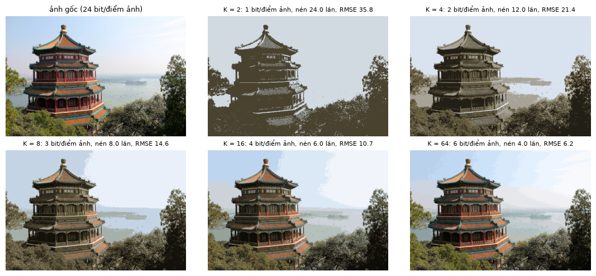
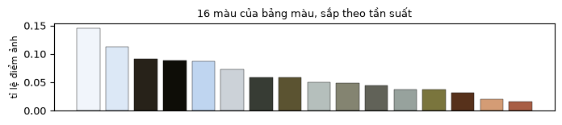
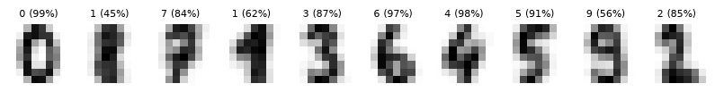
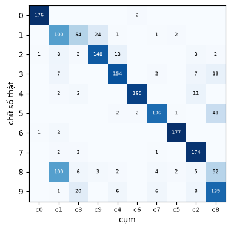

# Chương 10 · Ví dụ áp dụng: nén màu ảnh và phân cụm chữ số

> Ghi chú của người biên soạn: trang này do người biên soạn viết thêm, không có trong sách gốc. Trang làm lại hai ứng dụng của sách: nén ảnh (mục 10.6) trên ảnh mẫu `china.jpg` có sẵn trong scikit-learn, và phân cụm chữ số viết tay (mục 10.4) trên bộ `load_digits`.

## Phần A. Nén màu ảnh

<small class="viz-ref">Mục 10.5–10.6</small>

Mỗi điểm ảnh là một vector 3 chiều (đỏ, lục, lam). Phân cụm toàn bộ điểm ảnh thành $K$ cụm rồi thay mỗi điểm ảnh bằng tâm cụm của nó. Kết quả là một ảnh chỉ còn $K$ màu. Để lưu ảnh này, chỉ cần một **bảng màu** gồm $K$ màu, cộng với chỉ số màu ($\lceil\log_2 K\rceil$ bit) cho mỗi điểm ảnh, thay vì 24 bit như ảnh gốc.

### A.1 Ảnh gốc

<!-- run -->
```python
import numpy as np
import matplotlib.pyplot as plt
from sklearn.datasets import load_sample_image
from sklearn.cluster import KMeans, MiniBatchKMeans

img = load_sample_image("china.jpg")                 # 427 × 640 × 3, giá trị 0–255
h, w, _ = img.shape
pixels = img.reshape(-1, 3).astype(float) / 255
print("kích thước ảnh:", img.shape, " số điểm ảnh:", len(pixels))
print("số màu khác nhau trong ảnh gốc:", len(np.unique(img.reshape(-1, 3), axis=0)))
```

<!-- output -->
```output
kích thước ảnh: (427, 640, 3)  số điểm ảnh: 273280
số màu khác nhau trong ảnh gốc: 96615
```
<!-- /output -->

### A.2 Nén với nhiều giá trị $K$

Để nhanh, ta học các tâm cụm từ 10 000 điểm ảnh chọn ngẫu nhiên, rồi dùng `predict` để gán màu cho toàn bộ ảnh.

<!-- run -->
```python
rng = np.random.default_rng(0)
sample = pixels[rng.choice(len(pixels), 10_000, replace=False)]

fig, axes = plt.subplots(2, 3, figsize=(11, 5))
axes[0, 0].imshow(img); axes[0, 0].set_title("ảnh gốc (24 bit/điểm ảnh)", fontsize=9)
for ax, K in zip(axes.flat[1:], [2, 4, 8, 16, 64]):
    km = KMeans(K, n_init=3, random_state=0).fit(sample)
    labels = km.predict(pixels)
    quant = km.cluster_centers_[labels].reshape(h, w, 3)
    bits = int(np.ceil(np.log2(K)))
    ratio = 24 * h * w / (bits * h * w + 24 * K)                         # bảng màu + chỉ số
    err = np.sqrt(np.mean((quant - pixels.reshape(h, w, 3)) ** 2)) * 255
    ax.imshow(quant); ax.set_title(f"K = {K}: {bits} bit/điểm ảnh, nén {ratio:.1f} lần, RMSE {err:.1f}", fontsize=8)
    print(f"K = {K:2d}: tỉ lệ nén {ratio:5.1f} lần, sai số RMSE {err:5.1f} (thang 0–255)")
for ax in axes.flat: ax.axis("off")
fig.tight_layout()
```

<!-- output -->
```output
K =  2: tỉ lệ nén  24.0 lần, sai số RMSE  35.8 (thang 0–255)
K =  4: tỉ lệ nén  12.0 lần, sai số RMSE  21.4 (thang 0–255)
K =  8: tỉ lệ nén   8.0 lần, sai số RMSE  14.6 (thang 0–255)
K = 16: tỉ lệ nén   6.0 lần, sai số RMSE  10.7 (thang 0–255)
K = 64: tỉ lệ nén   4.0 lần, sai số RMSE   6.2 (thang 0–255)
```

<div align=center></div>
<!-- /output -->

Với $K = 2$, ảnh chỉ còn hai mảng màu. Với $K = 16$ (4 bit mỗi điểm ảnh, nén 6 lần), ảnh đã khá giống bản gốc, chỉ có bầu trời bị phân thành các dải màu rõ rệt. Bầu trời là vùng chuyển màu mịn, nên cần nhiều màu nhất. Đây là bài toán **lượng tử hoá vector** (vector quantization). Các định dạng ảnh GIF và PNG 8 bit dùng đúng ý tưởng bảng màu này.

### A.3 Bảng màu mà K-means chọn

<!-- run -->
```python
km16 = KMeans(16, n_init=3, random_state=0).fit(sample)
palette = km16.cluster_centers_
share = np.bincount(km16.predict(pixels), minlength=16) / len(pixels)
order = np.argsort(-share)
fig, ax = plt.subplots(figsize=(8, 1.4))
ax.bar(range(16), share[order], color=palette[order], edgecolor="k", linewidth=.3)
ax.set_xticks([]); ax.set_ylabel("tỉ lệ điểm ảnh", fontsize=8); ax.set_title("16 màu của bảng màu, sắp theo tần suất", fontsize=9)
```

<!-- output -->
<div align=center></div>
<!-- /output -->

K-means dành phần lớn các màu cho những vùng chiếm nhiều điểm ảnh, như bầu trời và tán cây. Những màu hiếm, như chút đỏ của mái ngói, phải chia nhau số ít màu còn lại.

## Phần B. Phân cụm chữ số viết tay

<small class="viz-ref">Mục 10.4</small>

Phân cụm 1797 ảnh chữ số $8 \times 8$ thành 10 cụm **mà không dùng nhãn**. Sau đó mới dùng nhãn thật để kiểm tra xem mỗi cụm có tương ứng với một chữ số không.

### B.1 Tâm cụm trông như thế nào?

<!-- run -->
```python
from sklearn.datasets import load_digits
from sklearn.metrics import adjusted_rand_score

digits = load_digits()
Xd, yd = digits.data, digits.target
km = KMeans(10, n_init=10, random_state=0).fit(Xd)

fig, axes = plt.subplots(1, 10, figsize=(10, 1.4))
for k, ax in enumerate(axes):
    major = np.bincount(yd[km.labels_ == k]).argmax()
    purity = np.mean(yd[km.labels_ == k] == major)
    ax.imshow(km.cluster_centers_[k].reshape(8, 8), cmap="gray_r"); ax.axis("off")
    ax.set_title(f"{major} ({purity:.0%})", fontsize=8)
print(f"ARI giữa cụm và nhãn thật: {adjusted_rand_score(yd, km.labels_):.3f}")
```

<!-- output -->
```output
ARI giữa cụm và nhãn thật: 0.666
```

<div align=center></div>
<!-- /output -->

Mỗi tâm cụm là "ảnh trung bình" của các ảnh trong cụm. Tiêu đề ghi chữ số chiếm đa số trong cụm và tỉ lệ của nó (độ thuần khiết của cụm).

Nhiều cụm gần như chỉ chứa một chữ số (0, 4, 6 đạt trên 95%). Nhưng có cụm trộn lẫn: một cụm "1" chỉ thuần 45%. Không có nhãn, K-means chỉ biết gom những ảnh trông giống nhau theo khoảng cách $\ell_2$, và "giống nhau" theo nghĩa đó không hoàn toàn trùng với "cùng chữ số".

### B.2 Cụm nào lẫn lộn?

<!-- run -->
```python
from sklearn.metrics import confusion_matrix

C = confusion_matrix(yd, km.labels_)                    # hàng: chữ số thật, cột: cụm
order = np.argsort(C.argmax(0))                          # xếp cột theo chữ số chiếm đa số
fig, ax = plt.subplots(figsize=(5, 4.2))
im = ax.imshow(C[:, order], cmap="Blues")
ax.set_xticks(range(10)); ax.set_xticklabels([f"c{c}" for c in order], fontsize=7)
ax.set_yticks(range(10)); ax.set_xlabel("cụm"); ax.set_ylabel("chữ số thật")
for i in range(10):
    for j in range(10):
        if C[i, order[j]]: ax.text(j, i, C[i, order[j]], ha="center", va="center", fontsize=6, color="w" if C[i, order[j]] > 90 else "k")
print("số chữ số không làm đa số ở cụm nào:", sorted(set(range(10)) - set(C.argmax(0))))
```

<!-- output -->
```output
số chữ số không làm đa số ở cụm nào: [8]
```

<div align=center></div>
<!-- /output -->

Ma trận cho thấy rõ hơn: chữ số 8 không chiếm đa số ở cụm nào. Các ảnh số 8 bị chia giữa cụm của số 1 và cụm của số 9, vì nét viết của chúng gần giống nhau ở độ phân giải $8 \times 8$. Ngược lại, số 1 bị tách thành hai cụm, có lẽ ứng với hai kiểu viết khác nhau (xem hai tâm cụm "1" ở mục B.1).

## Rút ra được gì

- K-means là một công cụ nén dữ liệu tự nhiên: $N$ vector được thay bằng $K$ tâm cụm và $N$ chỉ số. Ứng dụng nén màu ảnh cho thấy rõ sự đánh đổi giữa tỉ lệ nén và chất lượng.
- Không dùng nhãn, K-means vẫn tìm ra phần lớn cấu trúc của bộ chữ số: ARI khoảng 0.67, khác xa con số 0 của việc chia ngẫu nhiên. Nhưng một cụm không nhất thiết là một lớp: phân cụm chỉ tìm những gì "gần nhau" theo khoảng cách đã chọn.
- Để phân loại chữ số, các phương pháp có giám sát (KNN ở [chương 9](ml/ch09_app_vi) đạt khoảng 98%) vẫn tốt hơn nhiều. Phân cụm hữu ích khi không có nhãn, hoặc làm bước tiền xử lý.
