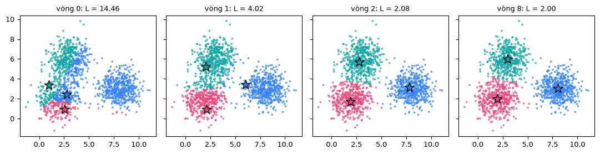
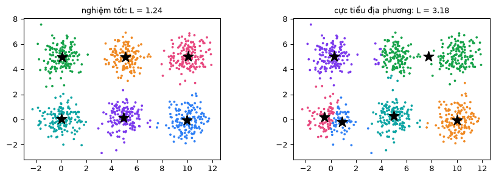
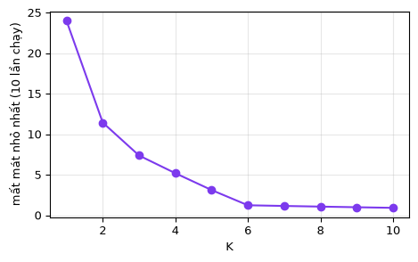
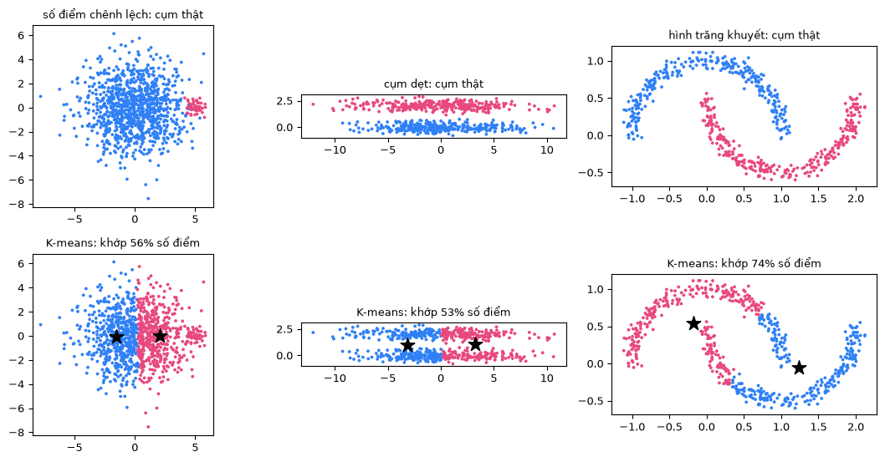

# Chương 10 · Code từ đầu

> Ghi chú của người biên soạn: trang này do người biên soạn viết thêm, không có trong sách gốc. Trang viết lại thuật toán phân cụm $K$-means của [mục 10.3](ml/ch10_vi) bằng NumPy, rồi thêm các thí nghiệm về khởi tạo, cách chọn $K$ và những trường hợp K-means thất bại (mục 10.7.1).

## Cách dùng trang này

Các khối chạy lần lượt từ trên xuống và dùng chung biến. Chỉ cần `numpy` và `matplotlib`.

## 1. Dữ liệu của sách

<small class="viz-ref">Mục 10.3.1</small>

Ba cụm, mỗi cụm 500 điểm, sinh từ phân phối chuẩn có tâm $(2, 2)$, $(8, 3)$, $(3, 6)$ và ma trận hiệp phương sai đơn vị. Dùng `np.random.seed(18)` như sách.

<!-- run -->
```python
import numpy as np
import matplotlib.pyplot as plt

np.random.seed(18)
means = [[2, 2], [8, 3], [3, 6]]
N = 500
X = np.concatenate([np.random.multivariate_normal(m, np.eye(2), N) for m in means])
true_label = np.repeat([0, 1, 2], N)
COLORS = np.array(["#2f80f5", "#e8487f", "#0ea5a4", "#f08a24", "#7c3aed", "#16a34a", "#9aa0c8", "#b45309"])
print("X:", X.shape)
```

<!-- output -->
```output
X: (1500, 2)
```
<!-- /output -->

## 2. Thuật toán, viết gọn bằng NumPy

<small class="viz-ref">Mục 10.2.2–10.2.3 · Thuật toán 10.1</small>

Thuật toán 10.1 xen kẽ hai bước, mỗi bước làm giảm (hoặc giữ nguyên) hàm mất mát

$$
\mathcal{L}(\mathbf{Y}, \mathbf{M}) = \frac{1}{N}\sum_{i=1}^N \|\mathbf{x}_i - \mathbf{m}_{y_i}\|_2^2.
$$

- **Gán nhãn:** cố định các tâm cụm, gán mỗi điểm vào cụm có tâm gần nhất.
- **Cập nhật tâm:** cố định nhãn, đặt mỗi tâm bằng trung bình các điểm của cụm đó.

Hàm mất mát trong sách là tổng, ở đây lấy trung bình để dễ so sánh giữa các bộ dữ liệu khác cỡ. Hai cách cho cùng một nghiệm.

<!-- run -->
```python
def sq_dist(X, M):
    return (X ** 2).sum(1)[:, None] + (M ** 2).sum(1)[None, :] - 2 * X @ M.T      # như mục 9.2

def assign(X, M):
    return sq_dist(X, M).argmin(1)

def update(X, labels, M_old):
    M = M_old.copy()
    for k in range(len(M)):
        if np.any(labels == k):            # cụm rỗng: giữ tâm cũ (sách không xử lý trường hợp này)
            M[k] = X[labels == k].mean(0)
    return M

def loss(X, labels, M):
    return np.mean(((X - M[labels]) ** 2).sum(1))

def kmeans(X, K, init=None, rng=None, max_iter=100):
    rng = rng or np.random.default_rng()
    M = X[rng.choice(len(X), K, replace=False)] if init is None else init.copy()
    history = [M.copy()]
    for it in range(max_iter):
        labels = assign(X, M)
        M_new = update(X, labels, M)
        history.append(M_new.copy())
        if np.allclose(M_new, M):          # tâm cụm không đổi: hội tụ
            break
        M = M_new
    return M, assign(X, M), history

M, labels, hist = kmeans(X, 3, rng=np.random.default_rng(1))
print("tâm cụm tìm được:\n", M.round(3))
print("số vòng lặp:", len(hist) - 1)
print("hàm mất mát theo vòng lặp:", [round(float(loss(X, assign(X, h), h)), 3) for h in hist])

# Chạy lại với 100 cách khởi tạo ngẫu nhiên khác nhau
final = np.array([loss(X, *kmeans(X, 3, rng=np.random.default_rng(s))[1:2], kmeans(X, 3, rng=np.random.default_rng(s))[0]) for s in range(100)])
print(f"\n100 lần khởi tạo: mất mát cuối nhỏ nhất {final.min():.3f}, lớn nhất {final.max():.3f}; "
      f"{np.mean(final > final.min() + 0.1):.0%} số lần rơi vào nghiệm tệ hơn (ví dụ hạt giống 0: {final[0]:.3f})")
```

<!-- output -->
```output
tâm cụm tìm được:
 [[8.075 3.015]
 [1.983 1.966]
 [3.027 5.957]]
số vòng lặp: 12
hàm mất mát theo vòng lặp: [15.271, 4.763, 4.636, 4.578, 4.157, 2.762, 2.054, 2.009, 2.005, 2.004, 2.004, 2.004, 2.004]

100 lần khởi tạo: mất mát cuối nhỏ nhất 2.004, lớn nhất 4.625; 10% số lần rơi vào nghiệm tệ hơn (ví dụ hạt giống 0: 4.596)
```
<!-- /output -->

Ở lần chạy này, các tâm tìm được rất gần tâm thật $(2, 2)$, $(8, 3)$, $(3, 6)$, và hàm mất mát giảm dần qua từng vòng lặp, đúng như lập luận hội tụ ở mục 10.2.3. Nhưng không phải lần chạy nào cũng may mắn như vậy: với khoảng một phần mười cách khởi tạo, thuật toán hội tụ tới một nghiệm tệ hơn hẳn, chẳng hạn hai tâm cùng nằm trong một cụm. Đây là **cực tiểu địa phương**, chủ đề của mục 4.

## 3. Vẽ lại hình 10.2: K-means qua các vòng lặp

<!-- run -->
```python
init = X[[5, 6, 7]]                                    # ba tâm khởi tạo nằm cùng một cụm: khởi đầu tệ
M, labels, hist = kmeans(X, 3, init=init)
show = [0, 1, 2, len(hist) - 1]
fig, axes = plt.subplots(1, 4, figsize=(11, 2.9), sharey=True)
for ax, t in zip(axes, show):
    lab = assign(X, hist[t])
    ax.scatter(X[:, 0], X[:, 1], s=3, c=COLORS[lab], alpha=.6)
    ax.scatter(*hist[t].T, s=160, c=COLORS[:3], marker="*", edgecolors="k")
    ax.set_title(f"vòng {t}: L = {loss(X, lab, hist[t]):.2f}", fontsize=9); ax.set_aspect("equal")
fig.tight_layout()
```

<!-- output -->
<div align=center></div>
<!-- /output -->

Ba tâm khởi tạo đều nằm trong cùng một cụm (dưới bên trái). Chỉ sau một vòng, một tâm đã "nhảy" sang cụm bên phải, vì nó là trung bình của những điểm gần nó nhất. Sau 8 vòng, ba tâm nằm đúng ba cụm. Lần này khởi đầu tệ vẫn cho kết quả tốt, nhưng không phải lúc nào cũng vậy.

## 4. Khởi tạo quan trọng: cực tiểu địa phương và K-means++

<small class="viz-ref">Mục 10.7.1</small>

K-means chỉ đảm bảo hội tụ tới một **cực tiểu địa phương**, kết quả phụ thuộc vào cách khởi tạo. Ta dùng dữ liệu có 6 cụm và chạy K-means 200 lần với hai cách khởi tạo:

- **Ngẫu nhiên:** chọn $K$ điểm dữ liệu bất kỳ, như sách.
- **K-means++** (Arthur và Vassilvitskii, 2007): chọn tâm đầu tiên ngẫu nhiên. Mỗi tâm tiếp theo được chọn với xác suất tỉ lệ với **bình phương khoảng cách** tới tâm gần nhất đã chọn, nên các tâm khởi tạo có xu hướng nằm xa nhau.

<!-- run -->
```python
def kmeanspp_init(X, K, rng):
    M = [X[rng.integers(len(X))]]
    for _ in range(1, K):
        d2 = sq_dist(X, np.array(M)).min(1).clip(0)
        M.append(X[rng.choice(len(X), p=d2 / d2.sum())])
    return np.array(M)

r = np.random.default_rng(3)
centers6 = np.array([[0, 0], [5, 0], [10, 0], [0, 5], [5, 5], [10, 5]])
X6 = np.concatenate([c + r.normal(0, 0.8, (150, 2)) for c in centers6])

rng = np.random.default_rng(0)
L_rand, L_pp = [], []
for _ in range(200):
    M, lab, _ = kmeans(X6, 6, rng=rng); L_rand.append(loss(X6, lab, M))
    M, lab, _ = kmeans(X6, 6, init=kmeanspp_init(X6, 6, rng)); L_pp.append(loss(X6, lab, M))
L_rand, L_pp = np.array(L_rand), np.array(L_pp)
best = min(L_rand.min(), L_pp.min())
print(f"mất mát nhỏ nhất tìm được: {best:.3f}")
print(f"khởi tạo ngẫu nhiên: {np.mean(L_rand < best + 1e-6):.0%} số lần đạt cực tiểu tốt nhất, mất mát trung bình {L_rand.mean():.3f}")
print(f"K-means++          : {np.mean(L_pp < best + 1e-6):.0%} số lần đạt cực tiểu tốt nhất, mất mát trung bình {L_pp.mean():.3f}")

fig, axes = plt.subplots(1, 2, figsize=(9, 3))
M_good, lab_good, _ = kmeans(X6, 6, init=kmeanspp_init(X6, 6, np.random.default_rng(1)))
bad_init = X6[[0, 1, 150, 300, 450, 600]]                     # hai tâm cùng một cụm, cụm cuối không có tâm
M_bad, lab_bad, _ = kmeans(X6, 6, init=bad_init)
for ax, M, lab, title in [(axes[0], M_good, lab_good, "nghiệm tốt"), (axes[1], M_bad, lab_bad, "cực tiểu địa phương")]:
    ax.scatter(X6[:, 0], X6[:, 1], s=3, c=COLORS[lab]); ax.scatter(*M.T, s=160, marker="*", c="k")
    ax.set_title(f"{title}: L = {loss(X6, lab, M):.2f}", fontsize=9); ax.set_aspect("equal")
fig.tight_layout()
```

<!-- output -->
```output
mất mát nhỏ nhất tìm được: 1.237
khởi tạo ngẫu nhiên: 71% số lần đạt cực tiểu tốt nhất, mất mát trung bình 1.808
K-means++          : 77% số lần đạt cực tiểu tốt nhất, mất mát trung bình 1.687
```

<div align=center></div>
<!-- /output -->

Với 6 cụm, khoảng 30% số lần khởi tạo ngẫu nhiên cho nghiệm tệ. Ví dụ bên phải là một nghiệm tệ: hai tâm chia nhau một cụm, còn một tâm nằm lơ lửng giữa hai cụm. K-means++ chỉ cải thiện một chút trên dữ liệu này (77% so với 71%). Cách chữa phổ biến nhất là **chạy nhiều lần rồi giữ nghiệm có mất mát nhỏ nhất**. Tham số `n_init` của scikit-learn làm đúng việc đó (trang [Dùng thư viện](ml/ch10_lib_vi)).

## 5. Chọn số cụm $K$: phương pháp khuỷu tay

$K$ phải được chọn trước. Hàm mất mát luôn giảm khi $K$ tăng (với $K = N$, mất mát bằng 0), nên không thể chọn $K$ bằng cách cực tiểu hoá nó. Một cách đơn giản là vẽ mất mát tốt nhất theo $K$ rồi tìm "khuỷu tay", nơi đường cong ngừng giảm nhanh.

<!-- run -->
```python
Ks = range(1, 11)
best_L = []
for K in Ks:
    rng = np.random.default_rng(0)
    best_L.append(min(loss(X6, lab, M) for M, lab, _ in (kmeans(X6, K, init=kmeanspp_init(X6, K, rng)) for _ in range(10))))
fig, ax = plt.subplots(figsize=(5.2, 3))
ax.plot(Ks, best_L, "o-", color="#7c3aed"); ax.set_xlabel("K"); ax.set_ylabel("mất mát nhỏ nhất (10 lần chạy)"); ax.grid(alpha=.3)
print("mất mát theo K:", np.round(best_L, 2))
```

<!-- output -->
```output
mất mát theo K: [24.   11.43  7.37  5.19  3.11  1.24  1.15  1.07  0.99  0.92]
```

<div align=center></div>
<!-- /output -->

Mất mát giảm mạnh cho tới $K = 6$, đúng bằng số cụm thật, rồi gần như nằm ngang. Đó là "khuỷu tay". Trong dữ liệu thật, các cụm hiếm khi tách bạch như vậy và khuỷu tay thường không rõ. Trang Dùng thư viện có thêm một cách khác: hệ số silhouette.

## 6. Khi K-means thất bại

<small class="viz-ref">Mục 10.7.1 · hình 10.11–10.12</small>

K-means ngầm giả sử các cụm có dạng **hình cầu**, kích thước tương đương và số điểm tương đương: mỗi điểm thuộc về tâm gần nhất. Ba ví dụ phá vỡ giả sử này:

<!-- run -->
```python
r = np.random.default_rng(0)
# (a) hai cụm số điểm chênh lệch và độ rộng khác nhau
A = np.concatenate([r.normal([0, 0], 2.0, (1000, 2)), r.normal([5, 0], 0.4, (50, 2))]); A_true = np.repeat([0, 1], [1000, 50])
# (b) cụm dẹt (không phải hình cầu)
B = np.concatenate([r.normal(0, 1, (300, 2)) * [4, 0.3] + [0, s] for s in (0, 2)]); B_true = np.repeat([0, 1], 300)
# (c) hai vành trăng lồng nhau
t = r.uniform(0, np.pi, 300)
C = np.concatenate([np.c_[np.cos(t), np.sin(t)], np.c_[1 - np.cos(t), 0.5 - np.sin(t)]]) + r.normal(0, 0.06, (600, 2)); C_true = np.repeat([0, 1], 300)

fig, axes = plt.subplots(2, 3, figsize=(11, 5.6))
for j, (D, truth, name) in enumerate([(A, A_true, "số điểm chênh lệch"), (B, B_true, "cụm dẹt"), (C, C_true, "hình trăng khuyết")]):
    rng = np.random.default_rng(0)
    M, lab, _ = min((kmeans(D, 2, init=kmeanspp_init(D, 2, rng)) for _ in range(10)), key=lambda res: loss(D, res[1], res[0]))
    axes[0, j].scatter(*D.T, s=3, c=COLORS[truth]); axes[0, j].set_title(f"{name}: cụm thật", fontsize=9)
    axes[1, j].scatter(*D.T, s=3, c=COLORS[lab]); axes[1, j].scatter(*M.T, s=160, marker="*", c="k")
    agree = max(np.mean(lab == truth), np.mean(lab != truth))
    axes[1, j].set_title(f"K-means: khớp {agree:.0%} số điểm", fontsize=9)
    M_true = np.array([D[truth == c].mean(0) for c in (0, 1)])
    print(f"{name:20s}: mất mát của K-means {loss(D, lab, M):.3f}   mất mát nếu chia đúng cụm thật {loss(D, truth, M_true):.3f}")
    for ax in axes[:, j]: ax.set_aspect("equal")
fig.tight_layout()
```

<!-- output -->
```output
số điểm chênh lệch  : mất mát của K-means 5.549   mất mát nếu chia đúng cụm thật 7.637
cụm dẹt             : mất mát của K-means 6.747   mất mát nếu chia đúng cụm thật 15.739
hình trăng khuyết   : mất mát của K-means 0.431   mất mát nếu chia đúng cụm thật 0.629
```

<div align=center></div>
<!-- /output -->

Trong cả ba trường hợp, K-means vẫn hội tụ và mất mát của nó *thấp hơn* mất mát tính theo cụm thật. Vấn đề không nằm ở thuật toán tối ưu mà ở **hàm mất mát**: nó không mô tả đúng thế nào là một "cụm" trong những dữ liệu này. Trang [Dùng thư viện](ml/ch10_lib_vi) có các thuật toán phân cụm khác xử lý được những trường hợp này.
