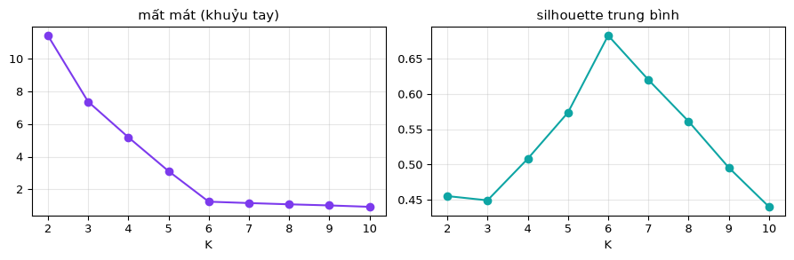
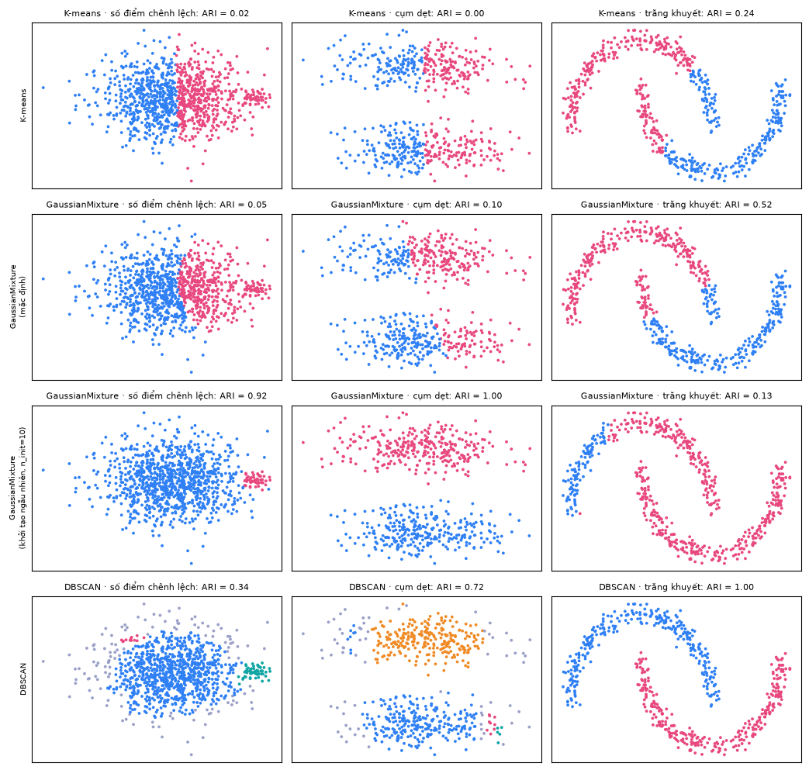

# Chương 10 · Dùng thư viện

> Ghi chú của người biên soạn: trang này do người biên soạn viết thêm, không có trong sách gốc. Trang dùng `sklearn.cluster.KMeans` cho các việc ở trang [Code từ đầu](ml/ch10_code_vi), cùng cách đánh giá một phép phân cụm và vài thuật toán thay thế cho những trường hợp K-means thất bại.

## Cách dùng trang này

Các khối chạy lần lượt từ trên xuống và dùng chung biến. Cần `numpy`, `matplotlib`, `scikit-learn`.

| Tham số / thuộc tính của `KMeans` | Ý nghĩa |
| --- | --- |
| `n_clusters` | $K$ |
| `init="k-means++"` | Khởi tạo K-means++ (mặc định) |
| `n_init` | Số lần chạy với các khởi tạo khác nhau. Giữ lần có mất mát nhỏ nhất |
| `cluster_centers_`, `labels_` | Ma trận tâm cụm $\mathbf{M}$ và nhãn của dữ liệu huấn luyện |
| `inertia_` | **Tổng** bình phương khoảng cách, tức hàm mất mát của sách (không chia $N$) |

## 1. `KMeans` trên dữ liệu của sách

<small class="viz-ref">Mục 10.3.3</small>

<!-- run -->
```python
import numpy as np
import matplotlib.pyplot as plt
from sklearn.cluster import KMeans

np.random.seed(18)
means = [[2, 2], [8, 3], [3, 6]]
X = np.concatenate([np.random.multivariate_normal(m, np.eye(2), 500) for m in means])

model = KMeans(n_clusters=3, n_init=10, random_state=0).fit(X)
order = np.argsort(model.cluster_centers_[:, 0])            # sắp xếp tâm theo hoành độ để dễ so
print("tâm cụm:\n", model.cluster_centers_[order].round(3))
print(f"inertia_ = {model.inertia_:.1f}   (mất mát trung bình = {model.inertia_ / len(X):.3f})")
print("số vòng lặp của lần chạy tốt nhất:", model.n_iter_)
print("cụm của hai điểm mới (0, 0) và (9, 3):", model.predict([[0, 0], [9, 3]]))
```

<!-- output -->
```output
tâm cụm:
 [[1.985 1.97 ]
 [3.028 5.961]
 [8.075 3.015]]
inertia_ = 3006.0   (mất mát trung bình = 2.004)
số vòng lặp của lần chạy tốt nhất: 4
cụm của hai điểm mới (0, 0) và (9, 3): [2 1]
```
<!-- /output -->

`predict` gán điểm mới vào cụm có tâm gần nhất, tức đúng bước gán nhãn của thuật toán. Ở trang Code, mất mát trung bình tốt nhất cũng là 2.004.

## 2. `n_init`: chạy nhiều lần để tránh cực tiểu địa phương

Dữ liệu 6 cụm giống trang Code. So sánh mất mát khi chỉ chạy 1 lần với khi chạy 10 lần, mỗi cấu hình lặp lại với 50 hạt giống:

<!-- run -->
```python
r = np.random.default_rng(3)
centers6 = np.array([[0, 0], [5, 0], [10, 0], [0, 5], [5, 5], [10, 5]])
X6 = np.concatenate([c + r.normal(0, 0.8, (150, 2)) for c in centers6])

for init in ["random", "k-means++"]:
    for n_init in [1, 10]:
        L = np.array([KMeans(6, init=init, n_init=n_init, random_state=s).fit(X6).inertia_ / len(X6) for s in range(50)])
        print(f"init={init:9s} n_init={n_init:2d}: mất mát trung bình {L.mean():.3f}, tệ nhất {L.max():.3f}, "
              f"{np.mean(L < L.min() + 1e-3):.0%} số lần đạt nghiệm tốt nhất")
```

<!-- output -->
```output
init=random    n_init= 1: mất mát trung bình 2.104, tệ nhất 3.318, 56% số lần đạt nghiệm tốt nhất
init=random    n_init=10: mất mát trung bình 1.237, tệ nhất 1.237, 100% số lần đạt nghiệm tốt nhất
init=k-means++ n_init= 1: mất mát trung bình 1.237, tệ nhất 1.237, 100% số lần đạt nghiệm tốt nhất
init=k-means++ n_init=10: mất mát trung bình 1.237, tệ nhất 1.237, 100% số lần đạt nghiệm tốt nhất
```
<!-- /output -->

Chỉ chạy một lần với khởi tạo ngẫu nhiên thì gần một nửa số lần cho nghiệm tệ. Chạy 10 lần (`n_init=10`) thì lần nào cũng đạt nghiệm tốt nhất. K-means++ của scikit-learn thì đạt nghiệm tốt nhất ngay cả khi chỉ chạy một lần, tốt hơn hẳn bản tự viết ở trang Code (77%). Lý do là scikit-learn dùng bản K-means++ "tham lam": ở mỗi bước chọn tâm, nó lấy $2 + \ln K$ ứng viên rồi giữ ứng viên làm mất mát giảm nhiều nhất.

## 3. Chọn $K$: khuỷu tay và hệ số silhouette

Hệ số silhouette của một điểm là $s = \frac{b - a}{\max(a, b)}$, trong đó:

- $a$: khoảng cách trung bình tới các điểm **cùng** cụm;
- $b$: khoảng cách trung bình tới các điểm của cụm **gần nhất khác** cụm của nó.

$s$ gần 1 nghĩa là điểm nằm gọn trong cụm của nó. $s$ gần 0 hoặc âm nghĩa là điểm nằm ở ranh giới hoặc bị xếp nhầm cụm. Khác với mất mát, trung bình silhouette **không** tăng mãi theo $K$, nên có thể chọn $K$ tại điểm lớn nhất.

<!-- run -->
```python
from sklearn.metrics import silhouette_score

Ks = range(2, 11)
inertia, sil = [], []
for K in Ks:
    m = KMeans(K, n_init=10, random_state=0).fit(X6)
    inertia.append(m.inertia_ / len(X6)); sil.append(silhouette_score(X6, m.labels_))
fig, axes = plt.subplots(1, 2, figsize=(9, 3))
axes[0].plot(Ks, inertia, "o-", color="#7c3aed"); axes[0].set_title("mất mát (khuỷu tay)"); axes[0].set_xlabel("K")
axes[1].plot(Ks, sil, "o-", color="#0ea5a4"); axes[1].set_title("silhouette trung bình"); axes[1].set_xlabel("K")
for ax in axes: ax.grid(alpha=.3)
fig.tight_layout()
print("K có silhouette lớn nhất:", list(Ks)[int(np.argmax(sil))], f"(silhouette = {max(sil):.3f})")
```

<!-- output -->
```output
K có silhouette lớn nhất: 6 (silhouette = 0.683)
```

<div align=center></div>
<!-- /output -->

Cả hai cách đều chọn đúng $K = 6$: mất mát ngừng giảm nhanh ở $K = 6$, còn silhouette đạt cực đại tại đó.

## 4. `MiniBatchKMeans` cho dữ liệu lớn

Mỗi vòng của K-means phải duyệt toàn bộ dữ liệu. `MiniBatchKMeans` chỉ dùng một lô nhỏ ngẫu nhiên ở mỗi bước cập nhật tâm, giống ý tưởng mini-batch gradient descent ở chương 12.

<!-- run -->
```python
from time import perf_counter
from sklearn.cluster import MiniBatchKMeans

r = np.random.default_rng(0)
big = np.concatenate([c + r.normal(0, 0.8, (100_000, 2)) for c in centers6])          # 600 000 điểm
for M in [KMeans(6, n_init=3, random_state=0), MiniBatchKMeans(6, n_init=3, batch_size=4096, random_state=0)]:
    t = perf_counter(); M.fit(big); dt = perf_counter() - t
    print(f"{type(M).__name__:16s} {dt:6.2f} s   mất mát trung bình {M.inertia_ / len(big):.4f}")
```

<!-- output -->
```output
KMeans             0.84 s   mất mát trung bình 1.2758
MiniBatchKMeans    0.52 s   mất mát trung bình 1.2759
```
<!-- /output -->

Trên 600 000 điểm, `MiniBatchKMeans` nhanh hơn, còn mất mát gần như bằng `KMeans`. Khoảng cách tốc độ càng lớn khi dữ liệu càng lớn hoặc càng nhiều chiều.

## 5. Khi K-means không phù hợp: các thuật toán khác

<small class="viz-ref">Mục 10.7.1</small>

Với ba bộ dữ liệu khó ở mục 6 của trang Code, ta thử hai thuật toán phân cụm khác có sẵn trong scikit-learn:

- **Hỗn hợp Gauss** (`GaussianMixture`): mỗi cụm là một phân phối chuẩn với ma trận hiệp phương sai *riêng*, nên cụm có thể dẹt và có kích thước khác nhau. Có thể xem K-means như một trường hợp đặc biệt: mọi cụm có cùng hiệp phương sai $\sigma^2\mathbf{I}$, và mỗi điểm bị gán "cứng" vào một cụm.
- **DBSCAN**: định nghĩa cụm là vùng có mật độ điểm cao, nối liền nhau. Không cần biết trước số cụm, và tìm được cụm có hình dạng bất kỳ.

<!-- run -->
```python
from sklearn.mixture import GaussianMixture
from sklearn.cluster import DBSCAN
from sklearn.metrics import adjusted_rand_score

r = np.random.default_rng(0)
A = np.concatenate([r.normal([0, 0], 2.0, (1000, 2)), r.normal([5, 0], 0.4, (50, 2))]); A_true = np.repeat([0, 1], [1000, 50])
B = np.concatenate([r.normal(0, 1, (300, 2)) * [4, 0.3] + [0, s] for s in (0, 2)]); B_true = np.repeat([0, 1], 300)
t = r.uniform(0, np.pi, 300)
C = np.concatenate([np.c_[np.cos(t), np.sin(t)], np.c_[1 - np.cos(t), 0.5 - np.sin(t)]]) + r.normal(0, 0.06, (600, 2)); C_true = np.repeat([0, 1], 300)

algos = {"K-means": lambda D, eps: KMeans(2, n_init=10, random_state=0).fit_predict(D),
         "GaussianMixture (mặc định)": lambda D, eps: GaussianMixture(2, random_state=0).fit(D).predict(D),
         "GaussianMixture (khởi tạo ngẫu nhiên, n_init=10)": lambda D, eps: GaussianMixture(
             2, n_init=10, init_params="random_from_data", random_state=0).fit(D).predict(D),
         "DBSCAN": lambda D, eps: DBSCAN(eps=eps, min_samples=8).fit_predict(D)}
COLORS = np.array(["#2f80f5", "#e8487f", "#0ea5a4", "#f08a24", "#9aa0c8"])
fig, axes = plt.subplots(4, 3, figsize=(10.5, 10))
for j, (D, truth, eps, name) in enumerate([(A, A_true, 0.5, "số điểm chênh lệch"), (B, B_true, 0.5, "cụm dẹt"), (C, C_true, 0.15, "trăng khuyết")]):
    for i, (aname, f) in enumerate(algos.items()):
        lab = f(D, eps)
        axes[i, j].scatter(*D.T, s=3, c=COLORS[lab % 4] if aname != "DBSCAN" else np.where(lab < 0, COLORS[4], COLORS[lab % 4]))
        axes[i, j].set_title(f"{aname.split(' (')[0]} · {name}: ARI = {adjusted_rand_score(truth, lab):.2f}", fontsize=8)
        if j == 0: axes[i, j].set_ylabel(aname.replace(" (", "\n("), fontsize=7)
        axes[i, j].set_xticks([]); axes[i, j].set_yticks([])
fig.tight_layout()
```

<!-- output -->
<div align=center></div>
<!-- /output -->

Ba điều rút ra từ hình:

- **K-means** (hàng 1) thất bại ở cả ba bộ dữ liệu, như đã thấy ở trang Code.
- **GaussianMixture với thiết lập mặc định** (hàng 2) cũng thất bại! Lý do là nó khởi tạo bằng kết quả của K-means (`init_params="kmeans"`), rồi thuật toán EM bị kẹt ở một cực tiểu địa phương gần nghiệm của K-means. Mô hình hỗn hợp Gauss không sai: người biên soạn đã kiểm tra rằng cách chia theo cụm thật có likelihood cao hơn nghiệm bị kẹt.
- **Khởi tạo ngẫu nhiên nhiều lần** (hàng 3) tìm được đúng cụm cho hai bộ đầu. Với hình trăng khuyết thì không mô hình Gauss nào phù hợp, và chỉ **DBSCAN** (hàng 4) chia đúng hoàn toàn.

Bài học chung với K-means: thuật toán tối ưu không lồi cần được chạy nhiều lần với các khởi tạo khác nhau.

ARI (*adjusted Rand index*) đo mức khớp giữa hai cách chia cụm, không phụ thuộc vào việc đánh số cụm. ARI bằng 1 là khớp hoàn toàn, khoảng 0 là không hơn chia ngẫu nhiên. Với DBSCAN, điểm màu xám là các điểm bị coi là nhiễu (không thuộc cụm nào).

## Tóm tắt

| Nhu cầu | Công cụ |
| --- | --- |
| Phân cụm K-means | `KMeans(n_clusters=K, n_init=10)` |
| Dữ liệu rất lớn | `MiniBatchKMeans` |
| Chọn $K$ | Vẽ `inertia_` theo $K$ (khuỷu tay), `silhouette_score` |
| Cụm dẹt, kích thước khác nhau | `GaussianMixture` |
| Cụm hình dạng bất kỳ, có nhiễu | `DBSCAN` (hoặc `HDBSCAN`) |
| So hai cách chia cụm | `adjusted_rand_score` |
