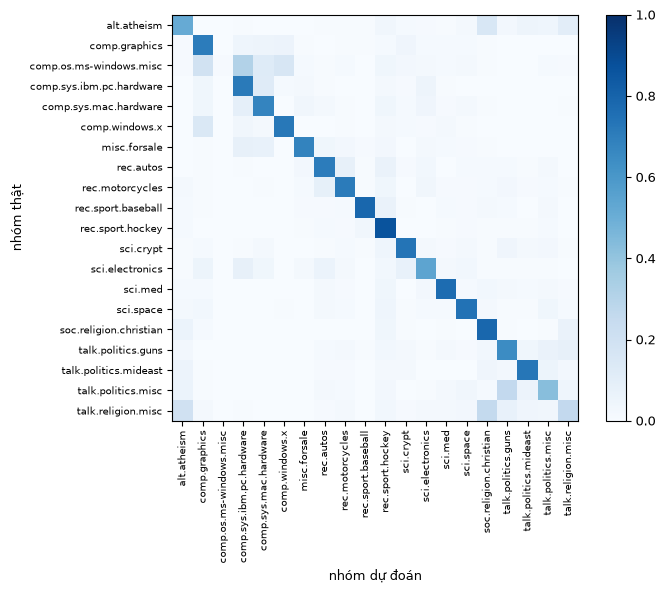
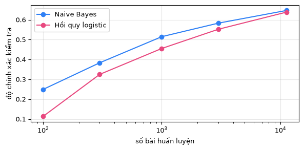

# Chương 11 · Ví dụ áp dụng: phân loại chủ đề văn bản

> Ghi chú của người biên soạn: trang này do người biên soạn viết thêm, không có trong sách gốc. Trang áp dụng multinomial naive Bayes ([chương 11](ml/ch11_vi)) cho một bài toán phân loại văn bản lớn hơn nhiều so với ví dụ email rác: 20 chủ đề, gần 19 000 bài viết, hàng chục nghìn từ. Naive Bayes được so với hồi quy logistic về độ chính xác và tốc độ.

## Bài toán

Bộ dữ liệu *20 Newsgroups* (Lang, 1995) gồm các bài đăng trên 20 nhóm thảo luận Usenet, từ máy tính (`comp.graphics`, `comp.sys.mac.hardware`...), khoa học (`sci.med`, `sci.space`...), thể thao, chính trị, đến tôn giáo. Nhiệm vụ: đoán nhóm của một bài đăng từ nội dung của nó.

Ta bỏ phần tiêu đề, chữ ký và trích dẫn của mỗi bài (tham số `remove`). Nếu giữ lại, mô hình có thể "ăn gian" bằng địa chỉ email hay tên nhóm trong tiêu đề.

## 1. Dữ liệu và vector đặc trưng

<!-- run -->
```python
import numpy as np
import matplotlib.pyplot as plt
from time import perf_counter
from sklearn.datasets import fetch_20newsgroups
from sklearn.feature_extraction.text import CountVectorizer

rm = ("headers", "footers", "quotes")
train = fetch_20newsgroups(subset="train", remove=rm)
test = fetch_20newsgroups(subset="test", remove=rm)
names = train.target_names
print("số bài: huấn luyện", len(train.data), ", kiểm tra", len(test.data))
print("ví dụ một bài thuộc nhóm", names[train.target[3]], ":\n", train.data[3][:300].strip(), "...")

vec = CountVectorizer(stop_words="english", min_df=2)        # bỏ từ quá phổ biến (the, and...) và từ chỉ gặp 1 lần
X_tr = vec.fit_transform(train.data); X_te = vec.transform(test.data)
y_tr, y_te = train.target, test.target
print(f"\nkích thước từ điển: {X_tr.shape[1]:,} từ; tỉ lệ phần tử khác 0: {X_tr.nnz / np.prod(X_tr.shape):.4%}")
```

<!-- output -->
```output
số bài: huấn luyện 11314 , kiểm tra 7532
ví dụ một bài thuộc nhóm comp.graphics :
 Do you have Weitek's address/phone number?  I'd like to get some information
about this chip. ...

kích thước từ điển: 39,115 từ; tỉ lệ phần tử khác 0: 0.1567%
```
<!-- /output -->

Ma trận đặc trưng rất thưa: mỗi bài chỉ chứa một phần rất nhỏ của từ điển. Đây đúng là tình huống mà sách mô tả ở [mục 6.3.4](ml/ch06_vi) (túi từ).

## 2. Naive Bayes so với hồi quy logistic

<!-- run -->
```python
from sklearn.naive_bayes import MultinomialNB, ComplementNB
from sklearn.linear_model import LogisticRegression

models = [("MultinomialNB, alpha=1", MultinomialNB(alpha=1.0)),
          ("MultinomialNB, alpha=0.01", MultinomialNB(alpha=0.01)),
          ("ComplementNB, alpha=0.3", ComplementNB(alpha=0.3)),
          ("Hồi quy logistic (softmax)", LogisticRegression(C=0.1, max_iter=2000))]
fitted = {}
for name, m in models:
    t = perf_counter(); m.fit(X_tr, y_tr); dt = perf_counter() - t
    fitted[name] = m
    print(f"{name:28s}: độ chính xác kiểm tra {m.score(X_te, y_te):.4f}, thời gian huấn luyện {dt:7.2f} s")
```

<!-- output -->
```output
MultinomialNB, alpha=1      : độ chính xác kiểm tra 0.6511, thời gian huấn luyện    0.09 s
MultinomialNB, alpha=0.01   : độ chính xác kiểm tra 0.6470, thời gian huấn luyện    0.13 s
ComplementNB, alpha=0.3     : độ chính xác kiểm tra 0.6709, thời gian huấn luyện    0.06 s
Hồi quy logistic (softmax)  : độ chính xác kiểm tra 0.6386, thời gian huấn luyện   18.46 s
```
<!-- /output -->

Naive Bayes huấn luyện chỉ bằng một lần đếm, nhanh hơn hồi quy logistic khoảng 200 lần, và còn chính xác hơn một chút. Độ chính xác khoảng 65% nghe có vẻ thấp, nhưng đây là bài toán 20 lớp (đoán ngẫu nhiên chỉ được 5%), và đã bỏ đi tiêu đề và chữ ký, những phần dễ đoán nhất. `ComplementNB` tốt nhất trong các mô hình thử ở đây. Sách nhận xét đúng ở mục 11.4.1: naive Bayes "có thời gian huấn luyện và kiểm tra rất nhanh" và thường được dùng cho phân loại văn bản.

## 3. Mô hình đã học được gì

Mỗi nhóm có một vector $\boldsymbol{\lambda}_c$: phân phối của các từ trong nhóm đó. Những từ đặc trưng nhất của một nhóm là những từ có $\log\lambda_{ci}$ lớn hơn hẳn so với trung bình các nhóm khác:

<!-- run -->
```python
nb = fitted["MultinomialNB, alpha=0.01"]
words = np.array(vec.get_feature_names_out())
L = nb.feature_log_prob_                                     # log lambda_ci, cỡ (20, số từ)
score = L - L.mean(axis=0)                                   # "đặc trưng" của từ i cho nhóm c
for c in [1, 6, 9, 13, 14, 15]:
    print(f"{names[c]:24s}: {', '.join(words[np.argsort(-score[c])[:8]])}")
```

<!-- output -->
```output
comp.graphics           : jpeg, rayshade, cview, siggraph, quicktime, pov, den, animation
misc.forsale            : wolverine, sabretooth, liefeld, hobgoblin, punisher, hulk, obo, bagged
rec.sport.baseball      : pitching, braves, pitcher, hitter, alomar, phillies, sox, cubs
sci.med                 : candida, hiv, geb, n3jxp, chastity, dsl, patients, hicnet
sci.space               : lunar, orbit, spacecraft, orbital, satellites, shuttle, orbiter, mars
soc.religion.christian  : christianity, christians, revelation, liturgy, christ, scripture, schism, resurrection
```
<!-- /output -->

Phần lớn các từ đúng như mong đợi: tên đội bóng chày, thuật ngữ vũ trụ, thuật ngữ đồ hoạ. Nhưng có hai điều bất ngờ:

- **`misc.forsale`** (rao vặt) toàn tên nhân vật truyện tranh (wolverine, hulk...): nhiều bài trong nhóm này là rao bán truyện tranh, và tên nhân vật hiếm khi xuất hiện ở nhóm khác.
- **`sci.med`** có "geb" và "n3jxp": đây là chữ ký của một người đăng bài rất thường xuyên trong nhóm, nằm trong thân bài nên không bị bỏ đi. Mô hình học cả *người viết* chứ không chỉ *chủ đề*. Đây là một dạng rò rỉ thông tin hay gặp với dữ liệu văn bản thật.

## 4. Mô hình nhầm ở đâu

<!-- run -->
```python
from sklearn.metrics import confusion_matrix

pred = nb.predict(X_te)
C = confusion_matrix(y_te, pred, normalize="true")
fig, ax = plt.subplots(figsize=(7.2, 6))
im = ax.imshow(C, cmap="Blues", vmin=0, vmax=1)
ax.set_xticks(range(20)); ax.set_xticklabels(names, rotation=90, fontsize=7)
ax.set_yticks(range(20)); ax.set_yticklabels(names, fontsize=7)
ax.set_xlabel("nhóm dự đoán"); ax.set_ylabel("nhóm thật"); fig.colorbar(im, fraction=0.046)
fig.tight_layout()

off = C.copy(); np.fill_diagonal(off, 0)
for k in np.argsort(-off.ravel())[:5]:
    i, j = divmod(k, 20)
    print(f"{off[i, j]:.1%} bài của {names[i]:26s} bị đoán là {names[j]}")
```

<!-- output -->
```output
31.2% bài của comp.os.ms-windows.misc    bị đoán là comp.sys.ibm.pc.hardware
26.1% bài của talk.politics.misc         bị đoán là talk.politics.guns
25.5% bài của talk.religion.misc         bị đoán là soc.religion.christian
19.9% bài của talk.religion.misc         bị đoán là alt.atheism
19.3% bài của comp.os.ms-windows.misc    bị đoán là comp.graphics
```

<div align=center></div>
<!-- /output -->

Các nhầm lẫn lớn nhất đều nằm giữa những nhóm thật sự gần nhau về nội dung: hệ điều hành Windows với phần cứng PC, chính trị nói chung với chính trị về súng, tôn giáo nói chung với Cơ Đốc giáo và vô thần. Những nhóm "misc" (linh tinh) vốn không có chủ đề rõ ràng nên bị nhầm nhiều nhất.

## 5. Bao nhiêu dữ liệu là đủ?

Vì có rất ít tham số cần "học" cho mỗi từ (chỉ là một tần suất), naive Bayes thường đạt độ chính xác khá ngay với ít dữ liệu, còn các mô hình phân biệt như hồi quy logistic cần nhiều dữ liệu hơn để vượt lên (Ng và Jordan, 2002).

<!-- run -->
```python
rng = np.random.default_rng(0)
sizes = [100, 300, 1000, 3000, len(y_tr)]
res = {"Naive Bayes": [], "Hồi quy logistic": []}
for n in sizes:
    idx = rng.choice(len(y_tr), n, replace=False)
    res["Naive Bayes"].append(MultinomialNB(alpha=0.01).fit(X_tr[idx], y_tr[idx]).score(X_te, y_te))
    res["Hồi quy logistic"].append(LogisticRegression(C=0.1, max_iter=2000).fit(X_tr[idx], y_tr[idx]).score(X_te, y_te))
    print(f"N = {n:6d}: naive Bayes {res['Naive Bayes'][-1]:.3f}, hồi quy logistic {res['Hồi quy logistic'][-1]:.3f}")

fig, ax = plt.subplots(figsize=(6, 3))
for (k, v), c in zip(res.items(), ["#2f80f5", "#e8487f"]):
    ax.semilogx(sizes, v, "o-", color=c, label=k)
ax.set_xlabel("số bài huấn luyện"); ax.set_ylabel("độ chính xác kiểm tra"); ax.grid(alpha=.3); ax.legend()
fig.tight_layout()
```

<!-- output -->
```output
N =    100: naive Bayes 0.249, hồi quy logistic 0.113
N =    300: naive Bayes 0.383, hồi quy logistic 0.325
N =   1000: naive Bayes 0.515, hồi quy logistic 0.455
N =   3000: naive Bayes 0.583, hồi quy logistic 0.552
N =  11314: naive Bayes 0.647, hồi quy logistic 0.639
```

<div align=center></div>
<!-- /output -->

## Rút ra được gì

- Với văn bản, naive Bayes là một mô hình nền rất mạnh: huấn luyện tức thì, độ chính xác gần với các mô hình phức tạp hơn.
- Các tham số của nó dễ đọc: những từ đặc trưng của mỗi nhóm hiện ra ngay từ $\boldsymbol{\lambda}_c$.
- Naive Bayes đặc biệt có lợi khi ít dữ liệu: với 100 bài, nó đúng 25% so với 11% của hồi quy logistic. Khi dữ liệu nhiều lên, khoảng cách thu hẹp.
- Đọc các tham số giúp phát hiện những đặc trưng "ăn gian" như chữ ký người viết.
