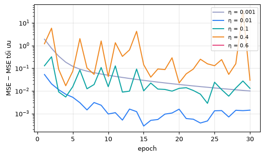
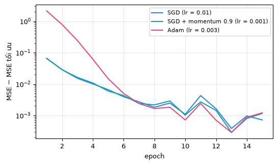

# Chương 12 · Ví dụ áp dụng: huấn luyện bằng mini-batch trên dữ liệu thật

> Ghi chú của người biên soạn: trang này do người biên soạn viết thêm, không có trong sách gốc. Trang quay lại bộ giá nhà California ở [ví dụ áp dụng của chương 7](ml/ch07_app_vi), nhưng lần này tìm nghiệm bằng mini-batch gradient descent thay vì công thức đóng. Mục tiêu là thấy những vấn đề thực tế khi huấn luyện: chuẩn hoá dữ liệu, chọn bước học, chọn bộ tối ưu.

## Bài toán

Hồi quy tuyến tính trên 8 đặc trưng, 16 512 khu dân cư huấn luyện. Ta đã biết nghiệm tối ưu nhờ công thức đóng (7.12). Câu hỏi ở đây là gradient descent cần bao nhiêu công để đạt tới nghiệm đó, và điều gì có thể làm nó thất bại.

## 1. Dữ liệu và nghiệm tối ưu để đối chiếu

<!-- run -->
```python
import numpy as np
import matplotlib.pyplot as plt
import torch
from sklearn.datasets import fetch_california_housing
from sklearn.model_selection import train_test_split

data = fetch_california_housing()
X_train, X_test, y_train, y_test = train_test_split(data.data, data.target, test_size=0.2, random_state=42)
N, d = X_train.shape

def mse(w, X, y):
    return np.mean((np.c_[np.ones(len(X)), X] @ w - y) ** 2)

w_star = np.linalg.lstsq(np.c_[np.ones(N), X_train], y_train, rcond=None)[0]
L_star = mse(w_star, X_train, y_train)
print(f"MSE tối ưu trên tập huấn luyện (công thức đóng): {L_star:.4f}")
print("độ lệch chuẩn từng cột:", X_train.std(0).round(1).tolist())
```

<!-- output -->
```output
MSE tối ưu trên tập huấn luyện (công thức đóng): 0.5179
độ lệch chuẩn từng cột: [1.9, 12.6, 2.4, 0.4, 1137.0, 11.6, 2.1, 2.0]
```
<!-- /output -->

## 2. Không chuẩn hoá thì gradient descent gần như bế tắc

Cột `Population` có độ lệch chuẩn hơn một nghìn, trong khi `AveBedrms` chỉ khoảng 0.5. Hàm mất mát vì thế là một "thung lũng" cực kỳ hẹp và dài. Bước học phải đủ nhỏ để không phân kỳ theo chiều dốc nhất, nhưng khi đó lại quá nhỏ cho các chiều thoải.

<!-- run -->
```python
def minibatch_gd(X, y, eta, epochs=20, batch=64, seed=0):
    rng = np.random.default_rng(seed)
    Xb = np.c_[np.ones(len(X)), X]; w = np.zeros(Xb.shape[1]); hist = []
    with np.errstate(over="ignore", invalid="ignore"):
        for ep in range(epochs):
            for j in np.array_split(rng.permutation(len(X)), len(X) // batch):
                w -= eta * 2 * Xb[j].T @ (Xb[j] @ w - y[j]) / len(j)
            hist.append(np.mean((Xb @ w - y) ** 2))
    return w, np.array(hist)

mu, sd = X_train.mean(0), X_train.std(0)
Xs_train, Xs_test = (X_train - mu) / sd, (X_test - mu) / sd
L_star_s = mse(np.linalg.lstsq(np.c_[np.ones(N), Xs_train], y_train, rcond=None)[0], Xs_train, y_train)

def report(h, ref):
    return "phân kỳ" if not np.isfinite(h[-1]) or h[-1] > 1e3 else f"MSE sau 20 epoch = {h[-1]:.4f}   (tối ưu {ref:.4f})"

print("Không chuẩn hoá:")
for eta in [1e-6, 1e-7, 1e-8]:
    print(f"  η = {eta:.0e}: " + report(minibatch_gd(X_train, y_train, eta)[1], L_star))
print("Đã chuẩn hoá:")
for eta in [0.3, 0.1, 0.01]:
    print(f"  η = {eta:4}: " + report(minibatch_gd(Xs_train, y_train, eta)[1], L_star_s))
```

<!-- output -->
```output
Không chuẩn hoá:
  η = 1e-06: phân kỳ
  η = 1e-07: MSE sau 20 epoch = 1.3204   (tối ưu 0.5179)
  η = 1e-08: MSE sau 20 epoch = 1.7769   (tối ưu 0.5179)
Đã chuẩn hoá:
  η =  0.3: phân kỳ
  η =  0.1: phân kỳ
  η = 0.01: MSE sau 20 epoch = 0.5197   (tối ưu 0.5179)
```
<!-- /output -->

Không chuẩn hoá, bước học lớn nhất mà không phân kỳ là khoảng $10^{-7}$. Với bước học đó, sau 20 epoch MSE vẫn còn cao hơn nhiều so với mức tối ưu 0.52. Chuẩn hoá giúp $\eta = 0.01$ chạy tốt. Nhưng lạ là $\eta = 0.1$ vẫn phân kỳ, dù đây là một bước học bình thường cho dữ liệu đã chuẩn hoá.

## 3. Thủ phạm: giá trị cực đoan

Chuẩn hoá chỉ đưa trung bình về 0 và độ lệch chuẩn về 1, không làm mất các giá trị cực đoan. Xem giá trị tuyệt đối lớn nhất của mỗi cột sau khi chuẩn hoá:

<!-- run -->
```python
cols = data.feature_names
print("max |z| sau chuẩn hoá:", dict(zip(cols, np.abs(Xs_train).max(0).round().astype(int).tolist())))

SKEWED = [2, 3, 4, 5]                                    # AveRooms, AveBedrms, Population, AveOccup
def log_skewed(X):
    X = X.copy(); X[:, SKEWED] = np.log1p(X[:, SKEWED]); return X
L_train, L_test = log_skewed(X_train), log_skewed(X_test)
mu2, sd2 = L_train.mean(0), L_train.std(0)
Xl_train, Xl_test = (L_train - mu2) / sd2, (L_test - mu2) / sd2
L_star_l = mse(np.linalg.lstsq(np.c_[np.ones(N), Xl_train], y_train, rcond=None)[0], Xl_train, y_train)
print("max |z| sau khi lấy log rồi chuẩn hoá:", dict(zip(cols, np.abs(Xl_train).max(0).round().astype(int).tolist())))
for eta in [0.3, 0.1, 0.01]:
    print(f"  η = {eta:4}: " + report(minibatch_gd(Xl_train, y_train, eta)[1], L_star_l))
```

<!-- output -->
```output
max |z| sau chuẩn hoá: {'MedInc': 6, 'HouseAge': 2, 'AveRooms': 57, 'AveBedrms': 57, 'Population': 30, 'AveOccup': 107, 'Latitude': 3, 'Longitude': 3}
max |z| sau khi lấy log rồi chuẩn hoá: {'MedInc': 6, 'HouseAge': 2, 'AveRooms': 14, 'AveBedrms': 24, 'Population': 8, 'AveOccup': 28, 'Latitude': 3, 'Longitude': 3}
  η =  0.3: MSE sau 20 epoch = 0.5880   (tối ưu 0.4527)
  η =  0.1: MSE sau 20 epoch = 0.4656   (tối ưu 0.4527)
  η = 0.01: MSE sau 20 epoch = 0.4542   (tối ưu 0.4527)
```
<!-- /output -->

Một khu dân cư có `AveOccup` (số người trung bình mỗi hộ) cách trung bình hơn 100 độ lệch chuẩn, có lẽ là ký túc xá hoặc một lỗi dữ liệu. Khi mini-batch chứa điểm này, gradient của nó lớn gấp hàng trăm lần bình thường, và một bước cập nhật đủ để đẩy trọng số ra xa. Lấy log nén các giá trị cực đoan lại, nên bước học lớn hơn chạy được. Mô hình cũng tốt hơn: MSE tối ưu giảm từ 0.52 xuống 0.45, giống kết quả ở chương 7.

Từ đây trở đi, ta dùng đặc trưng đã lấy log và chuẩn hoá.

## 4. Chọn bước học

Vẽ MSE theo epoch cho nhiều bước học:

<!-- run -->
```python
fig, ax = plt.subplots(figsize=(6, 3.4))
for eta, c in [(0.001, "#9aa0c8"), (0.01, "#2f80f5"), (0.1, "#0ea5a4"), (0.4, "#f08a24"), (0.6, "#e8487f")]:
    _, h = minibatch_gd(Xl_train, y_train, eta, epochs=30)
    ok = np.isfinite(h) & (h < 1e3)
    ax.semilogy(np.arange(1, 31)[ok], h[ok] - L_star_l + 1e-6, color=c, label=f"η = {eta}")
    print(f"η = {eta:5}: MSE − tối ưu sau 30 epoch = {h[-1] - L_star_l:.2e}" if ok[-1] else f"η = {eta:5}: phân kỳ")
ax.set_xlabel("epoch"); ax.set_ylabel("MSE − MSE tối ưu"); ax.legend(fontsize=8); ax.grid(alpha=.3)
```

<!-- output -->
```output
η = 0.001: MSE − tối ưu sau 30 epoch = 9.88e-03
η =  0.01: MSE − tối ưu sau 30 epoch = 1.41e-03
η =   0.1: MSE − tối ưu sau 30 epoch = 1.29e-02
η =   0.4: MSE − tối ưu sau 30 epoch = 2.95e-02
η =   0.6: phân kỳ
```

<div align=center></div>
<!-- /output -->

Bước học nhỏ ($0.001$) an toàn nhưng chậm. Bước học lớn ($0.1$, $0.4$) giảm nhanh ở những epoch đầu nhưng dừng ở một mức sai số cao hơn. Lý do là với bước học cố định, nhiễu của từng mini-batch làm trọng số dao động quanh nghiệm, và dao động càng lớn khi bước học càng lớn (xem mục 5 trang Code). Bước học quá lớn ($0.6$) thì phân kỳ. Ở đây $\eta = 0.01$ là điểm cân bằng tốt.

## 5. So sánh các bộ tối ưu với PyTorch

Cùng mô hình (`nn.Linear(8, 1)`), cùng mini-batch 64, so sánh SGD, SGD có momentum và Adam. Mỗi bộ tối ưu dùng bước học tốt nhất trong vài giá trị thử trước.

<!-- run -->
```python
from torch import nn

Xt = torch.tensor(Xl_train, dtype=torch.float32); yt = torch.tensor(y_train, dtype=torch.float32)[:, None]

def train(make_opt, epochs=15, seed=0):
    torch.manual_seed(seed)
    model = nn.Linear(8, 1); opt = make_opt(model.parameters()); hist = []
    for ep in range(epochs):
        for j in torch.randperm(len(Xt)).split(64):
            opt.zero_grad(); loss = nn.functional.mse_loss(model(Xt[j]), yt[j]); loss.backward(); opt.step()
        with torch.no_grad():
            hist.append(nn.functional.mse_loss(model(Xt), yt).item())
    return np.array(hist)

candidates = {"SGD": ([0.003, 0.01, 0.03], lambda lr: lambda p: torch.optim.SGD(p, lr=lr)),
              "SGD + momentum 0.9": ([0.0003, 0.001, 0.003], lambda lr: lambda p: torch.optim.SGD(p, lr=lr, momentum=0.9)),
              "Adam": ([0.003, 0.01, 0.03], lambda lr: lambda p: torch.optim.Adam(p, lr=lr))}
fig, ax = plt.subplots(figsize=(6, 3.4))
for (name, (lrs, mk)), c in zip(candidates.items(), ["#2f80f5", "#0ea5a4", "#e8487f"]):
    best = min(((lr, train(mk(lr))) for lr in lrs), key=lambda t: t[1][-1])
    ax.semilogy(np.arange(1, 16), best[1] - L_star_l + 1e-6, color=c, label=f"{name} (lr = {best[0]})")
    print(f"{name:20s} lr = {best[0]:<7}: MSE − tối ưu sau 1 epoch {best[1][0] - L_star_l:.2e}, sau 15 epoch {best[1][-1] - L_star_l:.2e}")
ax.set_xlabel("epoch"); ax.set_ylabel("MSE − MSE tối ưu"); ax.legend(fontsize=8); ax.grid(alpha=.3)
```

<!-- output -->
```output
SGD                  lr = 0.01   : MSE − tối ưu sau 1 epoch 6.55e-02, sau 15 epoch 7.20e-04
SGD + momentum 0.9   lr = 0.001  : MSE − tối ưu sau 1 epoch 6.59e-02, sau 15 epoch 1.16e-03
Adam                 lr = 0.003  : MSE − tối ưu sau 1 epoch 2.13e+00, sau 15 epoch 1.21e-03
```

<div align=center></div>
<!-- /output -->

Sau 15 epoch, cả ba bộ tối ưu đều cách nghiệm tối ưu khoảng $10^{-3}$. Trên bài toán này, không bộ tối ưu nào vượt trội: đây là một hàm mất mát bậc hai (lồi, chỉ có một cực tiểu), và sau khi chuẩn hoá thì nó cũng không quá "hẹp". Adam khởi đầu chậm vì bước học nhỏ nhất trong các giá trị thử lại là bước học tốt nhất về lâu dài. Ưu thế của momentum và Adam thể hiện rõ hơn trên các hàm khó như Rosenbrock ([trang Dùng thư viện](ml/ch12_lib_vi)) hoặc mạng neuron nhiều tầng (chương 16).

## Rút ra được gì

- **Chuẩn hoá đặc trưng gần như là bắt buộc** khi huấn luyện bằng gradient. Không chuẩn hoá, bước học phải nhỏ cỡ $10^{-7}$ và mô hình gần như không học được gì sau 20 epoch.
- **Chuẩn hoá chưa đủ khi có giá trị cực đoan.** Một vài điểm dữ liệu cách xa hàng trăm độ lệch chuẩn đủ để làm thuật toán phân kỳ. Hãy xem giá trị lớn nhất của từng cột sau khi chuẩn hoá. Lấy log, cắt ngưỡng hoặc dùng mất mát Huber (chương 7) là các cách xử lý.
- **Bước học là siêu tham số quan trọng nhất.** Hãy quét theo thang log ($0.001, 0.01, 0.1, \dots$) và vẽ đường mất mát theo epoch.
- Với hồi quy tuyến tính, công thức đóng vẫn nhanh và chính xác hơn. Gradient descent thực sự cần thiết khi dữ liệu quá lớn để nằm gọn trong bộ nhớ, hoặc khi mô hình không có công thức đóng (hồi quy logistic, mạng neuron).
