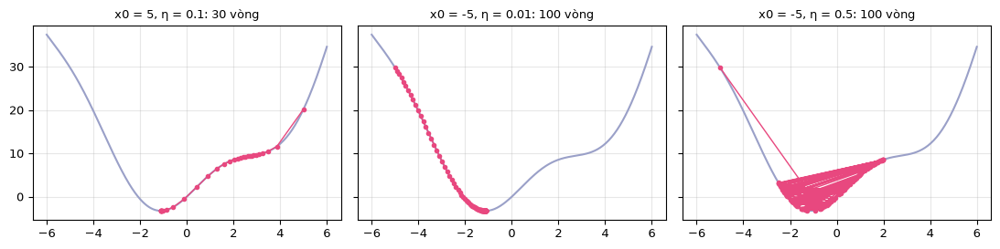
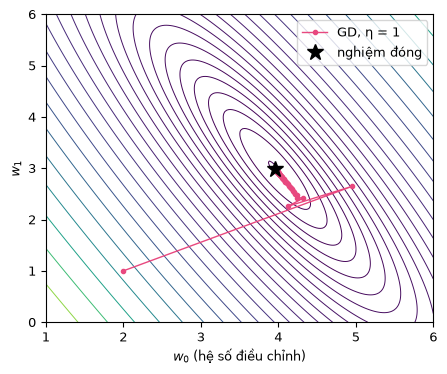
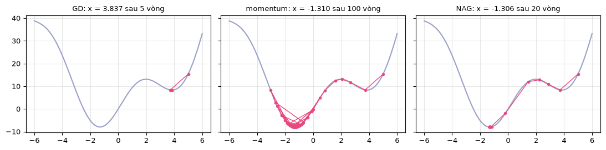
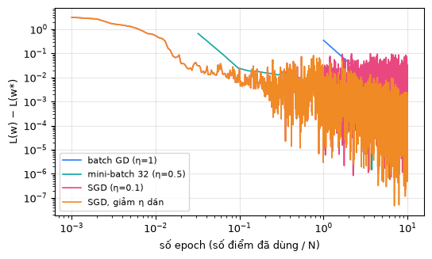

# Chương 12 · Code từ đầu

> Ghi chú của người biên soạn: trang này do người biên soạn viết thêm, không có trong sách gốc. Trang chạy lại các ví dụ của [chương 12](ml/ch12_vi) bằng NumPy: gradient descent (GD) cho hàm một biến và nhiều biến, kiểm tra đạo hàm bằng số, momentum, Nesterov (NAG), stochastic và mini-batch gradient descent.

## Cách dùng trang này

Các khối chạy lần lượt từ trên xuống và dùng chung biến. Chỉ cần `numpy` và `matplotlib`.

Mọi thuật toán trên trang đều có cùng một khuôn: bắt đầu từ $\theta_0$ rồi lặp $\theta \leftarrow \theta - \eta \cdot (\text{một hướng nào đó})$. Chúng chỉ khác nhau ở cách chọn hướng đi.

## 1. GD cho hàm một biến

<small class="viz-ref">Mục 12.2.1 · hình 12.2–12.5</small>

Hàm $f(x) = x^2 + 5\sin(x)$ có đạo hàm $f'(x) = 2x + 5\cos(x)$. Thuật toán dừng khi $|f'(x)| < 10^{-3}$, giống sách.

<!-- run -->
```python
import numpy as np
import matplotlib.pyplot as plt

def f(x):  return x ** 2 + 5 * np.sin(x)
def df(x): return 2 * x + 5 * np.cos(x)

def gd(grad, x0, eta, tol=1e-3, max_iter=100):
    xs = [np.asarray(x0, float)]
    for it in range(max_iter):
        x = xs[-1] - eta * grad(xs[-1])
        xs.append(x)
        if np.linalg.norm(grad(x)) / np.size(x) < tol:
            break
    return np.array(xs)

for x0, eta in [(-5, 0.1), (5, 0.1), (-5, 0.01), (-5, 0.5)]:
    xs = gd(df, x0, eta)
    print(f"x0 = {x0:2d}, η = {eta:4}: x = {xs[-1]:9.6f}, f(x) = {f(xs[-1]):9.6f}, sau {len(xs) - 1:3d} vòng lặp")

fig, axes = plt.subplots(1, 3, figsize=(11, 2.8), sharey=True)
t = np.linspace(-6, 6, 300)
for ax, (x0, eta) in zip(axes, [(5, 0.1), (-5, 0.01), (-5, 0.5)]):
    xs = gd(df, x0, eta)
    ax.plot(t, f(t), color="#9aa0c8"); ax.plot(xs, f(xs), "o-", ms=3, color="#e8487f", lw=1)
    ax.set_title(f"x0 = {x0}, η = {eta}: {len(xs) - 1} vòng", fontsize=9); ax.grid(alpha=.3)
fig.tight_layout()
```

<!-- output -->
```output
x0 = -5, η =  0.1: x = -1.110566, f(x) = -3.246394, sau  12 vòng lặp
x0 =  5, η =  0.1: x = -1.110451, f(x) = -3.246394, sau  30 vòng lặp
x0 = -5, η = 0.01: x = -1.117990, f(x) = -3.246213, sau 100 vòng lặp
x0 = -5, η =  0.5: x = -2.388153, f(x) =  2.282515, sau 100 vòng lặp
```

<div align=center></div>
<!-- /output -->

Hai dòng đầu khớp với sách: từ hai điểm xuất phát, GD đều tìm ra cực tiểu $x \approx -1.11$. Sách in "11" và "29" vòng vì đếm từ 0. Hai dòng sau minh hoạ ảnh hưởng của bước học. Với $\eta = 0.01$, sau 100 vòng vẫn chưa tới nơi. Với $\eta = 0.5$, nghiệm nhảy qua lại quanh cực tiểu mà không hội tụ (hình phải).

## 2. Kiểm tra đạo hàm bằng số

<small class="viz-ref">Mục 12.3</small>

Trước khi tin vào một công thức gradient tự tính, hãy so nó với **đạo hàm số** theo công thức sai phân trung tâm:

$$
\frac{\partial f}{\partial \theta_i} \approx \frac{f(\theta + \varepsilon \mathbf{e}_i) - f(\theta - \varepsilon \mathbf{e}_i)}{2\varepsilon}.
$$

Sai số của công thức này là $O(\varepsilon^2)$. Cách làm này chậm (mỗi thành phần gradient cần hai lần tính $f$), nhưng chỉ dùng để kiểm tra một lần.

<!-- run -->
```python
def numerical_grad(fun, theta, eps=1e-6):
    theta = np.asarray(theta, float)
    g = np.zeros_like(theta)
    for i in range(theta.size):
        e = np.zeros_like(theta); e.flat[i] = eps
        g.flat[i] = (fun(theta + e) - fun(theta - e)) / (2 * eps)
    return g

# Hồi quy tuyến tính trên dữ liệu của sách: y = 4 + 3x + nhiễu
rng = np.random.default_rng(2)
X = rng.random(1000)
y = 4 + 3 * X + 0.5 * rng.normal(size=1000)
Xbar = np.c_[np.ones(1000), X]

def cost(w):  return 0.5 / len(y) * np.sum((y - Xbar @ w) ** 2)       # (7.4)
def grad(w):  return Xbar.T @ (Xbar @ w - y) / len(y)                  # (7.7)
def grad_wrong(w): return Xbar.T @ (Xbar @ w - y)                      # quên chia N

w = rng.normal(size=2)
print("gradient công thức :", grad(w))
print("gradient số        :", numerical_grad(cost, w))
print(f"sai khác (đúng)    : {np.linalg.norm(grad(w) - numerical_grad(cost, w)):.2e}")
print(f"sai khác (quên ÷N) : {np.linalg.norm(grad_wrong(w) - numerical_grad(cost, w)):.2e}")
```

<!-- output -->
```output
gradient công thức : [-5.24688371 -2.99187176]
gradient số        : [-5.24688371 -2.99187176]
sai khác (đúng)    : 2.10e-09
sai khác (quên ÷N) : 6.03e+03
```
<!-- /output -->

Gradient đúng khớp với gradient số tới khoảng $10^{-9}$. Gradient "quên chia $N$" sai lệch hàng nghìn lần và bị phát hiện ngay. Đây là cách rẻ nhất để bắt lỗi khi tự cài đặt lan truyền ngược ở chương 16.

## 3. GD cho hồi quy tuyến tính

<small class="viz-ref">Mục 12.3 · hình 12.6–12.7</small>

Với $\eta = 1$ và điểm bắt đầu $\mathbf{w} = (2, 1)$ như sách. So sánh với nghiệm đóng (7.12):

<!-- run -->
```python
w_closed = np.linalg.lstsq(Xbar, y, rcond=None)[0]
ws = gd(grad, [2.0, 1.0], eta=1.0)
print("nghiệm đóng  :", w_closed.round(4))
print("GD, η = 1    :", ws[-1].round(4), f" sau {len(ws) - 1} vòng lặp")
for eta in [0.1, 0.5, 1.5, 2.0]:
    with np.errstate(over="ignore", invalid="ignore"):
        w_eta = gd(grad, [2.0, 1.0], eta=eta, max_iter=1000)
        L_eta = cost(w_eta[-1])
    if np.isfinite(L_eta):
        print(f"GD, η = {eta:3}  : {np.round(w_eta[-1], 4)}  sau {len(w_eta) - 1:4d} vòng lặp,  L = {L_eta:.4f}")
    else:
        print(f"GD, η = {eta:3}  : phân kỳ (các trọng số tăng tới vô cùng)")

# Đường đồng mức của L(w) và đường đi của GD
b, a = np.meshgrid(np.linspace(1, 6, 200), np.linspace(0, 6, 200))
Z = np.array([[cost(np.array([bi, ai])) for bi, ai in zip(rb, ra)] for rb, ra in zip(b, a)])
fig, ax = plt.subplots(figsize=(5, 4))
ax.contour(b, a, Z, levels=np.geomspace(Z.min() + 1e-3, Z.max(), 25), cmap="viridis", linewidths=.7)
ax.plot(ws[:, 0], ws[:, 1], "o-", ms=3, color="#e8487f", lw=1, label="GD, η = 1")
ax.plot(*w_closed, "k*", ms=12, label="nghiệm đóng")
ax.set_xlabel("$w_0$ (hệ số điều chỉnh)"); ax.set_ylabel("$w_1$"); ax.legend()
```

<!-- output -->
```output
nghiệm đóng  : [3.9596 2.9856]
GD, η = 1    : [3.9739 2.9589]  sau 49 vòng lặp
GD, η = 0.1  : [3.9741 2.9586]  sau  503 vòng lặp,  L = 0.1202
GD, η = 0.5  : [3.9738 2.9592]  sau  100 vòng lặp,  L = 0.1202
GD, η = 1.5  : [3.961 2.986]  sau   75 vòng lặp,  L = 0.1202
GD, η = 2.0  : phân kỳ (các trọng số tăng tới vô cùng)
```

<div align=center></div>
<!-- /output -->

GD với $\eta = 1$ dừng sau 49 vòng, giống sách. Nghiệm hơi khác nghiệm đóng vì điều kiện dừng ($\|\nabla\mathcal{L}\|/2 < 10^{-3}$) khá lỏng. Bước học quá nhỏ ($\eta = 0.1$) cần hàng trăm vòng. Bước học quá lớn ($\eta = 2$) làm thuật toán phân kỳ. Với hàm bậc hai này, GD hội tụ khi $\eta < 2/\lambda_{\max}$, trong đó $\lambda_{\max}$ là trị riêng lớn nhất của ma trận Hessian $\frac{1}{N}\bar{\mathbf{X}}^T\bar{\mathbf{X}}$.

## 4. Momentum: vượt qua cực tiểu địa phương

<small class="viz-ref">Mục 12.4 · hình 12.9</small>

Hàm $f(x) = x^2 + 10\sin(x)$ có một cực tiểu địa phương quanh $x \approx 3.8$ và cực tiểu toàn cục quanh $x \approx -1.3$. Bắt đầu từ $x_0 = 5$, GD thường rơi vào hố gần nhất. Momentum mang "đà" từ các bước trước:

$$
v_t = \gamma v_{t-1} + \eta \nabla f(\theta), \qquad \theta \leftarrow \theta - v_t.
$$

<!-- run -->
```python
def f2(x):  return x ** 2 + 10 * np.sin(x)
def df2(x): return 2 * x + 10 * np.cos(x)

def gd_momentum(grad, x0, eta, gamma, tol=1e-3, max_iter=100):
    xs, v = [np.asarray(x0, float)], 0.0
    for it in range(max_iter):
        v = gamma * v + eta * grad(xs[-1])
        xs.append(xs[-1] - v)
        if np.linalg.norm(grad(xs[-1])) / np.size(xs[-1]) < tol:
            break
    return np.array(xs)

def gd_nag(grad, x0, eta, gamma, tol=1e-3, max_iter=100):
    """Nesterov (12.10): tính gradient tại điểm "nhìn trước" θ − γv."""
    xs, v = [np.asarray(x0, float)], 0.0
    for it in range(max_iter):
        v = gamma * v + eta * grad(xs[-1] - gamma * v)
        xs.append(xs[-1] - v)
        if np.linalg.norm(grad(xs[-1])) / np.size(xs[-1]) < tol:
            break
    return np.array(xs)

runs = {"GD": gd(df2, 5, 0.1), "momentum": gd_momentum(df2, 5, 0.1, 0.9), "NAG": gd_nag(df2, 5, 0.1, 0.9)}
t = np.linspace(-6, 6, 300)
fig, axes = plt.subplots(1, 3, figsize=(11, 2.8), sharey=True)
for ax, (name, xs) in zip(axes, runs.items()):
    ax.plot(t, f2(t), color="#9aa0c8"); ax.plot(xs, f2(xs), "o-", ms=3, lw=1, color="#e8487f")
    ax.set_title(f"{name}: x = {xs[-1]:.3f} sau {len(xs) - 1} vòng", fontsize=9); ax.grid(alpha=.3)
    print(f"{name:9s}: dừng ở x = {xs[-1]:7.4f}, f(x) = {f2(xs[-1]):8.4f}, sau {len(xs) - 1:3d} vòng lặp")
fig.tight_layout()
```

<!-- output -->
```output
GD       : dừng ở x =  3.8374, f(x) =   8.3156, sau   5 vòng lặp
momentum : dừng ở x = -1.3102, f(x) =  -7.9457, sau 100 vòng lặp
NAG      : dừng ở x = -1.3065, f(x) =  -7.9458, sau  20 vòng lặp
```

<div align=center></div>
<!-- /output -->

Từ $x_0 = 5$, GD rơi ngay vào hố gần nhất ($x \approx 3.84$) sau 5 vòng. Momentum và NAG đều có đủ đà để vượt qua "đồi" và tới cực tiểu toàn cục $x \approx -1.31$. NAG "nhìn trước" nên phanh sớm hơn khi tới đáy, và hội tụ sau 20 vòng. Momentum thì dao động qua lại quanh đáy và vẫn chưa thoả điều kiện dừng sau 100 vòng.

## 5. Batch, stochastic và mini-batch GD

<small class="viz-ref">Mục 12.6</small>

GD ở mục 3 dùng **toàn bộ** 1000 điểm để tính mỗi gradient (batch GD). Stochastic GD (SGD) dùng **một** điểm mỗi lần. Mini-batch GD dùng một lô nhỏ, ví dụ 32 điểm. Ở cả hai cách sau, dữ liệu được xáo trộn lại ở mỗi epoch, tức mỗi lần duyệt hết dữ liệu.

Để so sánh công bằng, ta tính chi phí theo **số điểm dữ liệu đã dùng để tính gradient**, vì đó là phần tốn thời gian nhất.

<!-- run -->
```python
def minibatch_gd(w0, eta, batch, epochs, rng, decay=0.0):
    w = np.array(w0, float)
    N = len(y); seen = [0]; losses = [cost(w)]
    for ep in range(epochs):
        idx = rng.permutation(N)
        for s in range(0, N, batch):
            j = idx[s:s + batch]
            lr = eta / (1 + decay * ep)                         # giảm dần bước học theo epoch
            w -= lr * Xbar[j].T @ (Xbar[j] @ w - y[j]) / len(j)
            seen.append(seen[-1] + len(j)); losses.append(cost(w))
    return w, np.array(seen), np.array(losses)

L_opt = cost(w_closed)
fig, ax = plt.subplots(figsize=(6, 3.4))
for name, batch, eta, decay, c in [("batch GD (η=1)", 1000, 1.0, 0, "#2f80f5"), ("mini-batch 32 (η=0.5)", 32, 0.5, 0, "#0ea5a4"),
                                    ("SGD (η=0.1)", 1, 0.1, 0, "#e8487f"), ("SGD, giảm η dần", 1, 0.1, 1.0, "#f08a24")]:
    w, seen, L = minibatch_gd([2.0, 1.0], eta, batch, epochs=10, rng=np.random.default_rng(0), decay=decay)
    ax.loglog(seen[1:] / 1000, L[1:] - L_opt + 1e-12, color=c, lw=1.2, label=name)
    print(f"{name:22s}: sau 10 epoch, w = {np.round(w, 3)}, L − L* = {cost(w) - L_opt:.2e}")
ax.set_xlabel("số epoch (số điểm đã dùng / N)"); ax.set_ylabel("L(w) − L(w*)"); ax.legend(fontsize=8); ax.grid(alpha=.3)
```

<!-- output -->
```output
batch GD (η=1)        : sau 10 epoch, w = [4.158 2.616], L − L* = 5.72e-03
mini-batch 32 (η=0.5) : sau 10 epoch, w = [4.004 2.985], L − L* = 9.52e-04
SGD (η=0.1)           : sau 10 epoch, w = [4.007 2.989], L − L* = 1.23e-03
SGD, giảm η dần       : sau 10 epoch, w = [3.968 2.984], L − L* = 3.18e-05
```

<div align=center></div>
<!-- /output -->

Trục ngang là số epoch, tức chi phí tính toán. Sau cùng một chi phí (10 lần duyệt dữ liệu):

- **Batch GD** mới đi được 10 bước nên còn cách xa nghiệm.
- **SGD và mini-batch** đã đi hàng trăm, hàng nghìn bước, nên gần nghiệm hơn nhiều, dù mỗi bước "ồn" hơn.
- **SGD với bước học cố định** thì không bao giờ hội tụ hẳn: nó cứ dao động quanh nghiệm vì nhiễu của từng điểm. **Giảm bước học dần** (ở đây $\eta_t = \eta / (1 + \text{epoch})$) khắc phục được điều đó và cho sai số nhỏ nhất.

Mini-batch là lựa chọn phổ biến nhất trong thực tế: tận dụng được phép nhân ma trận (nhanh trên CPU và GPU), mà vẫn có nhiều bước cập nhật trong mỗi epoch.
