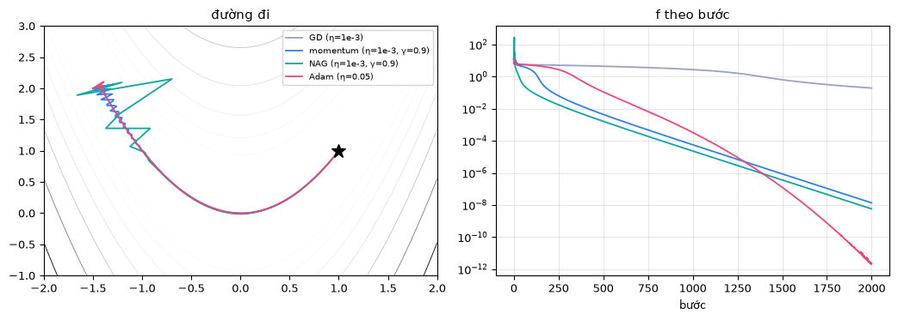

# Chương 12 · Dùng thư viện

> Ghi chú của người biên soạn: trang này do người biên soạn viết thêm, không có trong sách gốc. Trong thực tế, gần như không ai tự tính gradient bằng tay. Các thư viện học sâu như PyTorch tính gradient tự động (autograd) và có sẵn các thuật toán tối ưu của [chương 12](ml/ch12_vi), cùng nhiều biến thể mới hơn như Adam.

## Cách dùng trang này

Các khối chạy lần lượt từ trên xuống và dùng chung biến. Cần `numpy`, `matplotlib`, `torch`, `scikit-learn`, `scipy`.

| Trong sách | Trong PyTorch |
| --- | --- |
| Tự tính $\nabla f$ | `loss.backward()` rồi đọc `x.grad` |
| GD: $\theta \leftarrow \theta - \eta\nabla f$ | `torch.optim.SGD(params, lr=η)` |
| Momentum (12.7)–(12.8) | `torch.optim.SGD(params, lr=η, momentum=γ)` |
| NAG (12.10) | `torch.optim.SGD(params, lr=η, momentum=γ, nesterov=True)` |
| (không có trong sách) | `torch.optim.Adam`, `RMSprop`, `Adagrad` |

## 1. Gradient tự động (autograd)

<!-- run -->
```python
import numpy as np
import matplotlib.pyplot as plt
import torch

x = torch.tensor(5.0, requires_grad=True)
f = x ** 2 + 5 * torch.sin(x)          # hàm ở mục 12.2.1
f.backward()                            # tính df/dx và lưu vào x.grad
print(f"autograd : f'(5) = {x.grad.item():.6f}")
print(f"công thức: f'(5) = {2 * 5 + 5 * np.cos(5):.6f}")
```

<!-- output -->
```output
autograd : f'(5) = 11.418311
công thức: f'(5) = 11.418311
```
<!-- /output -->

PyTorch ghi lại mọi phép tính tạo ra `f` thành một đồ thị tính toán, rồi áp dụng quy tắc chuỗi ngược từ `f` về `x`. Đây chính là thuật toán **lan truyền ngược** ở chương 16, được làm tự động cho mọi hàm.

## 2. Viết lại GD, momentum và NAG bằng `torch.optim`

<small class="viz-ref">Mục 12.4–12.5 · hình 12.9</small>

Với hàm $f(x) = x^2 + 10\sin(x)$ và $x_0 = 5$ như trang Code. Vòng lặp tối ưu trong PyTorch luôn có bốn dòng: xoá gradient cũ, tính hàm mất mát, lan truyền ngược, cập nhật.

<!-- run -->
```python
def run(make_opt, x0=5.0, steps=100):
    x = torch.tensor(x0, requires_grad=True)
    opt = make_opt([x])
    path = [x.item()]
    for _ in range(steps):
        opt.zero_grad()                      # 1. xoá gradient của bước trước
        loss = x ** 2 + 10 * torch.sin(x)    # 2. tính hàm mất mát
        loss.backward()                      # 3. tính gradient
        opt.step()                           # 4. cập nhật tham số
        path.append(x.item())
    return np.array(path)

opts = {
    "GD":       lambda p: torch.optim.SGD(p, lr=0.1),
    "momentum": lambda p: torch.optim.SGD(p, lr=0.1, momentum=0.9),
    "NAG":      lambda p: torch.optim.SGD(p, lr=0.1, momentum=0.9, nesterov=True),
    "Adam":     lambda p: torch.optim.Adam(p, lr=0.5),
}
for name, mk in opts.items():
    path = run(mk)
    print(f"{name:9s}: x sau 100 bước = {path[-1]:7.4f}, f(x) = {path[-1] ** 2 + 10 * np.sin(path[-1]):8.4f}")
```

<!-- output -->
```output
GD       : x sau 100 bước =  3.8375, f(x) =   8.3156
momentum : x sau 100 bước = -1.3102, f(x) =  -7.9457
NAG      : x sau 100 bước = -1.3064, f(x) =  -7.9458
Adam     : x sau 100 bước =  3.8328, f(x) =   8.3157
```
<!-- /output -->

GD, momentum và NAG cho đúng kết quả như trang Code. Adam, dù là bộ tối ưu "mặc định" của học sâu, lại rơi vào cực tiểu địa phương $x \approx 3.83$. Adam chuẩn hoá độ lớn của gradient, nên mỗi bước có độ dài gần bằng $\eta$ bất kể dốc hay thoải. Ở đây nó không tích luỹ đủ đà để vượt đồi. Không có bộ tối ưu nào tốt nhất cho mọi hàm.

Lưu ý: momentum trong PyTorch được viết hơi khác sách, $v \leftarrow \gamma v + \nabla f$ rồi $\theta \leftarrow \theta - \eta v$. Với $\eta$ cố định, cách viết này tương đương công thức (12.7)–(12.8) của sách sau khi đổi biến $v_{\text{sách}} = \eta\, v_{\text{PyTorch}}$. Cách viết NAG cũng khác, nhưng ý tưởng "tính gradient ở điểm nhìn trước" là như nhau.

## 3. So sánh các bộ tối ưu trên hàm Rosenbrock

Hàm Rosenbrock $f(x, y) = (1 - x)^2 + 100(y - x^2)^2$ là phép thử kinh điển. Cực tiểu $(1, 1)$ nằm ở đáy một thung lũng hẹp và cong. GD thường dao động giữa hai vách thung lũng và tiến rất chậm dọc theo đáy.

<!-- run -->
```python
def rosen(p): return (1 - p[0]) ** 2 + 100 * (p[1] - p[0] ** 2) ** 2

def run2(make_opt, steps=2000):
    p = torch.tensor([-1.5, 2.0], requires_grad=True)
    opt = make_opt([p]); path = [p.detach().numpy().copy()]; L = []
    for _ in range(steps):
        opt.zero_grad(); loss = rosen(p); loss.backward(); opt.step()
        path.append(p.detach().numpy().copy()); L.append(loss.item())
    return np.array(path), np.array(L)

opts2 = {"GD (η=1e-3)": (lambda q: torch.optim.SGD(q, lr=1e-3), "#9aa0c8"),
         "momentum (η=1e-3, γ=0.9)": (lambda q: torch.optim.SGD(q, lr=1e-3, momentum=0.9), "#2f80f5"),
         "NAG (η=1e-3, γ=0.9)": (lambda q: torch.optim.SGD(q, lr=1e-3, momentum=0.9, nesterov=True), "#0ea5a4"),
         "Adam (η=0.05)": (lambda q: torch.optim.Adam(q, lr=0.05), "#e8487f")}
xx, yy = np.meshgrid(np.linspace(-2, 2, 300), np.linspace(-1, 3, 300))
fig, axes = plt.subplots(1, 2, figsize=(10.5, 3.8))
axes[0].contour(xx, yy, rosen([xx, yy]), levels=np.geomspace(0.1, 2000, 20), cmap="Greys", linewidths=.6)
for name, (mk, c) in opts2.items():
    path, L = run2(mk)
    axes[0].plot(path[:, 0], path[:, 1], color=c, lw=1.3, label=name)
    axes[1].semilogy(L, color=c, lw=1.3, label=name)
    print(f"{name:26s}: sau 2000 bước p = {np.round(path[-1], 4)}, f = {L[-1]:.2e}")
axes[0].plot(1, 1, "k*", ms=12); axes[0].legend(fontsize=7); axes[0].set_title("đường đi")
axes[1].set_xlabel("bước"); axes[1].set_title("f theo bước"); axes[1].grid(alpha=.3)
fig.tight_layout()
```

<!-- output -->
```output
GD (η=1e-3)               : sau 2000 bước p = [0.5589 0.3102], f = 1.95e-01
momentum (η=1e-3, γ=0.9)  : sau 2000 bước p = [0.9999 0.9998], f = 1.37e-08
NAG (η=1e-3, γ=0.9)       : sau 2000 bước p = [0.9999 0.9998], f = 5.82e-09
Adam (η=0.05)             : sau 2000 bước p = [1. 1.], f = 2.23e-12
```

<div align=center></div>
<!-- /output -->

Sau 2000 bước, GD vẫn còn ở giữa thung lũng, cách đích $(1, 1)$ khá xa. Momentum và NAG tới gần đích với sai số cỡ $10^{-8}$: đà giúp chúng tăng tốc dọc theo đáy thung lũng. Adam còn chính xác hơn, vì nó tự điều chỉnh bước học riêng cho từng toạ độ.

## 4. SGD trong scikit-learn: `SGDRegressor`

<small class="viz-ref">Mục 12.6</small>

`SGDRegressor` huấn luyện hồi quy tuyến tính bằng SGD (một điểm mỗi bước). Tham số `learning_rate` chọn cách giảm bước học. Mặc định là `"invscaling"`: $\eta_t = \eta_0 / t^{0.25}$.

<!-- run -->
```python
from sklearn.linear_model import SGDRegressor, LinearRegression

rng = np.random.default_rng(2)
X = rng.random((1000, 1)); y = 4 + 3 * X[:, 0] + 0.5 * rng.normal(size=1000)
ref = LinearRegression().fit(X, y)
print(f"nghiệm đóng              : w0 = {ref.intercept_:.4f}, w1 = {ref.coef_[0]:.4f}")
for lr in ["constant", "invscaling", "adaptive"]:
    m = SGDRegressor(learning_rate=lr, eta0=0.01, max_iter=50, tol=None, random_state=0).fit(X, y)
    print(f"SGDRegressor({lr:10s}): w0 = {m.intercept_[0]:.4f}, w1 = {m.coef_[0]:.4f}")
```

<!-- output -->
```output
nghiệm đóng              : w0 = 3.9596, w1 = 2.9856
SGDRegressor(constant  ): w0 = 3.9645, w1 = 2.9889
SGDRegressor(invscaling): w0 = 3.9841, w1 = 2.9502
SGDRegressor(adaptive  ): w0 = 3.9645, w1 = 2.9889
```
<!-- /output -->

Sau 50 epoch, cả ba cách giảm bước học đều cho nghiệm gần nghiệm đóng, sai khác ở chữ số thứ hai hoặc ba. Điều này phù hợp với mục 5 của trang Code: SGD cho nghiệm gần đúng khá nhanh, nhưng muốn chính xác tuyệt đối thì cần giảm bước học hợp lý hoặc dùng công thức đóng.

## 5. Khi hàm nhỏ và trơn: `scipy.optimize`

Với những bài toán ít tham số mà hàm và gradient tính được chính xác (không cần mini-batch), các phương pháp bậc cao hơn như L-BFGS thường hội tụ nhanh hơn GD rất nhiều. Chúng dùng thông tin về độ cong của hàm.

<!-- run -->
```python
from scipy.optimize import minimize

def rosen_np(p):  return (1 - p[0]) ** 2 + 100 * (p[1] - p[0] ** 2) ** 2
def rosen_grad(p): return np.array([-2 * (1 - p[0]) - 400 * p[0] * (p[1] - p[0] ** 2), 200 * (p[1] - p[0] ** 2)])

res = minimize(rosen_np, x0=[-1.5, 2.0], jac=rosen_grad, method="L-BFGS-B")
print(f"L-BFGS: p = {res.x.round(6)}, f = {res.fun:.2e}, số lần tính gradient = {res.njev}")
```

<!-- output -->
```output
L-BFGS: p = [1. 1.], f = 6.37e-18, số lần tính gradient = 53
```
<!-- /output -->

L-BFGS tới đúng $(1, 1)$ với sai số cỡ $10^{-18}$ chỉ sau khoảng 50 lần tính gradient, trong khi GD với 2000 bước vẫn chưa tới nơi. Nhưng L-BFGS cần gradient chính xác của toàn bộ dữ liệu ở mỗi bước. Với hàng triệu điểm dữ liệu và hàng triệu tham số như trong học sâu, các biến thể của SGD vẫn là lựa chọn duy nhất khả thi.

## Tóm tắt

| Nhu cầu | Công cụ |
| --- | --- |
| Tính gradient tự động | `torch` (`backward()`), hoặc `jax.grad` |
| GD, momentum, NAG | `torch.optim.SGD(lr, momentum, nesterov)` |
| Bộ tối ưu "mặc định" của học sâu | `torch.optim.Adam` |
| Mô hình tuyến tính, dữ liệu lớn | `SGDRegressor`, `SGDClassifier` |
| Ít tham số, hàm trơn, có gradient chính xác | `scipy.optimize.minimize(method="L-BFGS-B")` |
