# Chương 12 Gradient descent

> Ghi chú của người biên soạn: chương này lấy nguyên văn từ sách *Machine Learning cơ bản* của **Vũ Hữu Tiệp** ([mã nguồn LaTeX](https://github.com/tiepvupsu/ebookMLCB), giấy phép [CC BY-SA 4.0](https://creativecommons.org/licenses/by-sa/4.0/); trang gốc [machinelearningcoban.com](https://machinelearningcoban.com)). Người biên soạn chỉ đổi định dạng sang trang web: số chương, mục, công thức và hình giữ như bản PDF, hình vector được vẽ lại dưới dạng SVG.
>
> **Đính chính** *(người biên soạn)*:
>
> - Trong hàm `GD_NAG` ở mục 12.5.2, dòng `return theta` thiếu thụt lề nên nằm ngoài hàm. Bản chạy được nằm ở trang [Code từ đầu](ml/ch12_code_vi).
> - Các số vòng lặp in ra ở mục 12.2.1 ("after 11 iterations", "after 29 iterations") là chỉ số `it` đếm từ 0, tức thực tế là 12 và 30 vòng.

## 12.1 Giới thiệu

<div align=center>

</div>
<div align=center>Hình 12.1: Khảo sát sự biến thiên của một đa thức bậc hai.</div>

Xét một hàm số $f: \mathbb{R}^d \rightarrow \mathbb{R}$ với tập xác định $\mathcal{D}$,

- Điểm $\mathbf{x}^* \in \mathcal{D}$ được gọi là *cực tiểu toàn cục* (tương ứng *cực đại toàn cục*) nếu $f(\mathbf{x}) \geq f(\mathbf{x}^*)$ (tương ứng $f(\mathbf{x}) \leq f(\mathbf{x}^*)$) với mọi $\mathbf{x}$ trong tập xác định $\mathcal{D}$. Các điểm cực tiểu toàn cục và cực đại toàn cục được gọi chung là *cực trị toàn cục*.

- Điểm $\mathbf{x}^* \in \mathcal{D}$ được gọi là *cực tiểu địa phương* (tương ứng *cực đại địa phương*) nếu tồn tại $\varepsilon > 0$ sao cho $f(\mathbf{x}) \geq f(\mathbf{x}^*)$ (tương ứng $f(\mathbf{x}) \leq f(\mathbf{x}^*)$) với mọi $\mathbf{x}$ nằm trong lân cận $\mathcal{V}(\varepsilon) = \{\mathbf{x}: \mathbf{x} \in \mathcal{D}, d(\mathbf{x}, \mathbf{x}^*) \leq \varepsilon\}$. Ở đây $d(\mathbf{x}, \mathbf{x}^*)$ ký hiệu khoảng cách giữa hai vector $\mathbf{x}$ và $\mathbf{x}^*$, thường là khoảng cách Euclid. Các điểm cực tiểu địa phương và cực đại địa phương được gọi chung là *cực trị địa phương*. Các điểm cực tiểu/cực đại/cực trị toàn cục cũng là các điểm cực tiểu/cực đại/cực trị địa phương.

Giả sử ta đang quan tâm đến một hàm liên tục một biến có đạo hàm mọi nơi, xác định trên $\mathbb{R}$. Cùng nhắc lại một vài điểm cơ bản:

- Điểm cực tiểu địa phương $x^*$ của hàm số là điểm có đạo hàm $f'(x^*)$ bằng không. Hơn nữa, trong lân cận của nó, đạo hàm của các điểm phía bên trái $x^*$ là không dương, đạo hàm của các điểm phía bên phải $x^*$ là không âm.

- Đường tiếp tuyến với đồ thị hàm số đó tại một điểm bất kỳ có hệ số góc bằng đạo hàm của hàm số tại điểm đó.

Hình 12.1 mô tả sự biến thiên của hàm số $f(x) = \frac{1}{2}(x - 1)^2 - 2$. Điểm $x^* = 1$ là một điểm cực tiểu toàn cục của hàm số này. Các điểm bên trái của $\mathbf{x}^*$ có đạo hàm âm, các điểm bên phải có đạo hàm dương. Với hàm số này, càng xa về phía trái của $\mathbf{x}^*$ thì đạo hàm càng âm, càng xa về phía phải thì đạo hàm càng dương.

Trong machine learning nói riêng và toán tối ưu nói chung, chúng ta thường xuyên phải tìm các cực tiểu toàn cục của một hàm số. Nếu chỉ xét riêng các hàm khả vi, việc giải phương trình đạo hàm bằng không có thể phức tạp hoặc có vô số nghiệm. Thay vào đó, người ta thường tìm các điểm cực tiểu địa phương, và coi đó là một nghiệm cần tìm của bài toán trong những trường hợp nhất định.

Các điểm cực tiểu địa phương là nghiệm của phương trình đạo hàm bằng không (ta vẫn đang giả sử rằng các hàm này liên tục và khả vi). Nếu tìm được toàn bộ (hữu hạn) các điểm cực tiểu địa phương, ta chỉ cần thay từng điểm đó vào hàm số để suy ra điểm cực tiểu toàn cục. Tuy nhiên, trong hầu hết các trường hợp, việc giải phương trình đạo hàm bằng không là bất khả thi. Nguyên nhân có thể đến từ sự phức tạp của đạo hàm, từ việc các điểm dữ liệu có số chiều lớn hoặc từ việc có quá nhiều điểm dữ liệu. Thực tế cho thấy, trong nhiều bài toán machine learning, các điểm cực tiểu địa phương thường cho kết quả tốt, đặc biệt là trong các mạng neuron nhân tạo.

Một hướng tiếp cận phổ biến để giải quyết các bài toán tối ưu là dùng một phép toán. Đầu tiên, chọn một *điểm xuất phát* rồi tiến dần đến *đích* sau mỗi vòng lặp. Gradient descent (GD) và các biến thể của nó là một trong những phương pháp được dùng nhiều nhất.

***Chú ý***: Khái niệm *nghiệm* của một bài toán tối ưu được sử dụng không hẳn để chỉ cực tiểu toàn cục. Nó được sử dụng theo nghĩa là kết quả của quá trình tối ưu. Kết quả ở một vòng lặp trung gian được gọi là *vị trí của nghiệm*. Nói cách khác, *nghiệm* có thể được hiểu là giá trị hiện tại của tham số cần tìm trong quá trình tối ưu.

## 12.2 Gradient descent cho hàm một biến

Xét các hàm số một biến $f: \mathbb{R} \rightarrow \mathbb{R}$. Quay trở lại Hình 12.1 và một vài quan sát đã nêu. Giả sử $x_{t}$ là điểm tìm được sau vòng lặp thứ $t$. Ta cần tìm một thuật toán để đưa $x_{t}$ về càng gần $x^*$ càng tốt. Có hai quan sát sau đây:

- Nếu đạo hàm của hàm số tại $x_{t}$ là dương ($f'(x_{t}) > 0$) thì $x_t$ nằm về bên phải so với $x^*$, và ngược lại. Để điểm tiếp theo $x_{t+1}$ gần với $x^*$ hơn, ta cần di chuyển $x_t$ về bên trái, tức về phía *âm*. Nói các khác, *ta cần di chuyển $x_t$ ngược dấu với đạo hàm*:

  $$
  x_{t+1} = x_t + \Delta. \tag{12.1}
  $$

  Trong đó $\Delta$ là một đại lượng ngược dấu với đạo hàm $f'(x_t)$.

- $x_t$ càng xa $x^*$ về bên phải thì $f'(x_t)$ càng lớn (và ngược lại). Một cách tự nhiên nhất, ta chọn lượng di chuyển $\Delta$ tỉ lệ thuận với $-f'(x_t)$.

Từ hai nhận xét trên, ta có công thức cập nhật đơn giản là

$$
\boxed{
x_{t+1} = x_t - \eta f'(x_t)
} \tag{12.2}
$$

Trong đó $\eta$ là một số dương được gọi là *tốc độ học* (*learning rate*). Dấu trừ thể hiện việc $x_t$ cần *đi ngược* với đạo hàm $f'(x_t)$. Tên gọi *gradient descent* xuất phát từ đây<sup>1</sup>. Mặc dù các quan sát này không đúng trong mọi trường hợp, chúng vẫn là nền tảng cho rất nhiều phương pháp tối ưu.

### 12.2.1 Ví dụ đơn giản với Python

Xét hàm số $f(x) = x^2 + 5\sin(x)$ với đạo hàm $f'(x) = 2x + 5\cos(x)$. Giả sử xuất phát từ một điểm $x_{0}$, quy tắc cập nhật tại vòng lặp thứ $t$ là

$$
x_{t+1} = x_t - \eta(2x_t + 5\cos(x_t)). \tag{12.3}
$$

Khi thực hiện trên Python, ta cần viết các hàm số<sup>2</sup>:

1.  `grad` để tính đạo hàm.

2.  `cost` để tính giá trị của hàm số. Ta không sử dụng hàm này trong thuật toán cập nhật nghiệm. Tuy nhiên, nó vẫn đóng vai trò quan trọng trong việc kiểm tra tính chính xác của đạo hàm và sự biến thiên của hàm số sau mỗi vòng lặp.

3.  `myGD1` là phần chính thực hiện thuật toán GD. Đầu vào của hàm số này là điểm xuất phát `x0` và tốc độ học `eta`. Đầu ra là nghiệm của bài toán. Thuật toán dừng lại khi đạo hàm đủ nhỏ.

```python
def grad(x):
    return 2*x+ 5*np.cos(x)

def cost(x):
    return x**2 + 5*np.sin(x)
```

```python
def myGD1(x0, eta):
    x = [x0]
    for it in range(100):
        x_new = x[-1] - eta*grad(x[-1])
        if abs(grad(x_new)) < 1e-3: # just a small number
            break
        x.append(x_new)
    return (x, it)
```

#### Điểm xuất phát khác nhau

Sau khi đã có các hàm cần thiết, chúng ta thử tìm nghiệm với các điểm xuất phát khác nhau là $x_{0} = -5$ và $x_{0} = 5$ với cùng tốc độ học $\eta = 0.1$.

```python
(x1, it1) = myGD1(-5, .1)
(x2, it2) = myGD1(5, .1)
print('Solution x1 = %f, cost = %f, after %d iterations'\ 
      %(x1[-1], cost(x1[-1]), it1))
print('Solution x2 = %f, cost = %f, after %d iterations'\
      %(x2[-1], cost(x2[-1]), it2))
```

*Kết quả:*

```text
Solution x1 = -1.110667, cost = -3.246394, after 11 iterations
Solution x2 = -1.110341, cost = -3.246394, after 29 iterations
```

Như vậy, thuật toán trả về kết quả gần giống nhau với các điểm xuất phát khác nhau, nhưng tốc độ hội tụ khác nhau. Hình 12.2 và Hình 12.3 thể hiện vị trí của $x_t$ và đạo hàm qua các vòng lặp với cùng tốc độ học $\eta = 0.1$ nhưng điểm xuất phát khác nhau tại $-5$ và $5$.

<div align=center>
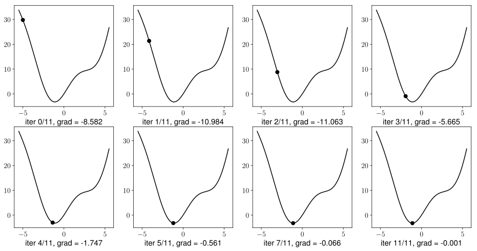
</div>
<div align=center>Hình 12.2: Kết quả tìm được qua các vòng lặp với $x_0 = -5, \eta = 0.1$</div>

<div align=center>
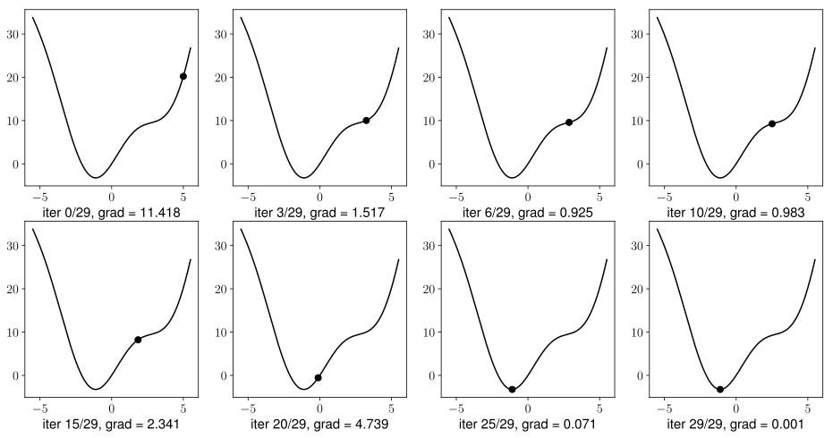
</div>
<div align=center>Hình 12.3: Kết quả tìm được qua các vòng lặp với $x_0 = 5, \eta = 0.1$</div>

Hình 12.2 tương ứng với $x_{0} = -5$, thuật toán hội tụ nhanh hơn. Hơn nữa, đường đi tới đích khá suôn sẻ với đạo hàm luôn âm và trị tuyệt đối của đạo hàm nhỏ dần khi $x_t$ tiến gần tới đích.

Hình 12.3 tương ứng với $x_{0} = 5$, đường đi của $x_t$ chứa một khu vực có đạo hàm khá nhỏ gần điểm có hoành độ bằng 2.5. Điều này khiến thuật toán la cà ở đây khá lâu. Khi vượt qua được điểm này thì mọi việc diễn ra tốt đẹp. Các điểm không phải là điểm cực tiểu nhưng có đạo hàm gần bằng không rất dễ gây ra hiện tượng $x_t$ bị *bẫy* vì đạo hàm nhỏ khiến nó không thay đổi nhiều ở vòng lặp tiếp theo. Chúng ta sẽ thấy một kỹ thuật khác giúp thuật toán *thoát* những chiếc bẫy này.

#### Tốc độ học khác nhau

<div align=center>
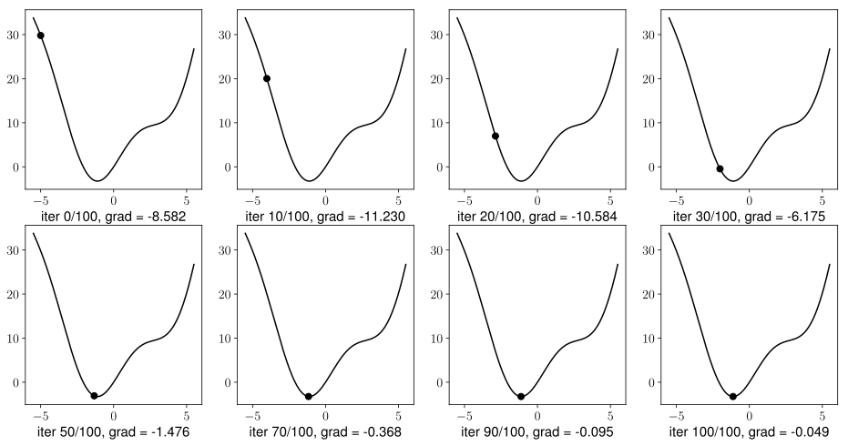
</div>
<div align=center>Hình 12.4: Kết quả tìm được qua các vòng lặp với $x_0 = -5$, $\eta = 0.01$.</div>

<div align=center>
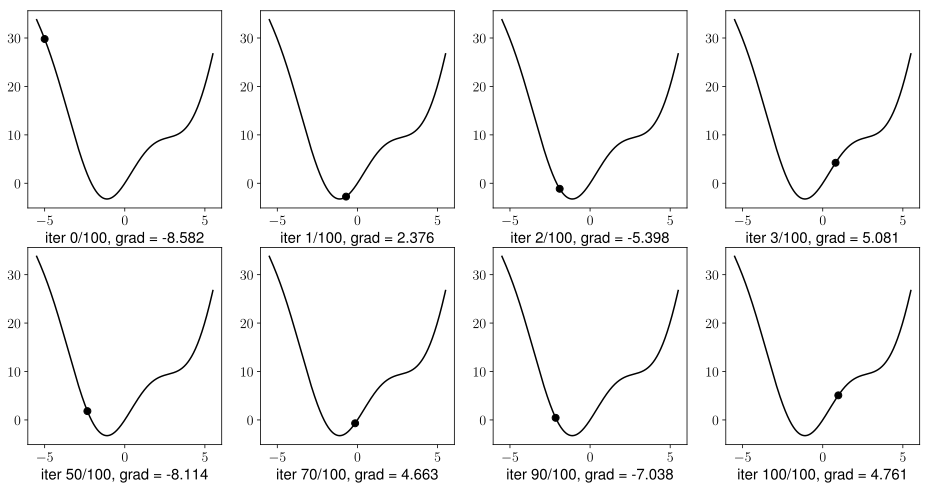
</div>
<div align=center>Hình 12.5: Kết quả tìm được qua các vòng lặp với $x_0 = -5, \eta = 0.5$</div>

Tốc độ hội tụ của GD không những phụ thuộc vào điểm xuất phát mà còn phụ thuộc vào tốc độ học. Hình 12.4 và Hình 12.5 thể hiện vị trí của $x_t$ qua các vòng lặp với cùng điểm xuất phát $x_{0} = -5$ nhưng tốc độ học khác nhau. Ta quan sát thấy hai điều:

- Với tốc độ học nhỏ $\eta = 0.01$ (Hình 12.4), tốc độ hội tụ rất chậm. Trong ví dụ này ta chọn tối đa 100 vòng lặp nên thuật toán dừng lại trước khi tới đích, mặc dù đã rất gần. Trong thực tế, khi việc tính toán trở nên phức tạp, tốc độ học quá thấp sẽ ảnh hưởng nhiều tới tốc độ của thuật toán. Thậm chí $x_t$ có thể không bao giờ tới được đích.

- Với tốc độ học lớn $\eta = 0.5$ (Hình 12.5), $x_t$ tiến nhanh tới gần đích sau vài vòng lặp. Tuy nhiên, thuật toán không hội tụ được vì sự thay đổi vị trí của $x_t$ sau mỗi vòng lặp là quá lớn, khiến $x_t$ dao động quanh đích nhưng không tới được đích.

Việc lựa chọn tốc độ học rất quan trọng. Tốc độ học thường được chọn thông qua các thí nghiệm. Ngoài ra, GD có thể làm việc hiệu quả hơn bằng cách chọn tốc độ học khác nhau ở mỗi vòng lặp. Trên thực tế, một kỹ thuật thường được sử dụng có tên là *suy giảm tốc độ học* (*learning rate decay*). Trong kỹ thuật này, tốc độ học được giảm đi sau một vài vòng lặp để nghiệm không bị dao động mạnh khi gần đích hơn.

## 12.3 Gradient descent cho hàm nhiều biến

Giả sử ta cần tìm cực tiểu toàn cục cho hàm $f(\mathbf{\theta})$ trong đó $\mathbf{\theta}$ là tập hợp các tham số cần tối ưu. Gradient<sup>3</sup> của hàm số đó tại một điểm $\theta$ bất kỳ được ký hiệu là $\nabla_{\theta}f(\theta)$. Tương tự như hàm một biến, thuật toán GD cho hàm nhiều biến cũng bắt đầu bằng một điểm dự đoán $\theta_{0}$, sau đó sử dụng quy tắc cập nhật

$$
\boxed{
\theta_{t+1} = \theta_{t} - \eta \nabla_{\theta} f(\theta_{t})
} \tag{12.4}
$$

Hoặc viết dưới dạng đơn giản hơn: $\theta \leftarrow \theta - \eta \nabla_{\theta} f(\theta)$.

#### Quay lại với bài toán hồi quy tuyến tính

Trong mục này, chúng ta quay lại với bài toán hồi quy tuyến tính và thử tối ưu hàm mất mát của nó bằng thuật toán GD.

Nhắc lại hàm mất mát của hồi quy tuyến tính và gradient theo $\mathbf{w}$:

$$
\mathcal{L}(\mathbf{w}) = \frac{1}{2N}\|\mathbf{y} - \mathbf{X}^T\mathbf{w}\|_2^2; \quad \nabla_{\mathbf{w}}\mathcal{L}(\mathbf{w}) =
\frac{1}{N}\mathbf{X}(\mathbf{X}^T\mathbf{w} - \mathbf{y}) \tag{12.5}
$$

#### Ví dụ trên Python và một vài lưu ý khi lập trình

Trước tiên, chúng ta tạo 1000 điểm dữ liệu gần đường thẳng $y = 4 + 3x$ rồi dùng thư viện scikit-learn để tìm nghiệm cho hồi quy tuyến tính:

```python
from sklearn.linear_model import LinearRegression
X = np.random.rand(1000, 1)
y = 4 + 3 * X + .5*np.random.randn(1000, 1) # noise added
model = LinearRegression()
model.fit(X.reshape(-1, 1), y.reshape(-1, 1))
w, b = model.coef_[0][0], model.intercept_[0]
sol_sklearn = np.array([b, w])
print(sol_sklearn)
```

Kết quả:

```text
Solution found by sklearn: [ 3.94323245  3.12067542]
```

<div align=center>
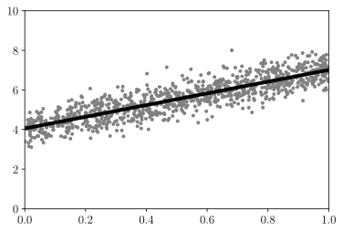
</div>
<div align=center>Hình 12.6: Nghiệm của bài toán hồi quy tuyến tính (đường thằng màu đen) tìm được bằng thư viện scikit-learn.</div>

Các điểm dữ liệu và đường thẳng tìm được bằng hồi quy tuyến tính có phương trình $y \approx 3.94 + 3.12x$ được minh hoạ trong Hình 12.6. Nghiệm tìm này được rất gần với mong đợi.

Tiếp theo, ta sẽ thực hiện tìm nghiệm bằng GD. Ta cần viết hàm mất mát và gradient theo $\mathbf{w}$. Chú ý rằng ở đây $\mathbf{w}$ đã bao gồm hệ số điều chỉnh $b$.

```python
def grad(w):
    N = Xbar.shape[0]
    return 1/N * Xbar.T.dot(Xbar.dot(w) - y)

def cost(w):
    N = Xbar.shape[0]
    return .5/N*np.linalg.norm(y - Xbar.dot(w))**2
```

Với các hàm phức tạp, chúng ta cần kiểm tra độ chính xác của gradient thông qua numerical gradient (xem Mục 2.6 (chương [2](math/ch02_vi), *Giải tích ma trận*)). Phần kiểm tra này xin giành lại cho bạn đọc. Dưới đây là thuật toán GD cho bài toán.

```python
def myGD(w_init, grad, eta):
    w = [w_init]
    for it in range(100):
        w_new = w[-1] - eta*grad(w[-1])
        if np.linalg.norm(grad(w_new))/len(w_new) < 1e-3:
            break
        w.append(w_new)
    return w, it

one = np.ones((X.shape[0],1))
Xbar = np.concatenate((one, X.reshape(-1, 1)), axis = 1)
w_init = np.array([[2], [1]])
w1, it1 = myGD(w_init, grad, 1)
print('Sol found by GD: w = ', w1[-1].T, ', after %d iterations.' %(it1+1))
```

*Kết quả:*

```text
Sol found by GD: w =  [ 3.99026984  2.98702942] , after 49 iterations.
```

Thuật toán hội tụ tới kết quả khá gần với nghiệm tìm được theo scikit-learn sau 49 vòng lặp. Hình 12.7 mô tả đường đi của $\mathbf{w}$ với cùng điểm xuất phát nhưng tốc độ học khác nhau. Các điểm được đánh dấu ‘start’ là các điểm xuất phát. Các điểm được đánh dấu ‘destination’ là nghiệm tìm được bằng thư viện scikit-learn. Các điểm hình tròn nhỏ màu đen là vị trí của $\mathbf{w}$ qua các vòng lặp trung gian. Ta thấy rằng khi $\eta = 1$, thuật toán hội tụ tới rất gần đích theo thư viện sau 49 vòng lặp. Với tốc độ học nhỏ hơn, $\eta = 0.1$, nghiệm vẫn còn cách xa đích sau hơn 100 vòng lặp. Như vậy, việc chọn tốc độ học hợp lý là rất quan trọng.

<div align=center class="ml-fig">
<span class="ml-subfig">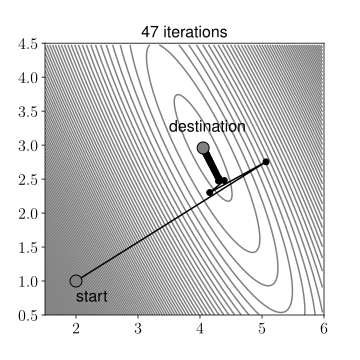<br><small>(a) $\eta = 1$.</small></span><span class="ml-subfig">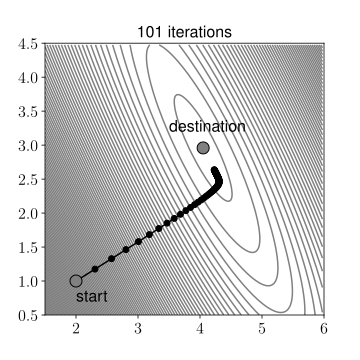<br><small>(b) $\eta = 0.1$.</small></span>
</div>
<div align=center>Hình 12.7: Đường đi nghiệm của hồi quy tuyến tính với các tốc độ học khác nhau.</div>

Ở đây, chúng ta cùng làm quen với một khái niệm quan trọng: *đường đồng mức*. Khái niệm này thường xuất hiện trong các bản đồ tự nhiên. Với các ngọn núi, đường đồng mức là các đường kín bao quanh đỉnh núi, bao gồm các điểm có cùng độ cao so với mực nước biển. Khái niệm tương tự cũng được sử dụng trong tối ưu. Đường đồng mức của một hàm số là tập hợp các điểm làm cho hàm số có cùng giá trị. Xét một hàm số hai biến với đồ thị là một bề mặt trong không gian ba chiều. Các đường đồng mức là giao điểm của bề mặt này với các mặt phẳng song song với đáy. Hàm mất mát của hồi quy tuyến tính với dữ liệu một chiều là một hàm bậc hai theo hai thành phần trong vector trọng số $\mathbf{w}$. Đồ thị của nó là một bề mặt parabolic. Vì vậy, các đường đồng mức của hàm này là các đường ellipse có cùng tâm như trên Hình 12.7. Tâm này chính là đáy của parabolic và là giá trị nhỏ nhất của hàm mất mát. Các đường đồng mức càng gần tâm (’destination’) tương ứng với giá trị càng thấp.

## 12.4 Gradient descent với momentum

Trước hết, nhắc lại thuật toán GD để tối ưu một hàm mất mát $J(\theta)$:

- Dự đoán một điểm xuất phát $\theta = \theta_0$.

- Cập nhật $\theta$ theo công thức

  $$
  \theta \leftarrow \theta - \eta \nabla_{\theta}J(\theta) \tag{12.6}
  $$

  tới khi hội tụ. Ở đây, $\nabla_{\theta}J(\theta)$ là gradient của hàm mất mát tại $\theta$.

#### Gradient dưới góc nhìn vật lý 

Thuật toán GD thường được ví với tác dụng của trọng lực lên một hòn bi đặt trên một mặt có dạng thung lũng như Hình 12.8a. Bất kể ta đặt hòn bi ở A hay B thì cuối cùng nó cũng sẽ lăn xuống và kết thúc ở vị trí C.

<div align=center>
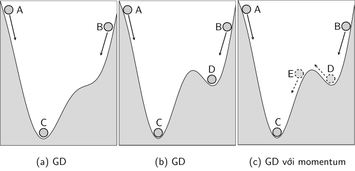
</div>
<div align=center>Hình 12.8: So sánh GD với các hiện tượng vật lý.</div>

Tuy nhiên, nếu bề mặt có hai đáy thung lũng như Hình 12.8b thì tùy vào việc đặt bi ở A hoặc B, vị trí cuối cùng tương ứng của bi sẽ ở C hoặc D (giả sử rằng ma sát đủ lớn và đà không mạnh để bi có thể vượt dốc). Điểm D là một điểm cực tiểu địa phương, điểm C là điểm cực tiểu toàn cục.

Vẫn trong Hình 12.8b, nếu vận tốc ban đầu của bi ở điểm B đủ lớn, nó vẫn có thể tiến tới dốc bên trái của D do có *đà*. Nếu vận tốc ban đầu lớn hơn nữa, bi có thể vượt dốc tới điểm E rồi lăn xuống C như trong Hình 12.8c. Dựa trên quan sát này, một thuật toán được ra đời nhằm giúp GD thoát được các cực tiểu địa phương. Thuật toán đó có tên là *momentum* (tức *theo đà*).

#### Gradient descent với momentum

Làm thế nào để biểu diễn *momentum* dưới dạng toán học?

Trong GD, ta cần tính lượng thay đổi ở thời điểm $t$ để cập nhật vị trí mới cho nghiệm (tức *hòn bi*). Nếu ta coi đại lượng này như vận tốc $v_t$ trong vật lý, vị trí mới của *hòn bi* sẽ là $\theta_{t+1} = \theta_{t} - v_t$ với giả sử rằng mỗi vòng lặp là một đơn vị thời gian. Dấu trừ thể hiện việc phải di chuyển ngược với gradient. Việc tiếp theo là tính đại lượng $v_t$ sao cho nó vừa mang thông tin của *độ dốc* hiện tại (tức gradient), vừa mang thông tin của *đà*. Thông tin của đà có thể được hiểu là vận tốc trước đó $v_{t-1}$ (với giả sử rằng vận tốc ban đầu $v_0=0$). Một cách đơn giản nhất, ta có thể lấy tổng trọng số của chúng:

$$
\boxed{v_{t}= \gamma v_{t-1} + \eta \nabla_{\theta}J(\theta)} \tag{12.7}
$$

Trong đó $\gamma$ là một số dương nhỏ hơn một. Giá trị thường được chọn là khoảng 0.9, $v_{t-1}$ là vận tốc tại thời điểm trước đó, $\nabla_{\theta}J(\theta)$ chính là độ dốc tại điểm hiện tại. Từ đó, ta có công thức cập nhật nghiệm:

$$
\boxed{\theta \leftarrow \theta - v_t = \theta  - \eta \nabla_{\theta}J(\theta)- \gamma
v_{t-1}} \tag{12.8}
$$

Sự khác nhau giữa GD thông thường và GD với momentem nằm ở thành phần cuối cùng trong (12.8). Thuật toán đơn giản này mang lại hiệu quả trong các bài toán thực tế.

Xét một hàm đơn giản có hai điểm cực tiểu địa phương, trong đó một điểm là cực tiểu toàn cục:

$$
f(x) = x^2 + 10\sin(x). \tag{12.9}
$$

Hàm số này có đạo hàm là $f'(x) = 2x + 10\cos(x)$. Hình 12.9 thể hiện các vị trí trung gian của nghiệm khi không sử dụng momentum. Ta thấy rằng thuật toán hội tụ nhanh chóng sau chỉ bốn vòng lặp. Tuy nhiên, nghiệm đạt được không phải là cực tiểu toàn cục. Trong khi đó, Hình 12.10 thể hiện các vị trí trung gian của nghiệm khi có sử dụng momentum. Chúng ta thấy rằng *hòn bi* vượt được dốc thứ nhất nhờ có *đà*, theo quán tính tiếp tục vượt qua điểm cực tiểu toàn cục, nhưng trở lại điểm này sau 50 vòng lặp rồi chuyển động chậm dần quanh đó tới khi dừng hẳn ở vòng lặp thứ 100. Ví dụ này cho thấy momentum thực sự đã giúp nghiệm thoát được khu vực cực tiểu địa phương.

<div align=center>
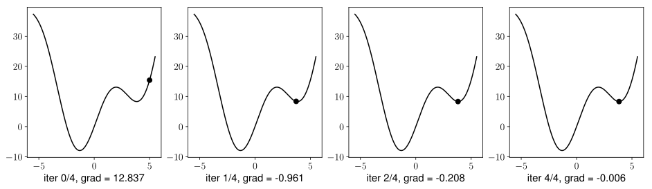
</div>
<div align=center>Hình 12.9: GD thông thường</div>

<div align=center>
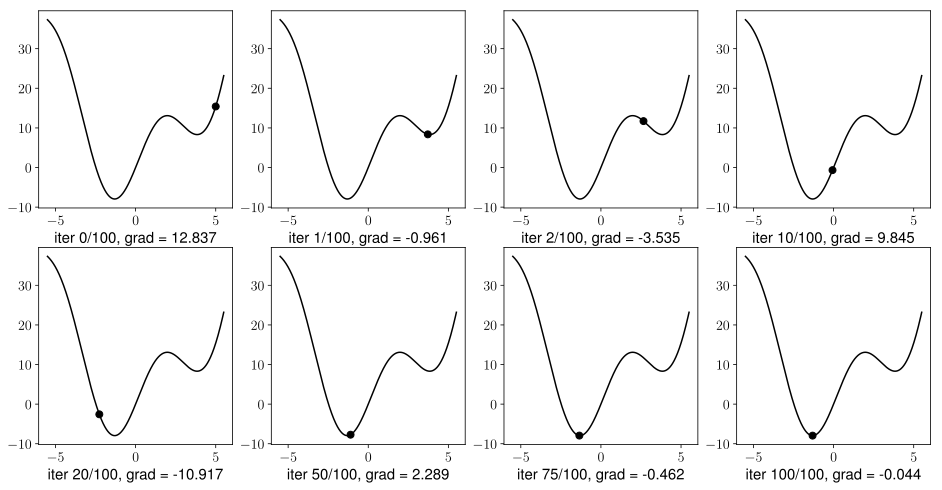
</div>
<div align=center>Hình 12.10: GD với momentum</div>

Nếu biết trước điểm xuất phát `theta`, gradient của hàm mất mát tại một điểm bất kỳ `grad(theta)`, lượng thông tin lưu trữ từ vận tốc trước đó `gamma` và tốc độ học `eta`, chúng ta có thể viết hàm `GD_momentum` như sau:

```python
def GD_momentum(grad, theta_init, eta, gamma):
    # Suppose we want to store history of theta
    theta = [theta_init]
    v_old = np.zeros_like(theta_init)
    for it in range(100):
        v_new = gamma*v_old + eta*grad(theta[-1])
        theta_new = theta[-1] - v_new
        if np.linalg.norm(grad(theta_new))/np.array(theta_init).size < 1e-3:
            break
        theta.append(theta_new)
        v_old = v_new
    return theta
```

## 12.5 Nesterov accelerated gradient

Momentum giúp nghiệm vượt qua được khu vực cực tiểu địa phương. Tuy nhiên, có một hạn chế có thể thấy trong ví dụ trên. Khi tới gần đích, momemtum khiến nghiệm dao động một khoảng thời gian nữa trước khi hội tụ. Một kỹ thuật có tên *Nesterov accelerated gradient* (NAG)  giúp cho thuật toán momentum GD hội tụ nhanh hơn.

Ý tưởng trung tâm của thuật toán là dự đoán vị trí của nghiệm trước một bước. Cụ thể, nếu sử dụng số hạng momentum $\gamma v_{t-1}$ để cập nhật thì vị trí tiếp theo của nghiệm là $\theta - \gamma v_{t-1}$. Vậy, thay vì sử dụng gradient tại điểm hiện tại, NAG sử dụng gradient tại điểm tiếp theo *nếu sử dụng momentum*. Ý tưởng này được thể hiện trên Hình 12.11.

<div align=center>

</div>
<div align=center>Hình 12.11: Ý tưởng của Nesterov accelerated gradient</div>

### 12.5.1 Công thức cập nhật

Công thức cập nhật của NAG được cho như sau:

$$
\begin{align*}
v_{t} &= \gamma v_{t-1} + \eta \nabla_{\theta}J(\theta - \gamma v_{t-1}) \tag{12.10} \\
\theta &\leftarrow \theta -  v_{t} \tag{12.11}
\end{align*}
$$

Đoạn code dưới đây thể hiện cách cập nhật nghiệm bằng NAG:

```python
def GD_NAG(grad, theta_init, eta, gamma):
    theta = [theta_init]
    v = [np.zeros_like(theta_init)]
    for it in range(100):
        v_new = gamma*v[-1] + eta*grad(theta[-1] - gamma*v[-1])
        theta_new = theta[-1] - v_new
        if np.linalg.norm(grad(theta_new))/np.array(theta_init).size < 1e-3:
            break
        theta.append(theta_new)
        v.append(v_new)
return theta
```

### 12.5.2 Ví dụ minh họa 

<div align=center class="ml-fig">
<span class="ml-subfig">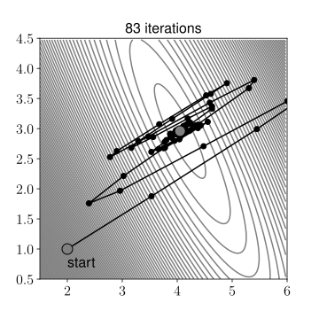<br><small>(a) GD với momentum.</small></span><span class="ml-subfig">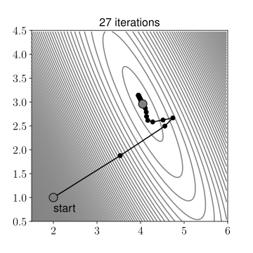<br><small>(b) GD với NAG.</small></span>
</div>
<div align=center>Hình 12.12: Đường đi của nghiệm cho bài toán hồi quy tuyến tính với hai phương pháp gradient descent khác nhau. NAG cho nghiệm mượt hơn và nhanh hơn.</div>

Chúng ta cùng áp dụng cả GD với momentum và GD với NAG cho bài toán hồi quy tuyến tính. Hình 12.12(a) thể hiện đường đi của nghiệm với phương pháp momentum. Nghiệm đi khá *zigzag* và mất nhiều vòng lặp hơn. Hình 12.12(b) thể hiện đường đi của nghiệm với phương pháp NAG, nghiệm hội tụ nhanh hơn và đường đi ít *zigzag* hơn.

## 12.6 Stochastic gradient descent

### 12.6.1 Batch gradient descent 

Thuật toán GD được đề cập từ đầu chương còn được gọi là *batch gradient desenct*. Batch ở đây được hiểu là *tất cả*, tức sử dụng tất cả các điểm dữ liệu $\mathbf{x}_i$ để cập nhật bộ tham số $\theta$. Hạn chế của việc này là khi lượng cơ sở dữ liệu lớn, việc tính toán gradient trên toàn bộ dữ liệu tại mỗi vòng lặp tốn nhiều thời gian.

*Online learning* là khi cơ sở dữ liệu được cập nhật liên tục, mỗi lần tăng thêm vài điểm dữ liệu mới. Việc này yêu cầu mô hình cũng phải được thay đổi để phù hợp với dữ liệu mới. Nếu thực hiện batch GD, tức tính lại gradient của hàm mất mát với toàn bộ dữ liệu, độ phức tạp tính toán sẽ rất cao. Lúc đó, thuật toán có thể không còn mang tính *online* nữa do mất quá nhiều thời gian tính toán.

Một kỹ thuật đơn giản hơn được sử dụng là *stochastic gradient descent* (SGD). Thuật toán này có thể gây ra sai số nhưng mang lại lợi ích về mặt tính toán.

### 12.6.2 Stochastic gradient descent

Trong SGD, tại một thời điểm, ta tính gradient của hàm mất mát dựa trên *chỉ một* điểm dữ liệu $\mathbf{x}_i$ rồi cập nhật $\theta$. Chú ý rằng hàm mất mát thường được lấy trung bình trên tất điểm dữ liệu nên gradient tương ứng với một điểm được kỳ vọng là khá gần với gradient tính theo mọi điểm dữ liệu. Sau khi duyệt qua tất cả các điểm dữ liệu, thuật toán lặp lại quá trình trên. Biến thể đơn giản này trên thực tế làm việc rất hiệu quả.

#### epoch

Mỗi lần duyệt một lượt qua tất cả các điểm trên toàn bộ dữ liệu được gọi là một *epoch*. Với GD thông thường, mỗi epoch ứng với một lần cập nhật $\theta$. Với SGD, mỗi epoch ứng với $N$ lần cập nhật $\theta$ với $N$ là số điểm dữ liệu. Một mặt, việc cập nhật $\theta$ theo từng điểm có thể làm giảm tốc độ thực hiện một epoch. Nhưng mặt khác, với SGD, nghiệm có thể hội tụ sau vài epoch. Vì vậy, SGD phù hợp với các bài toán có lượng cơ sở dữ liệu lớn và các bài toán yêu cầu mô hình thay đổi liên tục như *học trực tuyến*<sup>4</sup>. Với một mô hình đã được huấn luyện từ trước, khi có thêm dữ liệu, ta có thể chạy thêm một vài epoch nữa là đã có nghiệm hội tụ.

> Mỗi lần cập nhật nghiệm là một vòng lặp. Mỗi lần duyệt hết toàn bộ dữ liệu là một *epoch*. Một *epoch* bao gồm nhiều vòng lặp.

#### Thứ tự lựa chọn điểm dữ liệu

Một điểm cần lưu ý là sau mỗi epoch, thứ tự lấy các dữ liệu cần được xáo trộn để đảm bảo tính ngẫu nhiên. Việc này cũng ảnh hưởng tới hiệu năng của SGD. Đây cũng chính là lý do thuật toán này có chứa từ *stochastic*<sup>5</sup>.

Quy tắc cập nhật của SGD là

$$
\theta \leftarrow \theta - \eta \nabla_{\theta} J(\theta; \mathbf{x}_i, \mathbf{y}_i) \tag{12.12}
$$

Trong đó $J(\theta; \mathbf{x}_i, \mathbf{y}_i) \triangleq J_i(\theta)$ là hàm mất mát nếu chỉ có một cặp dữ liệu thứ $i$. Các kỹ thuật biến thể của GD như momentum hay NAG hoàn toàn có thể được áp dụng vào SGD.

### 12.6.3 Mini-batch gradient descent

Khác với SGD, mini-batch GD sử dụng $1 < k < N$ điểm dữ liệu để cập nhật ở mỗi vòng lặp. Giống với SGD, mini-batch GD bắt đầu mỗi epoch bằng việc xáo trộn ngẫu nhiên dữ liệu rồi chia toàn bộ dữ liệu thành các mini-batch, mỗi mini-batch có $k$ điểm dữ liệu (trừ mini-batch cuối có thể có ít hơn nếu $N$ không chia hết cho $k$). Ở mỗi vòng lặp, một mini-batch được lấy ra để tính toán gradient rồi cập nhật $\theta$. Khi thuật toán chạy hết dữ liệu một lượt cũng là khi kết thúc một epoch. Như vậy, một epoch bao gồm xấp xỉ $N/k$ vòng lặp. Giá trị $k$ được gọi là *kích thước batch* (không phải *kích thước mini-batch*) được chọn trong khoảng khoảng từ vài chục đến vài trăm.

Hình 12.13 là ví dụ về giá trị của hàm mất mát của một mô hình phức tạp hơn khi sử dụng mini-batch GD. Mặc dù giá trị của hàm mất mát sau các vòng lặp không luôn luôn giảm, nhìn chung giá trị này có xu hướng giảm và hội tụ.

<div align=center>
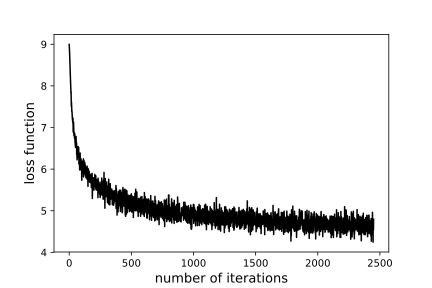
</div>
<div align=center>Hình 12.13: Ví dụ về giá trị hàm mất mát sau mỗi vòng lặp khi sử dụng mini-batch gradient descent. Hàm mất mát dao động sau mỗi lần cập nhật nhưng nhìn chung giảm dần và có xu hướng hội tụ.</div>

## 12.7 Thảo luận

### 12.7.1 Điều kiện dừng thuật toán

Khi nào thì nên dừng thuật toán GD?

Trong thực nghiệm, chúng ta có thể kết hợp các phương pháp sau:

1.  Giới hạn số vòng lặp. Nhược điểm của cách làm này là thuật toán có thể dừng lại trước khi nghiệm đủ tốt. Tuy nhiên, đây là phương pháp phổ biến nhất và cũng đảm bảo được chương trình chạy không quá lâu.

2.  So sánh gradient của hàm mất mát tại hai lần cập nhật liên tiếp, khi nào giá trị này đủ nhỏ thì dừng lại.

3.  So sánh giá trị của hàm mất mát sau một vài epoch, khi nào sự sai khác đủ nhỏ thì dừng lại. Nhược điểm của phương pháp này là nếu hàm mất mát có dạng bằng phẳng tại một điểm không phải cực tiểu địa phương, thuật toán sẽ dừng lại trước khi đạt giá trị mong muốn.

4.  Vừa chạy GD, vừa kiểm tra kết quả. Một kỹ thuật khác thường được sử dụng là cho thuật toán chạy với số lượng vòng lặp lớn. Trong quá trình chạy, chương trình thường xuyên kiểm tra chất lượng mô hình trên tập huấn luyện và tập xác thực. Đồng thời, mô hình sau một vài vòng lặp được lưu lại trong bộ nhớ. Nếu ta thấy chất lượng mô hình bắt đầu giảm trên tập xác thực thì dừng lại. Đây chính là kỹ thuật *early stoping* đã đề cập trong Chương [8](ml/ch08_vi) (*Quá khớp*).

### 12.7.2 Đọc thêm

Mã nguồn trong chương này có thể được tìm thấy tại <https://goo.gl/RJrRv7>.

Ngoài các thuật toán đã đề cập trong chương này, có nhiều thuật toán khác giúp cải thiện GD được đề xuất gần đây . Bạn đọc có thể tham khảo thêm AdaGrad , RMSProp , Adam ,...

Các trang web và video dưới đây cũng là các tài liệu tốt về GD.

1.  *An overview of gradient descent optimization algorithms* (<https://goo.gl/AGwbbg>).

2.  *Stochastic Gradient descent – Wikipedia* (<https://goo.gl/pmuLzk>).

3.  *Stochastic gradient descent – Andrew Ng* (<https://goo.gl/jgBf2N>).

4.  *An Interactive Tutorial on Numerical Optimization* (<https://goo.gl/t85mvA>).

5.  *Machine Learning cơ bản, Bài 7, 8* (<https://goo.gl/US17PP>).

---

**Chú thích**

1. *Descent* nghĩa là *đi ngược*
2. Giả sử rằng các thư viện đã được khai báo đầy đủ
3. Với các biến nhiều chiều, chúng ta sẽ sử dụng *gradient* thay cho *đạo hàm*.
4. *online learning*
5. *ngẫu nhiên*
