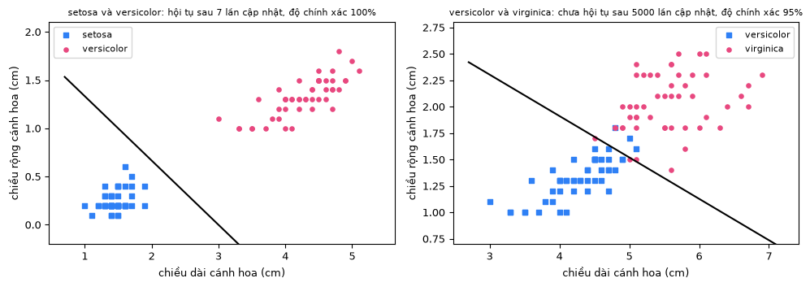

# Chương 13 · Ví dụ áp dụng: perceptron trên dữ liệu thật

> Ghi chú của người biên soạn: trang này do người biên soạn viết thêm, không có trong sách gốc. Dữ liệu là bộ hoa *Iris* (Fisher, 1936) và bộ *Breast Cancer Wisconsin* (UCI), cả hai có sẵn trong scikit-learn.

## Bài toán

Perceptron là bộ phân loại **nhị phân**. Ta thử nó trên ba bài toán thật, xếp từ dễ đến khó:

1. Hoa *setosa* với hoa *versicolor*: hai loài khác hẳn nhau.
2. Hoa *versicolor* với hoa *virginica*: hai loài khá giống nhau.
3. Phân biệt khối u lành tính với ác tính từ 30 chỉ số đo trên ảnh tế bào.

## 1. Setosa và versicolor: tách biệt tuyến tính

<!-- run -->
```python
import numpy as np
import matplotlib.pyplot as plt
from sklearn.datasets import load_iris
from sklearn.linear_model import Perceptron

iris = load_iris()
X, t = iris.data[:, [2, 3]], iris.target            # chỉ dùng chiều dài và chiều rộng cánh hoa để vẽ được
names = iris.target_names

def run_pla(X, y, rng, max_updates=5000):
    """PLA của Thuật toán 13.1 trên dữ liệu đã thêm cột 1. Trả về w và số lần cập nhật (None nếu chưa hội tụ)."""
    Xbar = np.c_[np.ones(len(X)), X]; w = np.zeros(3)
    for k in range(max_updates):
        mis = np.where(np.sign(Xbar @ w) != y)[0]
        if len(mis) == 0:
            return w, k
        i = rng.choice(mis); w += y[i] * Xbar[i]
    return w, None

fig, axes = plt.subplots(1, 2, figsize=(10, 3.6))
for ax, (a, b) in zip(axes, [(0, 1), (1, 2)]):
    m = (t == a) | (t == b); Xm, ym = X[m], np.where(t[m] == a, 1.0, -1.0)
    w, k = run_pla(Xm, ym, np.random.default_rng(0))
    acc = np.mean(np.sign(np.c_[np.ones(len(Xm)), Xm] @ w) == ym)
    ax.scatter(*Xm[ym > 0].T, marker="s", c="#2f80f5", s=14, label=names[a])
    ax.scatter(*Xm[ym < 0].T, c="#e8487f", s=14, label=names[b])
    xs = np.linspace(Xm[:, 0].min() - .3, Xm[:, 0].max() + .3, 2); ax.plot(xs, -(w[0] + w[1] * xs) / w[2], "k", lw=1.5)
    ax.set_ylim(Xm[:, 1].min() - .3, Xm[:, 1].max() + .3); ax.set_xlabel("chiều dài cánh hoa (cm)"); ax.set_ylabel("chiều rộng cánh hoa (cm)"); ax.legend(fontsize=8)
    status = f"hội tụ sau {k} lần cập nhật" if k is not None else "chưa hội tụ sau 5000 lần cập nhật"
    ax.set_title(f"{names[a]} và {names[b]}: {status}, độ chính xác {acc:.0%}", fontsize=8)
    print(f"{names[a]} và {names[b]}: {status}; độ chính xác trên tập huấn luyện của w cuối = {acc:.3f}")
fig.tight_layout()
```

<!-- output -->
```output
setosa và versicolor: hội tụ sau 7 lần cập nhật; độ chính xác trên tập huấn luyện của w cuối = 1.000
versicolor và virginica: chưa hội tụ sau 5000 lần cập nhật; độ chính xác trên tập huấn luyện của w cuối = 0.950
```

<div align=center></div>
<!-- /output -->

Hai cặp loài cho hai kết quả trái ngược. Setosa tách hẳn khỏi versicolor, nên PLA hội tụ sau vài lần cập nhật. Versicolor và virginica chồng lên nhau một chút, nên PLA chạy hết 5000 lần cập nhật mà không dừng. $\mathbf{w}$ lúc bị dừng ép vẫn đúng 95% trên tập huấn luyện, nhưng đó là nhờ may mắn ở thời điểm dừng.

## 2. Versicolor và virginica: không tách biệt tuyến tính

Với cặp loài thứ hai, PLA không dừng, và vector $\mathbf{w}$ tại thời điểm bị dừng ép có thể khá tệ. Ta so sánh `Perceptron` của thư viện (có và không có kết thúc sớm) với hồi quy logistic, dùng **cả 4 đặc trưng** và xác thực chéo:

<!-- run -->
```python
from sklearn.model_selection import cross_val_score, StratifiedKFold
from sklearn.pipeline import make_pipeline
from sklearn.preprocessing import StandardScaler
from sklearn.linear_model import LogisticRegression

m = t > 0
X4, y4 = iris.data[m], t[m]
cv = StratifiedKFold(5, shuffle=True, random_state=0)
models = {"Perceptron": Perceptron(random_state=0),
          "Perceptron, early_stopping": Perceptron(early_stopping=True, n_iter_no_change=10, random_state=0),
          "Hồi quy logistic": LogisticRegression(max_iter=1000)}
for name, clf in models.items():
    s = cross_val_score(make_pipeline(StandardScaler(), clf), X4, y4, cv=cv)
    print(f"{name:27s} độ chính xác xác thực chéo {s.mean():.3f}  (từng phần: {s.round(2)})")
```

<!-- output -->
```output
Perceptron                  độ chính xác xác thực chéo 0.950  (từng phần: [0.9  0.95 1.   1.   0.9 ])
Perceptron, early_stopping  độ chính xác xác thực chéo 0.940  (từng phần: [0.9  0.95 1.   0.95 0.9 ])
Hồi quy logistic            độ chính xác xác thực chéo 0.950  (từng phần: [0.9  0.95 1.   1.   0.9 ])
```
<!-- /output -->

Với 4 đặc trưng và dữ liệu đã chuẩn hoá, perceptron ngang hồi quy logistic (95%). Khi hai lớp chỉ chồng lên nhau một chút, một đường phân chia "gần đúng" cũng đủ tốt. Kết thúc sớm không giúp gì ở đây, vì tập xác thực chỉ có 20 điểm.

## 3. Chẩn đoán ung thư vú

Bộ dữ liệu có 569 khối u. Mỗi khối u có 30 đặc trưng tính từ ảnh nhân tế bào: bán kính, kết cấu, chu vi, diện tích, độ trơn và nhiều đặc trưng khác. Nhãn cho biết khối u lành tính hay ác tính.

<!-- run -->
```python
from sklearn.datasets import load_breast_cancer
from sklearn.model_selection import train_test_split

bc = load_breast_cancer()
Xb, yb = bc.data, bc.target                        # 1 = lành tính, 0 = ác tính
Xb_tr, Xb_te, yb_tr, yb_te = train_test_split(Xb, yb, test_size=0.25, random_state=0, stratify=yb)
print("huấn luyện:", Xb_tr.shape, " tỉ lệ lành tính:", yb.mean().round(3))

for scaled in [False, True]:
    clf = make_pipeline(StandardScaler(), Perceptron(random_state=0)) if scaled else Perceptron(random_state=0)
    s = cross_val_score(clf, Xb_tr, yb_tr, cv=cv)
    print(f"Perceptron, {'có' if scaled else 'không'} chuẩn hoá: xác thực chéo {s.mean():.3f} (dao động {s.min():.2f}–{s.max():.2f})")

final = make_pipeline(StandardScaler(), Perceptron(random_state=0)).fit(Xb_tr, yb_tr)
print(f"độ chính xác trên tập kiểm tra: {final.score(Xb_te, yb_te):.3f}")
logit = make_pipeline(StandardScaler(), LogisticRegression(max_iter=1000)).fit(Xb_tr, yb_tr)
print(f"hồi quy logistic, để so sánh: {logit.score(Xb_te, yb_te):.3f}")
```

<!-- output -->
```output
huấn luyện: (426, 30)  tỉ lệ lành tính: 0.627
Perceptron, không chuẩn hoá: xác thực chéo 0.770 (dao động 0.53–0.90)
Perceptron, có chuẩn hoá: xác thực chéo 0.955 (dao động 0.93–0.99)
độ chính xác trên tập kiểm tra: 0.944
hồi quy logistic, để so sánh: 0.958
```
<!-- /output -->

Không chuẩn hoá, perceptron rất thất thường: độ chính xác dao động từ 53% đến 90% giữa các lần chia. Nguyên nhân giống [chương 12](ml/ch12_app_vi): các đặc trưng có thang đo rất khác nhau (diện tích tính bằng hàng trăm, độ trơn nhỏ hơn 1), nên mỗi lần cập nhật $\mathbf{w} \leftarrow \mathbf{w} + y_i\mathbf{x}_i$ gần như chỉ thay đổi theo vài chiều lớn. Chuẩn hoá đưa độ chính xác lên khoảng 95%, gần bằng hồi quy logistic.

## Rút ra được gì

- Perceptron là một bộ phân loại tuyến tính đơn giản, có thể dùng được trên dữ liệu thật, miễn là dữ liệu đã chuẩn hoá và hai lớp gần như tách biệt.
- Khi dữ liệu không tách biệt, bản thân thuật toán không có cơ chế dừng hợp lý. Kết quả phụ thuộc vào thời điểm dừng.
- Hồi quy logistic (chương 14) giữ lại mô hình tuyến tính của perceptron, nhưng thay hàm dấu bằng hàm sigmoid và thay mất mát của perceptron bằng một hàm mất mát trơn. Nhờ vậy bài toán có một nghiệm tốt nhất xác định rõ, kể cả khi dữ liệu không tách biệt.
