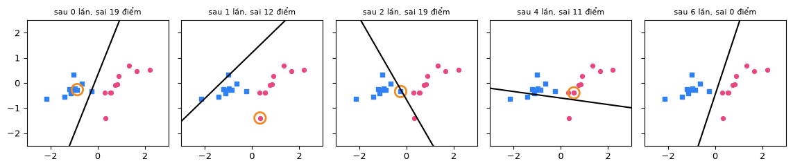
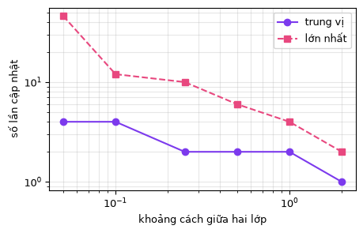
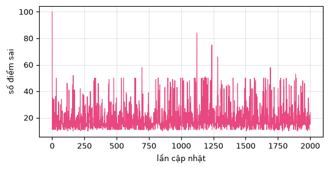
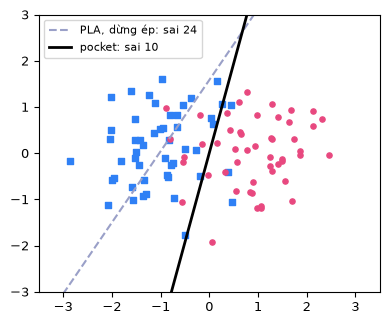

# Chương 13 · Code từ đầu

> Ghi chú của người biên soạn: trang này do người biên soạn viết thêm, không có trong sách gốc. Trang chạy lại thuật toán học perceptron (PLA) ở [mục 13.3](ml/ch13_vi), rồi thêm các thí nghiệm về tốc độ hội tụ, về dữ liệu không tách biệt tuyến tính và thuật toán *pocket*.

## Cách dùng trang này

Các khối chạy lần lượt từ trên xuống và dùng chung biến. Chỉ cần `numpy` và `matplotlib`. Nhãn là $y \in \{-1, +1\}$, và mỗi điểm dữ liệu đã được thêm phần tử $x_0 = 1$ (thủ thuật gộp hệ số điều chỉnh ở [chương 7](ml/ch07_vi)).

## 1. PLA trên dữ liệu của sách

<small class="viz-ref">Mục 13.3 · Thuật toán 13.1 · hình 13.3</small>

<!-- run -->
```python
import numpy as np
import matplotlib.pyplot as plt

def predict(w, Xbar):
    return np.sign(Xbar @ w)

def pla(Xbar, y, w_init, rng, max_updates=10_000):
    """Thuật toán 13.1. Trả về w cuối và lịch sử các lần cập nhật (w, chỉ số điểm được chọn)."""
    w = w_init.astype(float).copy()
    hist = [(w.copy(), None)]
    for _ in range(max_updates):
        mis = np.where(predict(w, Xbar) != y)[0]
        if len(mis) == 0:
            return w, hist
        i = rng.choice(mis)                    # chọn ngẫu nhiên một điểm bị phân loại lỗi
        w = w + y[i] * Xbar[i]                 # quy tắc cập nhật (13.6)
        hist.append((w.copy(), i))
    return w, hist                             # chưa hội tụ sau max_updates lần cập nhật

rng = np.random.default_rng(2)
N = 10
X = np.concatenate([rng.multivariate_normal(m, [[.3, .2], [.2, .3]], N) for m in ([-1, 0], [1, 0])])
y = np.concatenate([np.ones(N), -np.ones(N)])
Xbar = np.c_[np.ones(2 * N), X]

w, hist = pla(Xbar, y, rng.normal(size=3), rng)
print(f"hội tụ sau {len(hist) - 1} lần cập nhật, w = {w.round(3)}, số điểm sai: {np.sum(predict(w, Xbar) != y)}")

def draw_line(ax, w, **kw):
    xs = np.array([-3, 3])
    if abs(w[2]) > 1e-9: ax.plot(xs, -(w[0] + w[1] * xs) / w[2], **kw)
    else: ax.axvline(-w[0] / w[1], **kw)

n = len(hist)
show = sorted(set([0, 1, n // 3, 2 * n // 3, n - 1]))
fig, axes = plt.subplots(1, len(show), figsize=(2.3 * len(show), 2.5), sharey=True)
for ax, t in zip(axes, show):
    wt, _ = hist[t]
    ax.scatter(*X[y > 0].T, marker="s", c="#2f80f5", s=18); ax.scatter(*X[y < 0].T, c="#e8487f", s=18)
    draw_line(ax, wt, color="k", lw=1.5)
    if t + 1 < n:                                   # điểm sẽ được chọn ở lần cập nhật tiếp theo
        i = hist[t + 1][1]; ax.scatter(*X[i], s=140, facecolors="none", edgecolors="#f08a24", linewidths=2)
    ax.set_xlim(-3, 3); ax.set_ylim(-2.5, 2.5)
    ax.set_title(f"sau {t} lần, sai {np.sum(predict(wt, Xbar) != y)} điểm", fontsize=8)
fig.tight_layout()
```

<!-- output -->
```output
hội tụ sau 6 lần cập nhật, w = [ 0.243 -1.515  0.533], số điểm sai: 0
```

<div align=center></div>
<!-- /output -->

Với dữ liệu này, PLA chỉ cần 6 lần cập nhật. Mỗi lần, đường phân chia xoay về phía điểm bị phân loại sai (khoanh tròn màu cam). Đôi khi số điểm sai tạm thời *tăng* lên, đúng như mục 13.2.3 đã lưu ý: một lần cập nhật chỉ đảm bảo cải thiện tại điểm được chọn, không đảm bảo cải thiện trên toàn bộ dữ liệu.

## 2. Hội tụ nhanh hay chậm phụ thuộc vào khoảng cách giữa hai lớp

<small class="viz-ref">Mục 13.2.4</small>

Mục 13.2.4 chứng minh PLA dừng sau hữu hạn bước nếu dữ liệu tách biệt tuyến tính, nhưng không nói là bao nhiêu bước. Định lý Novikoff (1962) cho một chặn trên: số lần cập nhật không quá $(R/\rho)^2$. Trong đó $R$ là độ dài lớn nhất của các $\bar{\mathbf{x}}_i$, còn $\rho$ là **lề** (margin): khoảng cách nhỏ nhất từ các điểm tới một siêu phẳng phân chia tốt nhất. Hai lớp càng gần nhau thì lề càng nhỏ, và PLA càng cần nhiều bước.

<!-- run -->
```python
def two_blobs(gap, n, rng):
    """Hai lớp, mỗi lớp n điểm, tách nhau một khoảng 'gap', bỏ các điểm vượt sang phía bên kia."""
    A = rng.normal(size=(4 * n, 2)) * [0.6, 1.0]
    A = A[np.abs(A[:, 0]) < 1.5][:n]
    X = np.r_[A + [gap / 2 + 1.5, 0], A * [-1, 1] - [gap / 2 + 1.5, 0]]
    return np.c_[np.ones(2 * n), X], np.r_[np.ones(n), -np.ones(n)]

gaps = [2.0, 1.0, 0.5, 0.25, 0.1, 0.05]
med, mx = [], []
for gap in gaps:
    counts = [len(pla(*two_blobs(gap, 50, np.random.default_rng(s)), np.zeros(3), np.random.default_rng(s))[1]) - 1 for s in range(30)]
    med.append(np.median(counts)); mx.append(max(counts))
    print(f"khoảng cách {gap:5}: số lần cập nhật (trung vị 30 lần chạy) = {np.median(counts):6.0f}, lớn nhất = {max(counts)}")
fig, ax = plt.subplots(figsize=(5, 3))
ax.loglog(gaps, med, "o-", color="#7c3aed", label="trung vị"); ax.loglog(gaps, mx, "s--", color="#e8487f", label="lớn nhất")
ax.set_xlabel("khoảng cách giữa hai lớp"); ax.set_ylabel("số lần cập nhật"); ax.legend(); ax.grid(alpha=.3, which="both")
```

<!-- output -->
```output
khoảng cách   2.0: số lần cập nhật (trung vị 30 lần chạy) =      1, lớn nhất = 2
khoảng cách   1.0: số lần cập nhật (trung vị 30 lần chạy) =      2, lớn nhất = 4
khoảng cách   0.5: số lần cập nhật (trung vị 30 lần chạy) =      2, lớn nhất = 6
khoảng cách  0.25: số lần cập nhật (trung vị 30 lần chạy) =      2, lớn nhất = 10
khoảng cách   0.1: số lần cập nhật (trung vị 30 lần chạy) =      4, lớn nhất = 12
khoảng cách  0.05: số lần cập nhật (trung vị 30 lần chạy) =      4, lớn nhất = 46
```

<div align=center></div>
<!-- /output -->

Khi hai lớp xích lại gần nhau, số lần cập nhật tăng lên, nhất là ở những lần chạy xấu nhất. Chặn $(R/\rho)^2$ của Novikoff rất "rộng tay": ở khoảng cách 0.05, chặn này lên tới hàng chục nghìn lần cập nhật, trong khi thực tế chỉ vài chục. Chặn trên chỉ đảm bảo thuật toán dừng, không cho biết nó dừng nhanh đến đâu.

## 3. Dữ liệu không tách biệt tuyến tính: PLA không bao giờ dừng

<small class="viz-ref">Mục 13.5</small>

Chỉ cần một điểm nằm lẫn sang lớp bên kia là không còn đường thẳng nào phân chia đúng hoàn toàn. Vòng lặp của Thuật toán 13.1 không bao giờ dừng, và số điểm bị phân loại sai cứ nhảy lên xuống mãi.

<!-- run -->
```python
rng = np.random.default_rng(0)
X2 = np.concatenate([rng.normal([-1, 0], 0.8, (50, 2)), rng.normal([1, 0], 0.8, (50, 2))])
y2 = np.r_[np.ones(50), -np.ones(50)]
Xbar2 = np.c_[np.ones(100), X2]

w_end, hist2 = pla(Xbar2, y2, np.zeros(3), np.random.default_rng(1), max_updates=2000)
errors = np.array([np.sum(predict(h, Xbar2) != y2) for h, _ in hist2])
print(f"sau {len(hist2) - 1} lần cập nhật vẫn chưa dừng; số điểm sai ở w cuối = {errors[-1]}, nhỏ nhất từng đạt = {errors.min()}")

fig, ax = plt.subplots(figsize=(6, 2.8))
ax.plot(errors, color="#e8487f", lw=.8); ax.set_xlabel("lần cập nhật"); ax.set_ylabel("số điểm sai"); ax.grid(alpha=.3)
```

<!-- output -->
```output
sau 2000 lần cập nhật vẫn chưa dừng; số điểm sai ở w cuối = 24, nhỏ nhất từng đạt = 10
```

<div align=center></div>
<!-- /output -->

Số điểm sai nhảy liên tục giữa khoảng 10 và hơn 40. Nếu dừng ép ở một thời điểm bất kỳ, ta có thể nhận một $\mathbf{w}$ rất tệ: ở đây là 24 điểm sai, trong khi PLA đã từng đạt 10.

## 4. Thuật toán pocket

Cách sửa đơn giản nhất (Gallant, 1990): vẫn chạy PLA, nhưng **giữ trong túi** (pocket) vector $\mathbf{w}$ tốt nhất từng gặp, tức vector có ít điểm sai nhất trên tập huấn luyện. Sau một số bước cố định thì trả về vector trong túi.

<!-- run -->
```python
def pocket(Xbar, y, w_init, rng, max_updates=2000):
    w = w_init.astype(float).copy()
    best_w, best_err = w.copy(), np.sum(predict(w, Xbar) != y)
    for _ in range(max_updates):
        mis = np.where(predict(w, Xbar) != y)[0]
        if len(mis) == 0:
            return w
        i = rng.choice(mis)
        w = w + y[i] * Xbar[i]
        err = np.sum(predict(w, Xbar) != y)
        if err < best_err:
            best_w, best_err = w.copy(), err
    return best_w

w_pocket = pocket(Xbar2, y2, np.zeros(3), np.random.default_rng(1))
fig, ax = plt.subplots(figsize=(4.4, 3.6))
ax.scatter(*X2[y2 > 0].T, marker="s", c="#2f80f5", s=14); ax.scatter(*X2[y2 < 0].T, c="#e8487f", s=14)
draw_line(ax, w_end, color="#9aa0c8", lw=1.5, ls="--", label=f"PLA, dừng ép: sai {np.sum(predict(w_end, Xbar2) != y2)}")
draw_line(ax, w_pocket, color="k", lw=2, label=f"pocket: sai {np.sum(predict(w_pocket, Xbar2) != y2)}")
ax.set_xlim(-3.5, 3.5); ax.set_ylim(-3, 3); ax.legend(fontsize=8)
print("số điểm sai: PLA dừng ép =", np.sum(predict(w_end, Xbar2) != y2), "  pocket =", np.sum(predict(w_pocket, Xbar2) != y2))
```

<!-- output -->
```output
số điểm sai: PLA dừng ép = 24   pocket = 10
```

<div align=center></div>
<!-- /output -->

Pocket trả về vector tốt nhất từng gặp, với 10 điểm sai trên 100 điểm. Cái giá là mỗi lần cập nhật phải đếm lại số điểm sai trên toàn bộ dữ liệu.

## 5. XOR: giới hạn của một perceptron

<small class="viz-ref">Mục 13.5 và 16.1</small>

Bốn điểm $(0,0)$, $(1,1)$ thuộc một lớp, còn $(0,1)$, $(1,0)$ thuộc lớp kia. Không đường thẳng nào tách được hai lớp này. Dù chạy bao lâu, PLA luôn sai ít nhất một điểm. Đây là lý do cần nhiều tầng perceptron (chương 16).

<!-- run -->
```python
Xx = np.array([[0, 0], [1, 1], [0, 1], [1, 0]], float)
yx = np.array([-1, -1, 1, 1], float)
Xxbar = np.c_[np.ones(4), Xx]
_, hx = pla(Xxbar, yx, np.zeros(3), np.random.default_rng(0), max_updates=1000)
errs = [np.sum(predict(h, Xxbar) != yx) for h, _ in hx]
print(f"XOR: sau {len(hx) - 1} lần cập nhật, số điểm sai nhỏ nhất từng đạt = {min(errs)} (trên 4 điểm)")
```

<!-- output -->
```output
XOR: sau 1000 lần cập nhật, số điểm sai nhỏ nhất từng đạt = 1 (trên 4 điểm)
```
<!-- /output -->

Với XOR, mọi đường thẳng đều sai ít nhất một trong bốn điểm, nên PLA không bao giờ dừng. Mục 16.1 cho thấy chỉ cần thêm một tầng ẩn với hai perceptron là biểu diễn được XOR.
