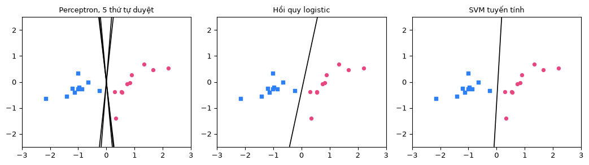

# Chương 13 · Dùng thư viện

> Ghi chú của người biên soạn: trang này do người biên soạn viết thêm, không có trong sách gốc. scikit-learn có sẵn lớp `Perceptron`. Trang so sánh nó với PLA tự viết, rồi đặt perceptron cạnh hai bộ phân loại tuyến tính khác sẽ học ở các chương sau: hồi quy logistic (chương 14) và SVM ([chương 26](ml/ch26_vi)).

## Cách dùng trang này

Các khối chạy lần lượt từ trên xuống và dùng chung biến. Cần `numpy`, `matplotlib`, `scikit-learn`.

`Perceptron` của scikit-learn không chọn ngẫu nhiên một điểm sai như Thuật toán 13.1. Nó duyệt **lần lượt** từng điểm theo một thứ tự xáo trộn ở mỗi epoch, và cập nhật mỗi khi gặp điểm sai. Đây là SGD (chương 12) trên hàm mất mát perceptron $\max(0, -y\,\mathbf{w}^T\mathbf{x})$, với bước học `eta0` (mặc định 1, giống sách).

## 1. `Perceptron` trên dữ liệu tách biệt

<small class="viz-ref">Mục 13.3</small>

<!-- run -->
```python
import numpy as np
import matplotlib.pyplot as plt
from sklearn.linear_model import Perceptron

rng = np.random.default_rng(2)
X = np.concatenate([rng.multivariate_normal(m, [[.3, .2], [.2, .3]], 10) for m in ([-1, 0], [1, 0])])
y = np.r_[np.ones(10), -np.ones(10)]

clf = Perceptron(random_state=0).fit(X, y)
print("w =", clf.coef_.round(3), " b =", clf.intercept_.round(3))
print("số epoch đã chạy:", clf.n_iter_, "  độ chính xác trên tập huấn luyện:", clf.score(X, y))
```

<!-- output -->
```output
w = [[-1.743  0.129]]  b = [0.]
số epoch đã chạy: 7   độ chính xác trên tập huấn luyện: 1.0
```
<!-- /output -->

`coef_` là $\mathbf{w}$ và `intercept_` là hệ số điều chỉnh $b$ (tức $w_0$ của sách). Mặc định, thuật toán dừng khi mất mát không giảm thêm `tol` sau `n_iter_no_change` epoch, hoặc khi đã phân loại đúng hết.

## 2. Ba bộ phân loại tuyến tính trên cùng dữ liệu

Perceptron dừng ở **bất kỳ** đường thẳng nào phân chia được dữ liệu, và đường thẳng đó phụ thuộc vào thứ tự duyệt. Hồi quy logistic và SVM chọn một đường thẳng **cụ thể** theo một tiêu chí: hồi quy logistic theo xác suất (chương 14), SVM theo lề lớn nhất ([chương 26](ml/ch26_vi)).

<!-- run -->
```python
from sklearn.linear_model import LogisticRegression
from sklearn.svm import LinearSVC

fig, axes = plt.subplots(1, 3, figsize=(10.5, 3))
xx, yy = np.meshgrid(np.linspace(-3, 3, 300), np.linspace(-2.5, 2.5, 300))
for ax, (name, make) in zip(axes, [("Perceptron, 5 thứ tự duyệt", None),
                                   ("Hồi quy logistic", lambda: LogisticRegression(C=100)),
                                   ("SVM tuyến tính", lambda: LinearSVC(C=100, max_iter=100_000))]):
    ax.scatter(*X[y > 0].T, marker="s", c="#2f80f5", s=18); ax.scatter(*X[y < 0].T, c="#e8487f", s=18)
    models = [Perceptron(random_state=s).fit(X, y) for s in range(5)] if make is None else [make().fit(X, y)]
    for m in models:
        Z = m.decision_function(np.c_[xx.ravel(), yy.ravel()]).reshape(xx.shape)
        ax.contour(xx, yy, Z, levels=[0], colors="k", linewidths=1.2)
    ax.set_title(name, fontsize=9)
fig.tight_layout()
```

<!-- output -->
<div align=center></div>
<!-- /output -->

Năm lần chạy `Perceptron` (năm thứ tự duyệt khác nhau) cho năm đường phân chia khác nhau, và đường nào cũng phân loại đúng toàn bộ dữ liệu. Hồi quy logistic và SVM cho một đường duy nhất, nằm ở khoảng giữa hai lớp. Đường như vậy thường tổng quát hoá tốt hơn: điểm mới hơi lệch một chút vẫn được phân loại đúng.

## 3. Dữ liệu không tách biệt: `max_iter`, `early_stopping`

<small class="viz-ref">Mục 13.5</small>

Với dữ liệu không tách biệt, PLA thuần tuý chạy mãi. Thư viện dừng sau `max_iter` epoch. Tuỳ chọn `early_stopping=True` giữ lại một phần dữ liệu làm tập xác thực (giống chương 8) và dừng khi điểm trên tập đó không cải thiện. Cách này gần giống ý tưởng của thuật toán pocket.

<!-- run -->
```python
rng = np.random.default_rng(0)
X2 = np.concatenate([rng.normal([-1, 0], 0.8, (50, 2)), rng.normal([1, 0], 0.8, (50, 2))])
y2 = np.r_[np.ones(50), -np.ones(50)]
for kw in [dict(max_iter=5), dict(max_iter=1000, tol=None), dict(early_stopping=True, validation_fraction=0.2, n_iter_no_change=10)]:
    accs = [Perceptron(random_state=s, **kw).fit(X2, y2).score(X2, y2) for s in range(20)]
    print(f"{str(kw):70s} độ chính xác (20 lần chạy): trung bình {np.mean(accs):.3f}, thấp nhất {min(accs):.2f}")
print(f"{'hồi quy logistic, để so sánh':70s} độ chính xác: {LogisticRegression().fit(X2, y2).score(X2, y2):.3f}")
```

<!-- output -->
```output
{'max_iter': 5}                                                        độ chính xác (20 lần chạy): trung bình 0.843, thấp nhất 0.75
{'max_iter': 1000, 'tol': None}                                        độ chính xác (20 lần chạy): trung bình 0.812, thấp nhất 0.50
{'early_stopping': True, 'validation_fraction': 0.2, 'n_iter_no_change': 10} độ chính xác (20 lần chạy): trung bình 0.837, thấp nhất 0.74
hồi quy logistic, để so sánh                                           độ chính xác: 0.860
```
<!-- /output -->

Một kết quả đáng chú ý: chạy **lâu hơn** (1000 epoch) cho độ chính xác trung bình *thấp hơn* chạy 5 epoch, và có lần chỉ đạt 50%. Với dữ liệu không tách biệt, $\mathbf{w}$ cuối cùng của perceptron là một điểm "ngẫu nhiên" trên quỹ đạo dao động. Chạy thêm không giúp gì. Kết thúc sớm cho kết quả ổn định hơn, nhưng vẫn thua hồi quy logistic, vốn được thiết kế cho đúng tình huống này (chương 14).

## Tóm tắt

| Nhu cầu | Công cụ |
| --- | --- |
| Thuật toán học perceptron | `Perceptron()` (tương đương `SGDClassifier(loss="perceptron", learning_rate="constant", eta0=1, penalty=None)`) |
| Dữ liệu không tách biệt | `Perceptron(early_stopping=True)`, hoặc tốt hơn là `LogisticRegression`, `LinearSVC` |
| Đường phân chia có lề lớn nhất | `LinearSVC` (chương 26) |
