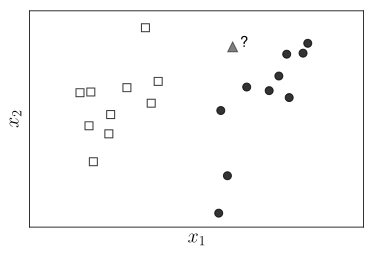
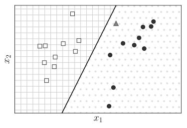
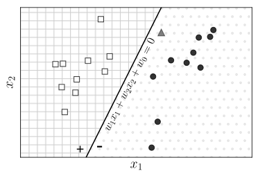
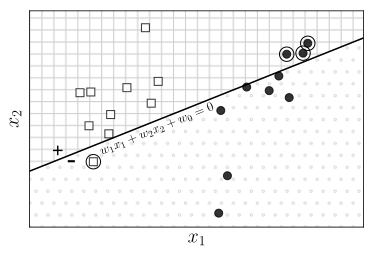
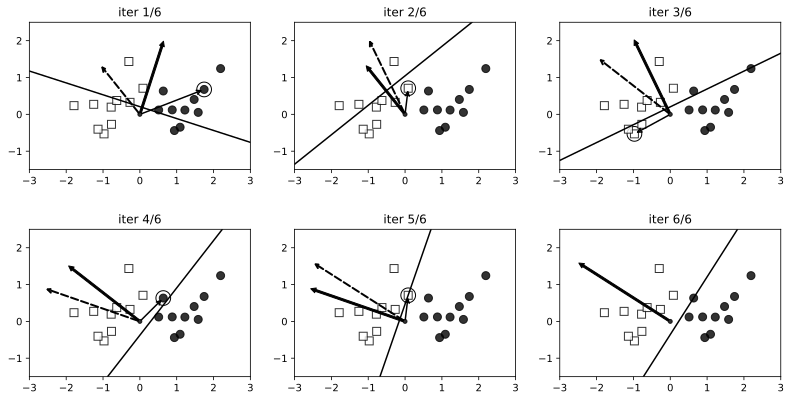
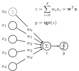
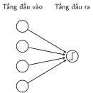
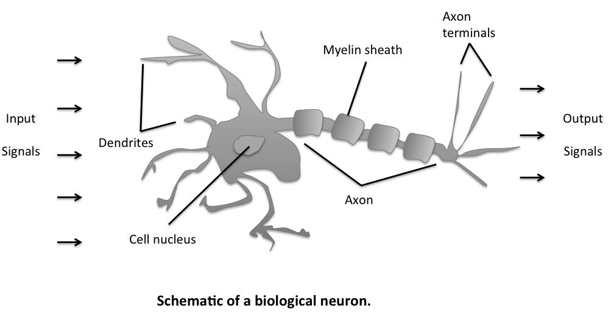
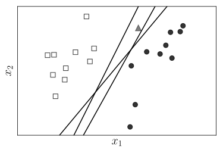
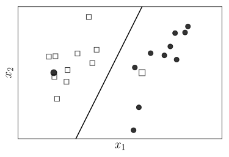

# Chương 13 Perceptron learning algorithm (PLA)

> Ghi chú của người biên soạn: chương này lấy nguyên văn từ sách *Machine Learning cơ bản* của **Vũ Hữu Tiệp** ([mã nguồn LaTeX](https://github.com/tiepvupsu/ebookMLCB), giấy phép [CC BY-SA 4.0](https://creativecommons.org/licenses/by-sa/4.0/); trang gốc [machinelearningcoban.com](https://machinelearningcoban.com)). Người biên soạn chỉ đổi định dạng sang trang web: số chương, mục, công thức và hình giữ như bản PDF, hình vector được vẽ lại dưới dạng SVG.

## 13.1 Giới thiệu

Trong chương này, chúng ta cùng tìm hiểu một trong các thuật toán xuất hiện đầu tiên trong lịch sử machine learning. Đây là một phương pháp phân loại đơn giản có tên là *thuật toán học perceptron* (perceptron learning algorithm – PLA ). Thuật toán này được thiết kế cho bài toán *phân loại nhị phân* khi dữ liệu chỉ thuộc một trong hai nhãn. Đây là nền tảng cho các thuật toán liên quan tới mạng neuron nhân tạo và gần đây là deep learning.

Giả sử có hai tập dữ liệu hình vuông và tròn như được minh hoạ trong Hình 13.1(a). Bài toán đặt ra là từ dữ liệu của hai tập được gán nhãn cho trước, hãy xây dựng một bộ phân loại có khả năng dự đoán nhãn của một điểm dữ liệu mới, chẳng hạn điểm hình tam giác màu xám.

Nếu coi mỗi vector đặc trưng là một điểm trong không gian nhiều chiều, bài toán phân loại có thể được coi như bài toán xác định nhãn của từng điểm trong không gian. Nếu coi mỗi nhãn chiếm một hoặc vài vùng trong không gian, ta cần đi tìm ranh giới giữa các vùng đó. Ranh giới đơn giản nhất trong không gian hai chiều là một đường thẳng, trong không gian ba chiều là một mặt phẳng, trong không gian nhiều chiều là một *siêu phẳng*. Những ranh giới phẳng này đơn giản vì chúng có thể được biểu diễn bởi một hàm số tuyến tính. Hình 13.1(b) minh họa một đường thẳng phân chia hai tập dữ liệu trong không gian hai chiều. Trong trường hợp này, điểm dữ liệu mới hình tam giác rơi vào cùng tập hợp với các điểm hình tròn.

PLA là một thuật toán đơn giản giúp tìm ranh giới siêu phẳng cho bài toán phân loại nhị phân trong trường hợp tồn tại siêu phẳng đó. Nếu hai tập dữ liệu có thể được phân chia hoàn toàn bằng một siêu phẳng, ta nói rằng hai tập đó *tách biệt tuyến tính* (linearly separable).

<div align=center class="ml-fig">
<span class="ml-subfig"><br><small>(a)</small></span><span class="ml-subfig"><br><small>(b)</small></span>
</div>
<div align=center>Hình 13.1: Bài toán phân loại nhị phân trong không gian hai chiều. (a) Cho hai tập dữ liệu được gán nhãn vuông và tròn, hãy xác định nhãn của điểm tam giác. (b) Ví dụ về một ranh giới phẳng phân chia hai tập hợp. Điểm tam giác được phân vào tập các điểm hình tròn.</div>

## 13.2 Thuật toán học perceptron

### 13.2.1 Quy tắc phân loại

Giả sử $\mathbf{X} = [\mathbf{x}_1, \mathbf{x}_2, \dots, \mathbf{x}_N] \in \mathbb{R}^{d \times N}$ là ma trận chứa tập huấn luyện mà mỗi cột $\mathbf{x}_i$ là một điểm dữ liệu trong không gian $d$ chiều. Các nhãn được lưu trong một vector hàng $\mathbf{y} = [y_1, y_2, \dots, y_N] \in \mathbb{R}^{1\times N}$ với $y_i = 1$ nếu $\mathbf{x}_i$ mang nhãn vuông và $y_i = -1$ nếu $\mathbf{x}_i$ mang nhãn tròn.

Tại một thời điểm, giả sử ranh giới là một siêu phẳng có phương trình

$$
\begin{align*}
f_{\mathbf{w}}(\mathbf{x}) &= w_1x_1 + \dots + w_dx_d + w_0 =\mathbf{x}^T\mathbf{w} + w_0 = 0 \tag{13.1}
\end{align*}
$$

với $\mathbf{w} \in \mathbb{R}^d$ là vector trọng số và $w_0$ là hệ số điều chỉnh. Bằng cách sử dụng thủ thuật gộp hệ số điều chỉnh (xem Mục 7.2.4 (chương [7](ml/ch07_vi), *Hồi quy tuyến tính*)), ta có thể coi phương trình siêu phẳng là $f_{\mathbf{w}}(\mathbf{x}) = \mathbf{x}^T\mathbf{w} = 0$ với $\mathbf{x}$ ở đây được ngầm hiểu như vector đặc trưng mở rộng thêm một đặc trưng bằng một. Vector trọng số $\mathbf{w}$ chính là *vector pháp tuyến* của siêu phẳng $\mathbf{x}^T\mathbf{w} = 0$.

<div align=center class="ml-fig">
<span class="ml-subfig"><br><small>(a) Đường thẳng phân chia không gây lỗi, mọi điểm được phân loại đúng.</small></span><span class="ml-subfig"><br><small>(b) Đường thẳng phân chia gây ra lỗi tại các điểm được khoanh tròn.</small></span>
</div>
<div align=center>Hình 13.2: Ví dụ về các đường thẳng trong không gian hai chiều: (a) một nghiệm của bài toán PLA, (b) đường thẳng không phân chia chính xác hai lớp.</div>

Trong không gian hai chiều, giả sử đường thẳng $w_1 x_1 + w_2 x_2 + w_0 = 0$ là nghiệm cần tìm như Hình 13.2(a). Ta thấy rằng các điểm nằm cùng phía so với đường thẳng này làm cho hàm số $f_{\mathbf{w}}(\mathbf{x})$ mang cùng dấu. Nếu cần thiết, ta có thể đổi dấu của $\mathbf{w}$ để các điểm trên nửa mặt phẳng nền kẻ ô vuông mang dấu dương (+), các điểm trên nửa mặt phẳng nền chấm mang dấu âm (-). Các dấu này tương đương với nhãn $y$ của mỗi điểm dữ liệu. Như vậy, nếu $\mathbf{w}$ là một nghiệm của bài toán thì nhãn của một điểm dữ liệu mới $\mathbf{x}$ được xác định bởi

$$
\begin{align*}
\text{label}(\mathbf{x}) = \left\{
\begin{matrix}
1 & \text{nếu}~ \mathbf{x}^T\mathbf{w} \geq 0\\
-1 & \text{trường hợp còn lại}
\end{matrix}
\right. \tag{13.2}
\end{align*}
$$

Vậy, $\text{label}(\mathbf{x}) = \text{sgn}(\mathbf{w}^T\mathbf{x})$ với $\text{sgn}$ là hàm xác định dấu. Quy ước $\text{sgn}(0) = 1$.

### 13.2.2 Xây dựng hàm mất mát

Tiếp theo, chúng ta xây dựng một hàm mất mát theo tham số $\mathbf{w}$ bất kỳ. Vẫn trong không gian hai chiều, xét đường thẳng $w_1x_1 + w_2x_2 + w_0 = 0$ được cho như Hình 13.2(b). Các điểm khoanh tròn là các điểm bị *phân loại lỗi*. Tham số $\mathbf{w}$ là một nghiệm của bài toán nếu nó không gây ra điểm bị phân loại lỗi nào. Như vậy, hàm đếm số lượng điểm bị phân loại lỗi có thể coi là hàm mất mát của mô hình. Ta sẽ tìm cách tối thiểu hàm số này.

Nếu một điểm $\mathbf{x}_i$ với nhãn $y_i$ bị phân loại lỗi, ta có $\text{sgn}(\mathbf{x}^T\mathbf{w}) \neq y_i$. Vì hai giá trị này chỉ bằng $1$ hoặc $-1$, ta phải có $y_i\text{sgn}(\mathbf{x}_i^T\mathbf{w}) = -1$. Như vậy, hàm đếm số lượng điểm bị phân loại lỗi có thể được viết dưới dạng

$$
J_1(\mathbf{w}) = \sum_{\mathbf{x}_i \in \mathcal{M}} (-y_i\text{sgn}(\mathbf{x}_i^T\mathbf{w})) \tag{13.3}
$$

trong đó $\mathcal{M}$ ký hiệu tập các điểm bị phân loại lỗi ứng với mỗi $\mathbf{w}$. Mục đích cuối cùng là đi tìm $\mathbf{w}$ sao cho mọi điểm trong tập huấn luyện đều được phân loại đúng, tức $J_1(\mathbf{w}) = 0$. Một điểm quan trọng cần lưu ý là hàm mất mát $J_1(\mathbf{w})$ rất khó được tối ưu vì $\text{sgn}$ là một hàm rời rạc. Chúng ta cần tìm một hàm mất mát khác để việc tối ưu khả thi hơn. Xét hàm

$$
J(\mathbf{w}) = \sum_{\mathbf{x}_i \in \mathcal{M}} (-y_i\mathbf{x}_i^T\mathbf{w}). \tag{13.4}
$$

Trong hàm số này, hàm rời rạc $\text{sgn}$ đã được lược bỏ. Ngoài ra, khi một điểm phân loại lỗi $\mathbf{x}_i$ nằm càng xa ranh giới, giá trị $-y_i\mathbf{x}_i^T\mathbf{w}$ sẽ càng lớn, khiến cho hàm mất mát cũng càng lớn. Lưu ý rằng hàm mất mát chỉ được tính trên các tập điểm bị phân loại lỗi $\mathcal{M}$, giá trị nhỏ nhất của hàm số này cũng bằng không nếu $\mathcal{M}$ là một tập rỗng. Vì vậy, $J(\mathbf{w})$ được cho là tốt hơn $J_1(\mathbf{w})$ vì nó *trừng phạt rất nặng những điểm lấn sâu sang lãnh thổ của tập còn lại*. Trong khi đó, $J_1(\mathbf{w})$ *trừng phạt* các điểm phân loại lỗi một lượng như nhau và đều bằng một, bất kể chúng gần hay xa ranh giới.

### 13.2.3 Tối ưu hàm mất mát

Tại một thời điểm, nếu chỉ quan tâm tới các điểm bị phân loại lỗi thì hàm số $J(\mathbf{w})$ khả vi tại mọi $\mathbf{w}$. Vậy ta có thể sử dụng GD hoặc SGD để tối ưu hàm mất mát này. Chúng ta sẽ giải quyết bài toán tối ưu hàm mất mát $J(\mathbf{w})$ bằng SGD. Nếu chỉ một điểm dữ liệu $\mathbf{x}_i$ bị phân loại lỗi, hàm mất mát và gradient của nó lần lượt là

$$
J(\mathbf{w}; \mathbf{x}_i; y_i) = -y_i\mathbf{x}_i^T\mathbf{w}; \quad
\nabla_{\mathbf{w}}J(\mathbf{w}; \mathbf{x}_i; y_i) = -y_i\mathbf{x}_i \tag{13.5}
$$

Quy tắc cập nhật $\mathbf{w}$ sử dụng SGD là

$$
\mathbf{w} \leftarrow \mathbf{w} - \eta (-y_i\mathbf{x}_i) = \mathbf{w} + \eta y_i\mathbf{x}_i \tag{13.6}
$$

với $\eta$ là tốc độ học. Trong PLA, $\eta$ được chọn bằng 1. Ta có một quy tắc cập nhật rất gọn:

$$
\mathbf{w}_{t+1} = \mathbf{w}_{t} + y_i\mathbf{x}_i \tag{13.7}
$$

Tiếp theo, ta thấy rằng

$$
\begin{gathered}
\mathbf{x}_i^T\mathbf{w}_{t+1} = \mathbf{x}_i^T(\mathbf{w}_t + y_i\mathbf{x}_i) \\ 
= \mathbf{x}_i^T\mathbf{w}_t + y_i \|\mathbf{x}_i\|_2^2.
\end{gathered} \tag{13.8}
$$

Nếu $\mathbf{x}_i$ bị phân loại lỗi và có nhãn đúng $y_i = 1$, ta có $\mathbf{x}_{i}^T\mathbf{w}_t < 0$. Cũng vì $y_i = 1$ nên $y_i \|\mathbf{x}_i\|_2^2 = \|\mathbf{x}_i\|_2^2 \geq 1$ (chú ý $\mathbf{x}_i$ là một vector đặc trưng mở rộng với một phần tử bằng một). Từ đó suy ra $\mathbf{x}_i^T\mathbf{w}_{t+1} > \mathbf{x}_i^T\mathbf{w}_t$. Nói cách khác, $-y_i\mathbf{x}_i^T\mathbf{w}_{t+1} < -y_i\mathbf{x}_i^T\mathbf{w}_t$. Điều tương tự cũng xảy ra với $y_i = -1$. Việc này chỉ ra rằng đường thẳng được mô tả bởi $\mathbf{w}_{t+1}$ có xu hướng khiến hàm mất mát tại điểm bị phân loại lỗi $\mathbf{x}_i$ giảm đi. *Chú ý rằng việc này không đảm bảo hàm mất mát tổng cộng sẽ giảm, vì rất có thể siêu thẳng mới sẽ làm cho một điểm lúc trước được phân loại đúng trở thành một điểm bị phân loại lỗi. Tuy nhiên, thuật toán này được đảm bảo sẽ hội tụ sau một số hữu hạn bước.* Thuật toán perceptron được tóm tắt dưới đây:

> **Thuật toán 13.1: Perceptron**
>
> 1.  Tại thời điểm $t = 0$, chọn ngẫu nhiên một vector trọng số $\mathbf{w}_0$.
>
> 2.  Tại thời điểm $t$, nếu không có điểm dữ liệu nào bị phân loại lỗi, dừng thuật toán.
>
> 3.  Giả sử $\mathbf{x}_i$ là một điểm bị phân loại lỗi, cập nhật
>
>     $$
>     \mathbf{w}_{t+1} = \mathbf{w}_t + y_i\mathbf{x}_i
>     $$
>
> 4.  Thay đổi $t = t + 1$ rồi quay lại Bước 2.

### 13.2.4 Chứng minh hội tụ

Gọi $\mathbf{w}^*$ là một nghiệm của bài toán phân loại nhị phân. Nghiệm này luôn tồn tại khi hai tập dữ liệu tách biệt tuyến tính. Ta sẽ chứng minh bằng phản chứng Thuật toán 13.1 kết thúc sau một số hữu hạn bước.

Giả sử ngược lại, tồn tại một điểm xuất phát $\mathbf{w}$ khiến Thuật toán 13.1 chạy vô hạn bước. Trước hết ta thấy rằng, nếu $\mathbf{w}^*$ là nghiệm thì $\alpha\mathbf{w}^*$ cũng là nghiệm của bài toán với $\alpha > 0$ bất kỳ. Xét dãy số không âm $u_{\alpha}(t) = \|\mathbf{w}_{t} - \alpha\mathbf{w}^*\|_2^2$. Theo giả thiết phản chứng, luôn tồn tại một điểm bị phân loại lỗi khi dùng nghiệm $\mathbf{w}_t$. Giả sử đó là điểm $\mathbf{x}_i$ với nhãn $y_i$. Ta có

$$
\begin{align*}
u_{\alpha}(t+1) &= \|\mathbf{w}_{t+1} - \alpha \mathbf{w}^*\|_2^2 \\
&= \|\mathbf{w}_{t} + y_i\mathbf{x}_i - \alpha\mathbf{w}^*\|_2^2 \\
&= \|\mathbf{w}_{t} -\alpha\mathbf{w}^*\|_2^2 + y_i^2\|\mathbf{x}_i\|_2^2 + 2y_i\mathbf{x}_i^T(\mathbf{w}_t - \alpha\mathbf{w}^*) \\
&< u_{\alpha}(t)   + \|\mathbf{x}_i\|_2^2 - 2\alpha y_i\mathbf{x}_i^T \mathbf{w}^* \tag{13.9}
\end{align*}
$$

Dấu nhỏ hơn ở dòng cuối xảy ra vì $y_i^2 = 1$ và $2y_i\mathbf{x}_i^T\mathbf{w}_{t} < 0$. Nếu tiếp tục đặt

$$
\beta^2 = \max_{i=1, 2, \dots, N}\|\mathbf{x}_i\|_2^2 \geq 1, \quad
\gamma = \min_{i=1, 2, \dots, N} y_i\mathbf{x}_i^T\mathbf{w}^*
$$

và chọn $\alpha = \frac{\beta^2}{\gamma}$, ta sẽ có $0 \leq u_{\alpha}(t+1) < u_{\alpha}(t) + \beta^2 - 2\alpha\gamma = u_{\alpha}(t) - \beta^2.$ Ta có thể chọn giá trị này vì (13.9) đúng với $\alpha$ bất kỳ. Điều này chỉ ra rằng nếu luôn có điểm bị phân loại lỗi thì dãy $u_{\alpha}(t)$ là một dãy giảm bị chặn dưới bởi 0, và phần tử sau kém phần tử trước ít nhất một lượng là $\beta^2\geq 1$. Điều vô lý này chứng tỏ giả thiết phản chứng là sai. Nói cách khác, thuật toán perceptron hội tụ sau một số hữu hạn bước.

## 13.3 Ví dụ và minh hoạ trên Python

Thuật toán 13.1 có thể được triển khai như sau:

#### Quy tắc phân loại

Giả sử đã tìm được vector trọng số `w`, nhãn của các điểm dữ liệu `X` được xác định bằng hàm `predict(w, X)`:

```python
import numpy as np
def predict(w, X):
    """
    predict label of each row of X, given w
    X: a 2-d numpy array of shape (N, d), each row is a datapoint
    w: a 1-d numpy array of shape (d)
    """
    return np.sign(X.dot(w))
```

#### Thuật toán tối ưu hàm mất mát

Hàm `perceptron(X, y, w_init)` thực hiện thuật toán PLA với tập huấn luyện `X`, nhãn `y` và nghiệm ban đầu `w_init`.

```python
def perceptron(X, y, w_init):
    """ perform perceptron learning algorithm
    X: a 2-d numpy array of shape (N, d), each row is a datapoint
    y: a 1-d numpy array of shape (N), label of each row of X. y[i] = 1/-1
    w_init: a 1-d numpy array of shape (d)
    """
    w = w_init
    while True:
        pred = predict(w, X)
        # find indexes of misclassified points
        mis_idxs = np.where(np.equal(pred, y) == False)[0]
        # number of misclassified points
        num_mis = mis_idxs.shape[0]
        if num_mis == 0: # no more misclassified points
            return w
        # randomly pick one misclassified point
        random_id = np.random.choice(mis_idxs, 1)[0]
        # update w
        w = w + y[random_id]*X[random_id]
    return w
```

Áp dụng thuật toán vừa viết vào dữ liệu trong không gian hai chiều:

```python
means = [[-1, 0], [1, 0]]
cov = [[.3, .2], [.2, .3]]
N = 10
X0 = np.random.multivariate_normal(means[0], cov, N)
X1 = np.random.multivariate_normal(means[1], cov, N)

X = np.concatenate((X0, X1), axis = 0)
y = np.concatenate((np.ones(N), -1*np.ones(N)))

Xbar = np.concatenate((np.ones((2*N, 1)), X), axis = 1)
w_init = np.random.randn(Xbar.shape[1])
w = perceptron(Xbar, y, w_init)
```

Mỗi nhãn có 10 phần tử, là các vector ngẫu nhiên lấy theo phân phối chuẩn có ma trận hiệp phương sai `cov` và vector kỳ vọng `means`. Hình 13.3 minh hoạ thuật toán học perceptron cho bài toán này. Nghiệm hội tụ chỉ sau sáu vòng lặp.

<div align=center>

</div>
<div align=center>Hình 13.3: Minh hoạ thuật toán perceptron. Các điểm hình vuông có nhãn bằng $1$, các điểm hình tròn có nhãn $-1$. Tại mỗi vòng lặp, đường thẳng là đường ranh giới. Vector pháp tuyến $\mathbf{w}_t$ của đường thằng này là vector đậm nét liền. Điểm được khoanh tròn là một điểm bị phân loại lỗi $\mathbf{x}_i$. Vector mảnh nét liền thể hiện vector $\mathbf{x}_i$. Vector nét đứt thể hiện $\mathbf{w}_{t+1}$. Nếu $y_i = 1$ (một điểm hình vuông), vector nét đứt bằng tổng hai vector kia. Nếu $y_i = -1$, vector nét đứt bằng hiệu hai vector kia.</div>

<div align=center class="ml-fig">
<span class="ml-subfig"><br><small>(a)</small></span><span class="ml-subfig"><br><small>(b)</small></span><span class="ml-subfig"><br><small>(c)</small></span>
</div>
<div align=center>Hình 13.4: Biểu diễn perceptron và hồi quy tuyến tính dưới dạng mạng neuron. (a) perceptron đầy đủ, (b) perceptron thu gọn, (c) hồi quy tuyến tính thu gọn.</div>

## 13.4 Mô hình mạng neuron đầu tiên

Hàm số dự đoán đầu ra của perceptron $\text{label}(\mathbf{x}) = \text{sgn}(\mathbf{w}^T\mathbf{x})$ được mô tả trên Hình 13.4(a). Đây chính là dạng đơn giản nhất của một mạng neuron.

Đầu vào $\mathbf{x}$ của mạng được minh họa bằng các hình tròn bên trái gọi là các *nút*. Tập hợp các nút này được gọi là *tầng đầu vào*. Số nút trong tầng đầu vào là $d + 1$ với nút điều chỉnh $x_0$ đôi khi được ẩn đi và ngầm hiểu bằng một. Các *trọng số* $w_0, w_1, \dots, w_d$ được gán vào các mũi tên đi tới nút $z = \sum_{i=0}^dw_ix_i = \mathbf{x}^T\mathbf{w}$. Nút $y = \text{sgn}(z)$ là đầu ra của mạng. Ký hiệu hình chữ Z ngược trong nút $y$ thể hiện đồ thị của hàm $\text{sgn}$. Hàm $y = \text{sgn}(z)$ đóng vai trò là một *hàm kích hoạt*. Có nhiều loại hàm kích hoạt khác nhau sẽ được trình bày trong các chương sau. Dữ liệu đầu vào được đặt tại tầng đầu vào, lấy tổng có trọng số lưu vào biến $z$ rồi đi qua hàm kích hoạt để có kết quả ở $y$. Đây chính là dạng đơn giản nhất của một mạng neuron nhân tạo. Perceptron cũng có thể được vẽ giản lược như Hình 13.4(b), với ẩn ý rằng hàm tính tổng và hàm kích hoạt được gộp làm một.

Các mạng neuron có thể có một hoặc nhiều nút ở đầu ra tạo thành một *tầng đầu ra*. Trong các mô hình phức tạp hơn, các mạng neuron có thể có thêm các tầng trung gian giữa tầng đầu vào và tầng đầu ra gọi là *tầng ẩn*. Chúng ta sẽ đi sâu vào các mạng nhiều tầng ẩn ở Chương [16](ml/ch16_vi) (*Mạng neuron đa tầng và lan truyền ngược*). Trước đó, chúng ta sẽ tìm hiểu các mạng neuron đơn giản hơn không có tầng ẩn nào.

Để ý rằng nếu thay hàm kích hoạt bởi hàm đồng nhất $y = z$, ta sẽ có một mạng neuron mô tả mô hình hồi quy tuyến tính như Hình 13.4(c). Đường thẳng chéo trong nút đầu ra thể hiện đồ thị hàm số $y = z$. Các trục tọa độ đã được lược bỏ.

<div align=center>

</div>
<div align=center>Hình 13.5: Cấu trúc của một neuron thần kinh sinh học. Nguồn: *Single-Layer Neural Networks and Gradient Descent* (<https://goo.gl/RjBREb>).</div>

Mô hình perceptron ở trên khá giống với một thành phần nhỏ của mạng thần kinh sinh học như Hình 13.5. Dữ liệu từ nhiều dây thần kinh đầu vào đi về một nhân tế bào. Nhân tế bào tổng hợp thông tin và đưa ra quyết định ở tín hiệu đầu ra. Trong mạng neuron nhận tạo của perceptron, mỗi giá trị $x_i$ đóng vai trò một tín hiệu đầu vào, hàm tính tổng và hàm kích hoạt có chức năng tương tự nhân tế bào. Tên gọi *mạng neuron nhân tạo* được khởi nguồn từ đây.

## 13.5 Thảo Luận

*PLA có thể cho vô số nghiệm khác nhau.* Nếu hai tập dữ liệu tách biệt tuyến tính thì có vô số đường ranh giới như trong Hình 13.6(a). Các đường khác nhau sẽ quyết định điểm hình tam giác có nhãn khác nhau. Trong các đường đó, đường nào là tốt nhất? Và định nghĩa “tốt nhất” được hiểu theo nghĩa nào? Các câu hỏi này sẽ được thảo luận kỹ hơn trong Chương [26](ml/ch26_vi) (*Máy vector hỗ trợ*).

*PLA đòi hỏi hai tập dữ liệu phải tách biệt tuyến tính*. Hình 13.6(b) mô tả hai tập dữ liệu *gần* tách biệt tuyến tính. Mỗi tập có một điểm nhiễu nằm lẫn tập còn lại. Trong trường hợp này, thuật toán PLA không bao giờ dừng lại vì luôn có ít nhất hai điểm bị phân loại lỗi.

<div align=center class="ml-fig">
<span class="ml-subfig"><br><small>(a)</small></span><span class="ml-subfig"><br><small>(b)</small></span>
</div>
<div align=center>Hình 13.6: Với bài toán phân loại nhị phân, PLA có thể (a) cho vô số nghiệm, hoặc (b) vô nghiệm thậm chí khi có nhiễu nhỏ.</div>

Trong một chừng mực nào đó, đường thẳng màu đen vẫn có thể coi là một nghiệm tốt vì nó đã giúp phân loại chính xác hầu hết các điểm. Việc không hội tụ với dữ liệu *gần* tách biệt tuyến tính là một nhược điểm lớn của PLA.

Nhược điểm này có thể được khắc phục bằng *thuật toán bỏ túi* (*pocket algorithm*).

*Thuật toán bỏ túi* : một cách trực quan, nếu chỉ có ít nhiễu, ta sẽ đi tìm một đường ranh giới sao cho có ít điểm bị phân loại lỗi nhất. Việc này có thể được thực hiện thông qua PLA và thuật toán tìm số nhỏ nhất trong mảng một chiều:

- Giới hạn số lượng vòng lặp của PLA. Đặt nghiệm $\mathbf{w}$ sau vòng lặp đầu tiên và số điểm bị phân loại lỗi vào trong *túi*.

- Mỗi lần cập nhật nghiệm $\mathbf{w}_t$ mới, ta đếm xem có bao nhiêu điểm bị phân loại lỗi. So sánh số lượng này với số điểm bị phân loại lỗi trong túi. Nếu số lượng điểm bị phân loại lỗi này nhỏ hơn, tức ta đạt được mô hình tốt hơn trên tập huấn luyện, ta thay thế nghiệm trong túi bằng nghiệm mới và số điểm bị phân loại lỗi tương ứng. Lặp lại bước này đến khi hết số vòng lặp.

Mã nguồn trong chương này có thể được tìm thấy tại <https://goo.gl/tisSTq>.
