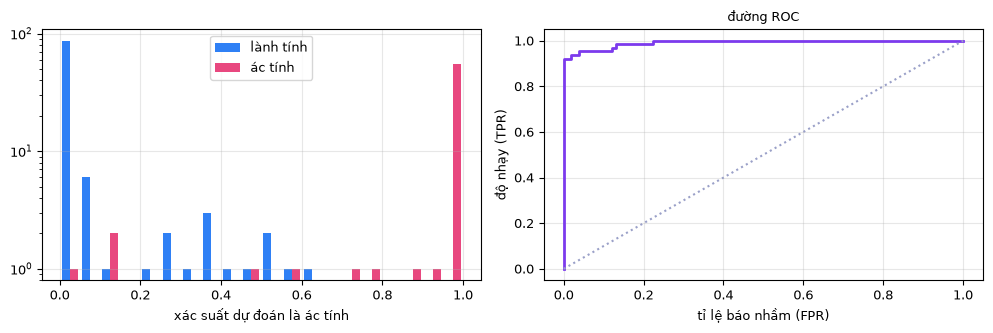
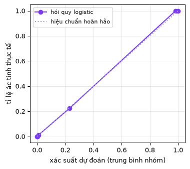

# Chương 14 · Ví dụ áp dụng: chẩn đoán ung thư vú

> Ghi chú của người biên soạn: trang này do người biên soạn viết thêm, không có trong sách gốc. Dữ liệu là bộ *Breast Cancer Wisconsin (Diagnostic)* (Street, Wolberg và Mangasarian, 1993), có sẵn trong scikit-learn.

## Bài toán

Bộ dữ liệu có 569 khối u. Mỗi khối u có 30 đặc trưng đo từ ảnh nhân tế bào: bán kính, kết cấu, chu vi, diện tích, độ trơn, độ lõm và nhiều đặc trưng khác. Mỗi đặc trưng có ba giá trị (trung bình, sai số chuẩn, giá trị xấu nhất). Nhãn cho biết khối u lành tính hay ác tính.

Ở [chương 13](ml/ch13_app_vi), perceptron đạt khoảng 95% độ chính xác trên bộ này. Hồi quy logistic cho thêm một thứ quan trọng trong y tế: **xác suất**. Có xác suất thì ta có thể tự chọn ngưỡng, đánh đổi giữa bỏ sót ca ác tính và báo động nhầm.

Trên trang này, ta coi **ác tính là lớp dương** (nhãn 1), vì đó là điều cần phát hiện.

## 1. Dữ liệu và mô hình

<!-- run -->
```python
import numpy as np
import pandas as pd
import matplotlib.pyplot as plt
from sklearn.datasets import load_breast_cancer
from sklearn.model_selection import train_test_split, GridSearchCV, StratifiedKFold
from sklearn.pipeline import make_pipeline
from sklearn.preprocessing import StandardScaler
from sklearn.linear_model import LogisticRegression

bc = load_breast_cancer()
X = pd.DataFrame(bc.data, columns=bc.feature_names)
y = 1 - bc.target                                    # 1 = ác tính, 0 = lành tính
print("số khối u:", len(y), " tỉ lệ ác tính:", y.mean().round(3))
X_tr, X_te, y_tr, y_te = train_test_split(X, y, test_size=0.3, random_state=0, stratify=y)

grid = GridSearchCV(make_pipeline(StandardScaler(), LogisticRegression(max_iter=5000)),
                    {"logisticregression__C": np.logspace(-3, 3, 13)},
                    cv=StratifiedKFold(5, shuffle=True, random_state=0), scoring="neg_log_loss")
grid.fit(X_tr, y_tr)
model = grid.best_estimator_
print("C tốt nhất:", grid.best_params_["logisticregression__C"], f"  entropy chéo xác thực chéo: {-grid.best_score_:.4f}")
print(f"độ chính xác trên tập kiểm tra (ngưỡng 0.5): {model.score(X_te, y_te):.3f}")
```

<!-- output -->
```output
số khối u: 569  tỉ lệ ác tính: 0.373
C tốt nhất: 1.0   entropy chéo xác thực chéo: 0.0704
độ chính xác trên tập kiểm tra (ngưỡng 0.5): 0.953
```
<!-- /output -->

Ở đây ta chọn `C` theo **entropy chéo** (`neg_log_loss`) thay vì độ chính xác. Entropy chéo chính là hàm mất mát (14.13), và nó đánh giá chất lượng của xác suất chứ không chỉ của nhãn cuối cùng.

## 2. Ma trận nhầm lẫn và các thước đo

<!-- run -->
```python
from sklearn.metrics import confusion_matrix, precision_score, recall_score, roc_auc_score

p_te = model.predict_proba(X_te)[:, 1]
def report(th):
    pred = (p_te >= th).astype(int)
    tn, fp, fn, tp = confusion_matrix(y_te, pred).ravel()
    return tp, fn, fp, tn, recall_score(y_te, pred), precision_score(y_te, pred, zero_division=0)

tp, fn, fp, tn, rec, prec = report(0.5)
print(f"ngưỡng 0.5: phát hiện {tp} ca ác tính, BỎ SÓT {fn} ca; báo nhầm {fp} ca lành tính")
print(f"  độ nhạy (recall) = {rec:.3f}: tỉ lệ ca ác tính được phát hiện")
print(f"  độ chính xác dương (precision) = {prec:.3f}: tỉ lệ ca bị báo ác tính đúng là ác tính")
print(f"  AUC = {roc_auc_score(y_te, p_te):.4f}")
```

<!-- output -->
```output
ngưỡng 0.5: phát hiện 60 ca ác tính, BỎ SÓT 4 ca; báo nhầm 4 ca lành tính
  độ nhạy (recall) = 0.938: tỉ lệ ca ác tính được phát hiện
  độ chính xác dương (precision) = 0.938: tỉ lệ ca bị báo ác tính đúng là ác tính
  AUC = 0.9917
```
<!-- /output -->

Với ngưỡng mặc định 0.5, mô hình bỏ sót 4 trong 64 ca ác tính. AUC gần 0.99 nghĩa là xác suất dự đoán xếp hạng các khối u rất tốt: lấy ngẫu nhiên một ca ác tính và một ca lành tính, thì 99% số lần ca ác tính có xác suất cao hơn.

## 3. Chọn ngưỡng theo mục đích

Bỏ sót một ca ác tính nguy hiểm hơn nhiều so với báo nhầm một ca lành tính (ca báo nhầm chỉ cần làm thêm xét nghiệm). Vì vậy ngưỡng 0.5 chưa chắc đã hợp lý. Hạ ngưỡng thì phát hiện được nhiều ca hơn, đổi lại phải chấp nhận nhiều báo nhầm hơn.

<!-- run -->
```python
from sklearn.metrics import roc_curve

for th in [0.5, 0.3, 0.1, 0.05]:
    tp, fn, fp, tn, rec, prec = report(th)
    print(f"ngưỡng {th:4}: bỏ sót {fn} / {tp + fn} ca ác tính, báo nhầm {fp} / {fp + tn} ca lành tính   (recall {rec:.3f}, precision {prec:.3f})")

fpr, tpr, ths = roc_curve(y_te, p_te)
fig, axes = plt.subplots(1, 2, figsize=(10, 3.4))
axes[0].hist([p_te[y_te == 0], p_te[y_te == 1]], bins=20, color=["#2f80f5", "#e8487f"], label=["lành tính", "ác tính"])
axes[0].set_xlabel("xác suất dự đoán là ác tính"); axes[0].set_yscale("log"); axes[0].legend()
axes[1].plot(fpr, tpr, color="#7c3aed", lw=2); axes[1].plot([0, 1], [0, 1], ":", color="#9aa0c8")
axes[1].set_xlabel("tỉ lệ báo nhầm (FPR)"); axes[1].set_ylabel("độ nhạy (TPR)"); axes[1].set_title("đường ROC", fontsize=9)
for ax in axes: ax.grid(alpha=.3)
fig.tight_layout()
```

<!-- output -->
```output
ngưỡng  0.5: bỏ sót 4 / 64 ca ác tính, báo nhầm 4 / 107 ca lành tính   (recall 0.938, precision 0.938)
ngưỡng  0.3: bỏ sót 3 / 64 ca ác tính, báo nhầm 10 / 107 ca lành tính   (recall 0.953, precision 0.859)
ngưỡng  0.1: bỏ sót 1 / 64 ca ác tính, báo nhầm 14 / 107 ca lành tính   (recall 0.984, precision 0.818)
ngưỡng 0.05: bỏ sót 1 / 64 ca ác tính, báo nhầm 20 / 107 ca lành tính   (recall 0.984, precision 0.759)
```

<div align=center></div>
<!-- /output -->

Hạ ngưỡng xuống 0.1 thì số ca bỏ sót giảm từ 4 xuống 1, đổi lại số báo nhầm tăng từ 4 lên 14. Chọn ngưỡng nào không phải là câu hỏi kỹ thuật, mà phụ thuộc vào cái giá của từng loại sai lầm. Biểu đồ phân bố (trái, trục dọc theo thang log) cho thấy hầu hết khối u có xác suất rất gần 0 hoặc 1. Chỉ một ít nằm ở vùng giữa, và đó là những ca "khó" thật sự.

## 4. Xác suất có đáng tin không?

Nếu mô hình nói "70% ác tính" cho một nhóm khối u, thì khoảng 70% trong nhóm đó có thực sự ác tính không? Biểu đồ **hiệu chuẩn** (calibration) trả lời câu hỏi này. Do tập kiểm tra nhỏ (171 khối u), ta dùng xác suất từ xác thực chéo trên toàn bộ dữ liệu cho đủ điểm.

<!-- run -->
```python
from sklearn.model_selection import cross_val_predict
from sklearn.calibration import calibration_curve

p_cv = cross_val_predict(model, X, y, cv=StratifiedKFold(10, shuffle=True, random_state=0), method="predict_proba")[:, 1]
frac, mean_p = calibration_curve(y, p_cv, n_bins=6, strategy="quantile")
fig, ax = plt.subplots(figsize=(4, 3.6))
ax.plot(mean_p, frac, "o-", color="#7c3aed", label="hồi quy logistic"); ax.plot([0, 1], [0, 1], ":", color="#9aa0c8", label="hiệu chuẩn hoàn hảo")
ax.set_xlabel("xác suất dự đoán (trung bình nhóm)"); ax.set_ylabel("tỉ lệ ác tính thực tế"); ax.legend(fontsize=8); ax.grid(alpha=.3)
for a, b in zip(mean_p, frac): print(f"dự đoán trung bình {a:.3f} → thực tế {b:.3f}")
```

<!-- output -->
```output
dự đoán trung bình 0.000 → thực tế 0.000
dự đoán trung bình 0.001 → thực tế 0.000
dự đoán trung bình 0.009 → thực tế 0.011
dự đoán trung bình 0.229 → thực tế 0.223
dự đoán trung bình 0.982 → thực tế 1.000
dự đoán trung bình 1.000 → thực tế 1.000
```

<div align=center></div>
<!-- /output -->

Các điểm nằm gần đường chéo: khi mô hình nói khoảng 23%, tỉ lệ ác tính thực tế là khoảng 22%. Hồi quy logistic thường hiệu chuẩn tốt, vì hàm mất mát entropy chéo trực tiếp phạt những xác suất sai. Đây là ưu điểm lớn so với perceptron, vốn không cho xác suất.

## 5. Đọc hệ số: tỉ số odds

Với dữ liệu đã chuẩn hoá, $e^{w_j}$ là hệ số nhân của **odds** $\frac{P}{1-P}$ khi đặc trưng $j$ tăng một độ lệch chuẩn và các đặc trưng khác giữ nguyên.

<!-- run -->
```python
coef = pd.Series(model[-1].coef_[0], index=bc.feature_names).sort_values()
top = pd.concat([coef.head(4), coef.tail(6)])
print(pd.DataFrame({"w": top.round(2), "odds × (tăng 1 độ lệch chuẩn)": np.exp(top).round(2)}).to_string())
```

<!-- output -->
```output
                            w  odds × (tăng 1 độ lệch chuẩn)
compactness error       -0.93                           0.39
fractal dimension error -0.68                           0.51
symmetry error          -0.39                           0.68
mean symmetry           -0.24                           0.79
worst perimeter          0.89                           2.43
perimeter error          0.89                           2.43
worst symmetry           0.94                           2.56
mean concave points      0.94                           2.57
worst radius             1.03                           2.80
radius error             1.26                           3.51
```
<!-- /output -->

Các đặc trưng về **kích thước** (bán kính, chu vi) và **độ lõm** của nhân tế bào làm tăng mạnh odds ác tính. Ví dụ `radius error` tăng một độ lệch chuẩn thì odds nhân thêm khoảng 3.5 lần. Tuy vậy, cần thận trọng khi đọc từng hệ số. Nhiều đặc trưng tương quan rất mạnh với nhau (bán kính, chu vi, diện tích gần như là một), nên mô hình có thể chia trọng số giữa chúng theo nhiều cách khác nhau (xem [chương 7](ml/ch07_app_vi)). Một vài hệ số âm có thể chỉ là hệ quả của việc bù trừ đó.

## Rút ra được gì

- Hồi quy logistic cho **xác suất** được hiệu chuẩn tốt. Nhờ vậy ta có thể chọn ngưỡng theo cái giá của từng loại sai lầm, thay vì luôn dùng 0.5.
- Với bài toán y tế, **độ nhạy** (không bỏ sót ca bệnh) thường quan trọng hơn độ chính xác chung. Độ chính xác 95% có thể che giấu việc bỏ sót 6% ca ác tính.
- Chọn siêu tham số `C` bằng entropy chéo thay vì độ chính xác khi điều ta cần là xác suất.
- Trọng số của hồi quy logistic diễn giải được qua tỉ số odds, nhưng chỉ đáng tin khi các đặc trưng không tương quan mạnh với nhau.
