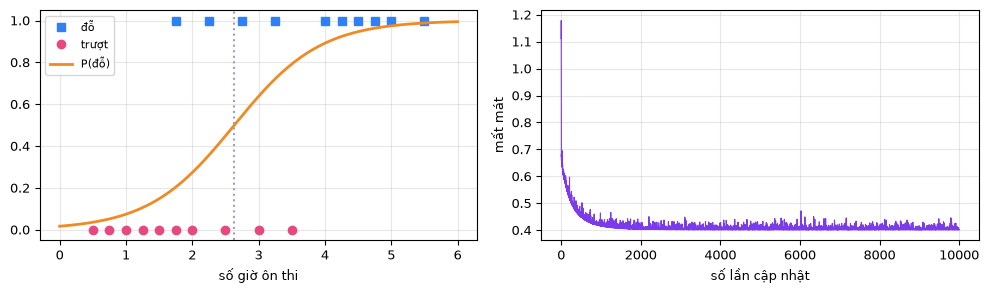
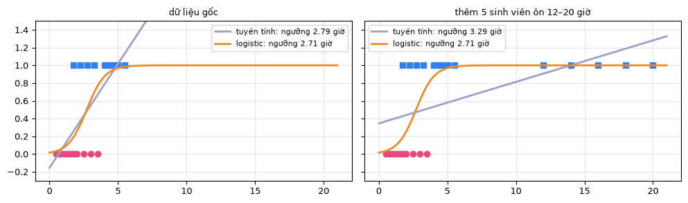
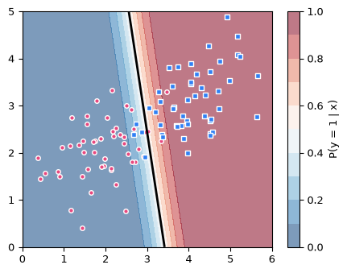
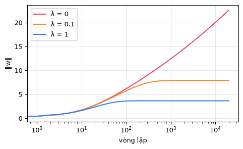

# Chương 14 · Code từ đầu

> Ghi chú của người biên soạn: trang này do người biên soạn viết thêm, không có trong sách gốc. Trang chạy lại các ví dụ của [chương 14](ml/ch14_vi) bằng NumPy, rồi thêm vài thí nghiệm: vì sao không dùng hồi quy tuyến tính để phân loại, vai trò của suy giảm trọng số khi dữ liệu tách biệt, và phân loại đa lớp kiểu one-vs-rest.

## Cách dùng trang này

Các khối chạy lần lượt từ trên xuống và dùng chung biến. Chỉ cần `numpy` và `matplotlib`. Nhãn là $y \in \{0, 1\}$. Giống sách, hệ số điều chỉnh được gộp vào **cuối** vector $\bar{\mathbf{x}} = [\mathbf{x}; 1]$.

## 1. Ví dụ đầu chương: thời gian ôn thi và kết quả thi

<small class="viz-ref">Mục 14.1.2 và 14.3.1 · bảng 14.1 · hình 14.3</small>

Dùng đúng code SGD của sách, kể cả `np.random.seed(2)`, để so kết quả:

<!-- run -->
```python
import numpy as np
import matplotlib.pyplot as plt

def sigmoid(s):
    return 1 / (1 + np.exp(-s))

def loss(w, X, y, lam):
    """Công thức (14.13): entropy chéo trung bình + suy giảm trọng số."""
    a = sigmoid(X @ w)
    return -np.mean(y * np.log(a) + (1 - y) * np.log(1 - a)) + 0.5 * lam / len(X) * np.sum(w * w)

def logistic_sgd(w_init, X, y, lam, lr=0.1, nepoches=2000):
    """SGD như mục 14.3.1: mỗi bước dùng một điểm, cập nhật (14.14)."""
    N, d = X.shape
    w = w_old = w_init.copy()
    loss_hist = [loss(w, X, y, lam)]
    for ep in range(nepoches):
        for i in np.random.permutation(N):
            a_i = sigmoid(X[i] @ w)
            w = w - lr * ((a_i - y[i]) * X[i] + lam * w)
            loss_hist.append(loss(w, X, y, lam))
        if np.linalg.norm(w - w_old) / d < 1e-6:
            break
        w_old = w
    return w, loss_hist

np.random.seed(2)
hours = np.array([0.50, 0.75, 1.00, 1.25, 1.50, 1.75, 1.75, 2.00, 2.25, 2.50,
                  2.75, 3.00, 3.25, 3.50, 4.00, 4.25, 4.50, 4.75, 5.00, 5.50])
passed = np.array([0, 0, 0, 0, 0, 0, 1, 0, 1, 0, 1, 0, 1, 0, 1, 1, 1, 1, 1, 1])
Xbar = np.c_[hours, np.ones(20)]                       # [x, 1] như sách
w_init = np.random.randn(2)
w, loss_hist = logistic_sgd(w_init, Xbar, passed, lam=1e-4, lr=0.05, nepoches=500)
print("nghiệm:", w, "   (sách: [ 1.54337021 -4.06486702])")
print("mất mát cuối:", loss(w, Xbar, passed, 1e-4), "   (sách: 0.402446724975)")

xs = np.linspace(0, 6, 200)
fig, axes = plt.subplots(1, 2, figsize=(10, 3))
axes[0].plot(hours[passed == 1], passed[passed == 1], "s", color="#2f80f5", label="đỗ")
axes[0].plot(hours[passed == 0], passed[passed == 0], "o", color="#e8487f", label="trượt")
axes[0].plot(xs, sigmoid(w[0] * xs + w[1]), color="#f08a24", lw=2, label="P(đỗ)")
axes[0].axvline(-w[1] / w[0], ls=":", color="#9aa0c8"); axes[0].set_xlabel("số giờ ôn thi"); axes[0].legend(fontsize=8)
axes[1].plot(loss_hist, color="#7c3aed", lw=.8); axes[1].set_xlabel("số lần cập nhật"); axes[1].set_ylabel("mất mát")
for ax in axes: ax.grid(alpha=.3)
fig.tight_layout()
print(f"ranh giới P = 0.5 tại {-w[1] / w[0]:.2f} giờ")
```

<!-- output -->
```output
nghiệm: [ 1.54337021 -4.06486702]    (sách: [ 1.54337021 -4.06486702])
mất mát cuối: 0.40244672497461936    (sách: 0.402446724975)
ranh giới P = 0.5 tại 2.63 giờ
```

<div align=center></div>
<!-- /output -->

Kết quả trùng **từng chữ số** với sách. Mô hình nói rằng ôn khoảng 2.6 giờ thì có 50% khả năng thi đỗ. Đường mất mát đi xuống theo kiểu răng cưa, vì mỗi lần cập nhật chỉ dùng một sinh viên.

## 2. Gradient đầy đủ, kiểm tra bằng đạo hàm số

<small class="viz-ref">Mục 14.2.2</small>

Gradient của hàm mất mát (14.13) theo $\mathbf{w}$ có dạng rất gọn: $\frac{1}{N}\bar{\mathbf{X}}^T(\mathbf{a} - \mathbf{y}) + \frac{\lambda}{N}\mathbf{w}$, với $\mathbf{a} = \sigma(\bar{\mathbf{X}}\mathbf{w})$. Giống hệt gradient của hồi quy tuyến tính, chỉ khác là đầu ra dự đoán đi qua hàm sigmoid. Ta kiểm tra công thức bằng đạo hàm số (như [trang Code chương 12](ml/ch12_code_vi)), rồi giải lại bằng GD với gradient đầy đủ:

<!-- run -->
```python
def grad(w, X, y, lam):
    return X.T @ (sigmoid(X @ w) - y) / len(X) + lam / len(X) * w

def numerical_grad(f, w, eps=1e-6):
    return np.array([(f(w + e) - f(w - e)) / (2 * eps) for e in np.eye(len(w)) * eps])

w_test = np.array([0.3, -0.7])
print("gradient công thức:", grad(w_test, Xbar, passed, 1e-4))
print("gradient số       :", numerical_grad(lambda v: loss(v, Xbar, passed, 1e-4), w_test))

w_gd = np.zeros(2)
for it in range(20000):
    w_gd -= 1.0 * grad(w_gd, Xbar, passed, 1e-4)
print("GD gradient đầy đủ:", w_gd.round(5), f" mất mát {loss(w_gd, Xbar, passed, 1e-4):.6f}")
```

<!-- output -->
```output
gradient công thức: [-0.26074667  0.03209881]
gradient số       : [-0.26074667  0.03209881]
GD gradient đầy đủ: [ 1.50416 -4.07629]  mất mát 0.401541
```
<!-- /output -->

Gradient công thức khớp với gradient số. GD với gradient đầy đủ tới một nghiệm có mất mát nhỏ hơn một chút so với SGD (0.4015 so với 0.4024). Lý do là SGD với bước học cố định dừng ở gần cực tiểu chứ không đúng tại cực tiểu, như đã thấy ở chương 12.

## 3. Vì sao không dùng hồi quy tuyến tính để phân loại?

<small class="viz-ref">Mục 14.1.1</small>

Có thể thử coi nhãn 0/1 như một số thực, dùng hồi quy tuyến tính rồi lấy ngưỡng 0.5. Trên dữ liệu trên, cách này cho kết quả không tệ. Nhưng hãy thêm vài sinh viên ôn rất nhiều giờ (và đương nhiên thi đỗ):

<!-- run -->
```python
def fit_linear(X, y):
    return np.linalg.lstsq(X, y, rcond=None)[0]

def fit_logistic(X, y, iters=50000):
    w = np.zeros(X.shape[1])
    for _ in range(iters):
        w -= 0.5 * grad(w, X, y, 1e-4)
    return w

extra_h = np.array([12, 14, 16, 18, 20.])
h2 = np.r_[hours, extra_h]; y2 = np.r_[passed, np.ones(5)]
X2 = np.c_[h2, np.ones(len(h2))]

fig, axes = plt.subplots(1, 2, figsize=(10, 3), sharey=True)
xs = np.linspace(0, 21, 300)
for ax, (Xd, yd, title) in zip(axes, [(Xbar, passed, "dữ liệu gốc"), (X2, y2, "thêm 5 sinh viên ôn 12–20 giờ")]):
    wl, wg = fit_linear(Xd, yd), fit_logistic(Xd, yd)
    tl, tg = (0.5 - wl[1]) / wl[0], -wg[1] / wg[0]
    ax.plot(Xd[yd == 1, 0], yd[yd == 1], "s", color="#2f80f5"); ax.plot(Xd[yd == 0, 0], yd[yd == 0], "o", color="#e8487f")
    ax.plot(xs, wl[0] * xs + wl[1], color="#9aa0c8", lw=2, label=f"tuyến tính: ngưỡng {tl:.2f} giờ")
    ax.plot(xs, sigmoid(wg[0] * xs + wg[1]), color="#f08a24", lw=2, label=f"logistic: ngưỡng {tg:.2f} giờ")
    ax.set_ylim(-0.3, 1.5); ax.set_title(title, fontsize=9); ax.legend(fontsize=8); ax.grid(alpha=.3)
    acc_l = np.mean((Xbar @ fit_linear(Xd, yd) > 0.5) == passed); acc_g = np.mean((sigmoid(Xbar @ wg) > 0.5) == passed)
    print(f"{title:32s}: ngưỡng tuyến tính {tl:.2f} giờ, logistic {tg:.2f} giờ | độ chính xác trên 20 sinh viên ban đầu: tuyến tính {acc_l:.2f}, logistic {acc_g:.2f}")
fig.tight_layout()
```

<!-- output -->
```output
dữ liệu gốc                     : ngưỡng tuyến tính 2.79 giờ, logistic 2.71 giờ | độ chính xác trên 20 sinh viên ban đầu: tuyến tính 0.75, logistic 0.80
thêm 5 sinh viên ôn 12–20 giờ   : ngưỡng tuyến tính 3.29 giờ, logistic 2.71 giờ | độ chính xác trên 20 sinh viên ban đầu: tuyến tính 0.75, logistic 0.80
```

<div align=center></div>
<!-- /output -->

Năm sinh viên ôn rất nhiều giờ, và việc họ thi đỗ chẳng có gì bất ngờ. Vậy mà họ kéo ngưỡng của hồi quy tuyến tính từ 2.79 lên 3.29 giờ. Hồi quy tuyến tính cố làm cho $\mathbf{w}^T\mathbf{x}$ *bằng* 1 ở những điểm này, nên đường thẳng bị kéo nghiêng đi. Hồi quy logistic thì gần như không đổi: với những điểm đã được phân loại đúng và chắc chắn, đạo hàm của sigmoid gần như bằng 0, nên chúng hầu như không đóng góp vào gradient. (Trên 20 sinh viên ban đầu, độ chính xác tình cờ không đổi. Giữa hai ngưỡng có đúng hai sinh viên, ôn 3.0 giờ (trượt) và 3.25 giờ (đỗ), và dự đoán cho hai người này đổi chỗ cho nhau. Với dữ liệu lớn hơn, một ngưỡng bị kéo lệch như vậy sẽ làm tăng số lỗi.)

## 4. Ví dụ hai chiều

<small class="viz-ref">Mục 14.3.2 · hình 14.4–14.5</small>

<!-- run -->
```python
rng = np.random.default_rng(0)
X2d = np.r_[rng.multivariate_normal([2, 2], [[.5, .2], [.2, .5]], 50), rng.multivariate_normal([4, 3], [[.5, .2], [.2, .5]], 50)]
y2d = np.r_[np.zeros(50), np.ones(50)]
X2bar = np.c_[X2d, np.ones(100)]
w2 = fit_logistic(X2bar, y2d, iters=20000)
print("w =", w2.round(3), f"  độ chính xác trên tập huấn luyện: {np.mean((sigmoid(X2bar @ w2) > 0.5) == y2d):.2f}")

xx, yy = np.meshgrid(np.linspace(0, 6, 200), np.linspace(0, 5, 200))
P = sigmoid(np.c_[xx.ravel(), yy.ravel(), np.ones(xx.size)] @ w2).reshape(xx.shape)
fig, ax = plt.subplots(figsize=(5, 3.8))
cs = ax.contourf(xx, yy, P, levels=np.linspace(0, 1, 11), cmap="RdBu_r", alpha=.55)
ax.contour(xx, yy, P, levels=[0.5], colors="k", linewidths=2)
ax.scatter(*X2d[y2d == 0].T, c="#e8487f", s=16, edgecolors="w"); ax.scatter(*X2d[y2d == 1].T, c="#2f80f5", marker="s", s=16, edgecolors="w")
fig.colorbar(cs, ax=ax, label="P(y = 1 | x)")
```

<!-- output -->
```output
w = [  4.539   0.781 -15.519]   độ chính xác trên tập huấn luyện: 0.93
```

<div align=center></div>
<!-- /output -->

Các đường đồng mức của xác suất là những **đường thẳng song song**. Ranh giới $P = 0.5$ là đường thẳng $\mathbf{w}^T\bar{\mathbf{x}} = 0$. Đây là tính chất ở mục 14.4: hồi quy logistic là một bộ phân loại tuyến tính.

## 5. Dữ liệu tách biệt và vai trò của suy giảm trọng số

<small class="viz-ref">Mục 14.2.3</small>

Khi hai lớp tách biệt hoàn toàn, mất mát có thể giảm mãi bằng cách **phóng to** $\mathbf{w}$: sigmoid càng dốc thì xác suất dự đoán càng gần đúng 0 và 1. Không có suy giảm trọng số, $\|\mathbf{w}\|$ tăng không giới hạn. Với $\lambda > 0$, nghiệm tồn tại và hữu hạn.

<!-- run -->
```python
Xs = np.r_[rng.normal([1, 1], 0.4, (30, 2)), rng.normal([3, 3], 0.4, (30, 2))]
ys = np.r_[np.zeros(30), np.ones(30)]
Xsbar = np.c_[Xs, np.ones(60)]
fig, ax = plt.subplots(figsize=(5.4, 3))
for lam, c in [(0, "#e8487f"), (0.1, "#f08a24"), (1, "#2f80f5")]:
    w = np.zeros(3); norms = []
    for it in range(20000):
        w -= 1.0 * grad(w, Xsbar, ys, lam); norms.append(np.linalg.norm(w))
    ax.semilogx(norms, color=c, label=f"λ = {lam}")
    print(f"λ = {lam:3}: ‖w‖ sau 20000 vòng = {norms[-1]:7.2f}   (sau 2000 vòng: {norms[1999]:.2f})")
ax.set_xlabel("vòng lặp"); ax.set_ylabel("‖w‖"); ax.legend(); ax.grid(alpha=.3)
```

<!-- output -->
```output
λ =   0: ‖w‖ sau 20000 vòng =   22.58   (sau 2000 vòng: 14.56)
λ = 0.1: ‖w‖ sau 20000 vòng =    7.90   (sau 2000 vòng: 7.90)
λ =   1: ‖w‖ sau 20000 vòng =    3.66   (sau 2000 vòng: 3.66)
```

<div align=center></div>
<!-- /output -->

Không có suy giảm trọng số, $\|\mathbf{w}\|$ cứ tăng mãi: từ 14.6 sau 2000 vòng lên 22.6 sau 20 000 vòng, và sẽ còn tăng tiếp. Với $\lambda > 0$, $\|\mathbf{w}\|$ dừng ở một giá trị hữu hạn ngay từ những vòng đầu. $\lambda$ càng lớn thì giá trị đó càng nhỏ, và sigmoid càng thoải.

## 6. Phân loại đa lớp: one-vs-rest

<small class="viz-ref">Mục 14.6.4</small>

Với $C$ lớp, ta huấn luyện $C$ bộ phân loại nhị phân. Bộ thứ $c$ phân biệt "lớp $c$" với "tất cả lớp còn lại". Khi dự đoán, chọn lớp có xác suất lớn nhất. Ta làm thử trên bộ Iris (3 loài hoa, 4 đặc trưng đã chuẩn hoá):

<!-- run -->
```python
from sklearn.datasets import load_iris              # chỉ để tải dữ liệu
iris = load_iris()
Xi = (iris.data - iris.data.mean(0)) / iris.data.std(0)
Xibar = np.c_[Xi, np.ones(len(Xi))]
yi = iris.target

idx = np.random.default_rng(0).permutation(150); tr, te = idx[:100], idx[100:]
W = np.array([fit_logistic(Xibar[tr], (yi[tr] == c).astype(float), iters=5000) for c in range(3)])   # 3 bộ phân loại
P_ovr = sigmoid(Xibar[te] @ W.T)                     # xác suất "thuộc lớp c" của từng bộ
pred = P_ovr.argmax(1)
print("độ chính xác trên tập kiểm tra:", np.mean(pred == yi[te]))
print("xác suất của 3 bộ cho 3 điểm đầu (mỗi hàng cộng lại không bằng 1):\n", P_ovr[:3].round(3), "\n tổng:", P_ovr[:3].sum(1).round(3))
```

<!-- output -->
```output
độ chính xác trên tập kiểm tra: 0.92
xác suất của 3 bộ cho 3 điểm đầu (mỗi hàng cộng lại không bằng 1):
 [[0.    0.357 0.993]
 [1.    0.186 0.   ]
 [1.    0.071 0.   ]] 
 tổng: [1.35  1.185 1.071]
```
<!-- /output -->

Xác suất từ các bộ one-vs-rest cộng lại không bằng 1, vì chúng được huấn luyện độc lập với nhau. Hồi quy softmax ở chương 15 sẽ giải quyết vấn đề này một cách tự nhiên.
