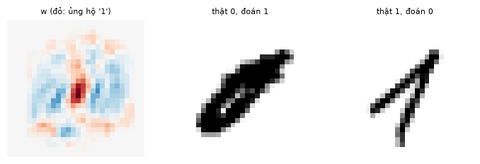

# Chương 14 · Dùng thư viện

> Ghi chú của người biên soạn: trang này do người biên soạn viết thêm, không có trong sách gốc. Trang dùng `LogisticRegression` của scikit-learn và `nn.Linear` của PyTorch cho các ví dụ của [chương 14](ml/ch14_vi), kể cả thí nghiệm MNIST ở mục 14.5.

## Cách dùng trang này

Các khối chạy lần lượt từ trên xuống và dùng chung biến. Cần `numpy`, `matplotlib`, `scikit-learn`, `torch`. Mục 2 tải bộ MNIST (khoảng 15 MB) ở lần chạy đầu.

| Trong sách | Trong `LogisticRegression` |
| --- | --- |
| Hệ số suy giảm trọng số $\lambda$ | `C` $\approx 1/\lambda$: **C càng lớn thì phạt càng nhẹ** |
| $\mathbf{w}$ và hệ số điều chỉnh | `coef_` và `intercept_` (hệ số điều chỉnh không bị phạt) |
| $P(y = 1 \mid \mathbf{x})$ | `predict_proba(X)[:, 1]` |
| $\mathbf{w}^T\bar{\mathbf{x}}$ | `decision_function(X)` |

## 1. Ví dụ thời gian ôn thi

<small class="viz-ref">Mục 14.3.1</small>

<!-- run -->
```python
import numpy as np
import matplotlib.pyplot as plt
from sklearn.linear_model import LogisticRegression

hours = np.array([0.50, 0.75, 1.00, 1.25, 1.50, 1.75, 1.75, 2.00, 2.25, 2.50,
                  2.75, 3.00, 3.25, 3.50, 4.00, 4.25, 4.50, 4.75, 5.00, 5.50])
passed = np.array([0, 0, 0, 0, 0, 0, 1, 0, 1, 0, 1, 0, 1, 0, 1, 1, 1, 1, 1, 1])
for C in [1e4, 1.0, 0.1]:
    m = LogisticRegression(C=C).fit(hours[:, None], passed)
    print(f"C = {C:7}: w = {m.coef_[0, 0]:.4f}, b = {m.intercept_[0]:.4f}, "
          f"P(đỗ | 1 giờ) = {m.predict_proba([[1]])[0, 1]:.3f}, P(đỗ | 4 giờ) = {m.predict_proba([[4]])[0, 1]:.3f}")
print("(sách, với λ = 1e-4: w = 1.5434, b = −4.0649)")
```

<!-- output -->
```output
C = 10000.0: w = 1.5050, b = -4.0786, P(đỗ | 1 giờ) = 0.071, P(đỗ | 4 giờ) = 0.875
C =     1.0: w = 1.1488, b = -3.1400, P(đỗ | 1 giờ) = 0.120, P(đỗ | 4 giờ) = 0.811
C =     0.1: w = 0.5074, b = -1.4073, P(đỗ | 1 giờ) = 0.289, P(đỗ | 4 giờ) = 0.651
(sách, với λ = 1e-4: w = 1.5434, b = −4.0649)
```
<!-- /output -->

Với `C` lớn (phạt rất nhẹ), nghiệm gần với nghiệm của sách. `C` càng nhỏ thì phạt càng nặng: $w$ bị kéo về 0, sigmoid thoải hơn, và xác suất dự đoán bị kéo về gần 0.5.

## 2. MNIST: phân biệt chữ số 0 và 1

<small class="viz-ref">Mục 14.5</small>

Sách dùng `fetch_mldata`, một hàm đã bị gỡ khỏi scikit-learn. Bây giờ ta dùng `fetch_openml("mnist_784")`.

<!-- run -->
```python
from sklearn.datasets import fetch_openml
from sklearn.model_selection import train_test_split

X_all, y_all = fetch_openml("mnist_784", version=1, return_X_y=True, as_frame=False)
y_all = y_all.astype(int)
print("MNIST:", X_all.shape)

m01 = (y_all == 0) | (y_all == 1)
X01, y01 = X_all[m01] / 255.0, y_all[m01]
X_tr, X_te, y_tr, y_te = train_test_split(X01, y01, test_size=2000, random_state=0)
clf = LogisticRegression(C=1e5, max_iter=1000).fit(X_tr, y_tr)
pred = clf.predict(X_te)
print(f"độ chính xác: {100 * np.mean(pred == y_te):.2f}%   (sách: 99.90%)   số ảnh sai: {np.sum(pred != y_te)} / {len(y_te)}")

fig, axes = plt.subplots(1, 3, figsize=(8.5, 2.6))
wimg = clf.coef_[0].reshape(28, 28); lim = np.abs(wimg).max()
axes[0].imshow(wimg, cmap="RdBu_r", vmin=-lim, vmax=lim); axes[0].set_title("w (đỏ: ủng hộ '1')", fontsize=8)
wrong = np.where(pred != y_te)[0][:2]
for ax, i in zip(axes[1:], wrong):
    ax.imshow(X_te[i].reshape(28, 28), cmap="gray_r"); ax.set_title(f"thật {y_te[i]}, đoán {pred[i]}", fontsize=8)
for ax in axes: ax.axis("off")
```

<!-- output -->
```output
MNIST: (70000, 784)
độ chính xác: 99.75%   (sách: 99.90%)   số ảnh sai: 5 / 2000
```

<div align=center></div>
<!-- /output -->

Độ chính xác khoảng 99.8%, rất gần con số của sách (99.90%). Hai kết quả chỉ khác nhau vài ảnh trên 2000, vì cách chia tập kiểm tra ngẫu nhiên khác nhau. Phân biệt 0 với 1 là bài toán rất dễ cho một mô hình tuyến tính.

Vector trọng số $\mathbf{w}$ có 784 phần tử, xếp lại thành ảnh $28 \times 28$. Vùng màu đỏ ở giữa (nơi số 1 có nét) đẩy dự đoán về "1". Vùng màu xanh hình vòng (nơi số 0 có nét) đẩy dự đoán về "0".

## 3. Đa lớp: one-vs-rest và multinomial

<small class="viz-ref">Mục 14.6</small>

Với nhiều lớp, `LogisticRegression` mặc định dùng hàm mất mát **multinomial**, tức hồi quy softmax của chương 15. Muốn dùng one-vs-rest như mục 14.6.4 thì bọc nó trong `OneVsRestClassifier`. Ta dùng 20 000 ảnh MNIST để huấn luyện cho nhanh.

<!-- run -->
```python
from sklearn.multiclass import OneVsRestClassifier
from time import perf_counter

Xm, ym = X_all / 255.0, y_all
X_tr, X_te, y_tr, y_te = train_test_split(Xm, ym, train_size=20000, test_size=10000, random_state=0)
for name, model in [("one-vs-rest", OneVsRestClassifier(LogisticRegression(C=0.1, max_iter=500))),
                    ("multinomial (softmax)", LogisticRegression(C=0.1, max_iter=500))]:
    t = perf_counter(); model.fit(X_tr, y_tr); dt = perf_counter() - t
    proba = model.predict_proba(X_te[:1000])
    print(f"{name:22s}: độ chính xác {100 * model.score(X_te, y_te):.2f}%, huấn luyện {dt:5.1f} s, "
          f"tổng xác suất mỗi ảnh = {proba.sum(1).min():.3f}–{proba.sum(1).max():.3f}")
```

<!-- output -->
```output
one-vs-rest           : độ chính xác 90.31%, huấn luyện   9.5 s, tổng xác suất mỗi ảnh = 1.000–1.000
multinomial (softmax) : độ chính xác 91.32%, huấn luyện  19.8 s, tổng xác suất mỗi ảnh = 1.000–1.000
```
<!-- /output -->

Trên MNIST đầy đủ (10 chữ số), mô hình tuyến tính chỉ đạt khoảng 90–91%, và multinomial tốt hơn one-vs-rest một chút. Lưu ý: `OneVsRestClassifier` của scikit-learn **tự chuẩn hoá** xác suất của các bộ phân loại cho tổng bằng 1, khác với bản tự viết ở [trang Code](ml/ch14_code_vi). Muốn vượt mốc 91% cần mô hình phi tuyến, như KNN (chương 9) hoặc mạng neuron (chương 16).

## 4. PyTorch: `nn.Linear` + `BCEWithLogitsLoss`

Hồi quy logistic chính là một neuron: lớp tuyến tính `nn.Linear(d, 1)`, rồi hàm sigmoid. Trong PyTorch, nên dùng `BCEWithLogitsLoss`: hàm này gộp sigmoid với entropy chéo, tính trực tiếp từ $z = \mathbf{w}^T\mathbf{x} + b$. Cách này ổn định số hơn so với tính $\sigma(z)$ trước rồi lấy $\log$, vì $\sigma(z)$ có thể bị làm tròn thành đúng 0 hoặc 1.

<!-- run -->
```python
import torch
from torch import nn

torch.manual_seed(0)
Xt = torch.tensor(hours[:, None], dtype=torch.float32); yt = torch.tensor(passed, dtype=torch.float32)[:, None]
model = nn.Linear(1, 1)
opt = torch.optim.LBFGS(model.parameters(), max_iter=200)
loss_fn = nn.BCEWithLogitsLoss()
def closure():
    opt.zero_grad(); l = loss_fn(model(Xt), yt); l.backward(); return l
opt.step(closure)
print(f"PyTorch: w = {model.weight.item():.4f}, b = {model.bias.item():.4f}, mất mát = {closure().item():.4f}")

z = torch.tensor([-200.0, 0.0, 200.0]); t = torch.tensor([1.0, 1.0, 0.0])
print("tính sigmoid rồi log:", nn.BCELoss(reduction="none")(torch.sigmoid(z), t).tolist())
print("BCEWithLogitsLoss   :", nn.BCEWithLogitsLoss(reduction="none")(z, t).tolist())
```

<!-- output -->
```output
PyTorch: w = 1.5047, b = -4.0778, mất mát = 0.4015
tính sigmoid rồi log: [100.0, 0.6931471824645996, 100.0]
BCEWithLogitsLoss   : [200.0, 0.6931471824645996, 200.0]
```
<!-- /output -->

Nghiệm của PyTorch khớp với `LogisticRegression(C=1e4)`. Ở hai dòng cuối, với $z = -200$ và nhãn 1, mất mát đúng là $-\log\sigma(-200) \approx 200$. Cách "tính sigmoid rồi log" bị làm tròn: $\sigma(-200)$ thành đúng 0, rồi `BCELoss` phải cắt $\log 0$ ở mức $-100$. `BCEWithLogitsLoss` cho đúng giá trị 200.

## Tóm tắt

| Nhu cầu | Công cụ |
| --- | --- |
| Hồi quy logistic | `LogisticRegression(C=1/λ)`: nên chuẩn hoá dữ liệu trước |
| Xác suất | `predict_proba` |
| Đa lớp | Mặc định multinomial (softmax), hoặc `OneVsRestClassifier` |
| Dữ liệu rất lớn | `SGDClassifier(loss="log_loss")` |
| Trong mạng neuron | `nn.Linear` + `nn.BCEWithLogitsLoss` (hai lớp) hoặc `nn.CrossEntropyLoss` (nhiều lớp) |
