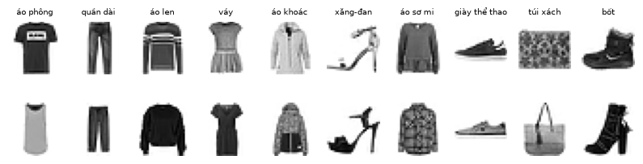
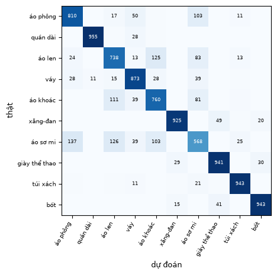
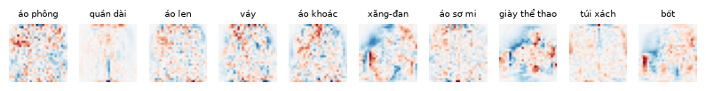
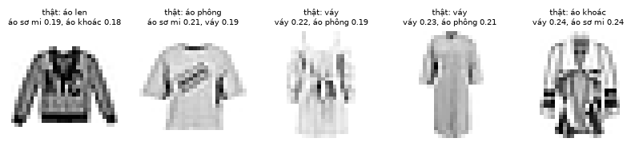

# Chương 15 · Ví dụ áp dụng: phân loại ảnh thời trang

> Ghi chú của người biên soạn: trang này do người biên soạn viết thêm, không có trong sách gốc. Dữ liệu là bộ *Fashion-MNIST* (Xiao, Rasul và Vollgraf, 2017, Zalando Research), tải qua OpenML.

## Bài toán

Fashion-MNIST có cùng định dạng với MNIST: 70 000 ảnh xám $28 \times 28$ thuộc 10 lớp. Nhưng thay vì chữ số, ảnh là quần áo và giày dép: áo phông, quần dài, áo len, váy, áo khoác, xăng-đan, áo sơ mi, giày thể thao, túi xách và bốt. Bộ dữ liệu được tạo ra vì MNIST đã quá dễ. Bài toán này khó hơn, nhất là khi phải phân biệt áo phông, áo sơ mi, áo len và áo khoác.

Ta dùng hồi quy softmax làm **mô hình cơ sở**: một mô hình tuyến tính đơn giản, nhanh, dễ diễn giải. Mô hình phức tạp hơn ở chương 16 sẽ phải vượt qua được nó.

## 1. Dữ liệu

<!-- run -->
```python
import numpy as np
import matplotlib.pyplot as plt
from sklearn.datasets import fetch_openml

X, y = fetch_openml("Fashion-MNIST", version=1, return_X_y=True, as_frame=False)
X, y = X / 255.0, y.astype(int)
NAMES = ["áo phông", "quần dài", "áo len", "váy", "áo khoác", "xăng-đan", "áo sơ mi", "giày thể thao", "túi xách", "bốt"]
X_tr, y_tr, X_te, y_te = X[:60000], y[:60000], X[60000:], y[60000:]      # cách chia chuẩn của bộ dữ liệu
print("huấn luyện:", X_tr.shape, " kiểm tra:", X_te.shape)

fig, axes = plt.subplots(2, 10, figsize=(10, 2.4))
for k in range(10):
    for r in range(2):
        axes[r, k].imshow(X_tr[y_tr == k][r].reshape(28, 28), cmap="gray_r"); axes[r, k].axis("off")
    axes[0, k].set_title(NAMES[k], fontsize=7)
```

<!-- output -->
```output
huấn luyện: (60000, 784)  kiểm tra: (10000, 784)
```

<div align=center></div>
<!-- /output -->

## 2. Huấn luyện và chọn mức suy giảm trọng số

Chọn `C` (nghịch đảo của $\lambda$) bằng một tập xác thực tách ra từ tập huấn luyện:

<!-- run -->
```python
from sklearn.linear_model import LogisticRegression
from sklearn.model_selection import train_test_split

X_a, X_v, y_a, y_v = train_test_split(X_tr, y_tr, test_size=10000, random_state=0, stratify=y_tr)
for C in [1e-3, 1e-2, 1e-1, 1.0]:
    m = LogisticRegression(C=C, max_iter=300).fit(X_a, y_a)
    print(f"C = {C:6}: độ chính xác huấn luyện {m.score(X_a, y_a):.4f}, xác thực {m.score(X_v, y_v):.4f}")
```

<!-- output -->
```output
C =  0.001: độ chính xác huấn luyện 0.8222, xác thực 0.8137
C =   0.01: độ chính xác huấn luyện 0.8575, xác thực 0.8488
C =    0.1: độ chính xác huấn luyện 0.8747, xác thực 0.8571
C =    1.0: độ chính xác huấn luyện 0.8792, xác thực 0.8568
```
<!-- /output -->

Độ chính xác xác thực tăng khi `C` tăng từ 0.001 lên 0.1, rồi gần như đứng yên. Khoảng cách giữa huấn luyện và xác thực nhỏ (khoảng 2%): mô hình tuyến tính ít bị quá khớp trên bộ dữ liệu này. Giới hạn của nó nằm ở chỗ chưa khớp, nghĩa là mô hình quá đơn giản. Ta chọn `C = 0.1`.

<!-- run -->
```python
best_C = 0.1
model = LogisticRegression(C=best_C, max_iter=500).fit(X_tr, y_tr)
pred = model.predict(X_te)
print(f"độ chính xác trên tập kiểm tra: {np.mean(pred == y_te):.4f}")
```

<!-- output -->
```output
độ chính xác trên tập kiểm tra: 0.8456
```
<!-- /output -->

## 3. Lớp nào bị nhầm với lớp nào?

<!-- run -->
```python
from sklearn.metrics import confusion_matrix

Cm = confusion_matrix(y_te, pred)
fig, ax = plt.subplots(figsize=(5.4, 4.6))
ax.imshow(Cm, cmap="Blues")
ax.set_xticks(range(10)); ax.set_xticklabels(NAMES, rotation=60, ha="right", fontsize=7)
ax.set_yticks(range(10)); ax.set_yticklabels(NAMES, fontsize=7); ax.set_xlabel("dự đoán"); ax.set_ylabel("thật")
for i in range(10):
    for j in range(10):
        if Cm[i, j] >= 10: ax.text(j, i, Cm[i, j], ha="center", va="center", fontsize=6, color="w" if Cm[i, j] > 500 else "k")
acc_per = Cm.diagonal() / Cm.sum(1)
for k in np.argsort(acc_per):
    worst = np.argsort(-Cm[k] * (np.arange(10) != k))[0]
    print(f"{NAMES[k]:14s}: đúng {acc_per[k]:.1%}, nhầm nhiều nhất thành {NAMES[worst]} ({Cm[k, worst]} ảnh)")
```

<!-- output -->
```output
áo sơ mi      : đúng 56.8%, nhầm nhiều nhất thành áo phông (137 ảnh)
áo len        : đúng 73.8%, nhầm nhiều nhất thành áo khoác (125 ảnh)
áo khoác      : đúng 76.0%, nhầm nhiều nhất thành áo len (111 ảnh)
áo phông      : đúng 81.0%, nhầm nhiều nhất thành áo sơ mi (103 ảnh)
váy           : đúng 87.3%, nhầm nhiều nhất thành áo sơ mi (39 ảnh)
xăng-đan      : đúng 92.5%, nhầm nhiều nhất thành giày thể thao (49 ảnh)
giày thể thao : đúng 94.1%, nhầm nhiều nhất thành bốt (30 ảnh)
túi xách      : đúng 94.3%, nhầm nhiều nhất thành áo sơ mi (21 ảnh)
bốt           : đúng 94.3%, nhầm nhiều nhất thành giày thể thao (41 ảnh)
quần dài      : đúng 95.5%, nhầm nhiều nhất thành váy (28 ảnh)
```

<div align=center></div>
<!-- /output -->

Các lớp có hình dáng đặc trưng (quần dài, giày, bốt, túi xách) được nhận ra tốt, đều trên 92%. Bốn loại áo thì bị nhầm với nhau rất nhiều: áo sơ mi chỉ đúng 57%. Ở độ phân giải $28 \times 28$ và với ảnh xám, chúng có cùng hình dáng tổng thể. Khác biệt nằm ở chi tiết như cổ áo, hàng cúc, hoa văn, mà một khuôn mẫu tuyến tính khó nắm bắt.

## 4. Mô hình "nhìn" thấy gì?

Mỗi cột $\mathbf{w}_k$ là một ảnh $28 \times 28$. Điểm số của lớp $k$ là tích vô hướng giữa ảnh đầu vào và ảnh trọng số này, tức một phép **so khớp khuôn mẫu** tuyến tính.

<!-- run -->
```python
fig, axes = plt.subplots(1, 10, figsize=(10, 1.6))
for k, ax in enumerate(axes):
    wk = model.coef_[k].reshape(28, 28); lim = np.abs(wk).max()
    ax.imshow(wk, cmap="RdBu_r", vmin=-lim, vmax=lim); ax.set_title(NAMES[k], fontsize=7); ax.axis("off")
```

<!-- output -->
<div align=center></div>
<!-- /output -->

Khác với MNIST, ở đây trọng số khá nhiễu. Chỉ một vài lớp có hình dáng nhận ra được, như vùng ủng hộ ở hai ống quần, hay viền đế của xăng-đan và giày thể thao. Phần lớn lớp không có một "khuôn mẫu" đơn giản.

## 5. Độ tự tin của dự đoán

Softmax cho một phân phối xác suất trên 10 lớp. Khi mô hình phân vân, xác suất lớn nhất thấp. Với những dự đoán như vậy, có thể chuyển cho người kiểm tra lại.

<!-- run -->
```python
proba = model.predict_proba(X_te)
conf = proba.max(1)
for th in [0.0, 0.5, 0.8, 0.95]:
    keep = conf >= th
    print(f"chỉ giữ dự đoán có xác suất ≥ {th:.2f}: giữ {keep.mean():6.1%} số ảnh, độ chính xác trên phần giữ lại {np.mean(pred[keep] == y_te[keep]):.4f}")

i = np.argsort(conf)[:5]
fig, axes = plt.subplots(1, 5, figsize=(10, 2.3))
for ax, j in zip(axes, i):
    top = np.argsort(-proba[j])[:2]
    ax.imshow(X_te[j].reshape(28, 28), cmap="gray_r"); ax.axis("off")
    ax.set_title(f"thật: {NAMES[y_te[j]]}\n{NAMES[top[0]]} {proba[j, top[0]]:.2f}, {NAMES[top[1]]} {proba[j, top[1]]:.2f}", fontsize=7)
```

<!-- output -->
```output
chỉ giữ dự đoán có xác suất ≥ 0.00: giữ 100.0% số ảnh, độ chính xác trên phần giữ lại 0.8456
chỉ giữ dự đoán có xác suất ≥ 0.50: giữ  92.8% số ảnh, độ chính xác trên phần giữ lại 0.8775
chỉ giữ dự đoán có xác suất ≥ 0.80: giữ  68.4% số ảnh, độ chính xác trên phần giữ lại 0.9582
chỉ giữ dự đoán có xác suất ≥ 0.95: giữ  47.2% số ảnh, độ chính xác trên phần giữ lại 0.9854
```

<div align=center></div>
<!-- /output -->

Khi mô hình chắc chắn (xác suất lớn nhất từ 0.95 trở lên), độ chính xác lên tới khoảng 98.5% trên gần một nửa số ảnh. Những ảnh mô hình phân vân nhất có xác suất lớn nhất chỉ khoảng 0.2, gần như chia đều cho vài loại áo, và đúng là ảnh khó cả với người nhìn.

## Rút ra được gì

- Hồi quy softmax đạt khoảng 84.6% trên Fashion-MNIST, thấp hơn khá nhiều so với khoảng 92% trên MNIST. Đây là con số cơ sở mà mọi mô hình phức tạp hơn cần vượt qua.
- Lỗi tập trung ở những lớp giống nhau về hình dáng tổng thể. Mô hình tuyến tính chỉ so khớp **một** khuôn mẫu cho mỗi lớp, nên không phân biệt được các chi tiết nhỏ.
- Xác suất của softmax hữu ích trong thực tế: lọc những dự đoán thiếu tự tin để người kiểm tra lại giúp tăng mạnh độ chính xác trên phần còn lại.
- Mạng neuron đa tầng ở chương 16 học được những đặc trưng phi tuyến và đạt khoảng 89% trên cùng tập kiểm tra ([Ví dụ áp dụng chương 16](ml/ch16_app_vi)). Mạng tích chập (CNN) còn đi xa hơn, lên khoảng 93%.
