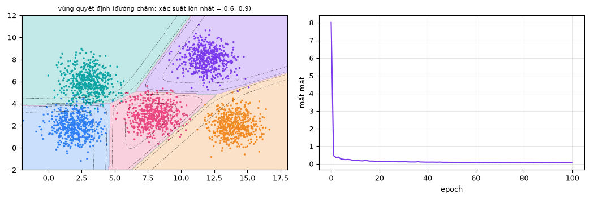

# Chương 15 · Code từ đầu

> Ghi chú của người biên soạn: trang này do người biên soạn viết thêm, không có trong sách gốc. Trang chạy lại code hồi quy softmax của [chương 15](ml/ch15_vi), có kiểm tra gradient và hai tính chất ở mục 15.5.

## Cách dùng trang này

Các khối chạy lần lượt từ trên xuống và dùng chung biến. Chỉ cần `numpy` và `matplotlib`. Giống sách, mỗi **hàng** của `X` là một điểm dữ liệu, `W` có kích thước `(d, C)`, và nhãn `y` là số nguyên từ 0 đến $C - 1$.

## 1. Hàm softmax và vấn đề tràn số

<small class="viz-ref">Mục 15.2.2 và 15.2.4</small>

<!-- run -->
```python
import numpy as np
import matplotlib.pyplot as plt

def softmax(Z):
    e = np.exp(Z)
    return e / e.sum(axis=1, keepdims=True)

def softmax_stable(Z):
    """(15.3): trừ đi giá trị lớn nhất của mỗi hàng trước khi lấy exp. Kết quả không đổi, nhưng không tràn số."""
    e = np.exp(Z - Z.max(axis=1, keepdims=True))
    return e / e.sum(axis=1, keepdims=True)

for z in [[2.0, 1.0, 0.1], [1000.0, 999.0, 998.1], [-1000.0, -1001.0, -1001.9]]:
    with np.errstate(over="ignore", invalid="ignore"):
        print(f"z = {z}:  softmax = {softmax(np.array([z])).round(4)[0]},  ổn định = {softmax_stable(np.array([z])).round(4)[0]}")
```

<!-- output -->
```output
z = [2.0, 1.0, 0.1]:  softmax = [0.659  0.2424 0.0986],  ổn định = [0.659  0.2424 0.0986]
z = [1000.0, 999.0, 998.1]:  softmax = [nan nan nan],  ổn định = [0.659  0.2424 0.0986]
z = [-1000.0, -1001.0, -1001.9]:  softmax = [nan nan nan],  ổn định = [0.659  0.2424 0.0986]
```
<!-- /output -->

Với điểm số cỡ $\pm 1000$, cách tính trực tiếp cho `nan`: $e^{1000}$ tràn thành vô cùng, còn $e^{-1000}$ bị làm tròn thành 0, nên phép chia thành $\infty/\infty$ hoặc $0/0$. Bản ổn định cho cùng kết quả như hàng đầu, vì ba bộ điểm số chỉ khác nhau một hằng số.

## 2. Hàm mất mát, gradient và kiểm tra bằng đạo hàm số

<small class="viz-ref">Mục 15.3 · công thức (15.11)–(15.13)</small>

Gradient của entropy chéo theo $\mathbf{W}$ là $\frac{1}{N}\mathbf{X}^T(\mathbf{A} - \mathbf{Y})$. Đây lại là dạng "đầu vào nhân với sai số dự đoán" quen thuộc của hồi quy tuyến tính và hồi quy logistic.

<!-- run -->
```python
def softmax_loss(X, y, W):
    A = softmax_stable(X @ W)
    return -np.mean(np.log(A[np.arange(len(y)), y]))

def softmax_grad(X, y, W):
    A = softmax_stable(X @ W)
    A[np.arange(len(y)), y] -= 1                       # A − Y
    return X.T @ A / len(y)

def numerical_grad(f, W, eps=1e-6):
    G = np.zeros_like(W)
    for idx in np.ndindex(W.shape):
        E = np.zeros_like(W); E[idx] = eps
        G[idx] = (f(W + E) - f(W - E)) / (2 * eps)
    return G

rng = np.random.default_rng(0)
Xt, yt, Wt = rng.normal(size=(100, 4)), rng.integers(0, 3, 100), rng.normal(size=(4, 3))
diff = np.abs(softmax_grad(Xt, yt, Wt) - numerical_grad(lambda W: softmax_loss(Xt, yt, W), Wt)).max()
print(f"sai khác lớn nhất giữa gradient công thức và gradient số: {diff:.2e}")
```

<!-- output -->
```output
sai khác lớn nhất giữa gradient công thức và gradient số: 2.13e-10
```
<!-- /output -->

## 3. Ví dụ 5 lớp của sách

<small class="viz-ref">Mục 15.4 · hình 15.6</small>

Năm cụm điểm 2 chiều, mỗi cụm 500 điểm, huấn luyện bằng mini-batch gradient descent với lô 10 điểm như sách:

<!-- run -->
```python
def softmax_fit(X, y, W, lr=0.01, nepochs=100, tol=1e-5, batch_size=10, rng=None):
    rng = rng or np.random.default_rng()
    W, W_old = W.copy(), W.copy()
    loss_hist = [softmax_loss(X, y, W)]
    N = len(X)
    for ep in range(nepochs):
        ids = rng.permutation(N)
        for s in range(0, N, batch_size):
            b = ids[s:s + batch_size]
            W -= lr * softmax_grad(X[b], y[b], W)
        loss_hist.append(softmax_loss(X, y, W))
        if np.linalg.norm(W - W_old) / W.size < tol:
            break
        W_old = W.copy()
    return W, loss_hist

C, N = 5, 500
means = [[2, 2], [8, 3], [3, 6], [14, 2], [12, 8]]
X = np.concatenate([rng.multivariate_normal(m, np.eye(2), N) for m in means])
Xbar = np.c_[X, np.ones(len(X))]                         # bias trick, hệ số điều chỉnh ở cuối
y = np.repeat(np.arange(C), N)
W, loss_hist = softmax_fit(Xbar, y, rng.normal(size=(3, C)), lr=0.05, rng=rng)
pred = (Xbar @ W).argmax(1)
print(f"số epoch: {len(loss_hist) - 1}, mất mát cuối {loss_hist[-1]:.4f}, độ chính xác trên tập huấn luyện {np.mean(pred == y):.4f}")

COLORS = np.array(["#2f80f5", "#e8487f", "#0ea5a4", "#f08a24", "#7c3aed"])
xx, yy = np.meshgrid(np.linspace(-2, 18, 300), np.linspace(-2, 12, 220))
G = np.c_[xx.ravel(), yy.ravel(), np.ones(xx.size)]
P = softmax_stable(G @ W)
fig, axes = plt.subplots(1, 2, figsize=(10.5, 3.6))
axes[0].contourf(xx, yy, P.argmax(1).reshape(xx.shape), levels=np.arange(-.5, 5), colors=COLORS, alpha=.25)
axes[0].contour(xx, yy, P.max(1).reshape(xx.shape), levels=[0.6, 0.9], colors="k", linewidths=.5, linestyles=":")
axes[0].scatter(*X.T, s=2, c=COLORS[y]); axes[0].set_title("vùng quyết định (đường chấm: xác suất lớn nhất = 0.6, 0.9)", fontsize=8)
axes[1].plot(loss_hist, color="#7c3aed"); axes[1].set_xlabel("epoch"); axes[1].set_ylabel("mất mát"); axes[1].grid(alpha=.3)
fig.tight_layout()
```

<!-- output -->
```output
số epoch: 100, mất mát cuối 0.0675, độ chính xác trên tập huấn luyện 0.9836
```

<div align=center></div>
<!-- /output -->

Mô hình phân loại đúng khoảng 98% số điểm. Các vùng quyết định là những đa giác lồi với cạnh thẳng. Mất mát giảm nhanh trong vài epoch đầu rồi chững lại.

## 4. Ranh giới tuyến tính và tính chất "dịch không đổi"

<small class="viz-ref">Mục 15.5.2</small>

Ranh giới giữa hai lớp $i$ và $j$ là tập các điểm có $\mathbf{w}_i^T\bar{\mathbf{x}} = \mathbf{w}_j^T\bar{\mathbf{x}}$, tức $(\mathbf{w}_i - \mathbf{w}_j)^T\bar{\mathbf{x}} = 0$: một siêu phẳng. Vì softmax chỉ phụ thuộc vào **hiệu** giữa các điểm số, cộng cùng một vector vào mọi cột của $\mathbf{W}$ không làm thay đổi dự đoán. Nghiệm của hồi quy softmax (khi không có suy giảm trọng số) vì thế không duy nhất.

<!-- run -->
```python
shift = rng.normal(size=(3, 1)) * 10
W2 = W + shift                                       # cộng cùng một vector vào mọi cột
print("thay đổi lớn nhất của xác suất sau khi dịch W:", np.abs(softmax_stable(Xbar @ W2) - softmax_stable(Xbar @ W)).max())
print("mất mát trước và sau:", softmax_loss(Xbar, y, W), softmax_loss(Xbar, y, W2))
```

<!-- output -->
```output
thay đổi lớn nhất của xác suất sau khi dịch W: 2.4424906541753444e-15
mất mát trước và sau: 0.06754974756277017 0.06754974756277016
```
<!-- /output -->

Xác suất thay đổi chỉ ở mức sai số làm tròn ($10^{-15}$), và mất mát giữ nguyên.

## 5. Hồi quy logistic là trường hợp riêng của softmax

<small class="viz-ref">Mục 15.5.1</small>

Với $C = 2$: $\text{softmax}(z_1, z_2)_2 = \frac{e^{z_2}}{e^{z_1} + e^{z_2}} = \sigma(z_2 - z_1)$. Huấn luyện softmax hai lớp và hồi quy logistic trên cùng dữ liệu, ta được cùng một bộ phân loại, với $\mathbf{w}_{\text{logistic}} = \mathbf{w}_2 - \mathbf{w}_1$:

<!-- run -->
```python
# Hai lớp chồng lấn nhau (nếu tách biệt, trọng số tăng mãi và không hội tụ, xem mục 5 trang Code chương 14)
X01 = np.c_[np.r_[rng.normal([0, 0], 1, (300, 2)), rng.normal([1.5, 1], 1, (300, 2))], np.ones(600)]
y01 = np.repeat([0, 1], 300)
W_sm = np.zeros((3, 2)); w_lr = np.zeros(3)
sigmoid = lambda s: 1 / (1 + np.exp(-s))
for _ in range(5000):
    W_sm -= 0.5 * softmax_grad(X01, y01, W_sm)
    w_lr -= 0.5 * X01.T @ (sigmoid(X01 @ w_lr) - y01) / len(y01)
print("softmax: w₂ − w₁ =", (W_sm[:, 1] - W_sm[:, 0]).round(4))
print("logistic:  w     =", w_lr.round(4))
print("sai khác lớn nhất giữa hai xác suất dự đoán:", np.abs(softmax_stable(X01 @ W_sm)[:, 1] - sigmoid(X01 @ w_lr)).max())
```

<!-- output -->
```output
softmax: w₂ − w₁ = [ 1.5615  1.0539 -1.6565]
logistic:  w     = [ 1.5615  1.0539 -1.6565]
sai khác lớn nhất giữa hai xác suất dự đoán: 7.216449660063518e-16
```
<!-- /output -->

Hai cách cho cùng một vector trọng số và cùng xác suất dự đoán (sai khác ở mức làm tròn). Hồi quy logistic chính là hồi quy softmax với $C = 2$, trong đó chỉ hiệu $\mathbf{w}_2 - \mathbf{w}_1$ là có ý nghĩa.
