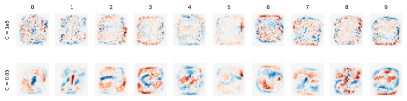

# Chương 15 · Dùng thư viện

> Ghi chú của người biên soạn: trang này do người biên soạn viết thêm, không có trong sách gốc. Trang chạy lại thí nghiệm MNIST của [mục 15.4](ml/ch15_vi) bằng API hiện tại của scikit-learn, rồi viết cùng mô hình bằng PyTorch.

## Cách dùng trang này

Các khối chạy lần lượt từ trên xuống và dùng chung biến. Cần `numpy`, `matplotlib`, `scikit-learn`, `torch`. Mục 2 tải MNIST ở lần chạy đầu.

Sách viết `LogisticRegression(C=1e5, solver="lbfgs", multi_class="multinomial")`. Tham số `multi_class` đã bị gỡ khỏi scikit-learn (từ bản 1.8). Bây giờ, với nhiều lớp, `LogisticRegression` **mặc định** là multinomial, tức hồi quy softmax.

## 1. Ví dụ 5 lớp

<small class="viz-ref">Mục 15.4</small>

<!-- run -->
```python
import numpy as np
import matplotlib.pyplot as plt
from sklearn.linear_model import LogisticRegression

rng = np.random.default_rng(0)
means = [[2, 2], [8, 3], [3, 6], [14, 2], [12, 8]]
X = np.concatenate([rng.multivariate_normal(m, np.eye(2), 500) for m in means]); y = np.repeat(np.arange(5), 500)
clf = LogisticRegression(C=1e5, max_iter=1000).fit(X, y)
print("độ chính xác trên tập huấn luyện:", round(clf.score(X, y), 4))
print("W (mỗi hàng một lớp):\n", clf.coef_.round(2))
print("tổng theo các lớp (từng đặc trưng):", clf.coef_.sum(0).round(6) + 0, "  tổng hệ số điều chỉnh:", round(clf.intercept_.sum(), 6) + 0)
print("xác suất của điểm (5, 4):", clf.predict_proba([[5, 4]]).round(3))
```

<!-- output -->
```output
độ chính xác trên tập huấn luyện: 0.992
W (mỗi hàng một lớp):
 [[-9.81 -2.22]
 [ 2.45 -2.59]
 [-8.56  2.8 ]
 [ 9.57 -4.69]
 [ 6.35  6.69]]
tổng theo các lớp (từng đặc trưng): [0. 0.]   tổng hệ số điều chỉnh: 0.0
xác suất của điểm (5, 4): [[0.034 0.286 0.68  0.    0.   ]]
```
<!-- /output -->

Ở [trang Code](ml/ch15_code_vi), ta thấy nghiệm softmax không duy nhất: cộng cùng một vector vào mọi cột không làm đổi dự đoán. scikit-learn chọn nghiệm có **tổng các cột bằng 0**, vì đó là nghiệm có chuẩn nhỏ nhất (một chút suy giảm trọng số, dù `C` rất lớn, sẽ chọn đúng nghiệm này).

## 2. MNIST: thí nghiệm của sách

<small class="viz-ref">Mục 15.4</small>

<!-- run -->
```python
from sklearn.datasets import fetch_openml
from sklearn.model_selection import train_test_split
from time import perf_counter

X_all, y_all = fetch_openml("mnist_784", version=1, return_X_y=True, as_frame=False)
X_all, y_all = X_all / 255.0, y_all.astype(int)
X_tr, X_te, y_tr, y_te = train_test_split(X_all, y_all, test_size=10000, random_state=0)

t = perf_counter()
mnist_clf = LogisticRegression(C=1e5, max_iter=300).fit(X_tr, y_tr)
print(f"C = 1e5: độ chính xác {100 * mnist_clf.score(X_te, y_te):.2f}%   (sách: 92.19%)   thời gian {perf_counter() - t:.0f} s")
t = perf_counter()
mnist_reg = LogisticRegression(C=0.05, max_iter=300).fit(X_tr, y_tr)
print(f"C = 0.05: độ chính xác {100 * mnist_reg.score(X_te, y_te):.2f}%   thời gian {perf_counter() - t:.0f} s")

fig, axes = plt.subplots(2, 10, figsize=(10, 2.4))
for row, (m, name) in zip(axes, [(mnist_clf, "C = 1e5"), (mnist_reg, "C = 0.05")]):
    for k, ax in enumerate(row):
        wk = m.coef_[k].reshape(28, 28); lim = np.abs(wk).max()
        ax.imshow(wk, cmap="RdBu_r", vmin=-lim, vmax=lim); ax.axis("off")
        ax.set_title(f"{k}" if name == "C = 1e5" else "", fontsize=8)
    row[0].text(-6, 14, name, rotation=90, va="center", ha="right", fontsize=7)
```

<!-- output -->
```output
C = 1e5: độ chính xác 91.68%   (sách: 92.19%)   thời gian 60 s
C = 0.05: độ chính xác 91.89%   thời gian 20 s
```

<div align=center></div>
<!-- /output -->

Với `C = 1e5` như sách, độ chính xác là 91.68%, rất gần con số của sách (92.19%). Chênh lệch đến từ cách chia tập kiểm tra ngẫu nhiên. Phạt nặng hơn (`C = 0.05`) cho kết quả nhỉnh hơn một chút, và chạy nhanh gấp bốn lần, vì bài toán tối ưu "dễ" hơn.

Mỗi ảnh là một cột $\mathbf{w}_k$ của $\mathbf{W}$, xếp lại thành $28 \times 28$: màu đỏ ủng hộ lớp $k$, màu xanh phản đối. Với `C` lớn (phạt rất nhẹ), trọng số trông như nhiễu. Với `C` nhỏ, chúng giống những "khuôn mẫu" của từng chữ số.

## 3. PyTorch: `nn.Linear` + `CrossEntropyLoss`

`nn.CrossEntropyLoss` nhận trực tiếp **điểm số** $\mathbf{z} = \mathbf{W}^T\mathbf{x}$ (logits) và nhãn nguyên. Bên trong, nó tính `log_softmax` theo cách ổn định số rồi lấy entropy chéo. Vì vậy **không** đặt `nn.Softmax` trước hàm mất mát.

<!-- run -->
```python
import torch
from torch import nn

torch.manual_seed(0)
Xt, yt = torch.tensor(X_tr, dtype=torch.float32), torch.tensor(y_tr)
Xv, yv = torch.tensor(X_te, dtype=torch.float32), torch.tensor(y_te)
model = nn.Linear(784, 10)
opt = torch.optim.SGD(model.parameters(), lr=0.5)
loss_fn = nn.CrossEntropyLoss()
for ep in range(10):
    for b in torch.randperm(len(Xt)).split(128):
        opt.zero_grad(); loss_fn(model(Xt[b]), yt[b]).backward(); opt.step()
    if ep in (0, 4, 9):
        with torch.no_grad():
            print(f"epoch {ep + 1:2d}: mất mát huấn luyện {loss_fn(model(Xt), yt).item():.4f}, độ chính xác kiểm tra {100 * (model(Xv).argmax(1) == yv).float().mean():.2f}%")

with torch.no_grad():
    probs = torch.softmax(model(Xv[:3]), dim=1)        # chỉ dùng softmax khi cần xác suất
print("xác suất của 3 ảnh đầu (lớn nhất):", probs.max(1).values.numpy().round(3), " nhãn thật:", y_te[:3])
```

<!-- output -->
```output
epoch  1: mất mát huấn luyện 0.3080, độ chính xác kiểm tra 90.65%
epoch  5: mất mát huấn luyện 0.2659, độ chính xác kiểm tra 91.65%
epoch 10: mất mát huấn luyện 0.2548, độ chính xác kiểm tra 91.68%
xác suất của 3 ảnh đầu (lớn nhất): [0.975 0.998 0.99 ]  nhãn thật: [0 4 1]
```
<!-- /output -->

Sau 10 epoch mini-batch SGD, mô hình PyTorch đạt khoảng 91.7%, ngang `LogisticRegression`. Đây là giới hạn của một mô hình tuyến tính trên MNIST. Chương 16 thêm tầng ẩn để vượt qua giới hạn này.

## Tóm tắt

| Nhu cầu | Công cụ |
| --- | --- |
| Hồi quy softmax | `LogisticRegression()`: mặc định multinomial khi có từ 3 lớp |
| Xác suất từng lớp | `predict_proba` |
| Trong mạng neuron | `nn.Linear(d, C)` + `nn.CrossEntropyLoss()` (nhận logits, không qua softmax) |
| Dữ liệu rất lớn | `SGDClassifier(loss="log_loss")`, hoặc PyTorch với mini-batch |
